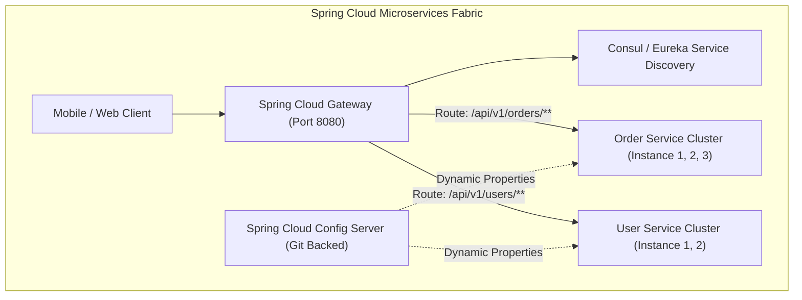
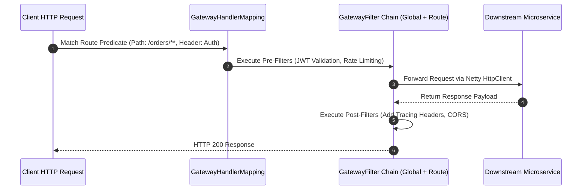
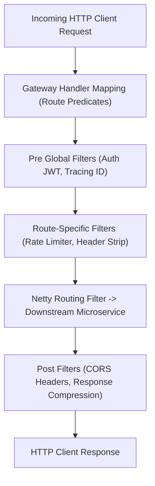
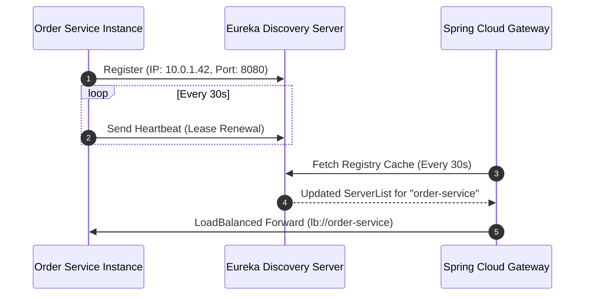

---


title: "Spring Cloud Architecture: API Gateway, Consul/Eureka & Config Server"
description: "Master-level engineering guide for Spring Cloud microservices, covering Spring Cloud Gateway (Netty WebFlux), Service Discovery, Distributed Configuration, and JWT Gateway Routing."
category: "Java Engineering"
tags: [spring-cloud, microservices, api-gateway, service-discovery, consul, eureka, webflux, cloud-native, technical-skills, software-engineering, learning-note]
date: "2026-08-21"
---

# Spring Cloud Architecture: Gateway, Discovery & Configuration Deep Dive

---

## 1. Executive Summary & Under-the-Hood Mechanics

In distributed cloud-native microservices architectures, **Spring Cloud** provides a standardized suite of tools for routing, service discovery, distributed configuration, and edge security.

The core infrastructure consists of:
1. **Spring Cloud Gateway**: Non-blocking, reactive edge reverse proxy built on Spring WebFlux and Project Reactor Netty, processing millions of concurrent requests over event loops with minimal memory footprint.
2. **Service Discovery (HashiCorp Consul / Netflix Eureka)**: Dynamic service registry mapping ephemeral container IP addresses and health states to logical service names (`lb://ORDER-SERVICE`).
3. **Spring Cloud Config Server**: Centralized Git-backed configuration store broadcasting runtime property updates via Spring Cloud Bus (Kafka/RabbitMQ) and `@RefreshScope`.
4. **Resilience & Rate Limiting**: Token bucket rate limiting backed by Redis and circuit breaking via Resilience4j.



---

## 2. Spring Cloud Gateway Reactive Execution Pipeline

Unlike legacy Netflix Zuul 1.x (which used a blocking 1-thread-per-connection Servlet architecture), Spring Cloud Gateway uses non-blocking **Reactor Netty EventLoops**:



---

## 3. Production Spring Cloud Gateway Configuration (`application.yml`)

```yaml
server:
  port: 8080

spring:
  application:
    name: enterprise-api-gateway
  cloud:
    gateway:
      discovery:
        locator:
          enabled: false # Use explicit route definitions for security
      routes:
        - id: order-service-route
          uri: lb://ORDER-SERVICE
          predicates:
            - Path=/api/v1/orders/**
            - Method=GET,POST,PUT,DELETE
          filters:
            - StripPrefix=0
            - name: RequestRateLimiter
              args:
                redis-rate-limiter.replenishRate: 100
                redis-rate-limiter.burstCapacity: 200
                key-resolver: "#{@userKeyResolver}"
            - name: CircuitBreaker
              args:
                name: orderServiceCircuitBreaker
                fallbackUri: forward:/fallback/orders
            - AddRequestHeader=X-Gateway-Origin, enterprise-edge

        - id: user-service-route
          uri: lb://USER-SERVICE
          predicates:
            - Path=/api/v1/users/**
          filters:
            - AddResponseHeader=X-Frame-Options, DENY

      globalcors:
        cors-configurations:
          '[/**]':
            allowedOrigins: "https://app.enterprise.com"
            allowedMethods:
              - GET
              - POST
              - PUT
              - DELETE
            allowedHeaders: "*"
            allowCredentials: true

# Resilience4j Circuit Breaker Settings
resilience4j:
  circuitbreaker:
    instances:
      orderServiceCircuitBreaker:
        slidingWindowSize: 20
        failureRateThreshold: 50
        waitDurationInOpenState: 10s
        permittedNumberOfCallsInHalfOpenState: 5
```

---

## 4. Custom JWT Authentication Gateway Filter Blueprint

```java
package com.enterprise.gateway.filter;

import io.jsonwebtoken.Claims;
import io.jsonwebtoken.Jwts;
import io.jsonwebtoken.security.Keys;
import org.springframework.beans.factory.annotation.Value;
import org.springframework.cloud.gateway.filter.GatewayFilter;
import org.springframework.cloud.gateway.filter.factory.AbstractGatewayFilterFactory;
import org.springframework.http.HttpHeaders;
import org.springframework.http.HttpStatus;
import org.springframework.http.server.reactive.ServerHttpRequest;
import org.springframework.stereotype.Component;

import javax.crypto.SecretKey;
import java.nio.charset.StandardCharsets;

@Component
public class JwtAuthenticationGatewayFilterFactory extends AbstractGatewayFilterFactory<JwtAuthenticationGatewayFilterFactory.Config> {

    @Value("${security.jwt.secret:defaultSecretKeyWithAtLeast256BitsLengthForHSCrypto}")
    private String jwtSecret;

    public static class Config {}

    public JwtAuthenticationGatewayFilterFactory() {
        super(Config.class);
    }

    @Override
    public GatewayFilter apply(Config config) {
        return (exchange, chain) -> {
            ServerHttpRequest request = exchange.getRequest();

            if (!request.getHeaders().containsKey(HttpHeaders.AUTHORIZATION)) {
                exchange.getResponse().setStatusCode(HttpStatus.UNAUTHORIZED);
                return exchange.getResponse().setComplete();
            }

            String authHeader = request.getHeaders().getFirst(HttpHeaders.AUTHORIZATION);
            if (authHeader == null || !authHeader.startsWith("Bearer ")) {
                exchange.getResponse().setStatusCode(HttpStatus.UNAUTHORIZED);
                return exchange.getResponse().setComplete();
            }

            String token = authHeader.substring(7);
            try {
                SecretKey key = Keys.hmacShaKeyFor(jwtSecret.getBytes(StandardCharsets.UTF_8));
                Claims claims = Jwts.parser()
                        .verifyWith(key)
                        .build()
                        .parseSignedClaims(token)
                        .getPayload();

                // Mutate request to propagate user identity & roles down to microservices
                ServerHttpRequest mutatedRequest = request.mutate()
                        .header("X-Auth-UserId", claims.getSubject())
                        .header("X-Auth-Roles", String.valueOf(claims.get("roles")))
                        .build();

                return chain.filter(exchange.mutate().request(mutatedRequest).build());
            } catch (Exception ex) {
                exchange.getResponse().setStatusCode(HttpStatus.FORBIDDEN);
                return exchange.getResponse().setComplete();
            }
        };
    }
}
```

---

## 5. Failure Modes & Operational Triage Matrix

| Failure Mode | Root Cause | Engineering Solution |
| :--- | :--- | :--- |
| **Gateway 503 Service Unavailable** | Eureka / Consul registry has stale IP addresses of crashed pods. | Tune heartbeat intervals (`lease-renewal-interval-in-seconds: 5`) and enable active health checking. |
| **Gateway OutOfMemoryError** | High-cardinality route predicates or unbounded Netty response buffers. | Configure Netty Direct Memory caps (`-XX:MaxDirectMemorySize=1g`) and enforce request body size filters (`RequestSize`). |
| **Circuit Breaker False Positives** | Downstream cold start latency trips circuit prematurely. | Configure `minimumNumberOfCalls: 20` and slow call rate thresholds (`slowCallRateThreshold: 70`). |

---

## 🔗 Graph-Linked Knowledge Base
- ⚓ Reactive Microservices: [[spring_microservices_webflux_resilience4j|Spring WebFlux & Resilience4j]]
- ⚓ REST API Validation: [[spring_mvc_rest_api_validation_security|Spring MVC & REST API Security]]
- 🔗 Distributed Systems: [[02_Technical_Skills/01_theory_and_concepts/01_Distributed_Systems/distributed_consensus|Distributed Consensus & Service Coordination]]

---

## 🔬 4. Spring Cloud Gateway Architecture, Route Filters & Rate Limiting

### Reactive Non-Blocking Gateway Pipeline
Spring Cloud Gateway operates on top of Project Reactor and Netty, using non-blocking event loops (`EventLoopGroup`) to route millions of concurrent HTTP requests without blocking worker threads:



### Production Redis Token-Bucket Rate Limiter Configuration
```yaml
spring:
  cloud:
    gateway:
      routes:
        - id: order-service-route
          uri: lb://order-service
          predicates:
            - Path=/api/v1/orders/**
            - Method=POST,GET,PUT
          filters:
            - name: RequestRateLimiter
              args:
                redis-rate-limiter.replenishRate: 500
                redis-rate-limiter.burstCapacity: 1000
                redis-rate-limiter.requestedTokens: 1
                key-resolver: "#{@userKeyResolver}"
            - name: CircuitBreaker
              args:
                name: orderCircuitBreaker
                fallbackUri: forward:/fallback/orders
```

```java
@Configuration
public class GatewaySecurityConfig {

    @Bean
    public KeyResolver userKeyResolver() {
        return exchange -> exchange.getPrincipal()
                .map(Principal::getName)
                .defaultIfEmpty(Objects.requireNonNull(
                        exchange.getRequest().getRemoteAddress()).getAddress().getHostAddress());
    }
}
```

---

## 🔬 5. Global Distributed Tracing, Eureka Service Discovery & Health Checking

### Service Discovery Heartbeat Protocol (Netflix Eureka / HashiCorp Consul)
When microservices register with Eureka Server, dynamic endpoint resolution replaces hardcoded IP addresses:
- **Registration**: On startup, services post metadata and network address to `/eureka/apps/{appName}`.
- **Heartbeat Renewals**: Clients send periodic heartbeats every 30 seconds (`eureka.instance.lease-renewal-interval-in-seconds=30`). If server receives no heartbeat within 90 seconds, instance is evicted from the registry.
- **Self-Preservation Mode**: If Eureka Server detects $>15\%$ drop in heartbeats due to network partition, it enters Self-Preservation Mode, disabling instance eviction to protect healthy services from temporary network glitches.


