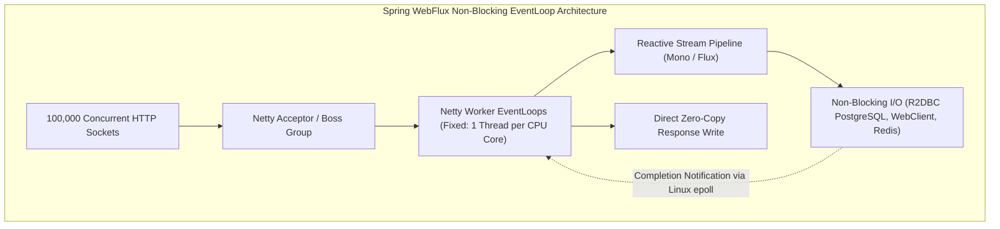
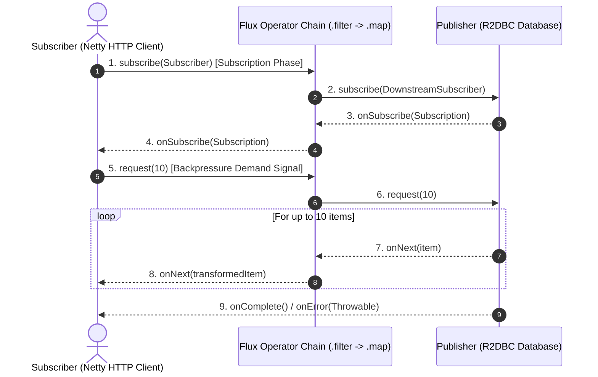
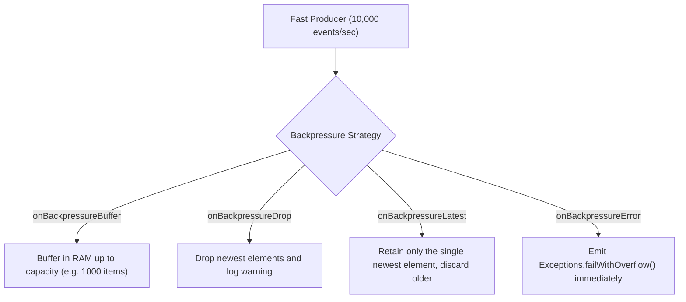

---


title: "Reactive Microservices with Spring WebFlux & Resilience4j"
description: "Master-level engineering guide for Reactive Programming in Java with Spring WebFlux, Project Reactor (Mono/Flux), Backpressure strategies, Non-blocking R2DBC persistence, and Resilience4j reactive circuit breakers."
category: "Java Engineering"
tags: [spring-webflux, reactive, project-reactor, mono, flux, resilience4j, r2dbc, netty, microservices, performance, technical-skills, software-engineering, learning-note]
date: "2026-08-21"
---

# Reactive Microservices with Spring WebFlux & Resilience4j Deep Dive

---

## 1. Executive Summary & Reactive Manifesto Architecture

**Spring WebFlux** is the fully asynchronous, non-blocking reactive web framework introduced in Spring Framework 5, built on **Project Reactor** and implementing the **Reactive Streams Specification (JSR-166 / Flow API)**. 

Traditional servlet architectures (Spring MVC over Tomcat) allocate a dedicated 1MB platform thread per incoming HTTP socket connection. When downstream I/O (database, external REST API, message broker) blocks, threads enter kernel sleep, causing thread pool starvation under high concurrency. In contrast, Spring WebFlux runs on **Reactor Netty**, multiplexing hundreds of thousands of concurrent client connections over a fixed pool of non-blocking **EventLoop Threads** equal to the CPU core count.



---

## 2. Project Reactor Internals: `Mono<T>`, `Flux<T>` & Execution Phases

In Project Reactor, operations are divided into two strictly separate operational phases:
1. **Assembly Time**: The declarative pipeline is constructed. **No computations occur and zero I/O is executed** ("Nothing happens until you subscribe").
2. **Subscription Time**: A `Subscriber` attaches to the `Publisher` via `.subscribe()`. An active `Subscription` is formed, triggering upstream data demand via Backpressure.



---

## 3. Backpressure Management & Flow Control

**Backpressure** is the feedback mechanism enabling a slow consumer to regulate the emission rate of a fast producer, preventing buffer overflows and `OutOfMemoryError` crashes:



### 3.1 Production Backpressure Operator Blueprint
```java
public Flux<TelemetryRecord> processTelemetryStream(Flux<TelemetryRecord> inboundStream) {
    return inboundStream
        // Buffer up to 5,000 items before dropping
        .onBackpressureBuffer(5000, 
            dropped -> log.warn("Telemetry buffer full. Dropping record: {}", dropped.id()),
            BufferOverflowStrategy.DROP_OLDEST)
        // Rate-limit processing to 50 items per 100ms window
        .windowTimeout(50, Duration.ofMillis(100))
        .flatMap(batch -> batch.collectList().flatMap(this::persistBatchAsync));
}
```

---

## 4. Execution Context Switching: `publishOn` vs. `subscribeOn`

Understanding Schedulers is critical for preventing thread pollution:
- **`subscribeOn(Scheduler)`**: Dictates which thread pool the **source publisher** runs on during initial subscription.
- **`publishOn(Scheduler)`**: Switches the execution thread for **all subsequent downstream operators** in the pipeline.


---

## 5. Non-Blocking Relational Persistence: R2DBC

Traditional JDBC / Hibernate drivers block the calling thread during database queries, which stalls Netty EventLoops. Applications must use **R2DBC (Reactive Relational Database Connectivity)**:

```java
package com.enterprise.order.repository;

import org.springframework.data.r2dbc.repository.Query;
import org.springframework.data.r2dbc.repository.R2dbcRepository;
import org.springframework.stereotype.Repository;
import reactor.core.publisher.Flux;
import reactor.core.publisher.Mono;

import java.math.BigDecimal;
import java.util.UUID;

@Repository
public interface ReactiveOrderRepository extends R2dbcRepository<OrderEntity, UUID> {

    @Query("SELECT * FROM orders WHERE customer_id = :customerId AND status = 'SETTLED'")
    Flux<OrderEntity> findSettledOrdersByCustomer(UUID customerId);

    @Query("UPDATE orders SET total_amount = :amount WHERE id = :id RETURNING *")
    Mono<OrderEntity> updateAmount(UUID id, BigDecimal amount);
}
```

### 5.1 Programmatic Reactive Transactions with `TransactionalOperator`
```java
@Service
public class ReactiveOrderFulfillmentService {

    private final ReactiveOrderRepository orderRepo;
    private final TransactionalOperator txOperator;

    public ReactiveOrderFulfillmentService(ReactiveOrderRepository repo, TransactionalOperator txOperator) {
        this.orderRepo = repo;
        this.txOperator = txOperator;
    }

    public Mono<OrderEntity> processOrder(UUID orderId) {
        return orderRepo.findById(orderId)
            .flatMap(order -> {
                order.setStatus("PROCESSED");
                return orderRepo.save(order);
            })
            // Enforce atomic non-blocking database transaction
            .as(txOperator::transactional);
    }
}
```

---

## 6. Resilience4j Reactive Integration (Circuit Breakers & Rate Limiters)

```java
package com.enterprise.market.controller;

import io.github.resilience4j.circuitbreaker.annotation.CircuitBreaker;
import io.github.resilience4j.ratelimiter.annotation.RateLimiter;
import org.springframework.http.MediaType;
import org.springframework.web.bind.annotation.GetMapping;
import org.springframework.web.bind.annotation.PathVariable;
import org.springframework.web.bind.annotation.RequestMapping;
import org.springframework.web.bind.annotation.RestController;
import org.springframework.web.reactive.function.client.WebClient;
import reactor.core.publisher.Flux;
import reactor.core.publisher.Mono;

import java.time.Duration;

@RestController
@RequestMapping("/api/v1/quotes")
public class ReactiveStockQuoteController {

    private final WebClient webClient;

    public record StockQuote(String symbol, double price, long timestamp) {}

    public ReactiveStockQuoteController(WebClient.Builder builder) {
        this.webClient = builder.baseUrl("https://market-feed.internal.enterprise.com").build();
    }

    @GetMapping(value = "/stream/{symbol}", produces = MediaType.TEXT_EVENT_STREAM_VALUE)
    @CircuitBreaker(name = "marketFeedService", fallbackMethod = "fallbackQuoteStream")
    @RateLimiter(name = "marketFeedService")
    public Flux<StockQuote> streamRealtimeQuotes(@PathVariable String symbol) {
        return Flux.interval(Duration.ofMillis(500))
            .flatMap(_ -> fetchQuoteFromRemote(symbol))
            .take(120); // Stream 120 ticks over 60 seconds
    }

    private Mono<StockQuote> fetchQuoteFromRemote(String symbol) {
        return webClient.get()
            .uri("/api/ticks/{symbol}", symbol)
            .retrieve()
            .bodyToMono(StockQuote.class)
            .timeout(Duration.ofMillis(400));
    }

    // Reactive Fallback: Returns cached tick when circuit is OPEN
    public Flux<StockQuote> fallbackQuoteStream(String symbol, Throwable ex) {
        return Flux.just(new StockQuote(symbol, 0.0, System.currentTimeMillis()));
    }
}
```

---

## 7. WebFlux (Reactive) vs Spring MVC with Java 21 Virtual Threads

| Architectural Dimension | Spring WebFlux (Reactor Netty) | Spring MVC + Java 21 Virtual Threads |
| :--- | :--- | :--- |
| **Programming Paradigm** | Declarative / Functional Reactive (`Mono`/`Flux`) | Imperative / Sequential (`try-catch`, standard `return`) |
| **Concurrency Engine** | Non-blocking Netty EventLoops ($N = \text{CPU Cores}$) | Lightweight Virtual Threads ($1$ thread per request) |
| **Database Ecosystem** | Requires non-blocking drivers (**R2DBC**) | Standard enterprise **JDBC / JPA / Hibernate** |
| **Streaming Support** | Native SSE, WebSockets, Infinite Flow | Supported via `ResponseBodyEmitter`, `SseEmitter` |
| **Stack Trace Debuggability** | Complex (Asynchronous execution across callbacks) | **Seamless** (Standard sequential stack traces) |
| **Best Production Fit** | High-throughput Gateways, Real-Time Streaming | **Enterprise CRUD Microservices, High-I/O REST APIs** |

---

## 8. Operational Failure Modes & Troubleshooting

| Incident | Root Cause | Engineering Solution |
| :--- | :--- | :--- |
| **Netty EventLoop Thread Hang** | A developer invoked a blocking call (e.g. `Thread.sleep()`, JDBC query, or `.block()`) inside a reactive chain. | Offload blocking operations using `.publishOn(Schedulers.boundedElastic())` or use BlockHound to detect violations. |
| **Silent Stream Drop (No Output)** | Constructed a `Mono` or `Flux` pipeline but forgot to invoke `.subscribe()` or return it from the `@RestController`. | Ensure all reactive chains are returned directly from controller methods. |
| **OutOfMemoryError: Direct Buffer Memory** | Fast upstream producer buffering unbounded elements in memory. | Implement explicit Backpressure strategies (`onBackpressureDrop`, `windowTimeout`). |

---

## 🔗 Graph-Linked Knowledge Base
- ⚓ Virtual Threads: [[java_concurrency_multithreading_virtual_threads|Java Concurrency & Virtual Threads]]
- ⚓ Cloud Gateway: [[spring_cloud_api_gateway_service_discovery_config|Spring Cloud Gateway & Discovery]]
- 🔗 Concurrency: [[02_Technical_Skills/01_theory_and_concepts/22_Concurrency_and_Performance/async_await_state_machine_lowering_csharp_rust|Async State Machine Lowering]]
