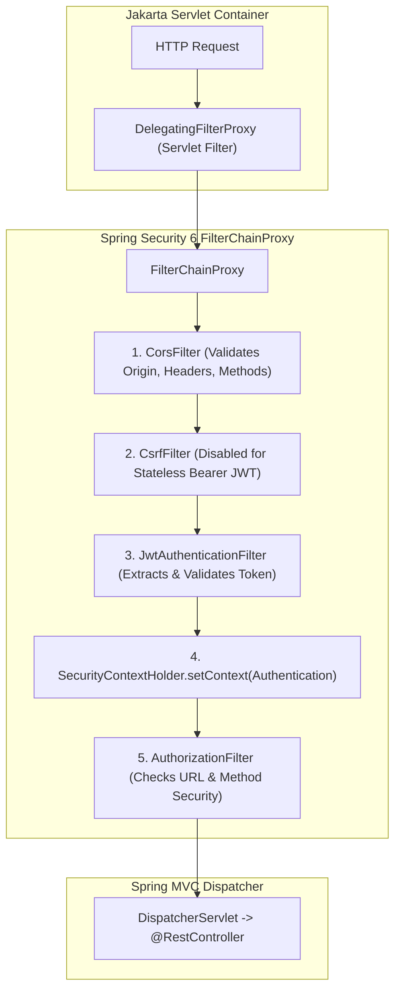
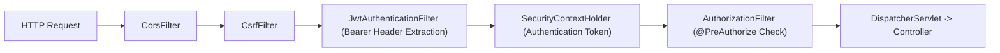

---


title: "Spring MVC REST APIs: Bean Validation, Security Filter Chains & Exception Handling"
description: "Master-level engineering guide for Spring MVC, Spring Security 6, SecurityFilterChain, JWT authentication, Jakarta Bean Validation, SpEL authorization, and RFC 7807 ProblemDetails."
category: "Java Engineering"
tags: [spring-mvc, spring-security, validation, jwt, rest-api, java, security, appsec, problem-detail, technical-skills, software-engineering, learning-note]
date: "2026-08-21"
---

# Spring MVC REST APIs: Validation & Security Architecture

---

## 1. Executive Summary & Spring Security 6 Filter Architecture

**Spring MVC** coupled with **Spring Security 6** provides the enterprise architectural standard for building hardened, authenticated, and contract-validated RESTful web services.

Unlike basic servlet filters, Spring Security operates through a specialized bridge between the Servlet container and the Spring `ApplicationContext`:
1. **`DelegatingFilterProxy`**: Standard Servlet Filter registered in web container that delegates execution to a Spring-managed Bean.
2. **`FilterChainProxy`**: The master Spring Security filter holding one or more **`SecurityFilterChain`** instances evaluated against URL patterns.
3. **`SecurityContextHolder`**: Thread-bound repository holding the current authenticated `Authentication` principal and granted authorities.



---

## 2. Production Spring Security 6 Configuration Blueprint

```java
package com.enterprise.security.config;

import org.springframework.context.annotation.Bean;
import org.springframework.context.annotation.Configuration;
import org.springframework.http.HttpMethod;
import org.springframework.security.config.Customizer;
import org.springframework.security.config.annotation.method.configuration.EnableMethodSecurity;
import org.springframework.security.config.annotation.web.builders.HttpSecurity;
import org.springframework.security.config.annotation.web.configuration.EnableWebSecurity;
import org.springframework.security.config.annotation.web.configurers.AbstractHttpConfigurer;
import org.springframework.security.config.http.SessionCreationPolicy;
import org.springframework.security.web.SecurityFilterChain;
import org.springframework.security.web.authentication.UsernamePasswordAuthenticationFilter;
import org.springframework.web.cors.CorsConfiguration;
import org.springframework.web.cors.CorsConfigurationSource;
import org.springframework.web.cors.UrlBasedCorsConfigurationSource;

import java.util.List;

@Configuration
@EnableWebSecurity
@EnableMethodSecurity(prePostEnabled = true, securedEnabled = true)
public class SecurityConfiguration {

    private final JwtAuthenticationFilter jwtAuthFilter;
    private final RestAuthenticationEntryPoint authenticationEntryPoint;

    public SecurityConfiguration(JwtAuthenticationFilter jwtAuthFilter, 
                                 RestAuthenticationEntryPoint authenticationEntryPoint) {
        this.jwtAuthFilter = jwtAuthFilter;
        this.authenticationEntryPoint = authenticationEntryPoint;
    }

    @Bean
    public SecurityFilterChain securityFilterChain(HttpSecurity http) throws Exception {
        return http
            .cors(Customizer.withDefaults())
            .csrf(AbstractHttpConfigurer::disable) // Stateless REST API using Bearer JWT
            .sessionManagement(session -> session.sessionCreationPolicy(SessionCreationPolicy.STATELESS))
            .exceptionHandling(ex -> ex.authenticationEntryPoint(authenticationEntryPoint))
            .authorizeHttpRequests(auth -> auth
                // Public Whitelist
                .requestMatchers("/api/v1/auth/**", "/actuator/health", "/swagger-ui/**", "/v3/api-docs/**").permitAll()
                .requestMatchers(HttpMethod.GET, "/api/v1/products/**").permitAll()
                // Role-restricted Endpoints
                .requestMatchers("/api/v1/admin/**").hasRole("ADMIN")
                // All other endpoints require authentication
                .anyRequest().authenticated()
            )
            .addFilterBefore(jwtAuthFilter, UsernamePasswordAuthenticationFilter.class)
            .build();
    }

    @Bean
    public CorsConfigurationSource corsConfigurationSource() {
        CorsConfiguration config = new CorsConfiguration();
        config.setAllowedOrigins(List.of("https://app.enterprise.com", "https://admin.enterprise.com"));
        config.setAllowedMethods(List.of("GET", "POST", "PUT", "PATCH", "DELETE", "OPTIONS"));
        config.setAllowedHeaders(List.of("Authorization", "Content-Type", "X-Correlation-Id", "If-Match"));
        config.setExposedHeaders(List.of("ETag", "Location"));
        config.setAllowCredentials(true);
        config.setMaxAge(3600L); // 1 hour preflight cache

        UrlBasedCorsConfigurationSource source = new UrlBasedCorsConfigurationSource();
        source.registerCorsConfiguration("/**", config);
        return source;
    }
}
```

---

## 3. JWT Authentication Filter Implementation

```java
package com.enterprise.security.config;

import jakarta.servlet.FilterChain;
import jakarta.servlet.ServletException;
import jakarta.servlet.http.HttpServletRequest;
import jakarta.servlet.http.HttpServletResponse;
import org.springframework.http.HttpHeaders;
import org.springframework.security.authentication.UsernamePasswordAuthenticationToken;
import org.springframework.security.core.authority.SimpleGrantedAuthority;
import org.springframework.security.core.context.SecurityContextHolder;
import org.springframework.security.web.authentication.WebAuthenticationDetailsSource;
import org.springframework.stereotype.Component;
import org.springframework.web.filter.OncePerRequestFilter;

import java.io.IOException;
import java.util.List;
import java.util.stream.Collectors;

@Component
public class JwtAuthenticationFilter extends OncePerRequestFilter {

    private final JwtTokenProvider tokenProvider;

    public JwtAuthenticationFilter(JwtTokenProvider tokenProvider) {
        this.tokenProvider = tokenProvider;
    }

    @Override
    protected void doFilterInternal(
            HttpServletRequest request,
            HttpServletResponse response,
            FilterChain filterChain) throws ServletException, IOException {

        final String authHeader = request.getHeader(HttpHeaders.AUTHORIZATION);

        if (authHeader == null || !authHeader.startsWith("Bearer ")) {
            filterChain.doFilter(request, response);
            return;
        }

        final String token = authHeader.substring(7);

        try {
            if (tokenProvider.validateToken(token) && SecurityContextHolder.getContext().getAuthentication() == null) {
                String userId = tokenProvider.getUserIdFromToken(token);
                List<String> roles = tokenProvider.getRolesFromToken(token);

                var authorities = roles.stream()
                    .map(role -> new SimpleGrantedAuthority("ROLE_" + role))
                    .collect(Collectors.toList());

                var authToken = new UsernamePasswordAuthenticationToken(userId, null, authorities);
                authToken.setDetails(new WebAuthenticationDetailsSource().buildDetails(request));

                // Bind Authentication to current Thread / Virtual Thread
                SecurityContextHolder.getContext().setAuthentication(authToken);
            }
        } catch (Exception ex) {
            SecurityContextHolder.clearContext();
        }

        filterChain.doFilter(request, response);
    }
}
```

---

## 4. Method-Level Security & SpEL Expressions

Method security enforces fine-grained authorization directly on domain services and controller endpoints using **Spring Expression Language (SpEL)**:

```java
package com.enterprise.order.controller;

import org.springframework.security.access.prepost.PostAuthorize;
import org.springframework.security.access.prepost.PreAuthorize;
import org.springframework.web.bind.annotation.*;

import java.util.UUID;

@RestController
@RequestMapping("/api/v1/accounts")
public class AccountController {

    private final AccountService accountService;

    public AccountController(AccountService accountService) {
        this.accountService = accountService;
    }

    // 1. Role-based check
    @DeleteMapping("/{accountId}")
    @PreAuthorize("hasRole('ADMIN')")
    public void deleteAccount(@PathVariable UUID accountId) {
        accountService.deleteAccount(accountId);
    }

    // 2. Resource-ownership check via SpEL
    @GetMapping("/{accountId}/statement")
    @PreAuthorize("hasRole('ADMIN') or #accountId.toString() == authentication.principal")
    public AccountStatement getStatement(@PathVariable UUID accountId) {
        return accountService.generateStatement(accountId);
    }

    // 3. Post-authorization inspection of return object
    @GetMapping("/{accountId}")
    @PostAuthorize("returnObject.ownerId == authentication.principal or hasRole('AUDITOR')")
    public AccountResponse getAccountDetails(@PathVariable UUID accountId) {
        return accountService.getAccount(accountId);
    }
}
```

---

## 5. Jakarta Validation (Bean Validation 3.0) & Custom Validators

```java
package com.enterprise.order.dto;

import jakarta.validation.constraints.*;
import java.math.BigDecimal;
import java.util.List;

public record CreateOrderRequest(
    @NotNull(message = "Customer ID is mandatory")
    String customerId,

    @NotEmpty(message = "Order must contain at least one line item")
    @Size(max = 50, message = "Exceeded maximum items per order (50)")
    List<@Valid OrderLineDTO> items,

    @NotNull(message = "Total amount is mandatory")
    @DecimalMin(value = "0.01", inclusive = true, message = "Amount must be strictly greater than zero")
    @Digits(integer = 8, fraction = 2, message = "Amount exceeds precision limit")
    BigDecimal totalAmount,

    @Pattern(regexp = "^(STANDARD|EXPRESS|OVERNIGHT)$", message = "Invalid shipping tier")
    String shippingTier
) {}
```

---

## 6. RFC 7807 Global Exception Handling (`ProblemDetail`)

```java
package com.enterprise.web.exception;

import org.springframework.http.HttpStatus;
import org.springframework.http.HttpStatusCode;
import org.springframework.http.ProblemDetail;
import org.springframework.http.ResponseEntity;
import org.springframework.security.access.AccessDeniedException;
import org.springframework.validation.FieldError;
import org.springframework.web.bind.MethodArgumentNotValidException;
import org.springframework.web.bind.annotation.ExceptionHandler;
import org.springframework.web.bind.annotation.RestControllerAdvice;
import org.springframework.web.context.request.WebRequest;
import org.springframework.web.servlet.mvc.method.annotation.ResponseEntityExceptionHandler;

import java.net.URI;
import java.time.Instant;
import java.util.Map;
import java.util.stream.Collectors;

@RestControllerAdvice
public class GlobalSecurityExceptionHandler extends ResponseEntityExceptionHandler {

    @ExceptionHandler(AccessDeniedException.class)
    public ProblemDetail handleAccessDenied(AccessDeniedException ex) {
        ProblemDetail problem = ProblemDetail.forStatusAndDetail(HttpStatus.FORBIDDEN, 
            "You do not possess sufficient permissions to execute this operation.");
        problem.setTitle("Access Denied");
        problem.setType(URI.create("https://api.enterprise.com/errors/forbidden"));
        problem.setProperty("timestamp", Instant.now());
        return problem;
    }

    @Override
    protected ResponseEntity<Object> handleMethodArgumentNotValid(
            MethodArgumentNotValidException ex,
            org.springframework.http.HttpHeaders headers,
            HttpStatusCode status,
            WebRequest request) {

        ProblemDetail problem = ProblemDetail.forStatusAndDetail(HttpStatus.BAD_REQUEST, 
            "Validation failed for one or more fields in request payload.");
        problem.setTitle("Bad Request: Invalid Payload");
        problem.setType(URI.create("https://api.enterprise.com/errors/validation-error"));

        Map<String, String> fieldErrors = ex.getBindingResult().getFieldErrors().stream()
            .collect(Collectors.toMap(
                FieldError::getField,
                fe -> fe.getDefaultMessage() != null ? fe.getDefaultMessage() : "Invalid",
                (f1, f2) -> f1
            ));

        problem.setProperty("violations", fieldErrors);
        problem.setProperty("timestamp", Instant.now());

        return ResponseEntity.status(status).body(problem);
    }
}
```

---

## 7. Security Anti-Patterns & Operational Troubleshooting

| Vulnerability / Incident | Impact | Production Remediation |
| :--- | :--- | :--- |
| **Missing `@EnableMethodSecurity`** | `@PreAuthorize` annotations are ignored, leaving endpoints exposed. | Ensure `@EnableMethodSecurity` is present on a `@Configuration` class. |
| **Wildcard CORS (`*`) with Credentials** | Browser security blocks request or leaks data to unauthorized domains. | Explicitly configure exact origin domains and allow credentials. |
| **Security Context Leak across Thread Pools** | `MODE_THREADLOCAL` fails when delegating tasks to worker thread pools. | Use `DelegatingSecurityContextExecutor` or `SecurityContextHolder.setStrategyName(...)`. |

---

## 🔗 Graph-Linked Knowledge Base
- ⚓ REST API Principles: [[02_Technical_Skills/01_theory_and_concepts/05_Backend_REST_API_Engineering/security_jwt_and_rbac|JWT Authentication & RBAC Hardening]]
- ⚓ Web Security: [[02_Technical_Skills/01_theory_and_concepts/10_Web_and_Frontend/web_security_xss_csrf_cors_csp_hardening|Web Security: XSS, CSRF, CORS & CSP Hardening]]
- 🔗 Spring Boot: [[spring_boot_3_core_ioc_dependency_injection|Spring Boot 3 Core IoC]]

---

## 🔬 4. Spring Security 6 Architecture, SecurityFilterChain & Jakarta Validation

### SecurityFilterChain Processing Pipeline
In Spring Security 6+, filter configuration migrated entirely to component-based `SecurityFilterChain` beans without subclassing deprecated adapters:



### Production Security & Jakarta Validation Implementation
```java
@Configuration
@EnableWebSecurity
@EnableMethodSecurity(prePostEnabled = true)
public class SecurityConfiguration {

    @Bean
    public SecurityFilterChain filterChain(HttpSecurity http, JwtAuthenticationFilter jwtFilter) throws Exception {
        return http
            .csrf(AbstractHttpConfigurer::disable)
            .sessionManagement(s -> s.sessionCreationPolicy(SessionCreationPolicy.STATELESS))
            .authorizeHttpRequests(auth -> auth
                .requestMatchers("/api/v1/auth/**", "/actuator/health").permitAll()
                .requestMatchers("/api/v1/admin/**").hasRole("ADMIN")
                .anyRequest().authenticated()
            )
            .addFilterBefore(jwtFilter, UsernamePasswordAuthenticationFilter.class)
            .build();
    }
}

// Immutable DTO with Strict Validation Constraints
public record CreateUserRequest(
    @NotBlank(message = "Username must not be empty")
    @Size(min = 4, max = 32, message = "Username must be between 4 and 32 characters")
    String username,

    @Email(message = "Invalid email format")
    @NotBlank(message = "Email is required")
    String email,

    @Pattern(regexp = "^(?=.*[A-Za-z])(?=.*\d)(?=.*[@$!%*#?&])[A-Za-z\d@$!%*#?&]{8,}$",
             message = "Password must be at least 8 characters with 1 letter, 1 number, and 1 symbol")
    String password
) {}
```
