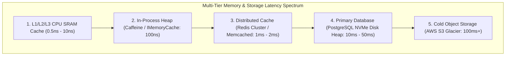
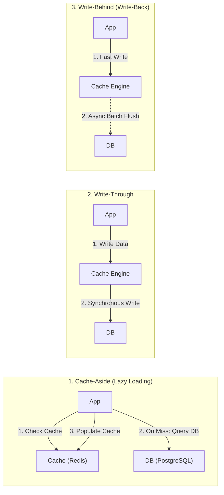
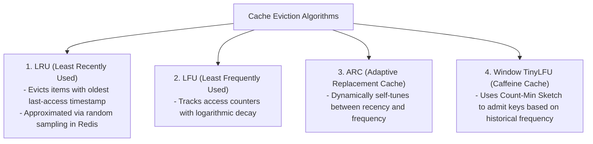
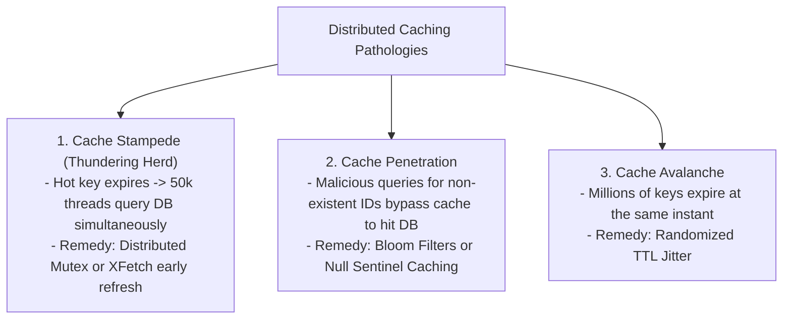
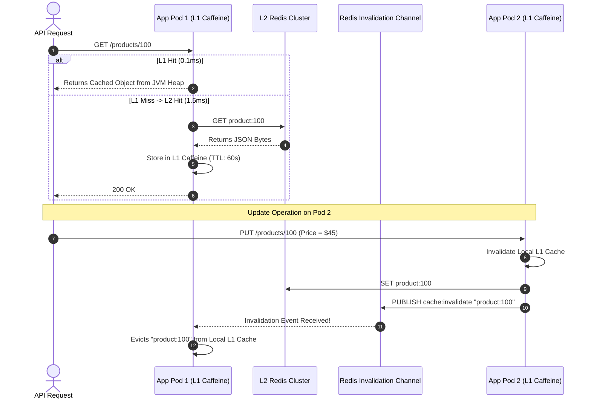

---


title: "Caching Fundamentals: Topologies, Eviction Policies & Distributed Consistency"
description: "Master-level engineering guide for Caching Fundamentals, covering Cache-Aside, Write-Through, Write-Behind, LRU/LFU/ARC/TinyLFU eviction mathematics, Cache Stampede, Bloom Filters, Two-Tier Near Cache, and Distributed Consistency."
category: "Backend Caching & Redis"
tags: [caching, redis, lru, lfu, cache-stampede, cache-aside, distributed-caching, bloom-filter, tinylfu, performance, technical-skills, software-engineering, learning-note]
date: "2026-08-21"
---

# Caching Fundamentals: Topologies, Eviction Policies & Distributed Consistency

---

## 1. Executive Summary & Hardware/Software Memory Hierarchy

**Caching** is the foundational performance engineering technique of staging computed or frequently queried data in fast, low-latency physical memory. In distributed architectures, caching operates across a multi-tier physical hierarchy where each layer represents orders-of-magnitude differences in latency and cost:

$$\text{L1 CPU SRAM } (0.5\text{ ns}) \ll \text{App Heap RAM } (100\text{ ns}) \ll \text{Distributed Redis } (1\text{ ms}) \ll \text{NVMe Database } (20\text{ ms}) \ll \text{Cold Storage } (100\text{ ms})$$



---

## 2. Caching Topologies & Read/Write Consistency Patterns



### 2.1 Pattern Matrix & Trade-Off Analysis

| Topology | Read Path | Write Path | Data Loss Risk | Consistency Level | Optimal Production Workload |
| :--- | :--- | :--- | :--- | :--- | :--- |
| **Cache-Aside** | App reads Cache; on miss reads DB & populates cache. | App updates DB; explicitly deletes cache key. | **Zero** | Eventual (Bounded by TTL) | General enterprise REST APIs, read-heavy workloads. |
| **Write-Through** | App reads Cache. | App writes to Cache; Cache writes synchronously to DB. | **Zero** | Strong between Cache & DB | Banking balances, user profile systems. |
| **Write-Behind** | App reads Cache. | App writes to Cache; Cache batches asynchronous DB writes. | **High** (Node crash before flush) | Eventual | High-throughput telemetry, IoT sensor feeds, gaming state. |
| **Refresh-Ahead** | App reads Cache; async worker refreshes hot keys before TTL expires. | Standard write path. | **Zero** | Near real-time | News homepages, e-commerce hot product catalogs. |

### 2.2 The Cache Invalidation Dilemma: Update vs Delete
When modifying data in the database:
> [!IMPORTANT]
> **Always delete (invalidate) the cache key rather than updating it.**
> If concurrent transactions write to the database in order $Tx_1 \to Tx_2$, but update the cache in reverse order $Tx_2 \to Tx_1$, the cache will store permanently stale data from $Tx_1$. Deleting the key forces the next read to fetch the latest committed database state cleanly.

---

## 3. Eviction Policy Mathematics & Modern Algorithms

When cache memory reaches its configured ceiling (`maxmemory`), the storage engine must evict items based on mathematical prioritization:



### 3.1 Redis Approximated LRU vs True LRU
True LRU requires maintaining a doubly linked list and a hash map, consuming 24+ bytes of metadata per key and causing lock contention on read operations. 

Redis implements **Approximated LRU**:
1. Every `redisObject` stores a 24-bit timestamp in `lru:LRU_BITS`.
2. Upon eviction, Redis randomly samples $N$ keys (configured via `maxmemory-samples 10`).
3. It selects the candidate with the highest idle time ($\text{current\_time} - \text{lru\_timestamp}$) and evicts it.
4. With $N=10$, Approximated LRU yields mathematical hit ratios identical to True LRU with zero extra memory overhead!

### 3.2 LFU Logarithmic Decay Mathematics
Redis LFU packs a 16-bit timestamp and an 8-bit Morris counter (\$0 - 255$) into the 24-bit LRU field:
$$\Delta \text{Counter} = \frac{1}{\text{Counter} \times \text{lfu-log-factor} + 1}$$
Every time a key is accessed, the counter increments probabilistically. Inactive keys decay periodically according to `lfu-decay-time`.

---

## 4. Distributed Caching Pathologies & Algorithmic Solutions



### 4.1 Probabilistic Early Expiration: The XFetch Algorithm
The **XFetch Algorithm** computes whether an incoming read should asynchronously refresh the cache *before* the key expires:

$$-\beta \times \Delta t_{\text{compute}} \times \ln(\text{rand}()) > \text{TTL} - t_{\text{now}}$$

Where:
- $\Delta t_{\text{compute}}$ is the time in seconds taken to re-query the database and compute the value.
- $\beta > 0$ is the aggressiveness multiplier (default $\beta = 1.0$).
- $\text{rand}() \sim U(0, 1)$ is a uniform random float.

---

## 5. Two-Tier Near Cache Architecture (Caffeine + Redis)

Combining an ultra-fast in-process memory cache (L1 Caffeine) with a shared distributed cache (L2 Redis) reduces network round-trips by $95\%$ while keeping data synchronized via **Redis Pub/Sub invalidation broadcasts**:



---

## 6. Production C# High-Performance Caching Implementation

```csharp
using Microsoft.Extensions.Caching.Distributed;
using StackExchange.Redis;
using System.Text.Json;

public sealed class EnterpriseCacheService
{
    private readonly IDistributedCache _distributedCache;
    private readonly IConnectionMultiplexer _redis;
    private readonly ILogger<EnterpriseCacheService> _logger;

    public EnterpriseCacheService(
        IDistributedCache distributedCache,
        IConnectionMultiplexer redis,
        ILogger<EnterpriseCacheService> logger)
    {
        _distributedCache = distributedCache;
        _redis = redis;
        _logger = logger;
    }

    public async Task<T?> GetOrSetAsync<T>(
        string key,
        Func<CancellationToken, Task<T?>> factory,
        TimeSpan baseTtl,
        CancellationToken ct = default) where T : class
    {
        // 1. Fast Path: Read from Distributed Cache
        byte[]? cached = await _distributedCache.GetAsync(key, ct);
        if (cached is not null)
        {
            if (cached.Length == 0) return null; // Null sentinel hit (Cache Penetration Guard)
            return JsonSerializer.Deserialize<T>(cached);
        }

        // 2. Slow Path: Acquire Distributed Lock to prevent Cache Stampede
        var db = _redis.GetDatabase();
        string lockKey = $"lock:{key}";
        string lockValue = Guid.NewGuid().ToString("N");

        // Attempt non-blocking distributed lock acquisition (5s TTL)
        bool lockAcquired = await db.StringSetAsync(lockKey, lockValue, TimeSpan.FromSeconds(5), When.NotExists);

        if (lockAcquired)
        {
            try
            {
                // Double-check cache inside lock
                cached = await _distributedCache.GetAsync(key, ct);
                if (cached is not null)
                {
                    return cached.Length == 0 ? null : JsonSerializer.Deserialize<T>(cached);
                }

                // Execute heavy DB factory computation
                T? value = await factory(ct);

                // Apply Randomized Jitter to prevent Cache Avalanche (Base TTL + 0-10% random variance)
                int jitterSeconds = Random.Shared.Next(0, (int)baseTtl.TotalSeconds / 10 + 1);
                var entryOptions = new DistributedCacheEntryOptions
                {
                    AbsoluteExpirationRelativeToNow = baseTtl + TimeSpan.FromSeconds(jitterSeconds)
                };

                if (value is not null)
                {
                    byte[] payload = JsonSerializer.SerializeToUtf8Bytes(value);
                    await _distributedCache.SetAsync(key, payload, entryOptions, ct);
                }
                else
                {
                    // Cache Penetration Protection: Store empty byte array sentinel for 60s
                    await _distributedCache.SetAsync(key, Array.Empty<byte>(), new DistributedCacheEntryOptions
                    {
                        AbsoluteExpirationRelativeToNow = TimeSpan.FromSeconds(60)
                    }, ct);
                }

                return value;
            }
            finally
            {
                // Atomic lock release via Lua script
                const string unlockLua = @"
                    if redis.call('get', KEYS[1]) == ARGV[1] then
                        return redis.call('del', KEYS[1])
                    else
                        return 0
                    end";
                await db.ScriptEvaluateAsync(unlockLua, new RedisKey[] { lockKey }, new RedisValue[] { lockValue });
            }
        }
        else
        {
            // Another thread is actively recalculating; wait and retry
            await Task.Delay(50, ct);
            return await GetOrSetAsync(key, factory, baseTtl, ct);
        }
    }
}
```

---

## 7. Cache Capacity Planning & Memory Sizing Mathematics

To size Redis clusters accurately:

$$\text{Total RAM} = N_{\text{keys}} \times \left( S_{\text{key}} + S_{\text{value}} + 64\text{ bytes (dictEntry + redisObject)} \right) \times 1.35\text{ (Fragmentation \& Rehash Factor)}$$

---

## 8. Operational Troubleshooting Runbook

| Incident | Root Cause | Engineering Solution |
| :--- | :--- | :--- |
| **`OOM command not allowed when used memory > 'maxmemory'`** | Redis memory full and `maxmemory-policy` is set to `noeviction`. | Change policy to `volatile-lru` or `allkeys-lru`, or scale cluster memory. |
| **High Database CPU during Deployment** | Cache wiped or restarted simultaneously, causing Thundering Herd. | Warm up cache prior to routing live traffic, or use distributed locking during cache misses. |
| **Stale Reads in Multi-Tier Caching** | Local L1 in-process caches not receiving invalidation notifications. | Implement Redis Pub/Sub or Redis 6 Client-Side Tracking (`CLIENT TRACKING on`). |

---

## 🔗 Graph-Linked Knowledge Base
- ⚓ Redis Deep Dive: [[redis_deep_dive|Redis Architecture & Data Structures]]
- ⚓ Distributed Locking: [[distributed_locking_and_pubsub|Distributed Locking & PubSub]]
- 🔗 Java Caching: [[02_Technical_Skills/01_theory_and_concepts/06_Java_Engineering/distributed_caching_spring_cache_redis|Spring Cache & Redis in Java]]
