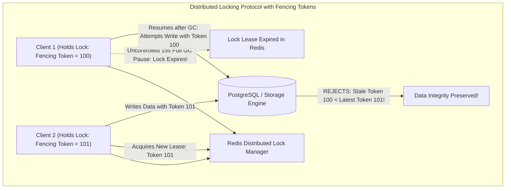
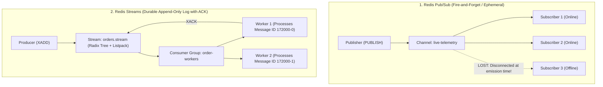

---


title: "Distributed Locking (Redlock) & Redis Pub/Sub Architecture"
description: "Master-level engineering guide for Distributed Locking algorithms (Redlock, SET NX PX, Fencing Tokens), Martin Kleppmann critique, Watchdog lease renewals, Redis Streams vs Pub/Sub, and Redisson/RedLock implementations."
category: "Backend Caching & Redis"
tags: [redis, distributed-locking, redlock, fencing-tokens, pubsub, redis-streams, concurrency, redisson, event-driven, technical-skills, software-engineering, learning-note]
date: "2026-08-21"
---

# Distributed Locking (Redlock) & Redis Pub/Sub Architecture

---

## 1. Executive Summary & Distributed Coordination Theory

In modern distributed microservice topologies where multiple application instances execute concurrent operations against shared resources (e.g. inventory decrements, payment captures, cluster leader election, scheduled batch jobs), single-process mutexes (`lock` in C#, `synchronized`/`ReentrantLock` in Java) provide zero cross-instance protection.

Distributed locking requires a distributed consensus or shared state engine that satisfies two fundamental mathematical guarantees:
1. **Safety (Mutual Exclusion)**: At any given moment $t$, at most one client can hold the lock for a specific resource identifier.
2. **Liveness (Deadlock Freedom)**: Even if the lock holder crashes, disconnects, or partitions, the lock must eventually become available for other clients to acquire.



---

## 2. Single-Instance Atomic Lock: Acquisition, Watchdogs & Lua Release

### 2.1 Atomic Acquisition Invariant
A distributed lock cannot be implemented using separate `EXISTS` followed by `SET` commands, as network interleaving causes race conditions. Redis provides atomic acquisition via:

```redis
SET resource_order_100 "uuid_token_8891a" NX PX 30000
```
- **`NX`**: Set if Not eXists (Guarantees safety / exclusivity).
- **`PX 30000`**: Expire after 30,000 milliseconds (Guarantees liveness / auto-release on crash).
- **`uuid_token_8891a`**: Cryptographically unique client ownership identifier.

### 2.2 Atomic Release via Lua Script
If Client A experiences an execution delay exceeding the lock TTL (e.g. 35s), the lock expires and Client B acquires it. If Client A then issues a plain `DEL`, it will **illegally destroy Client B's lock**.

Lock release must be atomic and conditional via a Lua script:
```lua
-- KEYS[1]: Resource lock key
-- ARGV[1]: Client unique ownership token
if redis.call("GET", KEYS[1]) == ARGV[1] then
    return redis.call("DEL", KEYS[1])
else
    return 0
end
```

### 2.3 Background Watchdog Lease Renewal
To prevent locks from expiring during long legitimate processing, frameworks like **Redisson** (Java) and **RedLockNet** (C#) launch a background asynchronous **Watchdog Timer**. Every $\frac{\text{TTL}}{3}$ (e.g. every 10s for a 30s TTL), the watchdog runs a Lua script extending the key expiration as long as the worker thread remains alive.

---

## 3. The Redlock Algorithm & The Kleppmann-Sanfilippo Debate

For enterprise high-availability without a single point of failure (SPOF), Salvatore Sanfilippo designed the **Redlock Algorithm** operating across $N$ independent, un-replicated Redis master nodes (typically $N=5$):

```mermaid
flowchart LR
    Client["Client Proposer"] --> M1["Redis Master 1 (ACK)"]
    Client --> M2["Redis Master 2 (ACK)"]
    Client --> M3["Redis Master 3 (ACK)"]
    Client --> M4["Redis Master 4 (TIMEOUT)"]
    Client --> M5["Redis Master 5 (ACK)"]
    
    Note over Client: Quorum = 4/5 Nodes Acquired within Validity Window!
```

### 3.1 Redlock Algorithmic Steps
1. Client records current timestamp $t_1$.
2. Client attempts to acquire the lock across all $N$ masters sequentially using identical key names and random tokens, with a tiny network timeout (\$5 - 50\text{ ms}$).
3. Client measures elapsed time: $\Delta t = t_2 - t_1$.
4. **Acquisition Success Rule**:
   $$\text{Nodes Acquired } M \ge \left( \left\lfloor \frac{N}{2} \right\rfloor + 1 \right) \quad \land \quad \Delta t < \text{TTL} - \text{CLOCK\_DRIFT}$$
5. If acquired, the **Effective Lock Validity Time** is:
   $$\text{Validity Time} = \text{TTL} - \Delta t - \text{CLOCK\_DRIFT}$$
6. If the client fails to achieve quorum ($M < 3$), it immediately sends an unlock Lua script to all $N$ nodes.

### 3.2 The Martin Kleppmann Critique & Fencing Tokens
Distributed systems researcher Martin Kleppmann proved that Redlock **cannot guarantee safety for correctness** in asynchronous networks subject to:
- Stop-The-World (STW) GC pauses.
- Unsynchronized physical clock drift / NTP jumps.
- Asynchronous network delays.

> [!IMPORTANT]
> **The Golden Rule of Distributed Locking**:
> A distributed lock alone cannot protect a shared resource against storage corruption without **Fencing Tokens**. Whenever a lock is acquired, the lock manager must issue a monotonically incrementing epoch token (e.g. 100, 101, 102). The downstream storage layer (PostgreSQL / MySQL) must reject any write carrying a token lower than the highest token previously committed.

---

## 4. Production Java Implementation with Redisson

```java
package com.enterprise.locking;

import org.redisson.api.RLock;
import org.redisson.api.RedissonClient;
import org.slf4j.Logger;
import org.slf4j.LoggerFactory;
import org.springframework.stereotype.Service;

import java.util.concurrent.TimeUnit;

@Service
public class OrderCheckoutLockService {

    private static final Logger log = LoggerFactory.getLogger(OrderCheckoutLockService.class);
    private final RedissonClient redissonClient;

    public OrderCheckoutLockService(RedissonClient redissonClient) {
        this.redissonClient = redissonClient;
    }

    public void executeWithLock(String orderId, Runnable task) {
        String lockKey = "lock:order:" + orderId;
        RLock lock = redissonClient.getLock(lockKey);

        try {
            // Attempt to acquire lock: Wait up to 5s, auto-renew via watchdog (leaseTime = -1)
            boolean acquired = lock.tryLock(5, -1, TimeUnit.SECONDS);

            if (!acquired) {
                throw new IllegalStateException("Could not acquire lock for order " + orderId + ". Another operation is in flight.");
            }

            log.info("Distributed lock acquired for order: {}", orderId);
            task.run();

        } catch (InterruptedException e) {
            Thread.currentThread().interrupt();
            throw new RuntimeException("Lock acquisition interrupted", e);
        } finally {
            if (lock.isHeldByCurrentThread()) {
                lock.unlock();
                log.info("Distributed lock released for order: {}", orderId);
            }
        }
    }
}
```

---

## 5. Redis Pub/Sub vs. Redis Streams Architecture



### 5.1 Comprehensive Architectural Comparison Matrix

| Feature / Dimension | Redis Pub/Sub | Redis Streams (`XADD` / `XREADGROUP`) |
| :--- | :--- | :--- |
| **Message Durability** | **Zero** (Pure in-memory, transient broadcast) | **Persistent** (Backed by RDB snapshots & AOF logs) |
| **Offline Consumer Handling** | Messages dropped immediately if subscriber is offline | Messages retained in log until explicitly acknowledged (`XACK`) |
| **Consumer Groups & Load Balancing** | No (Every subscriber receives every message) | **Yes** (Distributes partition workload across worker group) |
| **Message Replay** | Impossible | **Supported** (Seek by timestamp or ID: `XREAD STREAMS`) |
| **Dead-Letter / Failure Recovery** | None | Supported via Pending Entries List (`PEL`) & `XAUTOCLAIM` |
| **Memory Footprint** | Extremely low | Bounded via `MAXLEN ~ 100000` capping |
| **Optimal Use Case** | Cache invalidations, real-time chat, UI notifications | Asynchronous task queues, event sourcing, audit logging |

---

## 6. High-Throughput Redis Streams Consumer Group in C#

```csharp
using StackExchange.Redis;

public sealed class OrderStreamConsumerBackgroundService
{
    private readonly IConnectionMultiplexer _redis;
    private const string StreamKey = "orders.stream";
    private const string GroupName = "order-processing-group";
    private readonly string _consumerName = $"worker-{Guid.NewGuid():N}";

    public OrderStreamConsumerBackgroundService(IConnectionMultiplexer redis)
    {
        _redis = redis;
    }

    public async Task StartConsumingAsync(CancellationToken ct)
    {
        var db = _redis.GetDatabase();

        // 1. Create Consumer Group idempotently
        try
        {
            await db.StreamCreateConsumerGroupAsync(StreamKey, GroupName, StreamPosition.NewMessages);
        }
        catch (RedisServerException ex) when (ex.Message.Contains("BUSYGROUP"))
        {
            // Consumer group already exists
        }

        // 2. Continuous consumption loop
        while (!ct.IsCancellationRequested)
        {
            // Read up to 10 new unacknowledged messages
            var entries = await db.StreamReadGroupAsync(
                StreamKey, 
                GroupName, 
                _consumerName, 
                StreamPosition.NewMessages, 
                count: 10
            );

            if (entries.Length == 0)
            {
                await Task.Delay(100, ct);
                continue;
            }

            foreach (var entry in entries)
            {
                string orderId = entry["orderId"]!;
                string customer = entry["customer"]!;

                // Process business logic
                ProcessOrder(orderId, customer);

                // Acknowledge successful processing
                await db.StreamAcknowledgeAsync(StreamKey, GroupName, entry.Id);
            }
        }
    }

    private void ProcessOrder(string orderId, string customer)
    {
        Console.WriteLine($"Processed Order {orderId} for customer {customer}");
    }
}
```

---

## 7. Operational Troubleshooting & Split-Brain Matrix

| Incident | Root Cause | Engineering Solution |
| :--- | :--- | :--- |
| **Lock Lost during Execution** | Client task executed longer than lock TTL without Watchdog auto-renewal. | Enable Redisson / RedLockNet watchdog lease renewal or enforce Fencing Tokens on DB writes. |
| **Pub/Sub Client Disconnects** | Slow subscriber buffers exceeded `client-output-buffer-limit pubsub`. | Increase buffer limits or migrate high-volume queues to Redis Streams. |
| **Dead Consumer in Stream Group** | Consumer crashed while processing; unacknowledged messages stuck in `PEL`. | Implement a periodic background task using `XAUTOCLAIM` to reassign orphaned messages to healthy workers. |

---

## 🔗 Graph-Linked Knowledge Base
- ⚓ Caching Fundamentals: [[caching_fundamentals|Caching Fundamentals & Topologies]]
- ⚓ Redis Internals: [[redis_deep_dive|Redis Architecture & Data Structures]]
- 🔗 Messaging: [[02_Technical_Skills/01_theory_and_concepts/14_Messaging_and_Event_Driven/kafka_rabbitmq_event_streaming_architecture|Kafka vs RabbitMQ Architecture]]
