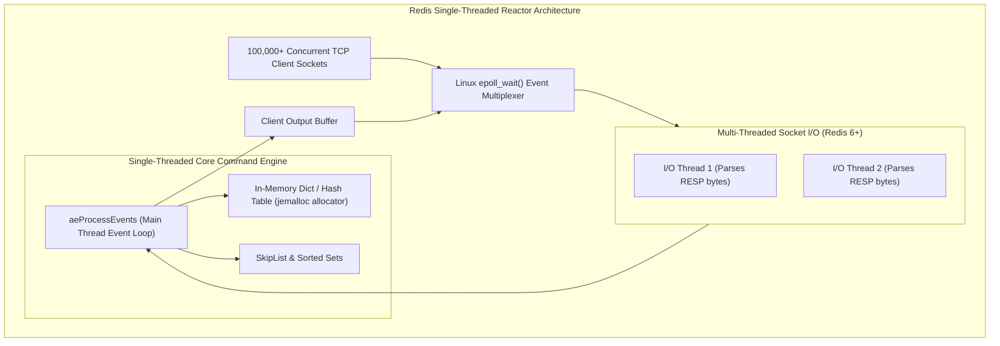
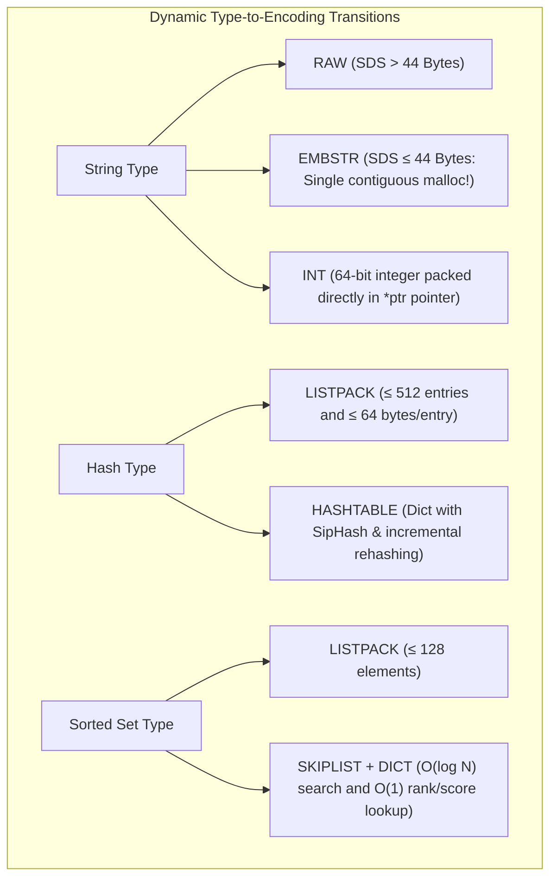
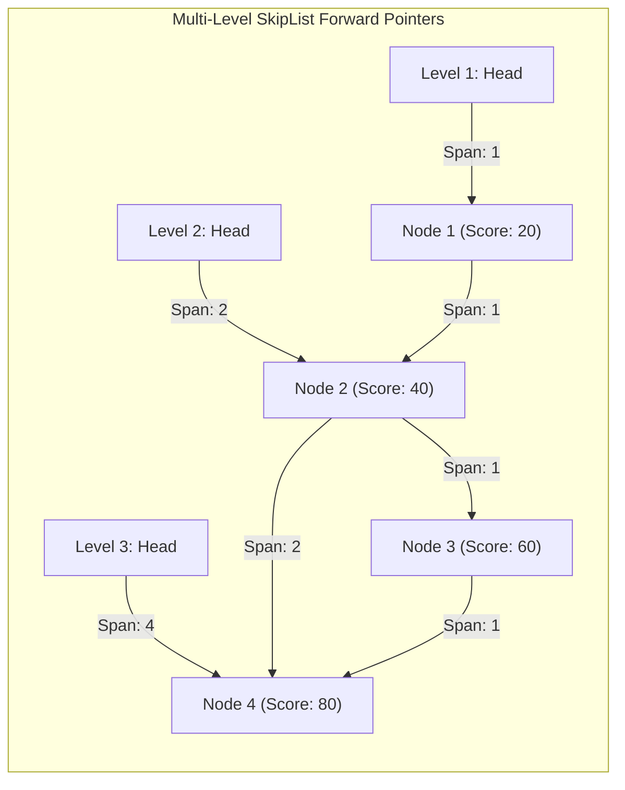

---


title: "Redis Architecture Deep Dive: Single-Threaded Event Loop, RESP & Memory"
description: "Master-level engineering guide for Redis internals, covering the single-threaded reactor event loop, I/O multiplexing (epoll/kqueue), RESP3 protocol, memory encoding optimizations (SDS, listpack, quicklist, skiplist), RDB/AOF persistence, and Redis Cluster hash slots."
category: "Backend Caching & Redis"
tags: [redis, resp, event-loop, epoll, memory-optimization, sds, skiplist, rdb, aof, cluster, internals, technical-skills, software-engineering, learning-note]
date: "2026-08-21"
---

# Redis Architecture Deep Dive: Event Loop, RESP & Memory Optimization

---

## 1. Executive Summary & Core Architectural Pillars

**Redis (Remote Dictionary Server)** is an open-source, in-memory key-value data structure store delivering sub-millisecond execution latencies for millions of operations per second. 

Redis achieves its speed and deterministic low latency through four core architectural pillars:
1. **Single-Threaded Reactor Event Loop**: Command execution is strictly single-threaded, completely eliminating thread contention, mutex locking, race conditions, and CPU context switching overhead.
2. **Non-Blocking I/O Multiplexing**: Utilizes Linux `epoll` / BSD `kqueue` / Windows `IOCP` to manage tens of thousands of concurrent client TCP sockets over an event-driven file descriptor loop.
3. **Multi-Threaded Network I/O (Redis 6+)**: Offloads socket read/write system calls to background worker threads while keeping core command dispatching strictly single-threaded.
4. **Memory-Compacted Binary Encodings**: Transparently adapts internal data structures (`SDS`, `listpack`, `quicklist`, `skiplist`) to maximize CPU L1/L2 cache line locality.



---

## 2. Low-Level Memory Layout: `redisObject` & Dynamic Encodings

Every key and value stored in Redis is wrapped in a 16-byte header structure called **`redisObject`** (`robj`):

```c
typedef struct redisObject {
    unsigned type:4;        // OBJ_STRING, OBJ_LIST, OBJ_SET, OBJ_ZSET, OBJ_HASH (4 bits)
    unsigned encoding:4;    // OBJ_ENCODING_RAW, OBJ_ENCODING_INT, OBJ_ENCODING_LISTPACK... (4 bits)
    unsigned lru:24;        // 24-bit timestamp for LRU / LFU eviction calculations
    int refcount;           // Reference counting (shared integer constants: 0 to 9999) (32 bits)
    void *ptr;              // Pointer to physical heap data payload (64 bits on x64)
} robj;
```



---

## 3. Simple Dynamic Strings (SDS) Internals

Standard C strings (`char*`) are null-terminated (`\0`), making length calculations $O(N)$ and preventing binary data (e.g. images, Protobuf) containing embedded `\0` bytes from being stored.

Redis replaces `char*` with **Simple Dynamic Strings (SDS)**:

```c
struct __attribute__ ((__packed__)) sdshdr8 {
    uint8_t len;         // Used string length (1 byte)
    uint8_t alloc;       // Total allocated capacity excluding header (1 byte)
    unsigned char flags; // Header type (SDS_TYPE_5, 8, 16, 32, 64)
    char buf[];          // Contiguous char array payload (includes trailing \0)
};
```

### 3.1 Why SDS Outperforms Plain C Strings:
1. **$O(1)$ Length Lookups**: Reads `sdshdr.len` in 1 CPU cycle.
2. **Binary Safety**: String length is determined by `len`, not `\0`.
3. **Buffer Overflow Prevention**: `sdscat()` automatically checks `alloc - len` and reallocates memory if necessary.
4. **Exponential Preallocation & Lazy Deallocation**: Buffers double in size up to $1\text{MB}$ to minimize `malloc` syscalls during string appends.

---

## 4. SkipList & Listpack Data Structures

### 4.1 SkipList (Sorted Sets `ZSET`)
A **SkipList** is a probabilistic alternative to balanced binary search trees (AVL / Red-Black). It consists of a base linked list overlaid with multiple layers of forward skip pointers:



- **Lookup Complexity**: $O(\log N)$ average time complexity.
- **Rank Calculations**: Each pointer node stores a `span` field (number of skipped elements), enabling $O(\log N)$ rank queries (`ZRANK`).

---

## 5. Persistence Engines: RDB, AOF & Mixed Preamble

```mermaid
flowchart LR
    subgraph RDBFlow["1. RDB Snapshot (Point-in-Time Dump)"]
        Main1["Redis Main Process"] -->|fork() Copy-On-Write| Child1["BGSAVE Child Process"]
        Child1 --> BinaryDump["dump.rdb (Compact Binary Snapshot)"]
    end

    subgraph AOFFlow["2. AOF Log (Append-Only Transaction Log)"]
        Main2["Redis Main Process"] --> AOFBuffer["AOF In-Memory Buffer"]
        AOFBuffer -->|appendfsync everysec| AOFFile["appendonly.aof (Text / Mixed Binary)"]
    end
```

### 5.1 RDB vs AOF vs Mixed Comparison Matrix

| Dimension | RDB (Snapshotting) | AOF (Append-Only File) | Mixed Persistence (`aof-use-rdb-preamble yes`) |
| :--- | :--- | :--- | :--- |
| **Data Safety / Durability** | Low (\$5 - 15\text{ mins}$ loss window) | **High** (At most 1 second loss with `everysec`) | **High** (At most 1 second loss) |
| **Crash Recovery Speed** | **Ultra-Fast** (Direct memory image mmap) | Slow (Replays millions of commands) | **Fast** (Loads RDB base + replays short AOF delta) |
| **File Size on Disk** | Minimal (LZF compressed binary) | Large (Requires `BGREWRITEAOF`) | Compact |
| **Disk I/O Impact** | Heavy burst I/O during save | Smooth sequential append I/O | Balanced |

---

## 6. Redis Cluster Architecture: Hash Slots & Gossip Protocol

Redis Cluster provides distributed horizontal scaling across multiple master-replica shards without requiring an external proxy:

```mermaid
flowchart TD
    subgraph ClusterTopology["Redis Cluster (16,384 Hash Slots)"]
        Key["Key: 'user:1000'"] --> HASH["CRC16('user:1000') % 16384 = Slot 4210"]
        
        HASH --> MasterA["Master A (Slots: 0 - 5460)"]
        MasterA --- ReplicaA["Replica A"]
        
        HASH -.-> MasterB["Master B (Slots: 5461 - 10922)"]
        MasterB --- ReplicaB["Replica B"]
        
        HASH -.-> MasterC["Master C (Slots: 10923 - 16383)"]
        MasterC --- ReplicaC["Replica C"]
        
        MasterA <-->|Gossip Protocol (Port 16379)| MasterB
        MasterB <-->|Gossip Protocol (Port 16379)| MasterC
    end
```

### 6.1 Hash Tags for Multi-Key Transactions
Redis Cluster prohibits multi-key commands across different slots unless keys share a **Hash Tag**:
```redis
MSET {user:1000}:profile "Alex" {user:1000}:orders "12" # Hashed on '{user:1000}' -> Guaranteed Same Shard!
```

---

## 7. Production Configuration & Operating System Hardening

```ini
# /etc/redis/redis.conf production template
bind 0.0.0.0
port 6379
protected-mode yes
requirepass "EnterpriseStrongPassword_2026"

# Memory Management & Eviction
maxmemory 16gb
maxmemory-policy allkeys-lru
maxmemory-samples 10

# Multi-Threaded I/O Configuration (Redis 6+)
io-threads 4
io-threads-do-reads yes

# Hybrid Persistence Configuration
appendonly yes
appendfilename "appendonly.aof"
appendfsync everysec
no-appendfsync-on-rewrite yes
auto-aof-rewrite-percentage 100
auto-aof-rewrite-min-size 64mb
aof-use-rdb-preamble yes

# Network Socket Tuning
tcp-backlog 65535
timeout 0
tcp-keepalive 300
```

### 7.1 Linux Kernel Parameter Tuning
```bash
# 1. Enable Overcommit Memory (Prevents fork() failure during background save)
sysctl vm.overcommit_memory=1

# 2. Increase Network Socket Connection Backlog
sysctl net.core.somaxconn=65535

# 3. Disable Transparent Huge Pages (THP) to eliminate latency spikes during COW fork
echo never > /sys/kernel/mm/transparent_hugepage/enabled
```

---

## 8. Operational Failure Modes & Troubleshooting Runbook

| Incident | Root Cause | Production Remediation |
| :--- | :--- | :--- |
| **Latency Spikes ($> 50\text{ ms}$)** | Running blocking $O(N)$ commands (`KEYS *`, `FLUSHALL`, `HGETALL` on massive keys). | Use `SCAN`, `HSCAN`, or enable `lazyfree-lazy-eviction yes`. |
| **`fork()` System Call Fails** | Insufficient swap / physical RAM during background save with Copy-on-Write. | Set `vm.overcommit_memory = 1` and ensure host has $\ge 30\%$ free memory. |
| **`CLUSTERDOWN The cluster is down`** | More than half of master nodes failed, or unassigned hash slots exist. | Ensure replicas auto-failover, or reassign unassigned slots via `redis-cli --cluster fix`. |

---

## 🔗 Graph-Linked Knowledge Base
- ⚓ Caching Fundamentals: [[caching_fundamentals|Caching Fundamentals & Topologies]]
- ⚓ Distributed Locking: [[distributed_locking_and_pubsub|Distributed Locking & PubSub]]
- 🔗 Java Caching: [[02_Technical_Skills/01_theory_and_concepts/06_Java_Engineering/distributed_caching_spring_cache_redis|Spring Cache & Redis in Java]]
