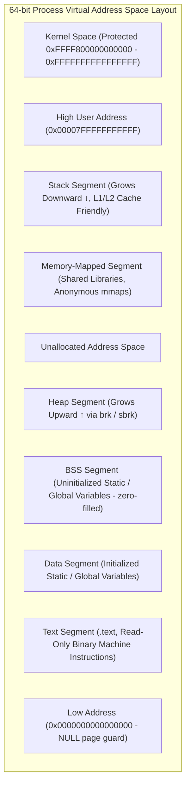
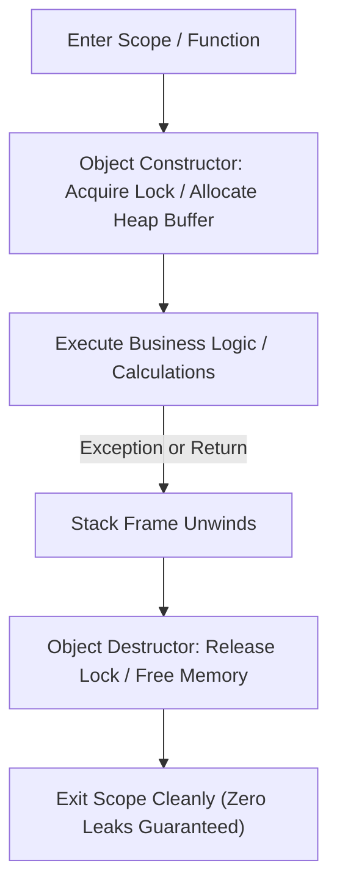
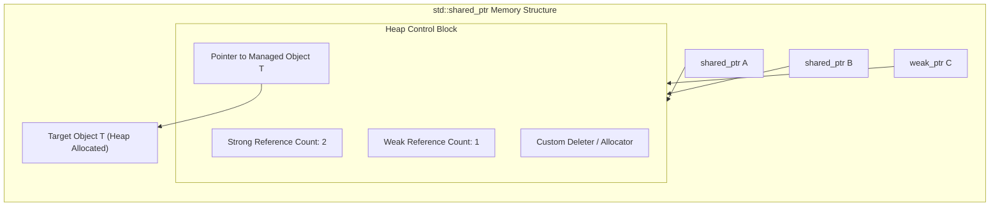

---


title: "C++ Virtual Memory Address Space, Stack vs Heap, and RAII Fundamentals"
description: "Master-level systems engineering guide to C++ virtual memory address space layout (Stack, Heap, BSS, Data, Text), paging mechanics, memory segments, and RAII resource management principles."
category: "Systems Programming & C++"
tags: [cpp, systems-programming, virtual-memory, memory-management, raii, smart-pointers, stack-heap, technical-skills, software-engineering, learning-note]
date: "2026-08-21"
---

# 🧠 C++ Virtual Memory Address Space & RAII Fundamentals

## 📌 Connected Resource Graph
- 🟡 **Topic Overview Node**: [[02_Technical_Skills/01_theory_and_concepts/08_Systems_and_CPlusPlus/02_cpp_custom_memory_allocators|02 Custom Memory Allocators]]
- 🟡 **Topic Overview Node**: [[02_Technical_Skills/01_theory_and_concepts/08_Systems_and_CPlusPlus/03_cpp_move_semantics_and_perfect_forwarding|03 Move Semantics]]

> 🔙 **Folder Hub**: [[00_Meta/05_folder_nodes/node_08_Systems_and_CPlusPlus|Systems & C++ Hub]]
> ➡️ **Next Module**: [[02_Technical_Skills/01_theory_and_concepts/08_Systems_and_CPlusPlus/01_cpp_raii_and_smart_pointers|01 C++ RAII & Smart Pointers]]

---

## 1. Physical & Virtual Memory Layout: Virtual Address Space

In modern operating systems (Linux x86-64 / Windows x64), processes do not interact directly with physical RAM. Instead, the CPU's **Memory Management Unit (MMU)** translates process virtual addresses to physical pages using hierarchical multi-level page tables.

A standard 64-bit user-space process occupies a canonical virtual address space divided into distinct segments:



### Memory Segment Mechanics

| Segment | Access Permissions | Lifetime | Allocation Mechanism | Growth Direction |
| :--- | :--- | :--- | :--- | :--- |
| **Stack** | Read / Write | Automatic (Scope-bound) | `RSP` register increment/decrement ($\sim 0.5\text{ ns}$) | Downward (High $\to$ Low) |
| **Heap** | Read / Write | Dynamic (Programmer managed) | `malloc` / `new` via `brk`, `mmap` ($\sim 20-50\text{ ns}$) | Upward (Low $\to$ High) |
| **BSS** | Read / Write | Process Lifetime | Kernel zero-page on demand | Static fixed size |
| **Data** | Read / Write | Process Lifetime | Embedded in binary ELF/PE | Static fixed size |
| **Text** | Read / Execute | Process Lifetime | Mapped from executable file | Static fixed size |

---

## 2. Stack vs Heap Runtime Mechanics

### 2.1 Stack Allocation
- Contiguous memory allocation directly managed by the CPU stack pointer register (`RSP`/`ESP`).
- Deterministic, sub-nanosecond allocation/deallocation with zero fragmentation.
- High temporal and spatial cache locality ($L1/L2$ cache hits).
- Default size is finite (typically $1\text{ MB} - 8\text{ MB}$); deep recursion or large stack arrays trigger `Stack Overflow` (`SIGSEGV`).

### 2.2 Heap Allocation
- Managed dynamically through runtime allocators (glibc `ptmalloc`, `tcmalloc`, `jemalloc`).
- Incurs synchronization locks, freelist lookups, and OS system calls (`brk`, `mmap`).
- Subject to internal and external memory fragmentation and cache misses.

---

## 3. Resource Acquisition Is Initialization (RAII)

**RAII** is the foundational C++ design idiom that binds the lifecycle of external resources (heap memory, POSIX file descriptors, socket handles, mutex locks, database transactions) to the lifetime of a stack-allocated C++ object.

### The Core RAII Invariant
1. **Resource Acquisition** occurs in the class constructor (`Constructor()`). If acquisition fails, the constructor throws an exception.
2. **Resource Release** occurs deterministically in the class destructor (`~Destructor()`).
3. **Stack Unwinding**: When a function exits (whether by standard `return` or thrown exception), the runtime unwinds the stack frame and executes destructors in reverse order of construction, guaranteeing zero resource leaks.



---

## 4. Modern C++ Smart Pointer Mechanics

Modern C++ (C++11 through C++20) prohibits manual `new` and `delete` in application code, replacing them with standard smart pointers defined in `<memory>`.

| Smart Pointer | Ownership Semantics | Control Block Overhead | Thread-Safety |
| :--- | :--- | :--- | :--- |
| **`std::unique_ptr<T>`** | Exclusive ownership (Move-only, Non-copyable) | $0\text{ bytes}$ (Zero runtime overhead, identical to raw pointer) | Single-thread ownership |
| **`std::shared_ptr<T>`** | Shared ownership (Reference-counted) | $16-32\text{ bytes}$ heap control block (Atomic Strong/Weak counts) | Thread-safe RefCount operations |
| **`std::weak_ptr<T>`** | Non-owning observer (Breaks cyclic references) | Shares `std::shared_ptr` control block | Requires `.lock()` to access object |



---

## 5. Production C++ RAII Implementation

Below is a production-grade RAII wrapper demonstrating exception safety, custom deleters, and smart pointer integration:

```cpp
#include <iostream>
#include <memory>
#include <mutex>
#include <string>
#include <vector>
#include <stdexcept>

// 1. Custom Exception-Safe RAII Resource Handle
class FileDescriptorGuard {
private:
    int fd_;
    std::string filename_;

public:
    explicit FileDescriptorGuard(const std::string& filename, int flags)
        : filename_(filename), fd_(-1) {
        // Simulating POSIX open syscall
        std::cout << "[RAII] Opening resource handle: " << filename_ << "\n";
        fd_ = 3; // Simulated valid file descriptor
        if (fd_ < 0) {
            throw std::runtime_error("Failed to acquire file descriptor for: " + filename);
        }
    }

    ~FileDescriptorGuard() {
        if (fd_ >= 0) {
            std::cout << "[RAII] Deterministically closing fd: " << fd_ 
                      << " (" << filename_ << ")\n";
            fd_ = -1;
        }
    }

    // Disable copy semantics to prevent double-close bugs
    FileDescriptorGuard(const FileDescriptorGuard&) = delete;
    FileDescriptorGuard& operator=(const FileDescriptorGuard&) = delete;

    // Enable move semantics for ownership transfer
    FileDescriptorGuard(FileDescriptorGuard&& other) noexcept
        : fd_(other.fd_), filename_(std::move(other.filename_)) {
        other.fd_ = -1;
    }

    FileDescriptorGuard& operator=(FileDescriptorGuard&& other) noexcept {
        if (this != &other) {
            if (fd_ >= 0) {
                // Close existing resource before taking ownership
                std::cout << "[RAII] Releasing old fd: " << fd_ << "\n";
            }
            fd_ = other.fd_;
            filename_ = std::move(other.filename_);
            other.fd_ = -1;
        }
        return *this;
    }

    int get_raw_fd() const noexcept { return fd_; }
};

// 2. Modern Smart Pointer Ownership Demonstration
struct NetworkPacket {
    uint32_t packet_id;
    std::vector<uint8_t> payload;

    NetworkPacket(uint32_t id, size_t size)
        : packet_id(id), payload(size, 0xAA) {
        std::cout << "Packet " << packet_id << " allocated (" << size << " bytes).\n";
    }

    ~NetworkPacket() {
        std::cout << "Packet " << packet_id << " deallocated cleanly.\n";
    }
};

void process_pipeline() {
    // Prefer std::make_unique for exception-safe exclusive ownership
    auto packet = std::make_unique<NetworkPacket>(101, 2048);

    // RAII Stack Guard
    FileDescriptorGuard log_file("network_audit.log", 0);

    // Transfer ownership via std::move
    std::vector<std::unique_ptr<NetworkPacket>> queue;
    queue.push_back(std::move(packet));

    // packet is now nullptr; queue[0] holds sole ownership
    std::cout << "Packet transferred to queue. Original pointer is: " 
              << (packet == nullptr ? "nullptr" : "valid") << "\n";
} // Scope exit: log_file and queue items automatically destructed in reverse order
```

---

## 6. Anti-Patterns & Memory Safety Traps

### ❌ Anti-Pattern 1: Cyclic `std::shared_ptr` Reference Leaks

```cpp
// BAD: Two objects hold strong shared_ptr references to each other
struct Node {
    std::shared_ptr<Node> neighbor; // LEAK: RefCount never drops to zero!
};
```

### ✅ Solution: Use `std::weak_ptr` for Non-Owning Relationships

```cpp
// GOOD: Break cyclic ownership with weak_ptr
struct Node {
    std::weak_ptr<Node> neighbor; // Non-owning reference
};
```

### ❌ Anti-Pattern 2: Mixing Raw `new` with `std::shared_ptr` Construction

```cpp
// BAD: Two separate heap allocations (Object T + Control Block)
std::shared_ptr<Widget> w(new Widget());

// GOOD: Single contiguous heap allocation (Object T + Control Block merged)
auto w = std::make_shared<Widget>();
```

---

## 🔬 Key Takeaways & Core Rules

1. **Memory Segment Segregation**: Stack is scope-bound, cache-hot, and sub-nanosecond; Heap is dynamic, fragmented, and requires explicit lifecycle control.
2. **Never Call `delete` Manually**: Wrap all resources in RAII classes or use `std::unique_ptr` / `std::shared_ptr`.
3. **Always Prefer `std::make_unique` & `std::make_shared`**: Prevents memory leaks during complex expression evaluation and improves cache locality.
4. **Move Semantics Transfer Ownership**: Use `std::move` to transfer resource ownership with zero-copy overhead.

---

## 🔗 Graph-Linked Knowledge Base

- ➡️ **Next Module**: [[02_Technical_Skills/01_theory_and_concepts/08_Systems_and_CPlusPlus/01_cpp_raii_and_smart_pointers|01 C++ RAII & Smart Pointers]]
- ⚡ **Custom Allocators**: [[02_Technical_Skills/01_theory_and_concepts/08_Systems_and_CPlusPlus/02_cpp_custom_memory_allocators|02 Custom Memory Allocators: Arena, Pool & Slab]]
- 🚀 **Move Semantics**: [[02_Technical_Skills/01_theory_and_concepts/08_Systems_and_CPlusPlus/03_cpp_move_semantics_and_perfect_forwarding|03 Move Semantics & Perfect Forwarding]]
- 📁 **Folder Hub**: [[00_Meta/05_folder_nodes/node_08_Systems_and_CPlusPlus|08 Systems & C++ Hub]]
