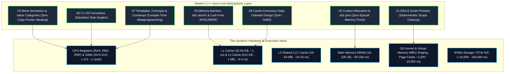
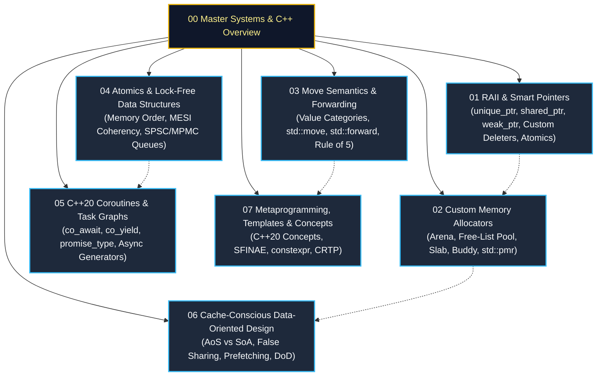
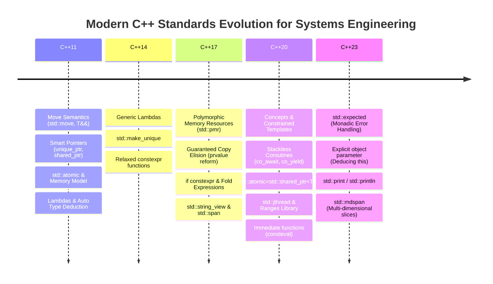

---

title: "Systems Programming & Modern C++ Engineering: Master Architecture & Roadmap"
description: "Master curriculum and foundational architecture for high-performance Systems Programming and Modern C++ (C++17/20/23), covering memory models, zero-cost abstractions, low-latency patterns, and lock-free architectures."
category: "Systems Programming & C++"
tags: [cpp, systems-programming, low-latency, memory-management, concurrency, performance, architecture, technical-skills, software-engineering, learning-note]
date: "2026-08-21"
---

# ⚡ Systems Programming & Modern C++ Engineering: Master Guide

> 🏛️ **Domain Master Hub**: Systems Architecture & Low-Latency C++
> 📁 **Module Directory**: `02_Technical_Skills/01_theory_and_concepts/08_Systems_and_CPlusPlus/`

---

## 1. Executive Philosophy & Systems Engineering Principles

Modern C++ is the foundational language for high-performance computing, distributed database engines, game engines, autonomous robotics, operating system kernels, and Ultra-Low Latency / High-Frequency Trading (HFT) platforms.

The design of C++ centers on three unshakeable systems engineering tenets:

1. **The Zero-Overhead Principle (Bjarne Stroustrup)**:
   - *What you don't use, you don't pay for.*
   - *What you do use, you couldn't hand code any better.*
   - Modern abstractions (smart pointers, templates, concepts, coroutines, move semantics) compile down directly into minimal raw assembly with zero runtime indirection when optimized (`-O3 -march=native`).
2. **Deterministic Resource Lifetimes**:
   - Unlike garbage-collected environments (Go, Java, .NET) which introduce non-deterministic **Stop-the-World (STW)** pause times, C++ enforces deterministic object destruction via **RAII (Resource Acquisition Is Initialization)**.
3. **Mechanical Sympathy with Underlying Hardware**:
   - Systems C++ code is designed around CPU memory hierarchies ($L1/L2/L3$ caches), branch prediction units, SIMD vector registers (AVX-512 / NEON), and direct OS kernel / hardware interfaces.

---

## 2. Master Module Architecture & Learning Curriculum

This curriculum is organized into seven core technical pillars designed to guide systems engineers from foundational memory mechanics to high-frequency concurrency:

---

## 3. Comprehensive Pillar Breakdown

### 🛡️ [01. C++ RAII & Smart Pointers](./02_Technical_Skills/01_theory_and_concepts/08_Systems_and_CPlusPlus/01_cpp_raii_and_smart_pointers.md)
- **Core Invariant**: Binding resource acquisition to object lifetime and stack unwinding.
- **Deep Dive**:
  - `std::unique_ptr<T, Deleter>`: Zero-cost abstractions, Empty Base Optimization (EBO), custom POSIX file descriptor and socket wrappers.
  - `std::shared_ptr<T>`: Internal anatomy of the Control Block, strong vs weak reference counters, contiguous memory benefits of `std::make_shared` vs direct `new`.
  - `std::weak_ptr<T>`: Non-owning observers, cyclic reference deadlock prevention, atomic promotion via `.lock()`.
  - `std::enable_shared_from_this<T>`: Safe self-referencing and factory patterns.
  - C++20 Atomic Smart Pointers: `std::atomic<std::shared_ptr<T>>` for lock-free Read-Copy-Update (RCU) tables.

### ⚡ [02. Custom Memory Allocators](./02_Technical_Skills/01_theory_and_concepts/08_Systems_and_CPlusPlus/02_cpp_custom_memory_allocators.md)
- **Core Invariant**: Eliminating OS heap allocation locks, fragmentation, and non-deterministic latency.
- **Deep Dive**:
  - Hardware Alignment Arithmetic: Power-of-two mask calculation, padding, cache line boundaries.
  - **Arena / Bump Allocator**: $\mathcal{O}(1)$ pointer bump, zero metadata header, $\mathcal{O}(1)$ bulk deallocation.
  - **Fixed-Size Free-List Pool Allocator**: Intrusive linked-list embedding pointers inside free memory chunks for zero per-node overhead.
  - **Slab & Buddy Allocators**: Size-binned multi-pools and binary tree buddy-splitting (`addr ^ size`).
  - **C++17/20 `std::pmr`**: Polymorphic memory resources, stack-backed `monotonic_buffer_resource`, zero-heap STL containers.

### 🚀 [03. Move Semantics & Perfect Forwarding](./02_Technical_Skills/01_theory_and_concepts/08_Systems_and_CPlusPlus/03_cpp_move_semantics_and_perfect_forwarding.md)
- **Core Invariant**: Eliminating expensive deep copies through $\mathcal{O}(1)$ pointer theft and resource transfer.
- **Deep Dive**:
  - C++ Value Categories Taxonomy: `glvalue`, `lvalue`, `rvalue`, `prvalue`, `xvalue`, and C++17 Guaranteed Copy Elision.
  - Universal / Forwarding References (`T&&` with deduction) vs concrete Rvalue References.
  - Reference Collapsing Rules and compile-time mechanics of `std::move` vs `std::forward`.
  - The Rule of Zero, Three, and Five; why move constructors **must be marked `noexcept`** for container optimizations.
  - C++20 Concept-constrained perfect forwarding factories.

### 🔒 [04. Memory Barriers, Atomics & Lock-Free Structures](./02_Technical_Skills/01_theory_and_concepts/08_Systems_and_CPlusPlus/04_cpp_memory_barriers_atomics_lock_free.md)
- **Core Invariant**: Multi-core synchronization without OS mutex locks or thread descheduling.
- **Deep Dive**:
  - Memory Ordering Semantics: `memory_order_relaxed`, `memory_order_acquire`, `memory_order_release`, `memory_order_acq_rel`, `memory_order_seq_cst`.
  - CPU Cache Coherency (MESI Protocol), CPU Store Buffers, and hardware memory fences.
  - False Sharing Prevention: `alignas(hardware_destructive_interference_size)`.
  - Production Lock-Free Single-Producer Single-Consumer (SPSC) Ring Buffer.

### 🌀 [05. C++20 Coroutines & Asynchronous Task Graphs](./02_Technical_Skills/01_theory_and_concepts/08_Systems_and_CPlusPlus/05_cpp20_coroutines_co_await_generators.md)
- **Core Invariant**: High-scale asynchronous execution without stack allocation overhead or callback hell.
- **Deep Dive**:
  - Stackless Coroutine Frame Architecture: Heap frame, suspend points, resumption mechanics.
  - The Triad of Keywords: `co_await`, `co_yield`, `co_return`.
  - Custom Coroutine Mechanics: `promise_type`, `initial_suspend`, `final_suspend`, `return_value`, `unhandled_exception`.
  - Custom Lazy Evaluator / Asynchronous Generator implementations.

### 🏎️ [06. Cache-Conscious Data-Oriented Design](./02_Technical_Skills/01_theory_and_concepts/08_Systems_and_CPlusPlus/06_cpp_cache_conscious_data_oriented_design.md)
- **Core Invariant**: Optimizing memory layouts for hardware cache lines ($L1/L2/L3$) and vectorization (SIMD).
- **Deep Dive**:
  - Object-Oriented Design (AoS: Array of Structures) vs Data-Oriented Design (SoA: Structure of Arrays / AoSoA).
  - Spatial and Temporal Locality, Hardware Prefetching, Instruction Cache Optimization.
  - Cache-Friendly ECS (Entity Component System) architecture.

### 🧩 [07. Metaprogramming, Templates & Concepts](./02_Technical_Skills/01_theory_and_concepts/08_Systems_and_CPlusPlus/07_cpp_metaprogramming_templates_concepts.md)
- **Core Invariant**: Moving runtime computations and validation entirely to compile time.
- **Deep Dive**:
  - C++20 Concepts and Constraints (`requires` clauses, `std::integral`, `std::invocable`).
  - Evolution from C++03 SFINAE (`std::enable_if_t`) to C++17 `if constexpr` and C++20 Concepts.
  - `constexpr`, `consteval` (Immediate Functions), and compile-time data tables.
  - Curiously Recurring Template Pattern (CRTP) for zero-cost static polymorphism.

---

## 4. Modern C++ Standard Evolution & Systems Impact

---

## 5. Systems Architecture Comparative Matrix

| Systems Dimension | Modern C++ (C++20/23) | C (C11/C23) | Rust | Java / Go |
| :--- | :--- | :--- | :--- | :--- |
| **Memory Model** | Strict RAII + Custom Allocators + PMR | Manual `malloc`/`free` (Unsafe) | Strict Borrow Checker (Lifetimes + RAII) | Managed Garbage Collection (STW GC) |
| **Runtime Overhead** | Zero-cost abstractions | Zero-cost (Procedural) | Zero-cost abstractions | JVM / Go Runtime GC and Escape Analysis |
| **Latency Predictability** | **Deterministic Sub-Microsecond** | **Deterministic** | **Deterministic Sub-Microsecond** | Non-deterministic P99 spikes (GC pauses) |
| **Polymorphism** | Static (CRTP/Concepts) & Dynamic (`virtual`) | Function pointer tables | Trait Objects & Static Trait bounds | Dynamic Virtual Tables / Interface boxing |
| **Concurrency Primitives** | Lock-Free Atomics, Memory Barriers, SPSC/MPMC | OS pthreads / stdatomic | Fearless Concurrency (`Send`/`Sync`) | Channels / Goroutines / Concurrent Locks |
| **Compile-Time Execution** | `constexpr`, `consteval`, Metaprogramming | Macro preprocessor only | `const fn`, Procedural Macros | Annotation processing / Reflection |

---

## 6. High-Performance Systems Engineering Checklist

When engineering mission-critical systems in C++, enforce this architectural invariant checklist:

- [ ] **Zero Unmanaged Handles**: Every file descriptor, socket, mutex, or memory allocation is encapsulated in an RAII type or smart pointer.
- [ ] **No Naked `new`/`delete`**: Application logic uses `std::make_unique`, `std::make_shared`, or custom pool allocators.
- [ ] **Noexcept Move Semantics**: All move constructors and move assignment operators are strictly marked `noexcept`.
- [ ] **Zero-Allocation Hot Paths**: High-frequency loops execute without invoking OS heap allocators; memory is pre-allocated via Arena or Free-List Pool allocators.
- [ ] **False Sharing Protected**: Concurrent atomics accessed by separate threads reside on separate 64-byte cache lines via `alignas(64)`.
- [ ] **Value Categories Preserved**: Template wrapper functions perfectly forward arguments via `T&&` and `std::forward<T>`.
- [ ] **Compile-Time Validation**: Generic APIs enforce parameter contracts using C++20 Concepts rather than dynamic runtime checks.

---

## 🧭 Navigation & Knowledge Graph
- ➡️ **Module 01**: 01 RAII & Smart Pointers
- ➡️ **Module 02**: 02 Custom Memory Allocators
- ➡️ **Module 03**: 03 Move Semantics & Perfect Forwarding
- ➡️ **Module 04**: 04 Memory Barriers & Atomics
- ➡️ **Module 05**: 05 C++20 Coroutines
- ➡️ **Module 06**: 06 Cache-Conscious Data-Oriented Design
- ➡️ **Module 07**: 07 Metaprogramming & Concepts
- 🌐 **Virtual Memory Deep Dive**: Virtual Memory & Address Space
