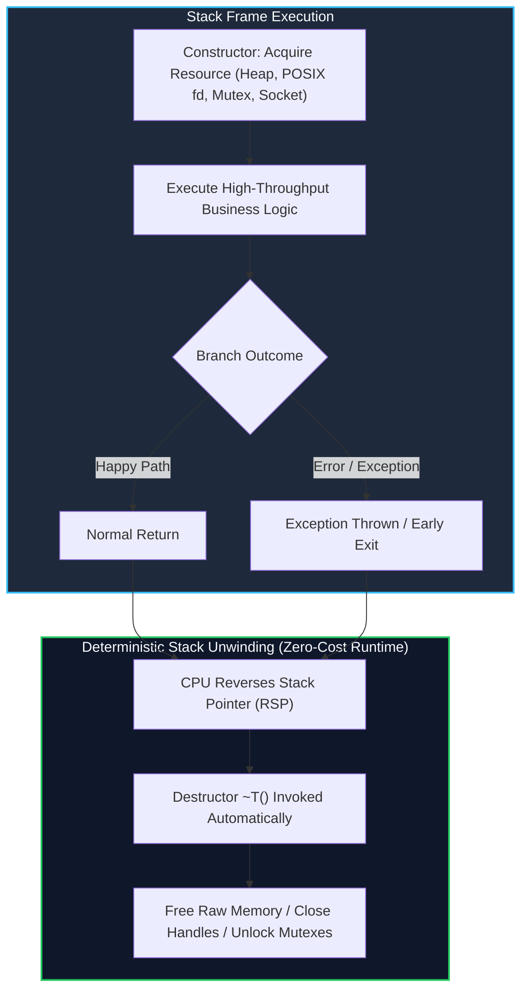
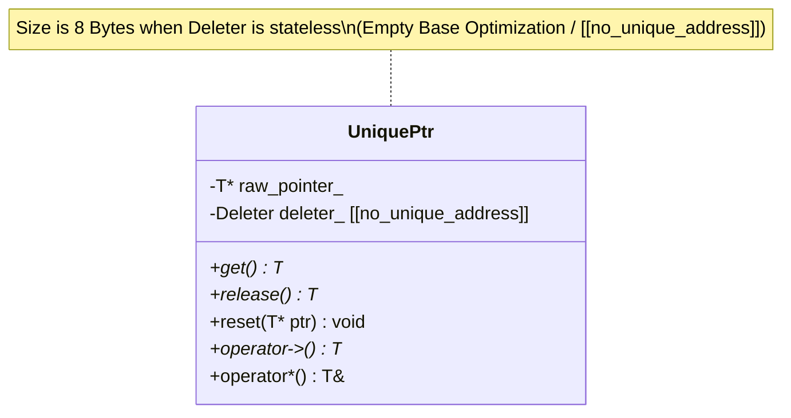
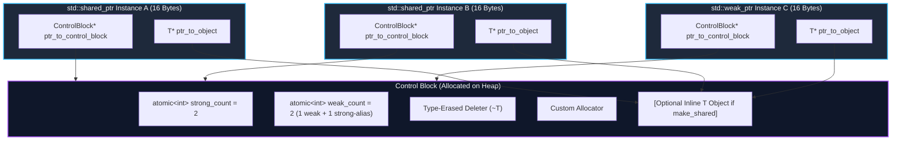
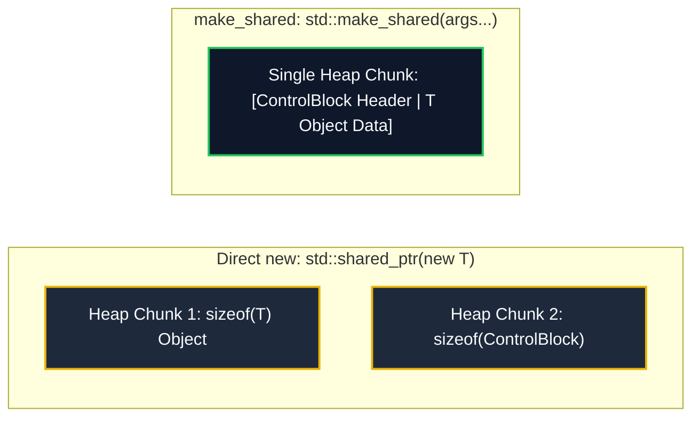
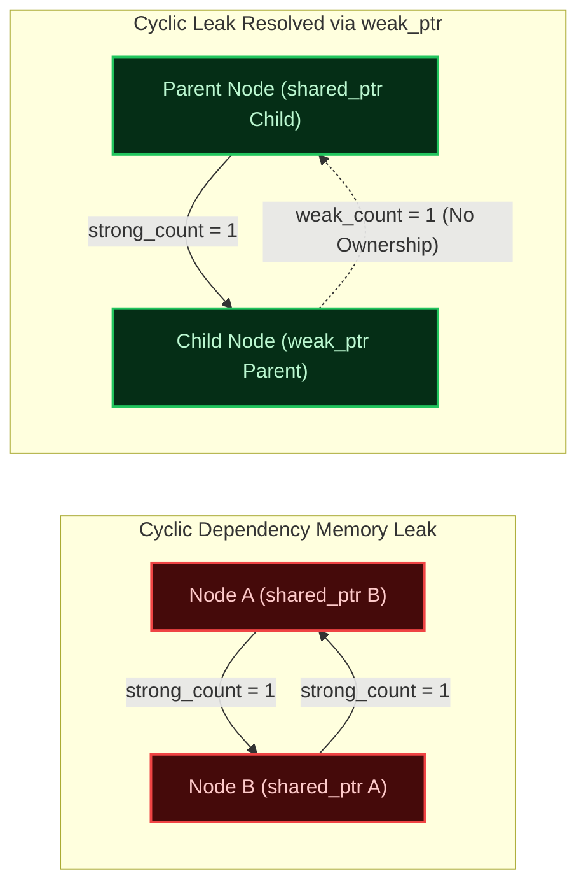
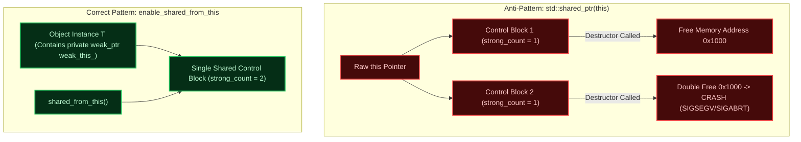
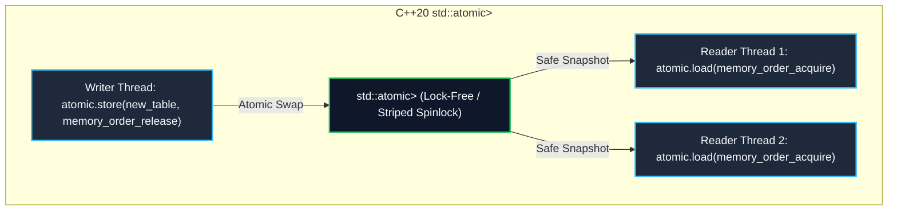

---


title: "C++ RAII & Smart Pointers: Unique, Shared, Weak, Custom Deleters & Atomics"
description: "Comprehensive production guide to Resource Acquisition Is Initialization (RAII), ownership semantics, control block architecture, custom deleters, enable_shared_from_this, and C++20 atomic smart pointers."
category: "Systems Programming & C++"
tags: [cpp, raii, smart-pointers, memory-management, systems-programming, low-latency, multithreading, technical-skills, software-engineering, learning-note]
date: "2026-08-21"
---

# 🛡️ C++ RAII & Smart Pointers Architecture

> 🔙 **Previous Module**: [[02_Technical_Skills/01_theory_and_concepts/08_Systems_and_CPlusPlus/00_cpp_virtual_memory_address_space_and_raii|00 Virtual Memory Address Space & RAII]]
> 📁 **Folder Hub**: [[00_Meta/05_folder_nodes/node_08_Systems_and_CPlusPlus|08 Systems & C++ Hub]]
> 🔀 **Next Topics**: [[02_Technical_Skills/01_theory_and_concepts/08_Systems_and_CPlusPlus/02_cpp_custom_memory_allocators|Custom Memory Allocators]] | [[02_Technical_Skills/01_theory_and_concepts/08_Systems_and_CPlusPlus/03_cpp_move_semantics_and_perfect_forwarding|Move Semantics & Perfect Forwarding]]

---

## 1. Executive Overview & The Invariant of RAII

In native systems programming, **Resource Acquisition Is Initialization (RAII)**—also known as *Scope-Bound Resource Management (SBRM)*—is the foundational idiom guaranteeing deterministic resource lifetimes without a garbage collector. Bjarne Stroustrup designed RAII around a strict invariant: **the lifetime of an acquired resource is bound directly to the lifetime of a stack-allocated object**.

### 1.1 The Classical Memory & Resource Leak Problem

In languages lacking deterministic destructors or in legacy C-style C++, resource acquisition is separated from resource release. Consider an error-prone workflow:

```text
[Allocate Heap / Open Socket / Lock Mutex] 
       │
       ▼
[Execute Business Logic] ──(Exception Thrown / Early Return)──✖ (Resource Leaked!)
       │
       ▼
[Manual Free / Close / Unlock] (Never Reached)
```

RAII eliminates this vulnerability by binding cleanup to **Stack Unwinding**. When an execution frame exits—whether via a normal return, `break`, `goto`, or an uncaught exception—the CPU automatically invokes destructors (`~T()`) for all automatic storage objects in reverse order of their construction.



### 1.2 Exception Safety Guarantees in Modern C++

RAII forms the backbone for the four levels of exception safety defined in systems engineering:

| Exception Guarantee Level | Invariant & Operational Contract | RAII Role & Mechanisms |
| :--- | :--- | :--- |
| **Nothrow / No-fail (`noexcept`)** | Operations are guaranteed to succeed and will never throw exceptions. Destructors and move operations **must** be `noexcept`. | Smart pointer swaps, pointer resets, and handle releases run under `noexcept`. |
| **Strong Guarantee** | *Commit-or-rollback* semantics: if an exception occurs, the system state remains exactly as it was before the call. | Scope guards (`std::unique_ptr` holding uncommitted staging buffers) auto-release if an intermediate step fails. |
| **Basic Guarantee** | Invariants are preserved; no memory, handles, or locks are leaked, but internal data may be in a valid yet indeterminate state. | Default guarantee achieved automatically whenever all raw handles are enclosed in smart wrappers. |
| **No Guarantee** | Memory leaks, dangling pointers, corrupted invariants, or undefined behavior (UB). | Direct consequence of raw `new`/`delete` and manual handle tracking. |

---

## 2. `std::unique_ptr<T, Deleter>`: Zero-Cost Exclusive Ownership

`std::unique_ptr` enforces strict, exclusive ownership of a heap resource or system handle. It is non-copyable (its copy constructor and copy assignment operator are `= delete`) and move-only.

### 2.1 The Zero-Overhead Abstraction Principle

Under standard compilation with optimizations (`-O2` or `-O3`), a default `std::unique_ptr<T>` has **identically the same memory footprint and assembly output as a raw C pointer** (`sizeof(std::unique_ptr<T>) == sizeof(T*) == 8` bytes on 64-bit platforms).



### 2.2 Custom Deleters & Size Impact

A frequent pitfall in systems programming is supplying a function pointer as a custom deleter, which doubles the size of the smart pointer from 8 bytes to 16 bytes on 64-bit architectures because the instance must store the 8-byte function pointer.

To maintain zero runtime size overhead:
1. **Stateless Functors / Lambdas**: Use a struct with an `operator()` or a stateless lambda in a custom type. Modern compilers utilize C++20 `[[no_unique_address]]` or Empty Base Optimization (EBO) to allocate zero bytes for the deleter.
2. **Stateful Deleters**: Allocate space only when tracking arena IDs, pool instances, or metadata.

```cpp
#include <iostream>
#include <memory>
#include <cstdio>
#include <unistd.h>
#include <fcntl.h>

// 1. Stateful / Function Pointer Deleter: Size = 16 Bytes
using FilePtrFP = std::unique_ptr<FILE, int(*)(FILE*)>;

// 2. Zero-Cost Stateless Functor Deleter: Size = 8 Bytes
struct FileCloser {
    void operator()(FILE* fp) const noexcept {
        if (fp) {
            std::fclose(fp);
            std::cout << "[FileCloser] Native FILE stream closed.\n";
        }
    }
};
using ZeroCostFilePtr = std::unique_ptr<FILE, FileCloser>;

// 3. POSIX File Descriptor RAII Wrapper
struct PosixFdCloser {
    void operator()(int* fd) const noexcept {
        if (fd) {
            if (*fd >= 0) {
                ::close(*fd);
                std::cout << "[PosixFdCloser] Descriptor " << *fd << " closed.\n";
            }
            delete fd;
        }
    }
};
```

---

## 3. `std::shared_ptr<T>`: Control Block Architecture & Reference Counting

`std::shared_ptr` provides reference-counted shared ownership. The resource is destroyed when the last owning `std::shared_ptr` is destroyed or reassigned.

### 3.1 Anatomy of the Control Block

A `std::shared_ptr` instance consists of **two pointers** (16 bytes on 64-bit systems):
1. A pointer to the managed object `T*`.
2. A pointer to the heap-allocated **Control Block**.

The Control Block contains:
- `std::atomic<uint32_t> strong_refs`: Count of active `std::shared_ptr` instances managing the object.
- `std::atomic<uint32_t> weak_refs`: Count of active `std::weak_ptr` instances plus 1 (the strong reference alias).
- **Custom Deleter**: Erased-type custom destruction logic.
- **Custom Allocator**: The allocator used to allocate the control block itself.
- **Managed Object Storage**: Stored inline if created via `std::make_shared`.



### 3.2 `std::make_shared` vs `std::shared_ptr<T>(new T)`

Understanding the memory layout difference between `std::make_shared` and direct `new` construction is critical for high-performance systems engineering:



| Dimension | `std::make_shared<T>` | `std::shared_ptr<T>(new T)` |
| :--- | :--- | :--- |
| **Heap Allocations** | **1 Allocation** (Control block and `T` allocated contiguously). | **2 Allocations** (One for `T`, one for the control block). |
| **Cache Locality** | **Superior** (`T` and reference counts share the same CPU cache line / page). | **Suboptimal** (Two disjoint memory regions; possible cache misses). |
| **Memory Deallocation Timing** | Delayed: Memory for `T` is destructed when `strong_refs == 0`, but the underlying block is only freed when `weak_refs == 0`. | Immediate: `T` memory is freed as soon as `strong_refs == 0`. Control block freed when `weak_refs == 0`. |
| **Custom Deleter Support** | Not supported directly via `make_shared` (`std::allocate_shared` required). | Fully supported in constructor: `std::shared_ptr<T>(ptr, custom_deleter)`. |

> [!CAUTION]
> **The Weak Pointer Memory Residency Caveat**: If you create a 50 MB object with `std::make_shared` and a long-lived `std::weak_ptr` observes it, the 50 MB of memory will **not** be returned to the OS allocator even after `~T()` runs. The 50 MB block remains occupied until the `weak_ptr` expires. In memory-constrained systems with large objects and lingering weak observers, prefer direct `std::shared_ptr<T>(new T)`.

---

## 4. `std::weak_ptr<T>`: Non-Owning Observers & Cycle Breaking

A `std::weak_ptr` models a non-owning observer of a `std::shared_ptr`. It does not increment `strong_refs`, preventing circular reference memory leaks.

### 4.1 Cyclic Reference Deadlocks

When two objects hold `std::shared_ptr` references to each other, neither reference count can ever reach zero, leading to an incurable memory and resource leak:



### 4.2 Safe Upgrading via `.lock()`

Because the underlying object can be destroyed concurrently by another thread, accessing the data from a `std::weak_ptr` requires promoting it to a `std::shared_ptr` atomically via `.lock()`:

```cpp
std::weak_ptr<Session> weak_session = session_ptr;

// Atomic promotion: thread-safe check and acquire
if (std::shared_ptr<Session> active = weak_session.lock()) {
    active->send_heartbeat();
} else {
    // Target object has already been destroyed
    std::cout << "[Observer] Session expired, removing from listener list.\n";
}
```

---

## 5. `std::enable_shared_from_this<T>`: Mechanics & Safe Idioms

When an object managed by a `std::shared_ptr` needs to pass a `std::shared_ptr<T>` referencing itself (e.g., registering callbacks, async event loops), passing `std::shared_ptr<T>(this)` is catastrophic: it creates a **second, disjoint control block**, causing a double-free when both control blocks reach count zero.



### 5.1 Internal Mechanics & Factory Function Pattern

Inheriting from `std::enable_shared_from_this<T>` injects an internal private member `std::weak_ptr<T> weak_this_`. During construction of the first `std::shared_ptr<T>`, the smart pointer constructor detects this base class and initializes `weak_this_`.

> [!WARNING]
> Calling `shared_from_this()` inside the constructor of `T` causes `std::bad_weak_ptr` because `weak_this_` has not yet been initialized by `std::shared_ptr`'s constructor. Always enforce a private constructor and a static factory method (e.g., `create()`).

---

## 6. C++20 Atomic Smart Pointers: `std::atomic<std::shared_ptr<T>>`

Before C++20, modifying a `std::shared_ptr` concurrently from multiple threads required clumsy global free functions (`std::atomic_store`, `std::atomic_load`) which were prone to data races if any thread accidentally accessed the pointer directly.

C++20 introduced primary template specializations:
- `std::atomic<std::shared_ptr<T>>`
- `std::atomic<std::weak_ptr<T>>`

These provide first-class lock-free (or internally lock-striped) concurrent pointer exchange, enabling lock-free read-copy-update (RCU) algorithms in high-throughput systems.



---

## 7. Production-Grade C++20 Implementation

The following complete, zero-allocation, thread-safe implementation demonstrates:
1. Custom RAII socket descriptor management.
2. Safe event dispatching using `std::enable_shared_from_this` and `std::weak_ptr`.
3. High-throughput configuration hot-reloading using C++20 `std::atomic<std::shared_ptr<T>>`.

```cpp
#include <iostream>
#include <memory>
#include <string>
#include <vector>
#include <atomic>
#include <thread>
#include <chrono>
#include <concepts>
#include <span>
#include <functional>

// ============================================================================
// 1. Zero-Overhead Custom Deleter RAII Network Socket
// ============================================================================
struct SocketDeleter {
    void operator()(int* fd) const noexcept {
        if (fd) {
            if (*fd >= 0) {
                std::cout << "[RAII SocketDeleter] Closing kernel socket FD: " << *fd << "\n";
                // On POSIX: ::close(*fd);
            }
            delete fd;
        }
    }
};

using UniqueSocket = std::unique_ptr<int, SocketDeleter>;

UniqueSocket create_native_socket(int simulated_fd) {
    return UniqueSocket(new int(simulated_fd), SocketDeleter{});
}

// ============================================================================
// 2. Safe Event Dispatcher with enable_shared_from_this
// ============================================================================
class NetworkSession;

class EventBus {
public:
    void register_listener(std::weak_ptr<NetworkSession> listener) {
        listeners_.push_back(std::move(listener));
    }

    void dispatch_event(std::string_view payload);

private:
    std::vector<std::weak_ptr<NetworkSession>> listeners_;
};

class NetworkSession : public std::enable_shared_from_this<NetworkSession> {
public:
    // Factory method enforcing proper control-block instantiation
    static std::shared_ptr<NetworkSession> create(uint64_t session_id, UniqueSocket socket) {
        return std::shared_ptr<NetworkSession>(new NetworkSession(session_id, std::move(socket)));
    }

    void attach_to_bus(EventBus& bus) {
        // Safe: weak_this_ is already initialized
        bus.register_listener(weak_from_this());
    }

    void on_event(std::string_view payload) {
        std::cout << "[Session " << session_id_ << "] Received event: " << payload << "\n";
    }

    uint64_t id() const noexcept { return session_id_; }

    ~NetworkSession() {
        std::cout << "[Session " << session_id_ << "] Destructor invoked.\n";
    }

private:
    explicit NetworkSession(uint64_t session_id, UniqueSocket socket)
        : session_id_(session_id), socket_(std::move(socket)) {}

    uint64_t session_id_;
    UniqueSocket socket_;
};

void EventBus::dispatch_event(std::string_view payload) {
    std::cout << "[EventBus] Broadcasting event to " << listeners_.size() << " registered observers...\n";
    for (auto it = listeners_.begin(); it != listeners_.end();) {
        if (auto session = it->lock()) {
            session->on_event(payload);
            ++it;
        } else {
            std::cout << "[EventBus] Pruning dead/expired session observer.\n";
            it = listeners_.erase(it);
        }
    }
}

// ============================================================================
// 3. High-Performance C++20 Atomic Configuration Manager (RCU Pattern)
// ============================================================================
struct RoutingConfig {
    std::string primary_endpoint;
    uint16_t port;
    uint32_t timeout_ms;

    void print() const {
        std::cout << "Config -> Endpoint: " << primary_endpoint 
                  << " | Port: " << port 
                  << " | Timeout: " << timeout_ms << "ms\n";
    }
};

class AtomicConfigRegistry {
public:
    explicit AtomicConfigRegistry(RoutingConfig initial)
        : active_config_(std::make_shared<RoutingConfig>(std::move(initial))) {}

    // Lock-free atomic snapshot retrieval for readers
    [[nodiscard]] std::shared_ptr<const RoutingConfig> get_config() const noexcept {
        return active_config_.load(std::memory_order_acquire);
    }

    // Atomic update for configuration hot-reload
    void update_config(RoutingConfig new_config) {
        auto new_ptr = std::make_shared<RoutingConfig>(std::move(new_config));
        active_config_.store(new_ptr, std::memory_order_release);
        std::cout << "[ConfigRegistry] Hot-reload complete.\n";
    }

private:
    std::atomic<std::shared_ptr<RoutingConfig>> active_config_;
};

// ============================================================================
// Main Systems Integration Pipeline
// ============================================================================
int main() {
    std::cout << "=== 1. Custom Deleter RAII Socket Verification ===\n";
    {
        UniqueSocket sock = create_native_socket(42);
        std::cout << "Socket FD: " << *sock << " is live.\n";
    } // sock destroyed here deterministically

    std::cout << "\n=== 2. enable_shared_from_this & weak_ptr Event Dispatch ===\n";
    EventBus bus;
    {
        auto session1 = NetworkSession::create(101, create_native_socket(501));
        auto session2 = NetworkSession::create(102, create_native_socket(502));

        session1->attach_to_bus(bus);
        session2->attach_to_bus(bus);

        bus.dispatch_event("SYNC_PACKET_ALPHA");

        std::cout << "--> Exiting session2 scope (Session 102 destroyed)...\n";
    } // session1 and session2 go out of scope, destroying their objects

    bus.dispatch_event("SYNC_PACKET_BETA"); // Pruning happens automatically

    std::cout << "\n=== 3. C++20 Atomic Smart Pointer RCU Pipeline ===\n";
    AtomicConfigRegistry config_mgr(RoutingConfig{"10.0.0.1", 8080, 250});

    std::thread reader_thread([&config_mgr]() {
        for (int i = 0; i < 3; ++i) {
            auto cfg = config_mgr.get_config();
            std::cout << "[Worker Thread Reader] ";
            cfg->print();
            std::this_thread::sleep_for(std::chrono::milliseconds(50));
        }
    });

    std::thread writer_thread([&config_mgr]() {
        std::this_thread::sleep_for(std::chrono::milliseconds(25));
        config_mgr.update_config(RoutingConfig{"192.168.1.100", 9443, 100});
    });

    reader_thread.join();
    writer_thread.join();

    return 0;
}
```

---

## 8. Smart Pointer Comparative Architecture & Performance Matrix

| Metric / Dimension | Raw Pointer (`T*`) | `std::unique_ptr<T>` | `std::shared_ptr<T>` | `std::weak_ptr<T>` | `std::atomic<std::shared_ptr<T>>` |
| :--- | :--- | :--- | :--- | :--- | :--- |
| **Size (64-bit ABI)** | 8 Bytes | 8 Bytes (stateless deleter) | 16 Bytes (Ptr + ControlBlock) | 16 Bytes (Ptr + ControlBlock) | 16 Bytes (Native or lock-striped) |
| **Heap Allocations** | 1 (`new T`) | 1 (`new T`) | 1 (`make_shared`) / 2 (`new T`) | 0 (Observes existing CB) | 1 per published snapshot |
| **Dereference Cost** | $O(1)$ (1 memory dereference) | $O(1)$ (Direct assembly load) | $O(1)$ (Direct memory dereference) | Inaccessible directly (Must `.lock()`) | $O(1)$ via atomic load |
| **Copy Cost** | 1 CPU register copy | N/A (Compile error) | Atomic increment (`fetch_add`) | Atomic increment (`fetch_add`) | N/A (Atomic copy-load) |
| **Move Cost** | 1 CPU register copy | 1 pointer write + nullify | 2 pointer writes + nullify | 2 pointer writes + nullify | Move disabled |
| **Thread Safety** | None | Non-thread-safe | Control block RefCounts are thread-safe; object is not | Control block WeakCounts are thread-safe | Entire pointer swap is atomic & thread-safe |
| **Primary Systems Use Case** | Low-level hardware drivers | Exclusive resource lifetime | Shared multi-owner graphs | Break cycles & cache observers | Lock-free RCU config/routing tables |

---

## 9. Systems Engineering Pitfalls & Checklist

1. ❌ **Direct `new` in Function Arguments**:
   ```cpp
   // Anti-pattern: If compute_priority() throws, memory leaked!
   process_task(std::shared_ptr<Task>(new Task()), compute_priority());
   
   // Production-standard:
   process_task(std::make_shared<Task>(), compute_priority());
   ```
2. ❌ **Passing `std::shared_ptr` by Value Everywhere**:
   Passing `shared_ptr` by value incurs two atomic operations (`lock xadd` instructions on x86-64) per copy, which serializes CPU store buffers and degrades performance. Pass by `const std::shared_ptr<T>&` when observing without taking ownership, or pass `T&` directly.
3. ❌ **Creating `shared_ptr` from `this` without Base Class**:
   Always inherit from `std::enable_shared_from_this<T>` and make constructors `private` or `protected` to enforce factory creation.
4. ❌ **Overlooking Weak Pointer Memory Retention**:
   Remember that `std::make_shared` fuses the control block and object into one contiguous allocation. Large objects observed by persistent `weak_ptr` instances will not release their memory block until all weak pointers are destroyed.

---

## 🔬 Related Knowledge & Graph Navigation
- 🔀 **Next Module**: [[02_Technical_Skills/01_theory_and_concepts/08_Systems_and_CPlusPlus/02_cpp_custom_memory_allocators|Custom Memory Allocators]]
- ⚙️ **Underlying Concurrency**: [[02_Technical_Skills/01_theory_and_concepts/08_Systems_and_CPlusPlus/04_cpp_memory_barriers_atomics_lock_free|Memory Barriers & Atomics]]
- 🚀 **Zero-Copy Optimization**: [[02_Technical_Skills/01_theory_and_concepts/08_Systems_and_CPlusPlus/03_cpp_move_semantics_and_perfect_forwarding|Move Semantics & Perfect Forwarding]]
