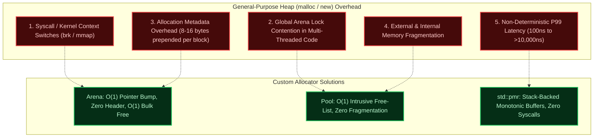
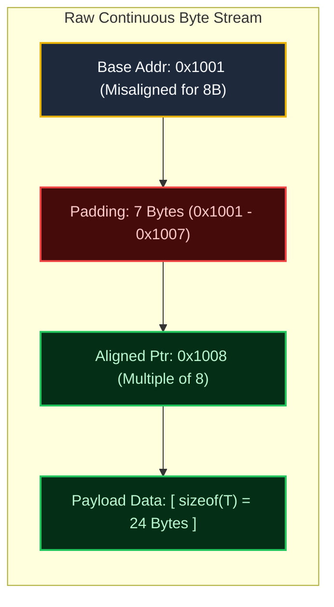
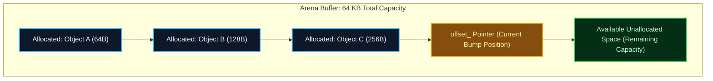
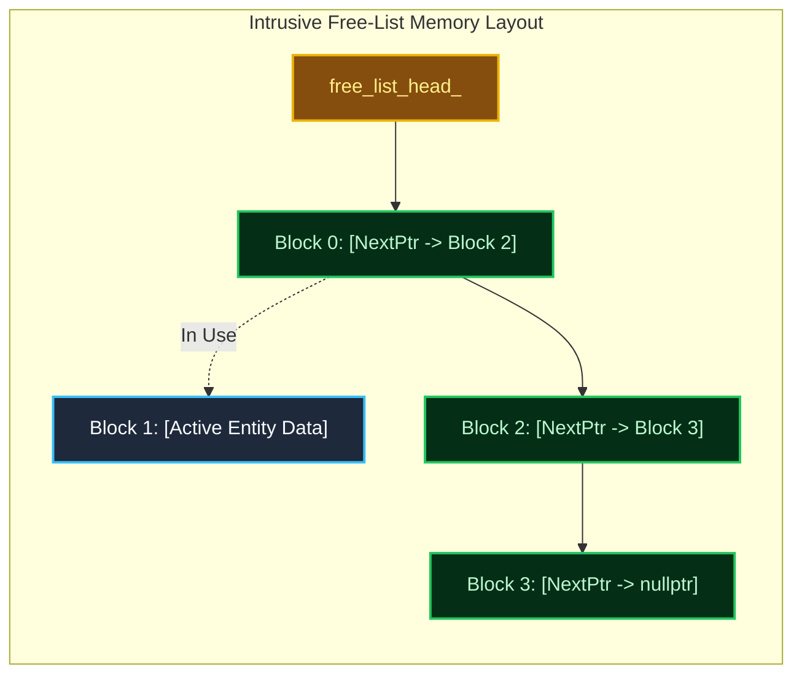
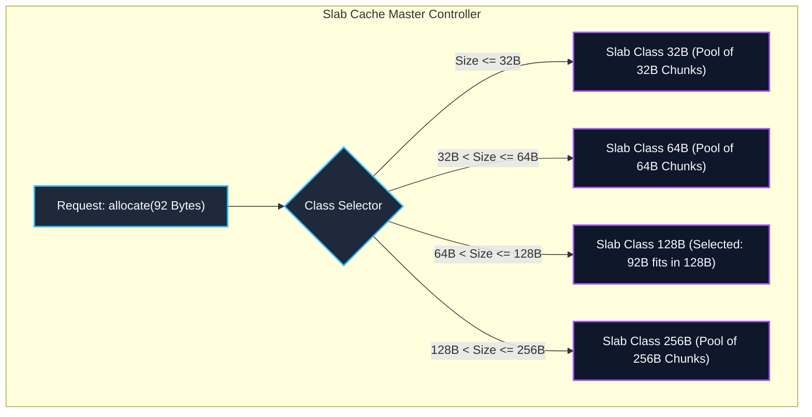
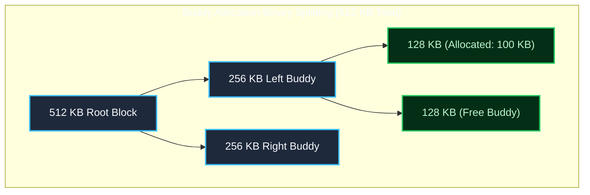
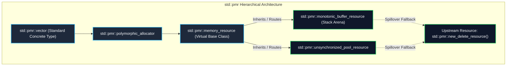

---


title: "Custom Memory Allocators: Arena, Pool, Slab, Buddy & std::pmr in C++"
description: "Master-level production guide to high-performance custom memory allocators in C++20: Monotonic Arenas, Free-List Pool Allocators, Slab & Buddy systems, hardware alignment, and Polymorphic Memory Resources (std::pmr)."
category: "Systems Programming & C++"
tags: [cpp, memory-allocators, arena-allocator, pool-allocator, slab-allocator, buddy-allocator, pmr, low-latency, systems-programming, technical-skills, software-engineering, learning-note]
date: "2026-08-21"
---

# ⚡ Custom Memory Allocators in Modern C++

> 🔙 **Folder Hub**: [[00_Meta/05_folder_nodes/node_08_Systems_and_CPlusPlus|08 Systems & C++ Hub]]
> ⬅️ **Previous Module**: [[02_Technical_Skills/01_theory_and_concepts/08_Systems_and_CPlusPlus/01_cpp_raii_and_smart_pointers|01 C++ RAII & Smart Pointers]]
> 🔀 **Related Modules**: [[02_Technical_Skills/01_theory_and_concepts/08_Systems_and_CPlusPlus/00_cpp_virtual_memory_address_space_and_raii|00 Virtual Memory Address Space & RAII]] | [[02_Technical_Skills/01_theory_and_concepts/08_Systems_and_CPlusPlus/06_cpp_cache_conscious_data_oriented_design|06 Cache-Conscious Data-Oriented Design]]

---

## 1. Executive Overview: The Cost of General-Purpose Allocation

General-purpose heap allocators (such as GNU `glibc`'s `ptmalloc`, Google's `tcmalloc`, or FreeBSD's `jemalloc`) are engineered for generic, multi-threaded workloads. While robust, their design imposes severe penalties on latency-critical systems (such as High-Frequency Trading, game engines, autonomous driving, and real-time audio synthesis):



### 1.1 Memory Fragmentation Mechanics

General allocators suffer from two forms of degradation over extended uptimes:
- **Internal Fragmentation**: Wasted space within an allocated block due to minimum chunk sizes or alignment rounding.
- **External Fragmentation**: Free memory is scattered in non-contiguous microscopic holes throughout the address space, causing allocations of large contiguous buffers to fail (`std::bad_alloc`) even when total free memory is abundant.

```text
[ Allocated 64B ] [ Free 32B ] [ Allocated 128B ] [ Free 16B ] [ Allocated 64B ]
Total Free Memory = 48 Bytes.
Attempting to allocate 40 Bytes -> FAILS (No single contiguous 40B segment available!)
```

Custom allocators solve this by tailoring memory layouts to the known lifetime and size distribution of specific data structures.

---

## 2. Hardware Realities & Memory Alignment Arithmetic

Modern CPU architectures (x86-64, ARMv8/v9) access physical memory via a multi-tiered cache hierarchy ($L1, L2, L3$) organized into **64-byte Cache Lines**. Misaligned memory accesses force the memory controller to execute two bus cycles across cache line boundaries, causing severe instruction stall penalties.

### 2.1 Pointer Alignment Bitwise Arithmetic

To align an arbitrary memory address `addr` to a power-of-two alignment $A$, we apply bitwise masking:

$$\text{Aligned Address} = (\text{addr} + (A - 1)) \ \& \ \sim(A - 1)$$

$$\text{Required Padding} = (A - (\text{addr} \pmod A)) \pmod A$$

```cpp
#include <cstdint>
#include <cstddef>

inline uintptr_t align_forward(uintptr_t ptr, size_t alignment) noexcept {
    // Alignment MUST be a power of 2
    return (ptr + (alignment - 1)) & ~(alignment - 1);
}

inline size_t calculate_padding(uintptr_t ptr, size_t alignment) noexcept {
    size_t modulo = ptr & (alignment - 1); // Fast bitwise modulo for power-of-2
    return (modulo == 0) ? 0 : (alignment - modulo);
}
```



---

## 3. Core Allocator Architectures: Deep Dive

### 3.1 Pattern 1: Arena / Bump / Monotonic Allocator

The **Arena Allocator** pre-allocates a large contiguous memory region. Individual allocations simply advance an offset pointer by the requested byte count plus alignment padding.

- **Allocation Complexity**: $\mathcal{O}(1)$ (typically 2 CPU assembly instructions: add + store).
- **Deallocation**: Individual deallocation is a no-op ($\mathcal{O}(0)$). All memory is reclaimed simultaneously in $\mathcal{O}(1)$ via `reset()`.
- **Ideal Use Cases**: Frame allocators in video games, HTTP request lifecycles in web engines, compiler AST parsing phases.



---

### 3.2 Pattern 2: Fixed-Size Block (Pool) Allocator

When an application frequently creates and destroys objects of the exact same type (e.g., ECS entities, network packet descriptors, order book transactions), a **Pool Allocator** achieves maximum throughput and zero fragmentation.

#### The Intrusive Free-List Trick
Rather than allocating separate memory for tracking pointers, the allocator embeds a pointer to the next free block **inside the unallocated memory block itself**. When a block is occupied, the application data overwrites this pointer. When freed, the pointer is restored.



- **Allocation**: Pop head from `free_list_head_` ($\mathcal{O}(1)$).
- **Deallocation**: Push returned pointer to `free_list_head_` ($\mathcal{O}(1)$).
- **Spatial Overhead**: Exactly **0 bytes** per element metadata overhead!

---

### 3.3 Pattern 3: Slab Allocator

Pioneered by Jeff Bonwick in the Solaris kernel, the **Slab Allocator** extends the Pool Allocator concept by maintaining an array of distinct pools ("slabs"), each configured for a specific power-of-two size class (e.g., 32B, 64B, 128B, 256B, 512B, 1024B).



---

### 3.4 Pattern 4: Buddy Allocator

The **Buddy Allocator** manages memory in power-of-two blocks. When an allocation request arrives:
1. The allocator searches for a free block of the smallest power-of-two size that satisfies the request.
2. If no block is available, it splits a larger block into two equal halves called **Buddies**.
3. Upon deallocation, the allocator calculates the address of the block's buddy using a simple bitwise XOR:
   $$\text{Buddy Address} = \text{Block Address} \oplus \text{Block Size}$$
4. If the buddy is also free, they are recursively merged into a single block, eliminating fragmentation.



---

## 4. Modern C++17/20 Polymorphic Memory Resources (`std::pmr`)

Prior to C++17, changing a container's allocator required changing the container's type (e.g., `std::vector<int, MyAllocator<int>>` was an entirely incompatible type from `std::vector<int>`).

C++17 resolved this by introducing **`std::pmr` (Polymorphic Memory Resources)**, which leverages dynamic dispatch (runtime polymorphism via virtual methods) to decouple the container from the underlying memory resource.



### 4.1 Stack-Backed Zero-Heap Chaining with PMR

By chaining a `std::pmr::monotonic_buffer_resource` to a stack buffer, modern C++ code can execute vector operations, string formatting, and map lookups **entirely on the CPU stack with zero heap allocation calls**:

```cpp
#include <iostream>
#include <memory_resource>
#include <vector>
#include <array>

void process_batch_pmr() {
    // 1. Pre-allocate 4 KB directly on the CPU stack
    std::array<std::byte, 4096> stack_buffer;

    // 2. Wrap the stack buffer in a monotonic PMR resource
    std::pmr::monotonic_buffer_resource mem_pool(
        stack_buffer.data(), 
        stack_buffer.size(), 
        std::pmr::null_memory_resource() // Disallow heap spillover (throws bad_alloc)
    );

    // 3. PMR vector operates directly inside stack_buffer!
    std::pmr::vector<int> numbers(&mem_pool);
    for (int i = 0; i < 100; ++i) {
        numbers.push_back(i * 10);
    }

    std::cout << "Successfully processed " << numbers.size() 
              << " elements on stack without a single heap allocation!\n";
}
```

---

## 5. Production-Grade C++20 Implementations

The following complete program implements:
1. A **High-Performance Intrusive Free-List Pool Allocator** with alignment enforcement and template type safety.
2. A **Custom PMR Memory Resource Adapter** routing custom arena allocations to standard STL containers.

```cpp
#include <iostream>
#include <memory>
#include <memory_resource>
#include <vector>
#include <cstddef>
#include <cstdint>
#include <new>
#include <concepts>
#include <utility>
#include <chrono>

// ============================================================================
// 1. High-Performance Intrusive Free-List Fixed-Size Pool Allocator
// ============================================================================
template <typename T, size_t BlockCount>
class FixedPoolAllocator {
public:
    static_assert(sizeof(T) >= sizeof(void*), "Type size must be at least pointer-sized for intrusive free-list.");

    FixedPoolAllocator() : free_head_(nullptr) {
        // Allocate raw contiguous aligned memory block
        raw_storage_ = static_cast<std::byte*>(::operator new(
            TotalBytes, 
            std::align_val_t{alignof(StorageNode)}
        ));
        reset();
    }

    ~FixedPoolAllocator() noexcept {
        ::operator delete(raw_storage_, std::align_val_t{alignof(StorageNode)});
    }

    // Non-copyable, Non-movable for pointer stability
    FixedPoolAllocator(const FixedPoolAllocator&) = delete;
    FixedPoolAllocator& operator=(const FixedPoolAllocator&) = delete;

    template <typename... Args>
    [[nodiscard]] T* allocate(Args&&... args) {
        if (!free_head_) {
            throw std::bad_alloc(); // Pool exhausted
        }

        // Pop from intrusive free-list
        Node* node = free_head_;
        free_head_ = free_head_->next;

        // Construct object in-place via placement new
        T* object_ptr = reinterpret_cast<T*>(node);
        ::new (static_cast<void*>(object_ptr)) T(std::forward<Args>(args)...);
        return object_ptr;
    }

    void deallocate(T* ptr) noexcept {
        if (!ptr) return;

        // Explicitly invoke destructor
        ptr->~T();

        // Push back onto intrusive free-list
        Node* node = reinterpret_cast<Node*>(ptr);
        node->next = free_head_;
        free_head_ = node;
    }

    void reset() noexcept {
        // Link all contiguous nodes sequentially
        free_head_ = reinterpret_cast<Node*>(raw_storage_);
        Node* curr = free_head_;
        for (size_t i = 0; i < BlockCount - 1; ++i) {
            std::byte* next_addr = raw_storage_ + ((i + 1) * NodeSize);
            curr->next = reinterpret_cast<Node*>(next_addr);
            curr = curr->next;
        }
        curr->next = nullptr;
    }

    [[nodiscard]] constexpr size_t capacity() const noexcept { return BlockCount; }

private:
    union Node {
        Node* next;
        alignas(alignof(T)) std::byte storage[sizeof(T)];
    };

    struct alignas(alignof(T)) StorageNode {
        Node node;
    };

    static constexpr size_t NodeSize = sizeof(StorageNode);
    static constexpr size_t TotalBytes = NodeSize * BlockCount;

    std::byte* raw_storage_;
    Node* free_head_;
};

// ============================================================================
// 2. Custom Stack-Backed PMR Memory Resource
// ============================================================================
template <size_t ArenaSize>
class StackArenaResource : public std::pmr::memory_resource {
public:
    StackArenaResource() : offset_(0) {}

    void reset() noexcept { offset_ = 0; }

protected:
    void* do_allocate(size_t bytes, size_t alignment) override {
        uintptr_t current_addr = reinterpret_cast<uintptr_t>(arena_buffer_ + offset_);
        size_t padding = (alignment - (current_addr % alignment)) % alignment;

        if (offset_ + padding + bytes > ArenaSize) {
            std::cout << "[StackArenaResource] Capacity exceeded! Spilling to upstream.\n";
            return std::pmr::get_default_resource()->allocate(bytes, alignment);
        }

        offset_ += padding;
        void* ptr = arena_buffer_ + offset_;
        offset_ += bytes;
        return ptr;
    }

    void do_deallocate(void* ptr, size_t bytes, size_t alignment) override {
        // Arena bulk-frees; individual deallocation is a no-op
        (void)ptr; (void)bytes; (void)alignment;
    }

    bool do_is_equal(const std::pmr::memory_resource& other) const noexcept override {
        return this == &other;
    }

private:
    alignas(64) std::byte arena_buffer_[ArenaSize]; // 64-byte aligned for cache line
    size_t offset_;
};

// ============================================================================
// 3. Systems Benchmark & Validation Pipeline
// ============================================================================
struct OrderPacket {
    uint64_t order_id;
    double price;
    uint32_t quantity;
    char symbol[8];

    OrderPacket(uint64_t id, double p, uint32_t q, const char* s)
        : order_id(id), price(p), quantity(q) {
        std::snprintf(symbol, sizeof(symbol), "%s", s);
    }
};

int main() {
    std::cout << "=== 1. Fixed-Size Free-List Pool Allocator Test ===\n";
    {
        FixedPoolAllocator<OrderPacket, 1024> order_pool;

        // Allocate elements
        OrderPacket* p1 = order_pool.allocate(1001ULL, 142.50, 100, "AAPL");
        OrderPacket* p2 = order_pool.allocate(1002ULL, 320.10, 50, "MSFT");

        std::cout << "Allocated Order 1: ID=" << p1->order_id << " Sym=" << p1->symbol << " at " << p1 << "\n";
        std::cout << "Allocated Order 2: ID=" << p2->order_id << " Sym=" << p2->symbol << " at " << p2 << "\n";

        // Deallocate in reverse order
        order_pool.deallocate(p1);
        order_pool.deallocate(p2);

        // Re-allocation should reuse the head of the free-list
        OrderPacket* p3 = order_pool.allocate(1003ULL, 275.00, 200, "NVDA");
        std::cout << "Reallocated Order 3: ID=" << p3->order_id << " at reused address " << p3 << "\n";

        order_pool.deallocate(p3);
    }

    std::cout << "\n=== 2. std::pmr Custom Stack Arena Integration ===\n";
    {
        StackArenaResource<8192> stack_arena; // 8 KB stack arena
        std::pmr::vector<OrderPacket> fast_orders(&stack_arena);

        for (int i = 0; i < 50; ++i) {
            fast_orders.emplace_back(2000ULL + i, 100.0 + i, 10, "GOOG");
        }

        std::cout << "PMR Vector stored " << fast_orders.size() 
                  << " orders with zero kernel malloc overhead.\n";
    }

    return 0;
}
```

---

## 6. Custom Allocator Architecture Comparative Matrix

| Allocator Strategy | Allocation Complexity | Deallocation Complexity | Spatial Overhead | Fragmentation Vulnerability | Thread Safety Overhead |
| :--- | :--- | :--- | :--- | :--- | :--- |
| **`malloc` / `new` (General)** | $\mathcal{O}(1)$ avg / $\mathcal{O}(N)$ worst | $\mathcal{O}(1)$ | 8–16 bytes header/chunk | High (External & Internal) | High (Mutex / Thread Arena locks) |
| **Arena / Bump** | $\mathcal{O}(1)$ (2-3 CPU instructions) | $\mathcal{O}(0)$ individual / $\mathcal{O}(1)$ bulk | **0 Bytes** | Zero external; Internal upon reset | Thread-local (Zero locks) or `std::atomic` bump |
| **Fixed Pool (Free-List)** | $\mathcal{O}(1)$ (Pointer pop) | $\mathcal{O}(1)$ (Pointer push) | **0 Bytes** (Intrusive pointers) | **Zero** | Lock-free CAS free-list possible |
| **Slab Allocator** | $\mathcal{O}(1)$ bucket index lookup | $\mathcal{O}(1)$ slab return | Very Low (Bucket metadata) | Low (Binned by power of 2) | Per-CPU / Per-thread slab queues |
| **Buddy Allocator** | $\mathcal{O}(\log N)$ binary tree split | $\mathcal{O}(\log N)$ coalescing | Low (Tree bitmask) | Low (Guaranteed mergeable blocks) | Coarse-grained mutex required |
| **`std::pmr` Stack Resource** | $\mathcal{O}(1)$ bump in stack array | $\mathcal{O}(0)$ no-op | **0 Bytes** | None (Stack frame lifetime) | Single-threaded per stack frame |

---

## 7. Systems Engineering Rules & Memory Checklists

1. 🎯 **Enforce Mechanical Alignment**: Always align custom allocations to `alignof(T)`. For SIMD operations (AVX-512), explicitly enforce 64-byte alignment (`alignas(64)`).
2. 🎯 **Prefer Stack PMR for Ephemeral Data**: Use `std::pmr::monotonic_buffer_resource` with a stack `std::array<std::byte, N>` for request-scoped structures.
3. 🎯 **Guard Against Pool Destructor Leaks**: In fixed pool allocators, if individual `deallocate()` calls are skipped, ensure the allocator's destructor properly tracks and destructs non-trivially destructible objects (or restrict the pool to `std::is_trivially_destructible_v<T>`).
4. 🎯 **Prevent False Sharing**: When deploying multi-threaded allocators, ensure distinct thread allocator instances sit on separate 64-byte cache lines using `alignas(hardware_destructive_interference_size)`.

---

## 🔬 Related Knowledge & Graph Navigation
- 🛡️ **Resource Safety**: [[02_Technical_Skills/01_theory_and_concepts/08_Systems_and_CPlusPlus/01_cpp_raii_and_smart_pointers|RAII & Smart Pointers]]
- 🏎️ **Cache Optimization**: [[02_Technical_Skills/01_theory_and_concepts/08_Systems_and_CPlusPlus/06_cpp_cache_conscious_data_oriented_design|Cache-Conscious Data-Oriented Design]]
- ⚡ **Lock-Free Concurrency**: [[02_Technical_Skills/01_theory_and_concepts/08_Systems_and_CPlusPlus/04_cpp_memory_barriers_atomics_lock_free|Memory Barriers & Atomics]]
