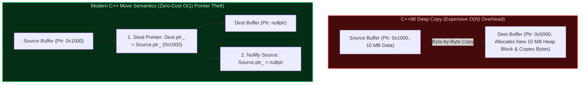
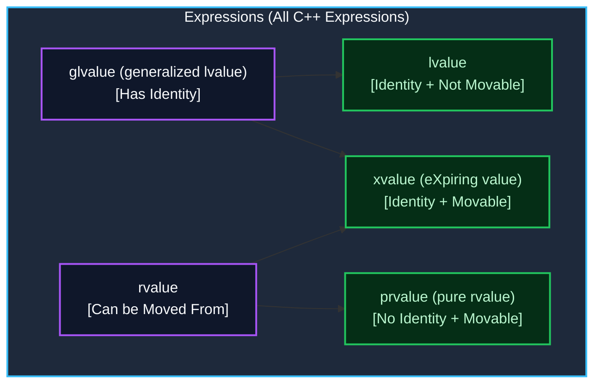
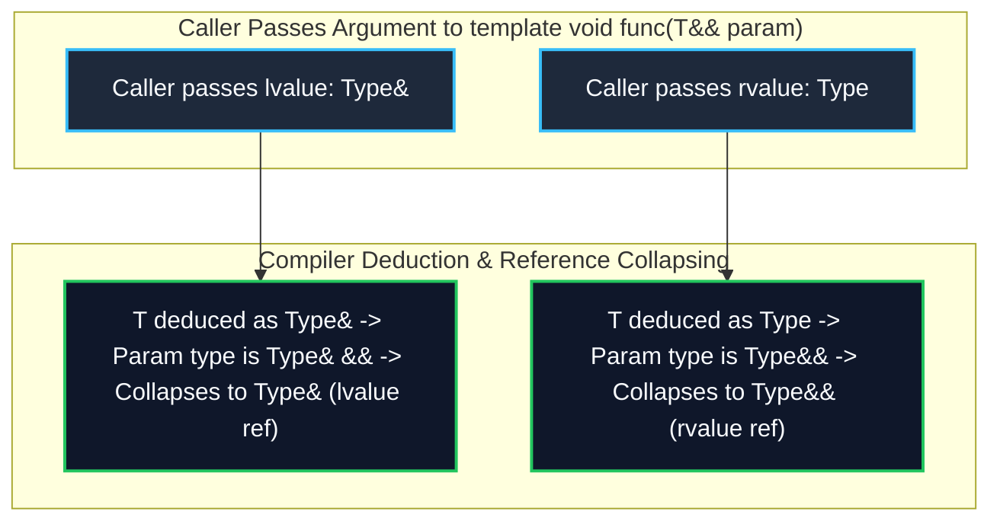
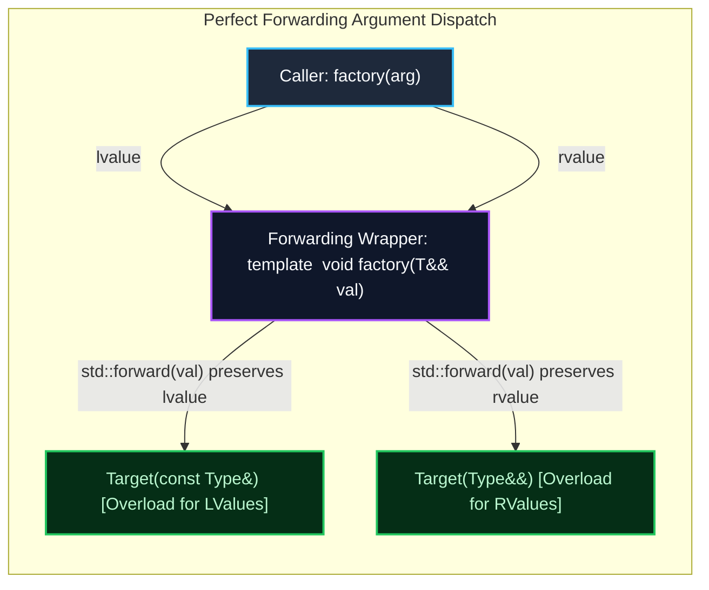
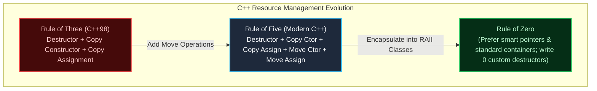

---


title: "Move Semantics, Rvalue References & Perfect Forwarding in C++20"
description: "Master-level production guide to C++ value categories (glvalue, prvalue, xvalue, lvalue), std::move, std::forward, reference collapsing, Rule of 5, and C++20 constrained forwarding."
category: "Systems Programming & C++"
tags: [cpp, move-semantics, rvalue-references, perfect-forwarding, zero-copy, rule-of-5, performance, technical-skills, software-engineering, learning-note]
date: "2026-08-21"
---

# 🚀 Move Semantics, Rvalue References & Perfect Forwarding

> 🔙 **Folder Hub**: [[00_Meta/05_folder_nodes/node_08_Systems_and_CPlusPlus|08 Systems & C++ Hub]]
> ⬅️ **Previous Module**: [[02_Technical_Skills/01_theory_and_concepts/08_Systems_and_CPlusPlus/02_cpp_custom_memory_allocators|02 Custom Memory Allocators]]
> 🔀 **Related Modules**: [[02_Technical_Skills/01_theory_and_concepts/08_Systems_and_CPlusPlus/01_cpp_raii_and_smart_pointers|01 RAII & Smart Pointers]] | [[02_Technical_Skills/01_theory_and_concepts/08_Systems_and_CPlusPlus/07_cpp_metaprogramming_templates_concepts|07 Templates & Concepts]]

---

## 1. Executive Overview: The Zero-Copy Imperative

In legacy C++98, returning large containers or passing temporary objects by value forced the compiler to perform **expensive deep copies**: allocating new heap blocks, copying every byte over the CPU memory bus, and then immediately deallocating the source temporary.

**Move Semantics** (introduced in C++11 and refined through C++17/20) transformed systems programming by enabling **Resource Theft (Pointer Stealing)**. Instead of cloning bytes, a move constructor transfers the internal raw pointer to the destination object and resets the source object's pointer to `nullptr` in $\mathcal{O}(1)$ time without touching heap allocators.



---

## 2. Complete C++ Value Categories Taxonomy

To write high-performance template code and understand when moves occur, every C++ expression is classified based on two fundamental orthogonal properties:
1. **Has Identity?**: Does the program have access to a memory address for the object?
2. **Can Be Moved From?**: Is the object an expiring temporary whose resources can be stolen?



### 2.1 The Five Value Categories Explained

| Category | Identity? | Movable? | Exact Definition & Practical Code Examples |
| :--- | :---: | :---: | :--- |
| **`lvalue`** | **Yes** | **No** | Named variables, persistent objects: `int x = 10; x;`, `*ptr`, `vec[0]`, function returning lvalue ref `T&`. |
| **`prvalue`** | **No** | **Yes** | Pure temporary computations: literals (`42`, `3.14`), function returning non-reference `T`, temporary `std::string("data")`, lambda `[](){}`. |
| **`xvalue`** | **Yes** | **Yes** | An object with identity marked explicitly for expiration: `std::move(var)`, `static_cast<T&&>(var)`, rvalue member access `move(obj).member`. |
| **`glvalue`** | **Yes** | — | Union of `lvalue` and `xvalue`. Expressions evaluating to a memory location. |
| **`rvalue`** | — | **Yes** | Union of `prvalue` and `xvalue`. Any expression that can safely be moved from. |

### 2.2 C++17 Guaranteed Copy Elision & `prvalue` Materialization

Since C++17, a `prvalue` is **not an object**; it is an *initializer expression*. Materialization of the object occurs only when the `prvalue` initializes a storage location. Thus, Return Value Optimization (RVO) for `prvalues` is **guaranteed by the language standard**, with zero copy or move constructors executed:

```cpp
struct HeavyResource {
    HeavyResource() { std::cout << "Constructed\n"; }
    HeavyResource(const HeavyResource&) { std::cout << "Copied\n"; }
    HeavyResource(HeavyResource&&) noexcept { std::cout << "Moved\n"; }
};

HeavyResource make_resource() {
    return HeavyResource(); // prvalue: Guaranteed Copy Elision in C++17/20
}

int main() {
    HeavyResource res = make_resource(); // EXACTLY 1 Constructor call! No move, no copy.
}
```

---

## 3. Rvalue References (`T&&`) & Reference Collapsing Rules

An **rvalue reference** `T&&` binds only to rvalues (temporaries or expressions cast with `std::move`).

### 3.1 Distinguishing Rvalue References from Forwarding References

A reference `T&&` is a **Forwarding Reference (Universal Reference)** *if and only if* type deduction is taking place:

```cpp
void process(std::string&& str); // Concrete Rvalue Reference (No type deduction)

template <typename T>
void route(T&& arg);             // Forwarding Reference (T is deduced by the compiler)

auto&& ref = compute();           // Forwarding Reference (auto type deduction)
```

### 3.2 The Reference Collapsing Invariant

When template argument deduction or `typedef`/`using` aliases cause references to references to form, the compiler collapses them according to the **Reference Collapsing Rules**:

$$\& + \& \longrightarrow \&$$
$$\& + \&\& \longrightarrow \&$$
$$\&\& + \& \longrightarrow \&$$
$$\&\& + \&\& \longrightarrow \&\&$$

> [!IMPORTANT]
> **The Golden Collapsing Rule**: If *either* reference in the combination is an **lvalue reference (`&`)**, the resulting type collapses to an **lvalue reference (`&`)**. It collapses to an rvalue reference (`&&`) **only if both** are rvalue references.



---

## 4. Deconstructing `std::move` vs `std::forward`

Neither `std::move` nor `std::forward` generates executable CPU assembly instructions. Both are **purely compile-time static casts**.

### 4.1 Anatomy of `std::move`
`std::move(x)` unconditionally casts an expression to an rvalue reference (`xvalue`), making it eligible for move construction or move assignment:

```cpp
template <typename T>
constexpr std::remove_reference_t<T>&& move(T&& t) noexcept {
    return static_cast<std::remove_reference_t<T>&&>(t);
}
```

### 4.2 Anatomy of `std::forward`
`std::forward<T>(x)` conditionally casts `x` to an rvalue reference *only* if `T` was not deduced as an lvalue reference, preserving the caller's original value category:

```cpp
template <typename T>
constexpr T&& forward(std::remove_reference_t<T>& t) noexcept {
    return static_cast<T&&>(t);
}
```



---

## 5. The Rule of Zero, Three, and Five

When managing native resources, classes must adhere to standard lifetime idioms:



### 5.1 Why Move Operations MUST Be `noexcept`

Standard library containers (like `std::vector`) must preserve the **Strong Exception Safety Guarantee** during reallocations. 
- When `std::vector::reserve()` or `push_back()` triggers reallocation:
  - If `std::is_nothrow_move_constructible_v<T>` is `true`, the vector moves elements to the new buffer.
  - If the move constructor can throw (not marked `noexcept`), `std::vector` **pessimistically falls back to deep copying** every element so that it can roll back safely if an exception is thrown!

```cpp
// ❌ PESSIMIZATION: std::vector will COPY instead of MOVE during reallocation!
MyType(MyType&& other) { /* ... */ }

// ✅ HIGH-PERFORMANCE: std::vector uses zero-cost pointer moves!
MyType(MyType&& other) noexcept { /* ... */ }
```

---

## 6. Production-Grade C++20 Implementations

The following complete program demonstrates:
1. A **Production Zero-Copy Dynamic Ring Buffer** implementing the **Rule of Five** with `noexcept` move guarantees.
2. A **Constrained Variadic Factory** using C++20 Concepts and `std::forward` to eliminate constructor hijacking.

```cpp
#include <iostream>
#include <memory>
#include <utility>
#include <concepts>
#include <cstddef>
#include <cstring>
#include <vector>

// ============================================================================
// 1. High-Performance Zero-Copy Dynamic Buffer (Rule of 5 Compliant)
// ============================================================================
template <typename T>
class DynamicBuffer {
public:
    explicit DynamicBuffer(size_t capacity)
        : capacity_(capacity), size_(0), data_(capacity ? new T[capacity] : nullptr) {
        std::cout << "[Buffer] Allocated capacity " << capacity_ << "\n";
    }

    // 1. Destructor
    ~DynamicBuffer() noexcept {
        delete[] data_;
        std::cout << "[Buffer] Destructed.\n";
    }

    // 2. Copy Constructor (Deep Copy O(N))
    DynamicBuffer(const DynamicBuffer& other)
        : capacity_(other.capacity_), size_(other.size_), data_(other.capacity_ ? new T[other.capacity_] : nullptr) {
        std::cout << "[Buffer] Deep Copy Constructor executed.\n";
        for (size_t i = 0; i < size_; ++i) {
            data_[i] = other.data_[i];
        }
    }

    // 3. Copy Assignment Operator (Copy-and-Swap Idiom)
    DynamicBuffer& operator=(const DynamicBuffer& other) {
        std::cout << "[Buffer] Copy Assignment Operator executed.\n";
        if (this != &other) {
            DynamicBuffer temp(other);
            swap(*this, temp);
        }
        return *this;
    }

    // 4. Move Constructor (Zero-Cost O(1) Pointer Theft)
    DynamicBuffer(DynamicBuffer&& other) noexcept
        : capacity_(other.capacity_), size_(other.size_), data_(other.data_) {
        std::cout << "[Buffer] Move Constructor executed (Resource Stolen).\n";
        other.data_ = nullptr;
        other.size_ = 0;
        other.capacity_ = 0;
    }

    // 5. Move Assignment Operator
    DynamicBuffer& operator=(DynamicBuffer&& other) noexcept {
        std::cout << "[Buffer] Move Assignment Operator executed.\n";
        if (this != &other) {
            delete[] data_; // Free existing local resource

            // Steal resource
            data_ = other.data_;
            size_ = other.size_;
            capacity_ = other.capacity_;

            // Nullify source
            other.data_ = nullptr;
            other.size_ = 0;
            other.capacity_ = 0;
        }
        return *this;
    }

    void push_back(const T& val) {
        if (size_ < capacity_) {
            data_[size_++] = val;
        }
    }

    [[nodiscard]] size_t size() const noexcept { return size_; }
    [[nodiscard]] size_t capacity() const noexcept { return capacity_; }

    friend void swap(DynamicBuffer& first, DynamicBuffer& second) noexcept {
        using std::swap;
        swap(first.capacity_, second.capacity_);
        swap(first.size_, second.size_);
        swap(first.data_, second.data_);
    }

private:
    size_t capacity_;
    size_t size_;
    T* data_;
};

// ============================================================================
// 2. C++20 Concept-Constrained Perfect Forwarding Factory
// ============================================================================
struct MessagePacket {
    uint32_t sender_id;
    std::string payload;

    MessagePacket(uint32_t id, std::string p)
        : sender_id(id), payload(std::move(p)) {
        std::cout << "MessagePacket Constructed (ID: " << sender_id << ", Payload: " << payload << ")\n";
    }
};

template <typename Target, typename... Args>
requires std::constructible_from<Target, Args...>
[[nodiscard]] std::unique_ptr<Target> make_unique_forwarded(Args&&... args) {
    // Perfect Forwarding: Preserves caller lvalue/rvalue category down to Target constructor
    return std::unique_ptr<Target>(new Target(std::forward<Args>(args)...));
}

// ============================================================================
// Main Execution Pipeline
// ============================================================================
int main() {
    std::cout << "=== 1. Move Semantics & Rule of Five Verification ===\n";
    {
        DynamicBuffer<int> buf1(100);
        buf1.push_back(42);
        buf1.push_back(84);

        std::cout << "\n--> Moving buf1 into buf2:\n";
        DynamicBuffer<int> buf2 = std::move(buf1); // Move Constructor

        std::cout << "buf1 size after move: " << buf1.size() << " (Pointers nullified)\n";
        std::cout << "buf2 size after move: " << buf2.size() << " (Took ownership)\n";

        std::cout << "\n--> Moving buf2 into buf3 via Move Assignment:\n";
        DynamicBuffer<int> buf3(10);
        buf3 = std::move(buf2); // Move Assignment
    }

    std::cout << "\n=== 2. std::vector Reallocation with noexcept Move Semantics ===\n";
    {
        std::vector<DynamicBuffer<int>> vec;
        vec.reserve(2);
        vec.push_back(DynamicBuffer<int>(50));
        std::cout << "Pushing second item (Triggers vector capacity growth):\n";
        vec.push_back(DynamicBuffer<int>(50)); // Fast move executed because of noexcept
    }

    std::cout << "\n=== 3. C++20 Constrained Perfect Forwarding Factory ===\n";
    {
        std::string text = "LOW_LATENCY_HEARTBEAT";
        
        // Pass lvalue text (forwarded as const ref) and rvalue literal
        auto msg1 = make_unique_forwarded<MessagePacket>(777, text);

        // Pass rvalue temporary string (forwarded as rvalue &&)
        auto msg2 = make_unique_forwarded<MessagePacket>(888, std::string("EXPIRING_PAYLOAD"));
    }

    return 0;
}
```

---

## 7. Anti-Patterns & Critical Systems Pitfalls

### 7.1 Anti-Pattern 1: Returning `std::move(local_variable)`
```cpp
// ❌ ANTI-PATTERN: Prevents Named Return Value Optimization (NRVO)!
std::vector<int> get_data() {
    std::vector<int> result(1000, 1);
    return std::move(result); // FORCES move constructor, preventing direct stack construction!
}

// ✅ CORRECT: NRVO elides both copies and moves entirely
std::vector<int> get_data_optimal() {
    std::vector<int> result(1000, 1);
    return result; // Constructed directly in caller's memory space!
}
```

### 7.2 Anti-Pattern 2: Moving `const` Objects
```cpp
const std::string secret = "TOP_SECRET_PASSWORD";
std::string dest = std::move(secret); // ❌ SILENT FALLBACK TO DEEP COPY!
// Reason: std::move(secret) produces `const std::string&&`, which matches `const std::string&` copy constructor!
```

### 7.3 Anti-Pattern 3: Passing by `T&&` and Forgetting `std::forward`
```cpp
template <typename T>
void log_and_store(T&& val) {
    // ❌ BUG: 'val' is a named variable inside this function scope, so 'val' is an LVALUE!
    storage.push_back(val); // Always copies!
    
    // ✅ CORRECT: std::forward preserves original caller category
    storage.push_back(std::forward<T>(val));
}
```

---

## 🔬 Related Knowledge & Graph Navigation
- 🛡️ **Resource Safety**: [[02_Technical_Skills/01_theory_and_concepts/08_Systems_and_CPlusPlus/01_cpp_raii_and_smart_pointers|RAII & Smart Pointers]]
- ⚡ **Memory Architectures**: [[02_Technical_Skills/01_theory_and_concepts/08_Systems_and_CPlusPlus/02_cpp_custom_memory_allocators|Custom Memory Allocators]]
- 🧩 **Advanced Metaprogramming**: [[02_Technical_Skills/01_theory_and_concepts/08_Systems_and_CPlusPlus/07_cpp_metaprogramming_templates_concepts|Templates & Concepts]]
