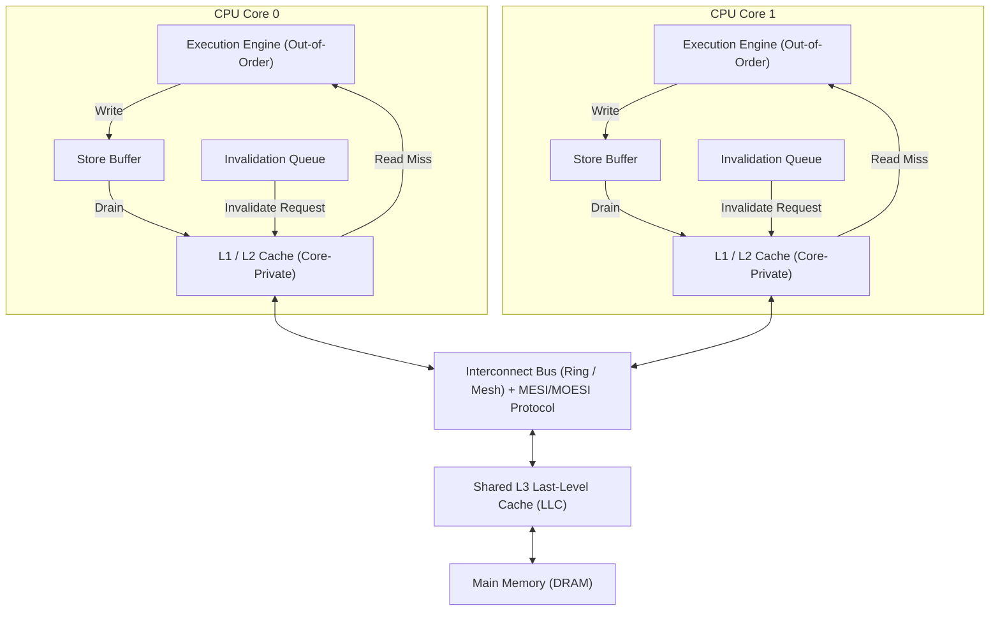
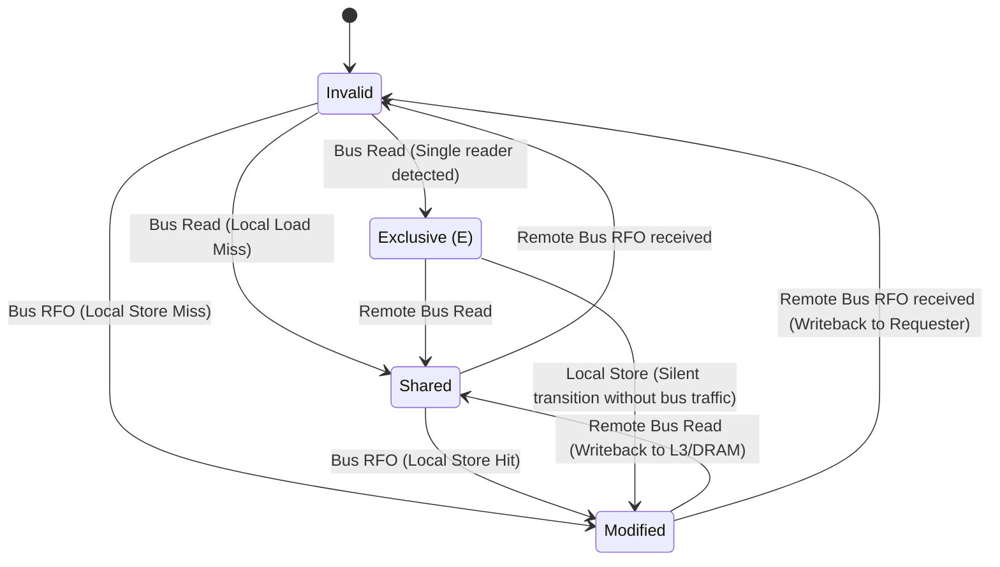
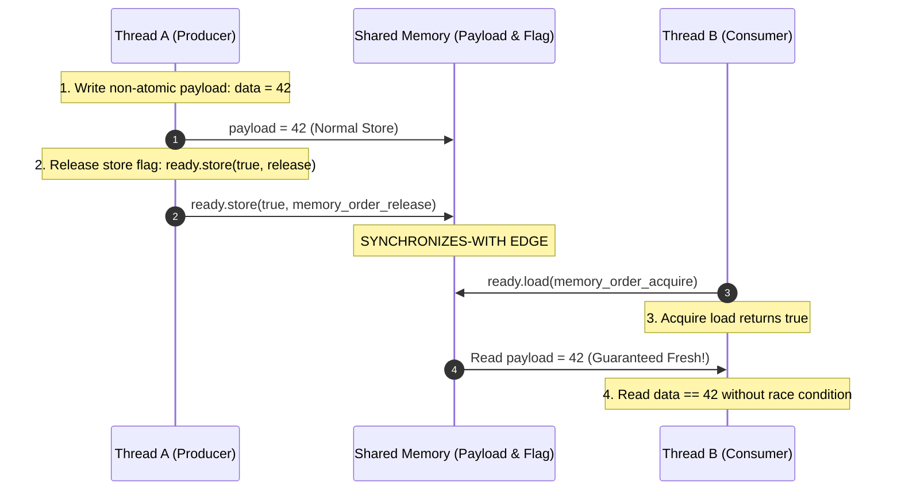
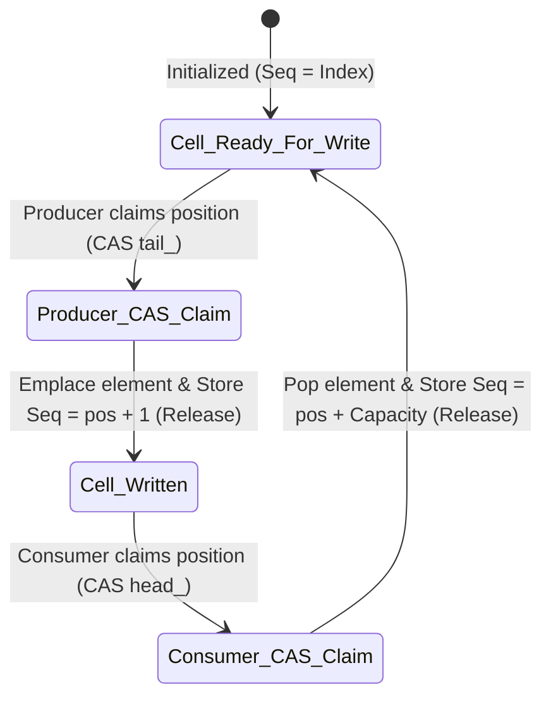
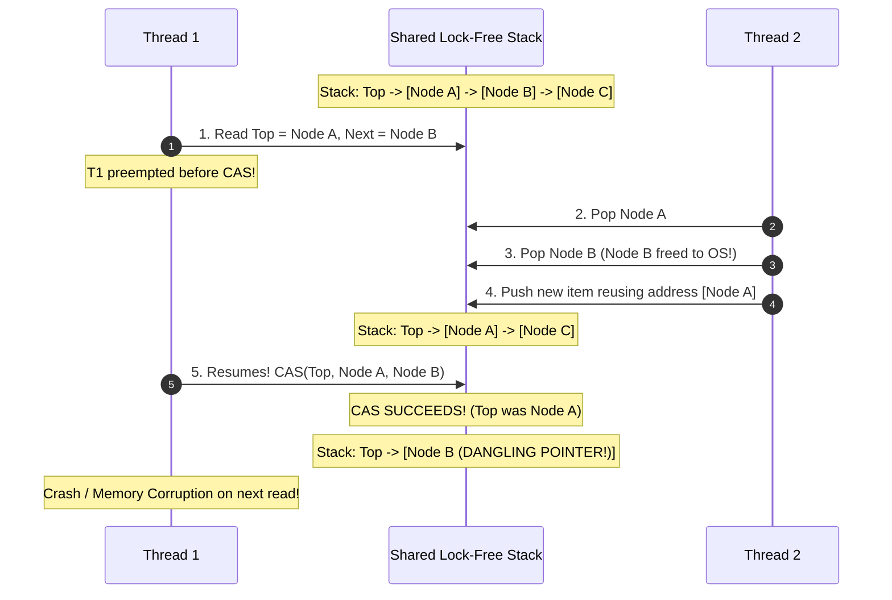

---


title: "C++ Memory Barriers, std::atomic & Lock-Free Data Structures"
description: "Comprehensive production guide to C++ memory orders, hardware cache coherency (MESI/MOESI), x86 TSO vs ARM weak ordering, MPMC Vyukov queue, hazard pointers, and lock-free data structures."
category: "Systems Programming & C++"
tags: [cpp, atomics, lock-free, memory-barriers, concurrency, systems-programming, mesi, mpmc, technical-skills, software-engineering, learning-note]
date: "2026-08-21"
---

# ⚡ C++ Memory Barriers, std::atomic & Lock-Free Data Structures

> 🔙 **Folder Hub**: [[00_Meta/05_folder_nodes/node_08_Systems_and_CPlusPlus|08 Systems & C++ Hub]]
> ⬅️ **Previous Module**: [[02_Technical_Skills/01_theory_and_concepts/08_Systems_and_CPlusPlus/03_cpp_move_semantics_and_perfect_forwarding|03 Move Semantics & Perfect Forwarding]]
> ➡️ **Next Module**: [[02_Technical_Skills/01_theory_and_concepts/08_Systems_and_CPlusPlus/05_cpp20_coroutines_co_await_generators|05 C++20 Coroutines]]
> 🔀 **Related Modules**: [[02_Technical_Skills/01_theory_and_concepts/08_Systems_and_CPlusPlus/01_cpp_raii_and_smart_pointers|01 RAII & Smart Pointers]] | [[02_Technical_Skills/01_theory_and_concepts/08_Systems_and_CPlusPlus/06_cpp_cache_conscious_data_oriented_design|06 Cache-Conscious Data-Oriented Design]]

---

## 1. Hardware Memory Models & Cache Coherency Architecture

Modern multicore CPUs achieve extreme throughput by executing instructions out-of-order, buffering memory writes, and speculatively prefetching data into hierarchical caches (L1i/L1d, L2, L3). Understanding lock-free synchronization requires examining the hardware structures underlying multi-socket, multicore microarchitectures.



### 1.1 Out-of-Order Execution, Store Buffers & Invalidation Queues

1. **Store Buffers (Write Buffers)**: When a CPU core executes a store instruction, writing directly to the L1 cache would stall the pipeline while waiting for cache line ownership across the bus (MESI Read-For-Ownership `RFO`). To prevent stalling, the core deposits the write into a FIFO **Store Buffer** and continues executing subsequent instructions immediately.
2. **Invalidation Queues**: When invalidation messages arrive from peer cores across the interconnect, acknowledging them immediately and queuing them in the **Invalidation Queue** prevents bus stalls. However, until the queue is drained, the core may read stale data from its local cache.
3. **Store-to-Load Forwarding**: A core can read its own pending writes from its local store buffer before they drain to L1, but peer cores cannot observe those writes until they drain into the coherent cache hierarchy.

### 1.2 x86 Total Store Order (TSO) vs. ARM/POWER Weak Memory Models

Different CPU architectures provide fundamentally different hardware ordering guarantees:

| Feature / Architecture | x86 / x86-64 (Intel / AMD) | ARMv8 / ARMv9 (AArch64) | IBM POWER |
| :--- | :--- | :--- | :--- |
| **Memory Model** | **TSO (Total Store Order)** (Strong) | **Weakly-Ordered (Relaxed)** | **Weakly-Ordered (Extremely Relaxed)** |
| **Reads reordered after Reads (Load-Load)** | ❌ No | ✅ Yes | ✅ Yes |
| **Writes reordered after Writes (Store-Store)** | ❌ No | ✅ Yes | ✅ Yes |
| **Reads reordered after Writes (Load-Store)** | ❌ No | ✅ Yes | ✅ Yes |
| **Writes reordered after Reads (Store-Load)** | ✅ **Yes** (Store Buffer drain delay) | ✅ Yes | ✅ Yes |
| **Dependent Load Reordering** | ❌ No | ❌ No | ✅ Yes (Alpha heritage) |
| **Acquire Instruction** | Hardware NOP (implicit acquire on loads) | `LDAR` (Load-Acquire Register) | `sync` / `lwsync` |
| **Release Instruction** | Hardware NOP (implicit release on stores) | `STLR` (Store-Release Register) | `lwsync` |
| **Full Fence Instruction** | `MFENCE` / `LOCK` prefix | `DMB ISH` (Data Memory Barrier) | `SYNC` |

> [!IMPORTANT]
> Because x86 is TSO, `memory_order_acquire` and `memory_order_release` translate to **regular MOV instructions** with zero hardware instruction penalty. Only `memory_order_seq_cst` stores require a bus lock (`LOCK XADD` or `MFENCE`) on x86. On ARM64, however, acquire/release generates explicit `LDAR` and `STLR` instructions.

### 1.3 The MESI and MOESI Cache Coherency Protocols

Cache coherency ensures that all CPU cores observe a consistent view of main memory locations across their private L1/L2 caches.



- **M (Modified)**: Cache line present only in current core's cache, dirty (modified relative to DRAM), core has exclusive write permission.
- **E (Exclusive)**: Cache line present only in current core's cache, clean (identical to DRAM). Can transition to Modified silently without bus traffic.
- **S (Shared)**: Cache line present in current cache and potentially other cores' caches, clean. Read-only access.
- **I (Invalid)**: Cache line contains no valid data. Any read or write triggers a cache miss.
- **O (Owner - MOESI only)**: Cache line is modified and shared with other cores. The owner core is responsible for responding to read requests and eventually writing back to DRAM, eliminating redundant writebacks.

---

## 2. The C++20 Memory Model & `std::memory_order`

The C++11/17/20 memory model defines the semantics of concurrent memory accesses and standardizes the relationship between the compiler optimizer, the hardware memory bus, and thread synchronization.

### 2.1 Formal Synchronization Relationships

1. **Sequenced-Before**: A strict partial order between evaluations within a single thread (program order).
2. **Synchronizes-With**: A runtime relationship between two actions executed by different threads:
   - An atomic store operation $W$ tagged with `memory_order_release`, `memory_order_acq_rel`, or `memory_order_seq_cst` **synchronizes-with** an atomic load operation $R$ tagged with `memory_order_acquire`, `memory_order_seq_cst`, or `memory_order_consume` that reads the value written by $W$.
3. **Inter-Thread Happens-Before**: If evaluation $A$ in Thread 1 is sequenced-before atomic release $W$, and $W$ synchronizes-with atomic acquire $R$ in Thread 2, and $R$ is sequenced-before evaluation $B$ in Thread 2, then **$A$ happens-before $B$**. All memory writes made before $A$ are guaranteed visible to Thread 2 at and after $B$.



### 2.2 Detailed Memory Order Matrix

```
                      RELAXED <--- CONSUME <--- ACQUIRE <--- ACQ_REL <--- SEQ_CST
                     (Fastest)                                           (Strict)
```

| `std::memory_order` | Permitted Compiler / HW Reorderings | Hardware Instruction (x86-64) | Hardware Instruction (ARM64) | Primary Use Cases |
| :--- | :--- | :--- | :--- | :--- |
| **`relaxed`** | Arbitrary reordering except data dependencies on the same atomic object. | `MOV` | `LDR` / `STR` | Counters (`fetch_add`), reference counting increments, statistics metrics. |
| **`consume`** | Data-dependent reads cannot be reordered before this load. | `MOV` | `LDR` (Implicit dependency tracking) | Pointer reading in Read-Copy-Update (RCU) trees (Rarely used, temporarily discouraged in C++20). |
| **`acquire`** | No subsequent reads or writes can be reordered **before** this load. | `MOV` | `LDAR` | Lock acquisition, reading ready flags, consuming published pointer data. |
| **`release`** | No prior reads or writes can be reordered **after** this store. | `MOV` | `STLR` | Lock release, publishing payloads, reference count decrements before deletion. |
| **`acq_rel`** | Combines both Acquire (for read) and Release (for write). | `LOCK XADD` / `LOCK CMPXCHG` | `LDAR` + `STLR` / `CASAL` | Read-Modify-Write (RMW) operations on mutexes, spinlocks, and queues. |
| **`seq_cst`** | Strict global total order visible identically to all threads. | `LOCK XCHG` / `MFENCE` | `LDAR` + `STLR` + full fence | Multi-variable cross-thread invariants (e.g. Peterson's algorithm, Dekker's algorithm). |

---

## 3. High-Performance Lock-Free SPSC Ring Buffer

A Single-Producer Single-Consumer (SPSC) queue can be implemented completely lock-free using only acquire-release semantics and power-of-two circular indexing with cached index copies to minimize cache coherency bus traffic.

### 3.1 Architecture and False Sharing Prevention

```mermaid
flowchart LR
    subgraph ProducerCore["Producer Thread (Core 0)"]
        Head["head_ (Atomic Store Release)"]
        CachedTail["cached_tail_ (Local Thread-Private)"]
    end

    subgraph RingBuffer["Continuous Circular Storage Buffer (alignas 64)"]
        Slot0["Slot [0]"]
        Slot1["Slot [1]"]
        Slot2["Slot [2]"]
        Slot3["Slot [3]"]
        SlotN["Slot [Capacity-1]"]
    end

    subgraph ConsumerCore["Consumer Thread (Core 1)"]
        Tail["tail_ (Atomic Store Release)"]
        CachedHead["cached_head_ (Local Thread-Private)"]
    end

    ProducerCore -->|Writes item at head_ & increments| RingBuffer
    RingBuffer -->|Reads item at tail_ & increments| ConsumerCore
```



### 3.2 Production C++20 SPSC Queue Implementation

```cpp
#include <atomic>
#include <cstddef>
#include <new>
#include <optional>
#include <type_traits>
#include <utility>

#if defined(__cpp_lib_hardware_interference_size)
    using std::hardware_destructive_interference_size;
#else
    constexpr size_t hardware_destructive_interference_size = 64;
#endif

template <typename T, size_t Capacity>
    requires (Capacity >= 2 && (Capacity & (Capacity - 1)) == 0) // Must be power of 2
class LockFreeSPSCQueue {
public:
    static_assert(std::is_nothrow_destructible_v<T>, "T must be nothrow destructible");

    LockFreeSPSCQueue() : head_(0), tail_(0), cached_tail_(0), cached_head_(0) {
        // Uninitialized buffer storage
    }

    ~LockFreeSPSCQueue() {
        T discard;
        while (pop(discard)) {}
    }

    // Non-copyable, non-movable for cache alignment safety
    LockFreeSPSCQueue(const LockFreeSPSCQueue&) = delete;
    LockFreeSPSCQueue& operator=(const LockFreeSPSCQueue&) = delete;

    template <typename... Args>
    bool emplace(Args&&... args) {
        const size_t current_head = head_.load(std::memory_order_relaxed);
        
        // Fast path: Check local cached tail to avoid cross-core bus traffic
        if (current_head - cached_tail_ == Capacity) {
            cached_tail_ = tail_.load(std::memory_order_acquire);
            if (current_head - cached_tail_ == Capacity) {
                return false; // Queue truly full
            }
        }

        // Construct object in-place inside uninitialized slot
        new (&storage_[current_head & IndexMask].value) T(std::forward<Args>(args)...);

        // Publish written object to consumer with release semantics
        head_.store(current_head + 1, std::memory_order_release);
        return true;
    }

    bool pop(T& out_value) {
        const size_t current_tail = tail_.load(std::memory_order_relaxed);

        // Fast path: Check local cached head
        if (current_tail == cached_head_) {
            cached_head_ = head_.load(std::memory_order_acquire);
            if (current_tail == cached_head_) {
                return false; // Queue truly empty
            }
        }

        auto* slot_ptr = reinterpret_cast<T*>(&storage_[current_tail & IndexMask].value);
        out_value = std::move(*slot_ptr);
        slot_ptr->~T(); // Explicitly destroy stored object

        // Free slot to producer with release semantics
        tail_.store(current_tail + 1, std::memory_order_release);
        return true;
    }

    [[nodiscard]] bool empty() const noexcept {
        return head_.load(std::memory_order_relaxed) == tail_.load(std::memory_order_relaxed);
    }

    [[nodiscard]] size_t size() const noexcept {
        const size_t h = head_.load(std::memory_order_relaxed);
        const size_t t = tail_.load(std::memory_order_relaxed);
        return (h >= t) ? (h - t) : 0;
    }

private:
    static constexpr size_t IndexMask = Capacity - 1;

    struct Node {
        alignas(alignof(T)) std::byte value[sizeof(T)];
    };

    // Separate into distinct cache lines to prevent False Sharing (Cache Line Bouncing)
    alignas(hardware_destructive_interference_size) std::atomic<size_t> head_;
    alignas(hardware_destructive_interference_size) size_t cached_tail_;

    alignas(hardware_destructive_interference_size) std::atomic<size_t> tail_;
    alignas(hardware_destructive_interference_size) size_t cached_head_;

    alignas(hardware_destructive_interference_size) Node storage_[Capacity];
};
```

---

## 4. Lock-Free Multi-Producer Multi-Consumer (MPMC) Vyukov Queue

Dmitry Vyukov's bounded MPMC queue is one of the most efficient lock-free queues in industrial high-frequency trading (HFT) and game engines. It uses an array of cells, each with a monotonic sequence counter, allowing concurrent pushes and pops without global locks.

### 4.1 Vyukov Cell State Transitions

Each cell has a sequence counter $S$. For capacity $C$:
- A producer can write to cell $i$ if $S == \text{pos}$. After writing, it updates $S \leftarrow \text{pos} + 1$.
- A consumer can read from cell $i$ if $S == \text{pos} + 1$. After reading, it resets $S \leftarrow \text{pos} + C$.



### 4.2 Production C++20 Bounded MPMC Queue Implementation

```cpp
#include <atomic>
#include <cstddef>
#include <new>
#include <optional>
#include <utility>
#include <vector>

#if defined(__x86_64__) || defined(_M_X64)
#include <immintrin.h>
inline void cpu_relax() noexcept { _mm_pause(); }
#else
inline void cpu_relax() noexcept { asm volatile("yield" ::: "memory"); }
#endif

template <typename T>
class LockFreeMPMCQueue {
public:
    explicit LockFreeMPMCQueue(size_t capacity)
        : buffer_mask_(capacity - 1)
    {
        // Enforce power-of-2 capacity
        if (capacity < 2 || (capacity & (capacity - 1)) != 0) {
            throw std::invalid_argument("Capacity must be a power of 2");
        }

        buffer_ = new Cell[capacity];
        for (size_t i = 0; i < capacity; ++i) {
            buffer_[i].sequence.store(i, std::memory_order_relaxed);
        }
        enqueue_pos_.store(0, std::memory_order_relaxed);
        dequeue_pos_.store(0, std::memory_order_relaxed);
    }

    ~LockFreeMPMCQueue() {
        T item;
        while (pop(item)) {}
        delete[] buffer_;
    }

    LockFreeMPMCQueue(const LockFreeMPMCQueue&) = delete;
    LockFreeMPMCQueue& operator=(const LockFreeMPMCQueue&) = delete;

    template <typename... Args>
    bool emplace(Args&&... args) {
        Cell* cell;
        size_t pos = enqueue_pos_.load(std::memory_order_relaxed);

        for (;;) {
            cell = &buffer_[pos & buffer_mask_];
            const size_t seq = cell->sequence.load(std::memory_order_acquire);
            const intptr_t diff = static_cast<intptr_t>(seq) - static_cast<intptr_t>(pos);

            if (diff == 0) {
                // Cell is ready for write; attempt to advance enqueue_pos_
                if (enqueue_pos_.compare_exchange_weak(pos, pos + 1, std::memory_order_relaxed)) {
                    break; // Successfully claimed slot
                }
            } else if (diff < 0) {
                // Queue is completely full
                return false;
            } else {
                // Another thread advanced enqueue_pos_; refresh pos
                pos = enqueue_pos_.load(std::memory_order_relaxed);
                cpu_relax();
            }
        }

        // Construct object into claimed slot
        new (&cell->storage) T(std::forward<Args>(args)...);

        // Make element visible to consumers
        cell->sequence.store(pos + 1, std::memory_order_release);
        return true;
    }

    bool pop(T& out_value) {
        Cell* cell;
        size_t pos = dequeue_pos_.load(std::memory_order_relaxed);

        for (;;) {
            cell = &buffer_[pos & buffer_mask_];
            const size_t seq = cell->sequence.load(std::memory_order_acquire);
            const intptr_t diff = static_cast<intptr_t>(seq) - static_cast<intptr_t>(pos + 1);

            if (diff == 0) {
                // Cell contains data ready to read; attempt to advance dequeue_pos_
                if (dequeue_pos_.compare_exchange_weak(pos, pos + 1, std::memory_order_relaxed)) {
                    break; // Successfully claimed read
                }
            } else if (diff < 0) {
                // Queue is empty
                return false;
            } else {
                pos = dequeue_pos_.load(std::memory_order_relaxed);
                cpu_relax();
            }
        }

        auto* val_ptr = reinterpret_cast<T*>(&cell->storage);
        out_value = std::move(*val_ptr);
        val_ptr->~T();

        // Increment sequence to signal slot is free for next epoch
        cell->sequence.store(pos + buffer_mask_ + 1, std::memory_order_release);
        return true;
    }

private:
    struct Cell {
        std::atomic<size_t> sequence;
        alignas(alignof(T)) std::byte storage[sizeof(T)];
    };

    static constexpr size_t CacheLineSize = 64;

    alignas(CacheLineSize) Cell* buffer_;
    alignas(CacheLineSize) const size_t buffer_mask_;
    alignas(CacheLineSize) std::atomic<size_t> enqueue_pos_;
    alignas(CacheLineSize) std::atomic<size_t> dequeue_pos_;
};
```

---

## 5. The ABA Problem & Safe Memory Reclamation

In lock-free dynamic data structures (e.g. Treiber stack, Michael-Scott linked queue), the **ABA problem** occurs when a pointer reads address $A$, is preempted, another thread pops $A$, frees it, allocates a new node at the identical virtual address $A$, and pushes it back. The original thread's Compare-And-Swap (`CAS`) succeeds because the address is still $A$, but intermediate state has mutated, causing severe memory corruption.



### 5.1 Mitigation 1: Hazard Pointers

**Hazard Pointers** (Maged Michael) allow lock-free readers to advertise a pointer they are currently dereferencing. Deleting threads cannot reclaim memory until no thread holds a hazard pointer to it.

```cpp
#include <atomic>
#include <array>
#include <vector>
#include <algorithm>

constexpr size_t MaxHazardPointers = 64;
constexpr size_t MaxThreads = 16;

struct HazardPointerRecord {
    std::atomic<void*> pointer{nullptr};
    std::atomic<bool> active{false};
};

inline std::array<HazardPointerRecord, MaxHazardPointers> g_hazard_pointers;

class HazardPointerGuard {
public:
    HazardPointerGuard() {
        for (auto& hp : g_hazard_pointers) {
            bool expected = false;
            if (hp.active.compare_exchange_strong(expected, true, std::memory_order_relaxed)) {
                hp_record_ = &hp;
                return;
            }
        }
        throw std::runtime_error("Exhausted hazard pointer pool");
    }

    ~HazardPointerGuard() {
        if (hp_record_) {
            hp_record_->pointer.store(nullptr, std::memory_order_release);
            hp_record_->active.store(false, std::memory_order_relaxed);
        }
    }

    void protect(void* ptr) {
        hp_record_->pointer.store(ptr, std::memory_order_seq_cst);
    }

    void clear() {
        hp_record_->pointer.store(nullptr, std::memory_order_release);
    }

private:
    HazardPointerRecord* hp_record_{nullptr};
};

template <typename T>
class LockFreeTreiberStack {
    struct Node {
        T data;
        Node* next{nullptr};
        explicit Node(T val) : data(std::move(val)) {}
    };

    std::atomic<Node*> head_{nullptr};
    thread_local static inline std::vector<Node*> retired_list_;

public:
    void push(T val) {
        auto* new_node = new Node(std::move(val));
        new_node->next = head_.load(std::memory_order_relaxed);
        while (!head_.compare_exchange_weak(
            new_node->next, new_node,
            std::memory_order_release,
            std::memory_order_relaxed)) {}
    }

    std::optional<T> pop() {
        HazardPointerGuard guard;
        Node* curr = head_.load(std::memory_order_relaxed);

        while (curr != nullptr) {
            guard.protect(curr); // Publish hazard pointer
            
            // Verify curr did not change after setting hazard pointer
            if (head_.load(std::memory_order_acquire) != curr) {
                curr = head_.load(std::memory_order_relaxed);
                continue;
            }

            Node* next = curr->next;
            if (head_.compare_exchange_weak(
                curr, next,
                std::memory_order_acquire,
                std::memory_order_relaxed)) {
                break; // Claimed node safely
            }
        }

        if (!curr) return std::nullopt;

        guard.clear();
        T result = std::move(curr->data);
        retire_node(curr);
        return result;
    }

private:
    void retire_node(Node* node) {
        retired_list_.push_back(node);
        if (retired_list_.size() >= 32) {
            scan_and_reclaim();
        }
    }

    void scan_and_reclaim() {
        // Collect all active hazard pointers
        std::vector<void*> active_ptrs;
        active_ptrs.reserve(MaxHazardPointers);
        for (const auto& hp : g_hazard_pointers) {
            void* p = hp.pointer.load(std::memory_order_acquire);
            if (p) active_ptrs.push_back(p);
        }
        std::sort(active_ptrs.begin(), active_ptrs.end());

        // Reclaim retired nodes not guarded by hazard pointers
        auto it = std::remove_if(retired_list_.begin(), retired_list_.end(), [&](Node* n) {
            if (!std::binary_search(active_ptrs.begin(), active_ptrs.end(), n)) {
                delete n;
                return true;
            }
            return false;
        });
        retired_list_.erase(it, retired_list_.end());
    }
};
```

### 5.2 Mitigation 2: Epoch-Based Reclamation (EBR)

Epoch-Based Reclamation divides execution into global epochs ($e, e+1, e+2$). Threads enter an epoch before reading lock-free structures. Memory retired during epoch $e$ can only be freed once all threads have advanced past epoch $e$. EBR has near-zero overhead during loads compared to hazard pointers.

### 5.3 Mitigation 3: C++20 `std::atomic<std::shared_ptr<T>>` & `std::atomic_ref`

C++20 introduces first-class atomic smart pointers (`std::atomic<std::shared_ptr<T>>` and `std::atomic<std::weak_ptr<T>>`), providing lock-free or lock-assisted reference-counted memory reclamation without manual hazard pointers.

```cpp
#include <atomic>
#include <memory>
#include <iostream>

template <typename T>
class AtomicSharedStack {
    struct Node {
        T value;
        std::shared_ptr<Node> next;
        explicit Node(T v) : value(std::move(v)) {}
    };

    std::atomic<std::shared_ptr<Node>> head_{nullptr};

public:
    void push(T val) {
        auto new_node = std::make_shared<Node>(std::move(val));
        new_node->next = head_.load(std::memory_order_relaxed);
        while (!head_.compare_exchange_weak(
            new_node->next, new_node,
            std::memory_order_release,
            std::memory_order_relaxed)) {}
    }

    std::optional<T> pop() {
        std::shared_ptr<Node> curr = head_.load(std::memory_order_acquire);
        while (curr && !head_.compare_exchange_weak(
            curr, curr->next,
            std::memory_order_acq_rel,
            std::memory_order_acquire)) {}

        if (!curr) return std::nullopt;
        return curr->value;
    }
};
```

---

## 6. Benchmarking, Hardware Contention & Anti-Patterns

### 6.1 Cache Line Bouncing vs. Spinlock Backoff

When multiple cores simultaneously write or CAS the same atomic cache line, the line bounces between L1 caches via MESI Invalidation storms, collapsing throughput.

```cpp
// Backoff strategy for high contention atomic loops
void exponential_backoff(size_t attempt) {
    if (attempt < 4) {
        cpu_relax(); // 1 to 4 pause instructions (~12-40 cycles)
    } else if (attempt < 10) {
        for (size_t i = 0; i < (1 << (attempt - 4)); ++i) {
            cpu_relax();
        }
    } else {
        std::this_thread::yield(); // Yield OS time slice
    }
}
```

### 6.2 Lock-Free Engineering Best Practices Summary

1. **Avoid `memory_order_seq_cst` unless strictly necessary**: Acquire-Release semantics satisfy $> 95\%$ of lock-free queue/ring buffer requirements with zero bus lock penalty on x86 and minimal overhead on ARM.
2. **Align atomic indices to separate 64-byte cache lines**: Always use `alignas(64)` between producer and consumer pointers to eliminate false sharing.
3. **Cache local copies of atomic indices**: In SPSC queues, reading thread-private cached tail indices avoids Cross-Core Interconnect requests.
4. **Never ignore memory reclamation**: Lock-free dynamic node lists without Hazard Pointers, EBR, or atomic smart pointers suffer guaranteed ABA memory corruption or Use-After-Free crashes.

---

## 🔗 Graph-Linked Knowledge Base

- [[00_Meta/05_folder_nodes/node_08_Systems_and_CPlusPlus|08 Systems & C++ Architecture Node]]
- [[02_Technical_Skills/01_theory_and_concepts/08_Systems_and_CPlusPlus/01_cpp_raii_and_smart_pointers|01 RAII, Smart Pointers & Custom Deleters]]
- [[02_Technical_Skills/01_theory_and_concepts/08_Systems_and_CPlusPlus/06_cpp_cache_conscious_data_oriented_design|06 Cache-Conscious C++ & Data-Oriented Design]]
- [[02_Technical_Skills/01_theory_and_concepts/08_Systems_and_CPlusPlus/05_cpp20_coroutines_co_await_generators|05 C++20 Coroutines & Asynchronous Generators]]
