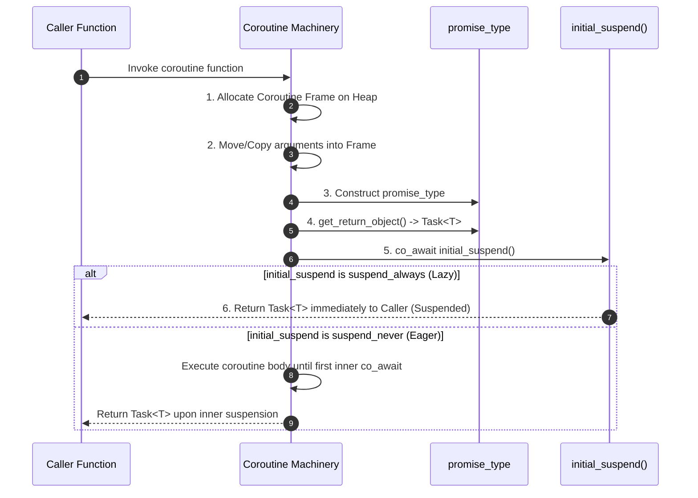
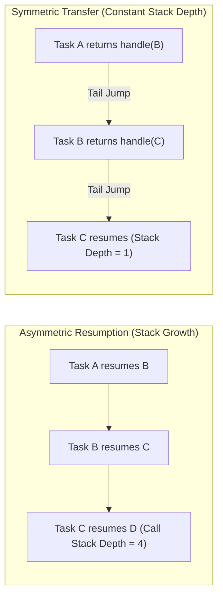
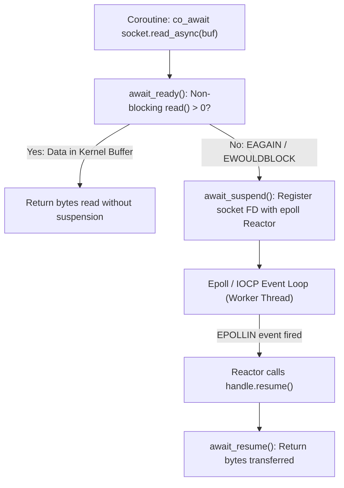

---


title: "C++20 Coroutines: co_await, co_yield & Asynchronous Task Graphs"
description: "Comprehensive architectural guide to C++20 stackless coroutines, coroutine frame memory layout, HALO elision, promise_type, awaitable protocol, symmetric transfer, and asynchronous task engines."
category: "Systems Programming & C++"
tags: [cpp, coroutines, async, concurrency, halo, promise-type, awaitable, systems-programming, technical-skills, software-engineering, learning-note]
date: "2026-08-21"
---

# 🌀 C++20 Coroutines & Asynchronous Task Engines

> 🔙 **Folder Hub**: [[00_Meta/05_folder_nodes/node_08_Systems_and_CPlusPlus|08 Systems & C++ Hub]]
> ⬅️ **Previous Module**: [[02_Technical_Skills/01_theory_and_concepts/08_Systems_and_CPlusPlus/04_cpp_memory_barriers_atomics_lock_free|04 Memory Barriers & Atomics]]
> ➡️ **Next Module**: [[02_Technical_Skills/01_theory_and_concepts/08_Systems_and_CPlusPlus/06_cpp_cache_conscious_data_oriented_design|06 Cache-Conscious Data-Oriented Design]]
> 🔀 **Related Modules**: [[02_Technical_Skills/01_theory_and_concepts/08_Systems_and_CPlusPlus/00_cpp_virtual_memory_address_space_and_raii|00 Virtual Memory Address Space & RAII]] | [[02_Technical_Skills/01_theory_and_concepts/08_Systems_and_CPlusPlus/07_cpp_metaprogramming_templates_concepts|07 Metaprogramming & Concepts]]

---

## 1. Stackless Coroutines & Memory Architecture

C++20 introduces **Stackless Coroutines**. Unlike stackful coroutines (fibers, Go goroutines) which allocate a dedicated runtime call stack (typically 2KB–8MB) for each execution context, a C++20 coroutine does not maintain an independent call stack. Instead, the compiler transforms the coroutine into a state machine and packs its state into a compact, heap-allocated (or compiler-elided) **Coroutine Frame**.

### 1.1 Stackful vs. Stackless Execution Model

| Characteristic | Stackful Coroutines (Fibers / Goroutines) | C++20 Stackless Coroutines |
| :--- | :--- | :--- |
| **Stack Allocation** | Dedicated contiguous memory buffer per fiber (e.g. 8KB to 2MB). | No stack; state packed into a compiler-generated frame structure (~64–256 bytes). |
| **Context Switch Overhead** | Assembly registers swap (RSP, RBP, callee-saved registers) ~20–50 ns. | Regular function pointer jump / virtual return ~1–3 ns. |
| **Suspension Depth** | Can suspend deeply nested inside arbitrary subroutine calls. | Can only suspend directly within the coroutine function body via `co_await` / `co_yield`. |
| **Memory Footprint (1M instances)** | ~2GB – 8GB of virtual memory. | ~64MB – 256MB total memory. |
| **Allocation Mechanism** | `mmap` / VirtualAlloc with guard pages. | Heap `operator new` or compile-time **HALO** stack elision. |

```mermaid
flowchart TB
    subgraph CoroutineFrame["C++20 Coroutine Frame (Heap / Elided)"]
        PH["Promise Object (promise_type)"]
        Params["Copied / Moved Function Arguments"]
        Locals["Local Variables across Suspension Points"]
        Temps["Evaluated Temporaries"]
        State["State Index / Resume Function Ptr"]
        DestroyPtr["Destroy Function Ptr"]
    end

    Caller["Caller Function"] -->|Calls Coroutine| Alloc["Allocate Frame (operator new / HALO)"]
    Alloc --> CoroutineFrame
    CoroutineFrame -->|get_return_object()| Handle["coroutine_handle & RAII Return Object (Task / Generator)"]
    Handle --> Caller
```

### 1.2 The Coroutine Frame Memory Layout & Lifecycle

When a function containing `co_await`, `co_yield`, or `co_return` is invoked, the compiler executes the following sequence:
1. **Frame Allocation**: Allocates memory for the coroutine frame via `operator new` (or uses an overload provided in `promise_type`).
2. **Parameter Transfer**: Copies or moves all function arguments into the frame to ensure parameter lifetimes outlive the initial caller.
3. **Promise Construction**: Constructs the `promise_type` object in-place inside the frame.
4. **Return Object Creation**: Calls `promise.get_return_object()` and saves the resulting handle/wrapper to return to the caller upon first suspension.
5. **Initial Suspend**: Executes `co_await promise.initial_suspend()`. If it yields `std::suspend_always`, control returns immediately to the caller.



### 1.3 Heap Allocation eLision Optimization (HALO)

Modern optimizing compilers (LLVM/Clang and GCC) perform **HALO** (Heap Allocation eLision Optimization). If the compiler can prove that the lifetime of the coroutine frame is strictly enclosed within the caller's lifetime, the compiler:
1. Elides the dynamic `operator new` call entirely.
2. Inlines the coroutine frame directly into the caller's stack frame.
3. Devirtualizes the resume and destroy function calls into direct local jumps.

> [!TIP]
> To maximize HALO eligibility:
> - Mark coroutine return types with `[[nodiscard]]`.
> - Keep coroutine handle lifespans local and ensure they are destroyed in the same lexical scope as the caller (e.g. consuming generators via range-for loops).

---

## 2. The Coroutine Protocol & Awaitable Interface

A type is **Awaitable** if it implements the Awaiter protocol, which dictates how suspension, context handoff, and resumption occur.

### 2.1 The Awaiter Concept

```cpp
template <typename T>
concept Awaiter = requires(T a, std::coroutine_handle<> h) {
    { a.await_ready() } -> std::same_as<bool>;
    { a.await_suspend(h) }; // Returns void, bool, or std::coroutine_handle<>
    { a.await_resume() };
};
```

1. `await_ready() -> bool`:
   - Returns `true`: The asynchronous operation is already finished (e.g., cached value or non-blocking socket buffer). The coroutine **does not suspend**, avoiding context switch overhead entirely.
   - Returns `false`: The coroutine prepares to suspend.
2. `await_suspend(std::coroutine_handle<P> h)`:
   - **`void` return**: Suspends the coroutine unconditionally and returns control to the caller/resumer.
   - **`bool` return**: Returning `true` keeps the coroutine suspended; returning `false` immediately resumes the coroutine on the current thread without returning to the caller.
   - **`std::coroutine_handle<>` return (Symmetric Transfer)**: Directly transfers execution to another suspended coroutine without consuming extra C++ call stack frames.
3. `await_resume() -> ResultType`:
   - Called immediately when the coroutine is resumed. Returns the result of the `co_await` expression or rethrows any captured exception.

### 2.2 Symmetric Transfer vs. Asymmetric Resumption

In naive asymmetric coroutine task runners, when Task $A$ completes and resumes Task $B$, which in turn completes and resumes Task $C$, each resumption is a regular function call:

$$\text{Task } A \rightarrow \text{Task } B \rightarrow \text{Task } C \rightarrow \dots \rightarrow \text{Stack Overflow!}$$

**Symmetric Transfer** solves this by having `await_suspend` return a `std::coroutine_handle<>`. The compiler generates a tail-call jump (`jmp`), resetting the C++ call frame:



---

## 3. Production Asynchronous `Task<T>` with Symmetric Transfer

Below is a complete, production-grade C++20 `Task<T>` implementation featuring lazy evaluation, symmetric transfer, exception capture, and value extraction.

```cpp
#include <coroutine>
#include <exception>
#include <utility>
#include <variant>
#include <iostream>

template <typename T>
class [[nodiscard]] Task {
public:
    struct promise_type;
    using handle_type = std::coroutine_handle<promise_type>;

    struct promise_type {
        std::variant<std::monostate, T, std::exception_ptr> storage;
        std::coroutine_handle<> continuation{nullptr};

        Task get_return_object() noexcept {
            return Task{handle_type::from_promise(*this)};
        }

        // Lazy evaluation: suspend initially
        std::suspend_always initial_suspend() noexcept { return {}; }

        // Final suspend: Symmetric transfer to awaiting parent continuation
        struct FinalAwaiter {
            bool await_ready() noexcept { return false; }
            
            std::coroutine_handle<> await_suspend(handle_type h) noexcept {
                auto continuation = h.promise().continuation;
                if (continuation) {
                    return continuation; // Symmetric transfer: tail-call to parent
                }
                return std::noop_coroutine(); // No continuation; terminate frame
            }

            void await_resume() noexcept {}
        };

        FinalAwaiter final_suspend() noexcept { return {}; }

        template <typename Value>
            requires std::convertible_to<Value&&, T>
        void return_value(Value&& val) noexcept(std::is_nothrow_constructible_v<T, Value&&>) {
            storage.template emplace<1>(std::forward<Value>(val));
        }

        void unhandled_exception() noexcept {
            storage.template emplace<2>(std::current_exception());
        }

        T& result() {
            if (storage.index() == 2) {
                std::rethrow_exception(std::get<2>(storage));
            }
            return std::get<1>(storage);
        }
    };

    explicit Task(handle_type handle) noexcept : handle_(handle) {}

    ~Task() {
        if (handle_) handle_.destroy();
    }

    // Move-only semantics
    Task(Task&& other) noexcept : handle_(std::exchange(other.handle_, nullptr)) {}
    Task& operator=(Task&& other) noexcept {
        if (this != &other) {
            if (handle_) handle_.destroy();
            handle_ = std::exchange(other.handle_, nullptr);
        }
        return *this;
    }

    Task(const Task&) = delete;
    Task& operator=(const Task&) = delete;

    // Awaiter interface for Task<T>
    auto operator co_await() const noexcept {
        struct TaskAwaiter {
            handle_type handle;

            bool await_ready() const noexcept {
                return !handle || handle.done();
            }

            std::coroutine_handle<> await_suspend(std::coroutine_handle<> awaiting_coro) noexcept {
                handle.promise().continuation = awaiting_coro;
                return handle; // Symmetric transfer to child task
            }

            T await_resume() {
                if (!handle) throw std::runtime_error("Broken task handle");
                return std::move(handle.promise().result());
            }
        };

        return TaskAwaiter{handle_};
    }

private:
    handle_type handle_{nullptr};
};

// Void specialization for Tasks without return payload
template <>
struct Task<void>::promise_type {
    std::exception_ptr exception{nullptr};
    std::coroutine_handle<> continuation{nullptr};

    Task<void> get_return_object() noexcept {
        return Task<void>{std::coroutine_handle<promise_type>::from_promise(*this)};
    }
    std::suspend_always initial_suspend() noexcept { return {}; }

    struct FinalAwaiter {
        bool await_ready() noexcept { return false; }
        std::coroutine_handle<> await_suspend(std::coroutine_handle<promise_type> h) noexcept {
            if (h.promise().continuation) return h.promise().continuation;
            return std::noop_coroutine();
        }
        void await_resume() noexcept {}
    };

    FinalAwaiter final_suspend() noexcept { return {}; }
    void return_void() noexcept {}
    void unhandled_exception() noexcept { exception = std::current_exception(); }
    void result() { if (exception) std::rethrow_exception(exception); }
};
```

---

## 4. High-Performance Zero-Allocation `Generator<T>`

A Generator produces a sequence of elements lazily, suspending on each `co_yield` and resuming on demand via C++20 standard iterator interfaces.

```cpp
#include <coroutine>
#include <exception>
#include <iterator>
#include <utility>
#include <concepts>

template <typename T>
class [[nodiscard]] Generator {
public:
    struct promise_type {
        const T* current_value{nullptr};
        std::exception_ptr exception{nullptr};

        Generator get_return_object() noexcept {
            return Generator{std::coroutine_handle<promise_type>::from_promise(*this)};
        }

        std::suspend_always initial_suspend() noexcept { return {}; }
        std::suspend_always final_suspend() noexcept { return {}; }

        std::suspend_always yield_value(const T& value) noexcept {
            current_value = std::addressof(value);
            return {};
        }

        std::suspend_always yield_value(T&& value) noexcept {
            current_value = std::addressof(value);
            return {};
        }

        void return_void() noexcept {}
        void unhandled_exception() noexcept { exception = std::current_exception(); }
    };

    using handle_type = std::coroutine_handle<promise_type>;

    struct Sentinel {};

    struct Iterator {
        using iterator_category = std::input_iterator_tag;
        using difference_type   = std::ptrdiff_t;
        using value_type        = T;
        using reference         = const T&;
        using pointer           = const T*;

        handle_type handle{nullptr};

        Iterator& operator++() {
            handle.resume();
            if (handle.done()) {
                if (handle.promise().exception) {
                    std::rethrow_exception(handle.promise().exception);
                }
            }
            return *this;
        }

        void operator++(int) { (void)operator++(); }

        reference operator*() const noexcept {
            return *handle.promise().current_value;
        }

        pointer operator->() const noexcept {
            return handle.promise().current_value;
        }

        bool operator==(Sentinel) const noexcept {
            return !handle || handle.done();
        }
    };

    explicit Generator(handle_type h) noexcept : handle_(h) {}
    ~Generator() { if (handle_) handle_.destroy(); }

    Generator(Generator&& other) noexcept : handle_(std::exchange(other.handle_, nullptr)) {}
    Generator& operator=(Generator&& other) noexcept {
        if (this != &other) {
            if (handle_) handle_.destroy();
            handle_ = std::exchange(other.handle_, nullptr);
        }
        return *this;
    }

    Iterator begin() {
        if (handle_) {
            handle_.resume();
            if (handle_.done() && handle_.promise().exception) {
                std::rethrow_exception(handle_.promise().exception);
            }
        }
        return Iterator{handle_};
    }

    Sentinel end() noexcept { return {}; }

private:
    handle_type handle_{nullptr};
};

// Example: Fibonacci Infinite Stream Generator
Generator<uint64_t> fibonacci() {
    uint64_t a = 0, b = 1;
    while (true) {
        co_yield a;
        auto next = a + b;
        a = b;
        b = next;
    }
}
```

---

## 5. Non-Blocking I/O Reactor Integration

In high-performance networking engines, C++20 coroutines replace nested callbacks with linear code flow over non-blocking epoll/IOCP event loops.



```cpp
#include <coroutine>
#include <sys/socket.h>
#include <unistd.h>
#include <cerrno>

struct SocketReadAwaiter {
    int fd;
    void* buffer;
    size_t length;
    ssize_t bytes_read{0};
    int error_code{0};

    bool await_ready() const noexcept {
        // Fast path: attempt immediate non-blocking read
        ssize_t res = ::read(fd, buffer, length);
        if (res >= 0) {
            const_cast<SocketReadAwaiter*>(this)->bytes_read = res;
            return true;
        }
        return (errno != EAGAIN && errno != EWOULDBLOCK);
    }

    void await_suspend(std::coroutine_handle<> h) {
        // Register FD and coroutine handle with external Reactor Event Loop
        // EventLoop::get_instance().register_read(fd, [h]() { h.resume(); });
    }

    ssize_t await_resume() {
        if (error_code != 0) throw std::system_error(error_code, std::generic_category());
        return bytes_read;
    }
};
```

---

## 6. Critical Lifetime Rules & Anti-Patterns

### ❌ Anti-Pattern 1: Passing Pass-by-Reference Arguments to Asynchronous Coroutines

```cpp
// DANGEROUS BUG: String view or reference bound to caller's temporary stack!
Task<void> log_message_async(const std::string& msg) {
    co_await async_sleep(100ms);
    // msg is a reference pointing to caller's destroyed stack frame!
    std::cout << msg << "\n"; // USE-AFTER-FREE MEMORY CORRUPTION
}
```

**Fix**: Always pass parameters **by value** in asynchronous coroutines so that arguments are moved/copied safely into the heap-allocated Coroutine Frame:

```cpp
// SAFE: msg is copied into the coroutine frame
Task<void> log_message_async(std::string msg) {
    co_await async_sleep(100ms);
    std::cout << msg << "\n"; // Valid
}
```

### ❌ Anti-Pattern 2: Forgetting Final Suspend in Symmetric Transfer

If `final_suspend()` returns `std::suspend_never`, the coroutine frame is destroyed immediately upon completion. Any subsequent `handle.done()` checks or access to `promise.result()` by an awaiting parent task results in an undefined behavior crash.

---

## 🔗 Graph-Linked Knowledge Base

- [[00_Meta/05_folder_nodes/node_08_Systems_and_CPlusPlus|08 Systems & C++ Architecture Node]]
- [[02_Technical_Skills/01_theory_and_concepts/08_Systems_and_CPlusPlus/04_cpp_memory_barriers_atomics_lock_free|04 Memory Barriers, std::atomic & Lock-Free Data Structures]]
- [[02_Technical_Skills/01_theory_and_concepts/08_Systems_and_CPlusPlus/06_cpp_cache_conscious_data_oriented_design|06 Cache-Conscious C++ & Data-Oriented Design]]
- [[02_Technical_Skills/01_theory_and_concepts/08_Systems_and_CPlusPlus/07_cpp_metaprogramming_templates_concepts|07 C++ Metaprogramming & C++20 Concepts]]
