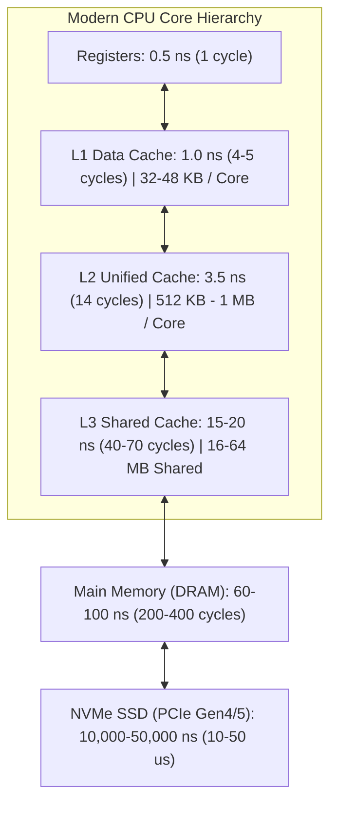
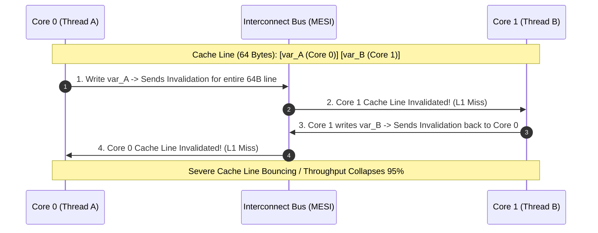
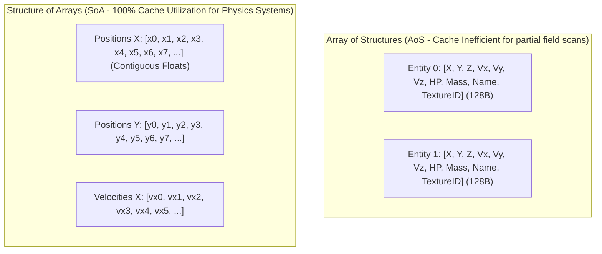
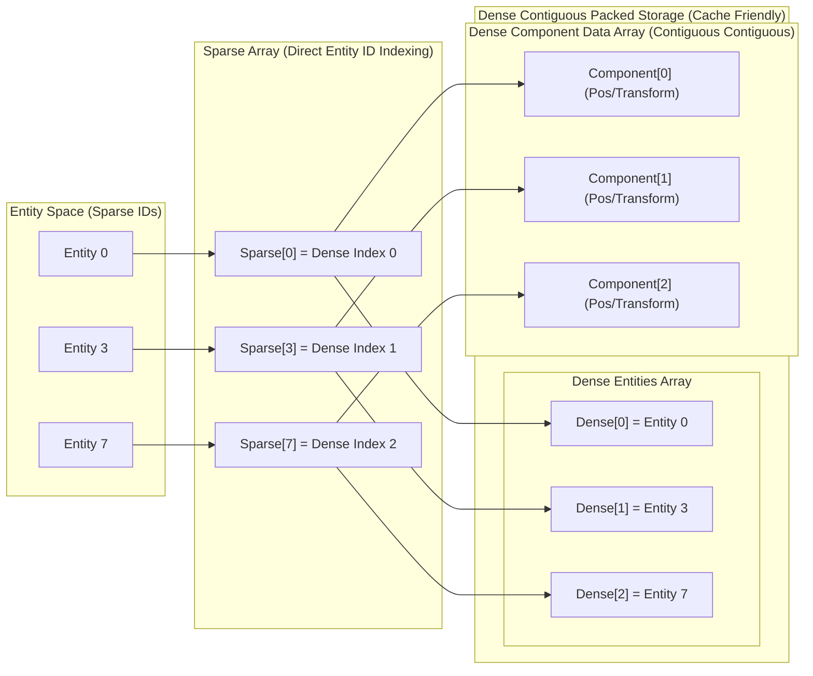

---


title: "Cache-Conscious C++ & Data-Oriented Design (DOD)"
description: "Comprehensive guide to CPU cache hierarchies, memory latencies, spatial/temporal locality, false sharing, AoS vs SoA vs AoSoA, and high-performance Sparse Set ECS architecture."
category: "Systems Programming & C++"
tags: [cpp, data-oriented-design, cpu-cache, simd, performance, ecs, sparse-set, systems-programming, technical-skills, software-engineering, learning-note]
date: "2026-08-21"
---

# 🚀 Cache-Conscious C++ & Data-Oriented Design (DOD)

> 🔙 **Folder Hub**: [[00_Meta/05_folder_nodes/node_08_Systems_and_CPlusPlus|08 Systems & C++ Hub]]
> ⬅️ **Previous Module**: [[02_Technical_Skills/01_theory_and_concepts/08_Systems_and_CPlusPlus/05_cpp20_coroutines_co_await_generators|05 C++20 Coroutines]]
> ➡️ **Next Module**: [[02_Technical_Skills/01_theory_and_concepts/08_Systems_and_CPlusPlus/07_cpp_metaprogramming_templates_concepts|07 Metaprogramming & Concepts]]
> 🔀 **Related Modules**: [[02_Technical_Skills/01_theory_and_concepts/08_Systems_and_CPlusPlus/00_cpp_virtual_memory_address_space_and_raii|00 Virtual Memory Address Space & RAII]] | [[02_Technical_Skills/01_theory_and_concepts/08_Systems_and_CPlusPlus/02_cpp_custom_memory_allocators|02 Custom Memory Allocators]]

---

## 1. Hardware Realities & The Modern Memory Hierarchy

In modern computer architecture, CPU arithmetic compute capabilities have grown exponentially, while DRAM memory latency has barely improved—a phenomenon known as the **Memory Wall**. A modern CPU core can execute 4 to 8 instructions per cycle at 4.5+ GHz (~0.22 ns per clock cycle), whereas a main memory DRAM access takes **60 to 100 nanoseconds (~200–400 CPU cycles)**. During a DRAM cache miss, the CPU execution pipeline stalls completely.



### 1.1 Cache Line Architecture & Mechanics

Main memory is never fetched in individual bytes. Instead, memory is transferred into CPU caches in fixed-size blocks called **Cache Lines** (almost universally **64 bytes** on x86-64 and ARM64).

```
+---------------------------------------------------------------+
|                      64-Byte Cache Line                       |
| [Byte 0 .. 7] [Byte 8 .. 15] [Byte 16 .. 31] [Byte 32 .. 63] |
+---------------------------------------------------------------+
```

1. **Spatial Locality**: If an address $A$ is accessed, adjacent addresses $A + 1, A + 2, \dots$ will be pulled into the same 64-byte cache line for free. Traversing contiguous memory utilizes $100\%$ of fetched bytes.
2. **Temporal Locality**: Data accessed recently is retained in L1/L2 caches for fast subsequent accesses.
3. **Hardware Prefetchers**: Modern CPUs feature hardware stream and stride prefetchers that recognize linear access patterns (e.g. `ptr[i++]`) and asynchronously pull future cache lines into L2/L1 before the instruction executes. Pointer-chasing (e.g. linked lists, tree nodes) completely breaks prefetch prediction.

### 1.2 False Sharing & Cache Thrashing

**False Sharing** occurs when two distinct threads on different cores modify independent variables that happen to reside within the **same 64-byte cache line**. The MESI cache coherency protocol forces the cache line to invalidate back and forth across the interconnect bus, causing extreme pipeline stalls.



---

## 2. Memory Layout Paradigms: AoS vs. SoA vs. AoSoA

Object-Oriented Programming (OOP) naturally encourages **Array of Structures (AoS)**. Data-Oriented Design (DOD) prioritizes hardware cache alignment and SIMD efficiency by structuring data into **Structure of Arrays (SoA)** or **Array of Structures of Arrays (AoSoA)**.



### 2.1 Comparative Analysis

| Dimension | Array of Structures (AoS) | Structure of Arrays (SoA) | AoSoA / Tiled Layout (Tile = 8/16) |
| :--- | :--- | :--- | :--- |
| **Memory Layout** | `struct { float x, y, z; int hp; } arr[N];` | `struct { vector<float> x, y, z; vector<int> hp; };` | `struct Tile { float x[8], y[8], z[8]; } arr[N/8];` |
| **Cache Line Utilization** | Low if only updating positions ($\sim 25\%$). | $100\%$ optimal for single-field operations. | $100\%$ optimal, avoids huge multi-array striding. |
| **SIMD Vectorization** | Requires gather/scatter instructions (Slow). | Trivial auto-vectorization (AVX2 / AVX-512 packed loads). | Perfect fit for AVX-512 registers (512 bits = 16 floats). |
| **Object Lifecycle** | Trivial individual allocation / removal. | Complex coordinated index management. | Moderately easy tile-level management. |

### 2.2 AoSoA (Tiled Layout) Implementation in C++20

AoSoA groups small arrays into fixed tile blocks matching the width of CPU SIMD registers (e.g. 8 floats for 256-bit AVX2, or 16 floats for 512-bit AVX-512):

```cpp
#include <cstddef>
#include <vector>
#include <immintrin.h>

template <size_t TileSize = 16> // 16 floats = 64 bytes (1 AVX-512 register or 1 Cache Line)
class ParticleSystemAoSoA {
public:
    struct alignas(64) ParticleTile {
        float x[TileSize];
        float y[TileSize];
        float z[TileSize];
        float vx[TileSize];
        float vy[TileSize];
        float vz[TileSize];
    };

    void add_tile() {
        tiles_.emplace_back();
    }

    void update_physics(float dt) noexcept {
        const size_t num_tiles = tiles_.size();
        
        #pragma omp simd
        for (size_t t = 0; t < num_tiles; ++t) {
            ParticleTile& tile = tiles_[t];
            for (size_t i = 0; i < TileSize; ++i) {
                tile.x[i] += tile.vx[i] * dt;
                tile.y[i] += tile.vy[i] * dt;
                tile.z[i] += tile.vz[i] * dt;
            }
        }
    }

private:
    std::vector<ParticleTile> tiles_;
};
```

---

## 3. High-Performance Sparse Set Entity Component System (ECS)

The **Sparse Set ECS** pattern (used in world-class game engines like EnTT and Flecs) provides:
1. **$O(1)$ Component Insertion & Lookup by Entity ID**.
2. **$O(1)$ Component Removal** without fragmentation via the swap-and-pop technique.
3. **Linear, cache-contiguous iteration** over tightly packed component data.



### 3.1 Production C++20 Sparse Set Component Pool

```cpp
#include <cstdint>
#include <vector>
#include <cassert>
#include <utility>
#include <concepts>

using Entity = uint32_t;
constexpr Entity NullEntity = 0xFFFFFFFF;

template <typename Component>
class SparseSetPool {
public:
    explicit SparseSetPool(size_t initial_sparse_capacity = 1024) {
        sparse_.resize(initial_sparse_capacity, NullEntity);
    }

    [[nodiscard]] bool contains(Entity e) const noexcept {
        return e < sparse_.size() && sparse_[e] != NullEntity;
    }

    template <typename... Args>
    Component& emplace(Entity e, Args&&... args) {
        assert(!contains(e) && "Entity already possesses component");

        if (e >= sparse_.size()) {
            sparse_.resize(e * 2 + 1, NullEntity);
        }

        const size_t dense_index = dense_entities_.size();
        sparse_[e] = static_cast<Entity>(dense_index);
        dense_entities_.push_back(e);
        dense_components_.emplace_back(std::forward<Args>(args)...);

        return dense_components_.back();
    }

    void remove(Entity e) noexcept {
        assert(contains(e) && "Entity does not possess component");

        const size_t removed_dense_index = sparse_[e];
        const size_t last_dense_index = dense_entities_.size() - 1;
        const Entity last_entity = dense_entities_[last_dense_index];

        // Swap with back element to maintain contiguous packed density
        if (removed_dense_index != last_dense_index) {
            dense_entities_[removed_dense_index] = last_entity;
            dense_components_[removed_dense_index] = std::move(dense_components_[last_dense_index]);
            sparse_[last_entity] = static_cast<Entity>(removed_dense_index);
        }

        sparse_[e] = NullEntity;
        dense_entities_.pop_back();
        dense_components_.pop_back();
    }

    [[nodiscard]] Component& get(Entity e) noexcept {
        assert(contains(e));
        return dense_components_[sparse_[e]];
    }

    [[nodiscard]] const Component& get(Entity e) const noexcept {
        assert(contains(e));
        return dense_components_[sparse_[e]];
    }

    // Direct, cache-line optimal raw buffer access for systems
    [[nodiscard]] Component* raw_components() noexcept { return dense_components_.data(); }
    [[nodiscard]] const Entity* raw_entities() noexcept { return dense_entities_.data(); }
    [[nodiscard]] size_t size() const noexcept { return dense_components_.size(); }

    auto begin() noexcept { return dense_components_.begin(); }
    auto end() noexcept { return dense_components_.end(); }

private:
    std::vector<Entity> sparse_;          // Indexed directly by Entity ID -> dense index
    std::vector<Entity> dense_entities_;  // Packed Entity IDs for reverse lookup
    std::vector<Component> dense_components_; // Packed Contiguous Component Data
};
```

---

## 4. Cache-Conscious Data Structures vs. STL Containers

Standard pointer-based containers (`std::map`, `std::list`, `std::unordered_map`) scatter individual node allocations across the process virtual address space, incurring continuous L1/L2 cache misses.

```
Accessing std::map<int, int> (Red-Black Tree):
Root Node (Addr 0x1000) -> Left Node (Addr 0x9040) -> Right Node (Addr 0x4010)
=== 3 Independent Memory Accesses = 3 Potential DRAM Cache Misses (~200 cycles each) ===

Accessing Contiguous Sorted Array (Binary Search or B-Tree):
[Page 0: 64 bytes with 16 keys] -> Entire node loaded in ONE 64-byte Cache Line Fetch!
```

### 4.1 Comparison Matrix

| Data Structure | Cache Locality | Memory Overhead | Lookup Complexity | Hardware Prefetcher Friendly? |
| :--- | :--- | :--- | :--- | :--- |
| **`std::vector`** | $100\%$ Contiguous | $0\%$ (Minimal capacity buffer) | $O(N)$ linear scan / $O(\log N)$ sorted | ✅ **Optimal** (Linear stream prefetch) |
| **`std::list`** | Horrible (Fragmented heap nodes) | 16–24 bytes per node (`prev`, `next`) | $O(N)$ pointer chase | ❌ Broken |
| **`std::map` (RB-Tree)**| Poor (Node-based heap allocations) | 24–32 bytes per node (`left`, `right`, `parent`, `color`) | $O(\log N)$ pointer chase | ❌ Broken |
| **`std::flat_map` (C++23)**| $100\%$ Contiguous | $0\%$ extra overhead | $O(\log N)$ binary search in flat vector | ✅ **Optimal** |
| **B-Tree ($B_\epsilon$-Tree)**| Excellent (64–512 byte cache nodes)| Low ($\sim 10\%$) | $O(\log_B N)$ | ✅ High |

---

## 5. Struct Member Packing & Hot/Cold Field Splitting

### 5.1 Eliminating Structure Padding Holes

Compilers align struct members according to their natural alignment (`alignof(T)`). Naive field ordering leads to hidden memory padding:

```cpp
// ❌ UNOPTIMIZED: 24 Bytes due to padding holes
struct UnpackedEntity {
    bool is_active;     // 1 byte  + 3 bytes padding
    int id;             // 4 bytes
    bool is_visible;    // 1 byte  + 7 bytes padding
    double velocity;    // 8 bytes
}; // Total = 24 bytes

// ✅ OPTIMIZED: 16 Bytes (Descending Alignment Order)
struct PackedEntity {
    double velocity;    // 8 bytes
    int id;             // 4 bytes
    bool is_active;     // 1 byte
    bool is_visible;    // 1 byte  + 2 bytes trailing padding
}; // Total = 16 bytes (33% memory reduction -> fits 4 items per 64B cache line instead of 2.6)
```

### 5.2 Hot / Cold Field Splitting Pattern

When a struct contains fields accessed in every loop iteration (Hot) alongside fields accessed rarely (Cold, e.g. name strings, debug UUIDs), splitting them into two separate structures prevents cold fields from polluting CPU caches:

```cpp
// Hot Data: Updated at 120 FPS by physics pipeline
struct TransformHot {
    float x, y, z;
    float vx, vy, vz;
}; // 24 bytes (Compact, fits 2.6 per 64B cache line)

// Cold Data: Accessed only upon user inspection or diagnostics
struct EntityMetadataCold {
    std::string entity_name;
    uint64_t creation_timestamp;
    std::string author_debug_tag;
};
```

---

## 🔗 Graph-Linked Knowledge Base

- [[00_Meta/05_folder_nodes/node_08_Systems_and_CPlusPlus|08 Systems & C++ Architecture Node]]
- [[02_Technical_Skills/01_theory_and_concepts/08_Systems_and_CPlusPlus/00_cpp_virtual_memory_address_space_and_raii|00 Virtual Memory Address Space & RAII]]
- [[02_Technical_Skills/01_theory_and_concepts/08_Systems_and_CPlusPlus/02_cpp_custom_memory_allocators|02 High-Performance Memory Allocators]]
- [[02_Technical_Skills/01_theory_and_concepts/08_Systems_and_CPlusPlus/04_cpp_memory_barriers_atomics_lock_free|04 Memory Barriers, std::atomic & Lock-Free Data Structures]]
