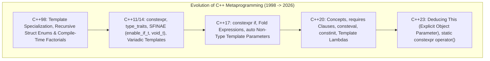
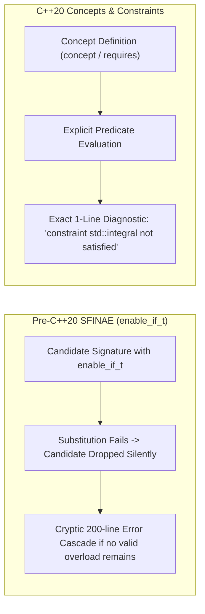

---


title: "C++ Metaprogramming: Templates, SFINAE, CRTP, Concepts & Compile-Time State Machines"
description: "Comprehensive production guide to C++ compile-time metaprogramming, SFINAE vs C++20 Concepts, variadic fold expressions, CRTP vs C++23 Deducing This, consteval lookup tables, compile-time state machines, and Expression Templates."
category: "Systems Programming & C++"
tags: [cpp, metaprogramming, templates, sfinae, concepts, crtp, constexpr, consteval, systems-programming, expression-templates, state-machine, technical-skills, software-engineering, learning-note]
date: "2026-08-21"
---

# 🧬 C++ Metaprogramming, Templates & C++20 Concepts

> 🔙 **Folder Hub**: [[00_Meta/05_folder_nodes/node_08_Systems_and_CPlusPlus|08 Systems & C++ Hub]]
> ⬅️ **Previous Module**: [[02_Technical_Skills/01_theory_and_concepts/08_Systems_and_CPlusPlus/06_cpp_cache_conscious_data_oriented_design|06 Cache-Conscious Data-Oriented Design]]
> 🔀 **Related Modules**: [[02_Technical_Skills/01_theory_and_concepts/08_Systems_and_CPlusPlus/03_cpp_move_semantics_and_perfect_forwarding|03 Move Semantics & Perfect Forwarding]] | [[02_Technical_Skills/01_theory_and_concepts/08_Systems_and_CPlusPlus/05_cpp20_coroutines_co_await_generators|05 C++20 Coroutines]]

---

## 1. The Metaprogramming Paradigm & Evolution

Metaprogramming enables code generation, type transformations, and mathematical evaluations at **compile time**, emitting specialized machine code with zero runtime dispatch cost, zero heap allocations, and zero branching penalties.



### 1.1 SFINAE (Substitution Failure Is Not An Error) vs. C++20 Concepts

Before C++20, type-constrained template overloading relied on **SFINAE** via `std::enable_if_t` and expression validity probing. SFINAE exploits the compiler's template substitution rules: if substituting a template parameter creates an invalid type or expression in the function signature, the candidate is discarded without emitting a compiler error.



#### Detailed Comparison: SFINAE vs. C++20 Concepts

| Dimension | SFINAE (`std::enable_if_t`, `void_t`) | C++20 Concepts (`concept`, `requires`) |
| :--- | :--- | :--- |
| **Syntax Readability** | Dense boilerplate (`std::enable_if_t<std::is_integral_v<T>, int> = 0`). | Natural language predicate (`template <std::integral T>` or `requires std::integral<T>`). |
| **Diagnostic Errors** | 100+ lines of template instantiation cascades and compiler dumps. | Exact constraint failure reported at the caller site with highlighted requirements. |
| **Compilation Speed** | Slow AST expansions; heavy compiler symbol table bloat. | High-speed boolean short-circuit evaluation in the front-end parser. |
| **Overload Ordering** | Ambiguous overloads require mutually exclusive conditions (`!cond`). | Automatic **Subsumption Rules**: more constrained concepts naturally win overloads. |
| **Duck-Typing Verification** | Complex `decltype(declval<T>().foo(), std::true_type{})` helpers. | Clean compound `requires` expressions checking return types and `noexcept`. |

```cpp
// ❌ Pre-C++20 SFINAE Detection Idiom Boilerplate
template <typename T, typename = void>
struct has_serialize : std::false_type {};

template <typename T>
struct has_serialize<T, std::void_t<decltype(std::declval<T>().serialize())>> : std::true_type {};

template <typename T, std::enable_if_t<has_serialize<T>::value, int> = 0>
void process(T&& obj) {
    obj.serialize();
}

// ✅ Modern C++20 Concepts Definition
template <typename T>
concept Serializable = requires(T obj) {
    { obj.serialize() } -> std::same_as<void>;
};

void process(Serializable auto&& obj) {
    obj.serialize();
}
```

### 1.2 Constraint Subsumption & Disjunction Rules

In C++20, if function overload $A$ requires concept $C_1$, and overload $B$ requires concept $C_1 \land C_2$, the compiler automatically selects overload $B$ for types satisfying both without ambiguity:

```cpp
template <typename T>
concept Shape = requires(T s) {
    { s.area() } -> std::floating_point;
};

template <typename T>
concept PrintableShape = Shape<T> && requires(T s) {
    { s.to_string() } -> std::convertible_to<std::string>;
};

// Subsumption in action: PrintableShape strictly subsumes Shape
void render(Shape auto& s) {
    std::cout << "Rendering base shape with area: " << s.area() << "\n";
}

void render(PrintableShape auto& s) {
    std::cout << "Rendering " << s.to_string() << " with area: " << s.area() << "\n";
}
```

---

## 2. Variadic Templates & Modern Fold Expressions

Variadic templates accept arbitrary numbers of heterogeneous arguments. C++17/20 **Fold Expressions** replace recursive template struct unwinding with direct inline expansions.

### 2.1 The Four Fold Expression Forms

| Fold Syntax | Name | Expansion Pattern |
| :--- | :--- | :--- |
| `(... + args)` | Unary Left Fold | `(((args1 + args2) + args3) + ... + argsN)` |
| `(args + ...)` | Unary Right Fold | `(args1 + (args2 + (... + argsN)))` |
| `(init + ... + args)` | Binary Left Fold | `(((init + args1) + args2) + ... + argsN)` |
| `(args + ... + init)` | Binary Right Fold | `(args1 + (args2 + (... + (argsN + init))))` |

### 2.2 Production Variadic Tuple Streamer & Compile-Time Type Detection

```cpp
#include <iostream>
#include <tuple>
#include <string_view>
#include <concepts>
#include <type_traits>

// 1. Fold-based Tuple Streamer with Comma Operator
template <typename Tuple, size_t... Indices>
void print_tuple_impl(std::ostream& os, const Tuple& t, std::index_sequence<Indices...>) {
    os << "(";
    size_t i = 0;
    ((os << (i++ == 0 ? "" : ", ") << std::get<Indices>(t)), ...);
    os << ")";
}

template <typename... Args>
std::ostream& operator<<(std::ostream& os, const std::tuple<Args...>& t) {
    print_tuple_impl(os, t, std::make_index_sequence<sizeof...(Args)>{});
    return os;
}

// 2. High-Performance Multi-Argument Hash Combiner
inline void hash_combine(size_t& seed) noexcept {}

template <typename T, typename... Rest>
inline void hash_combine(size_t& seed, const T& v, const Rest&... rest) noexcept {
    std::hash<T> hasher;
    seed ^= hasher(v) + 0x9e3779b9 + (seed << 6) + (seed >> 2);
    (hash_combine(seed, rest), ...); // Fold expression over recursive expansion
}
```

---

## 3. Zero-Cost Abstractions: CRTP vs. C++23 Deducing This vs. Virtual Dispatch

Dynamic polymorphism via `virtual` functions carries significant performance penalties in performance-critical loops:
1. **Virtual Table Pointer (`vptr`)**: Adds 8 bytes per object instance, polluting CPU cache lines.
2. **Double Pointer Indirection**: Dereferencing `vptr -> vtable -> function pointer`.
3. **Inlining Barrier**: Compilers cannot inline virtual method calls unless exact type devirtualization can be mathematically proven.

```mermaid
flowchart TD
    subgraph Dynamic["Dynamic Polymorphism (Virtual Dispatch)"]
        Obj["Object Instance (+8B vptr)"] --> VTable["vtable table in .rodata"]
        VTable --> FuncPtr["Function Pointer Call (Indirect Call / No Inline)"]
    end

    subgraph CRTP["Static Polymorphism (CRTP)"]
        Derived["Derived Class"] -->|Passes Derived type as Template Param| Base["Base<Derived>"]
        Base -->|static_cast to Derived*| DirectCall["Direct Inlined CPU Instructions (Zero Overhead)"]
    end

    subgraph DeducingThis["Modern C++23 (Deducing This)"]
        DDerived["Derived Class"] --> ExplicitObj["void write(this Self&& self)"]
        ExplicitObj --> DirectCall2["Direct Inlined Call (No Base<Derived> Inheritance needed)"]
    end
```



### 3.1 Production CRTP Zero-Cost Stream Serializer

```cpp
#include <cstdint>
#include <string_view>
#include <vector>
#include <iostream>

template <typename Derived>
class BinaryWriter {
public:
    void write_u32(uint32_t value) {
        underlying().write_raw(reinterpret_cast<const char*>(&value), sizeof(value));
    }

    void write_string(std::string_view str) {
        write_u32(static_cast<uint32_t>(str.size()));
        underlying().write_raw(str.data(), str.size());
    }

    // Static Dispatch: calls Derived without virtual tables
    void flush() {
        underlying().flush_impl();
    }

private:
    Derived& underlying() noexcept { return static_cast<Derived&>(*this); }
    const Derived& underlying() const noexcept { return static_cast<const Derived&>(*this); }
};

// Concrete derived implementation: Memory Buffer Writer
class MemoryBufferWriter : public BinaryWriter<MemoryBufferWriter> {
public:
    void write_raw(const char* data, size_t size) {
        buffer_.insert(buffer_.end(), data, data + size);
    }
    void flush_impl() noexcept { /* No-op for memory */ }

    [[nodiscard]] const std::vector<char>& data() const noexcept { return buffer_; }
private:
    std::vector<char> buffer_;
};
```

### 3.2 C++23 Explicit Object Parameters (`this Self&& self`)

In C++23, **Deducing This** replaces CRTP boilerplate by allowing member functions to accept an explicit object parameter:

```cpp
// C++23 Modern Static Dispatch without CRTP Base<Derived>
struct ModernWriterBase {
    template <typename Self>
    void write_u32(this Self&& self, uint32_t value) {
        self.write_raw(reinterpret_cast<const char*>(&value), sizeof(value));
    }
};

struct FastFileWriter : ModernWriterBase {
    void write_raw(const char* data, size_t size) {
        // Direct write to OS file descriptor
    }
};
```

---

## 4. Compile-Time Type-Safe State Machines

Using C++20 concepts and phantom types, state machines can enforce valid state transitions at compile time, eliminating runtime state validation bugs entirely:

```cpp
#include <iostream>

// State Types
struct Disconnected {};
struct Connecting {};
struct Connected {};

template <typename State>
class Connection {
public:
    Connection() requires std::same_as<State, Disconnected> = default;

    Connection<Connecting> connect() && requires std::same_as<State, Disconnected> {
        std::cout << "Initiating connection...\n";
        return Connection<Connecting>{};
    }

    Connection<Connected> establish() && requires std::same_as<State, Connecting> {
        std::cout << "Connection established!\n";
        return Connection<Connected>{};
    }

    void send_payload(std::string_view data) const requires std::same_as<State, Connected> {
        std::cout << "Transmitting payload: " << data << "\n";
    }

    Connection<Disconnected> disconnect() && requires std::same_as<State, Connected> {
        std::cout << "Disconnected.\n";
        return Connection<Disconnected>{};
    }

private:
    template <typename> friend class Connection;
    Connection() = default;
};

void run_connection_lifecycle() {
    Connection<Disconnected> conn;
    auto connecting = std::move(conn).connect();
    auto connected = std::move(connecting).establish();
    connected.send_payload("HELO 2026");
    auto disconnected = std::move(connected).disconnect();
    
    // Attempting to send payload while disconnected triggers a COMPILE-TIME ERROR:
    // disconnected.send_payload("FAILED"); // error: constraints not satisfied!
}
```

---

## 5. Expression Templates for Zero-Allocation Vector Mathematics

In numerical computing, evaluating expressions like `D = A + B + C` naively allocates temporary vectors for each intermediate addition `(A + B)`. **Expression Templates** defer evaluation, constructing a lightweight compile-time type tree that evaluates in a single fused loop:

```cpp
#include <vector>
#include <cstddef>
#include <cassert>
#include <iostream>

template <typename E>
class VecExpression {
public:
    [[nodiscard]] double operator[](size_t i) const {
        return static_cast<const E&>(*this)[i];
    }
    [[nodiscard]] size_t size() const {
        return static_cast<const E&>(*this).size();
    }
};

class Vector : public VecExpression<Vector> {
    std::vector<double> data_;
public:
    explicit Vector(size_t n) : data_(n, 0.0) {}
    Vector(std::initializer_list<double> init) : data_(init) {}

    double operator[](size_t i) const { return data_[i]; }
    double& operator[](size_t i) { return data_[i]; }
    [[nodiscard]] size_t size() const { return data_.size(); }

    template <typename E>
    Vector& operator=(const VecExpression<E>& expr) {
        assert(size() == expr.size());
        for (size_t i = 0; i < size(); ++i) {
            data_[i] = expr[i]; // Single fused loop: NO intermediate memory allocations!
        }
        return *this;
    }
};

template <typename E1, typename E2>
class VecSum : public VecExpression<VecSum<E1, E2>> {
    const E1& u_;
    const E2& v_;
public:
    VecSum(const E1& u, const E2& v) : u_(u), v_(v) {
        assert(u.size() == v.size());
    }
    double operator[](size_t i) const { return u_[i] + v_[i]; }
    [[nodiscard]] size_t size() const { return u_.size(); }
};

template <typename E1, typename E2>
VecSum<E1, E2> operator+(const VecExpression<E1>& u, const VecExpression<E2>& v) {
    return VecSum<E1, E2>(static_cast<const E1&>(u), static_cast<const E2&>(v));
}
```

---

## 6. Compile-Time Computation: `consteval` & Lookup Tables (LUT)

C++20 introduces `consteval` (Immediate Functions), which are guaranteed to execute strictly at compile time.

### 6.1 Compile-Time String Hashing (Murmur3 / FNV-1a)

```cpp
#include <cstdint>
#include <string_view>

// Guaranteed compile-time FNV-1a 64-bit hash
consteval uint64_t fnv1a_hash(std::string_view str) noexcept {
    uint64_t hash = 14695981039346656037ULL;
    for (char c : str) {
        hash ^= static_cast<uint64_t>(c);
        hash *= 1099511628211ULL;
    }
    return hash;
}

// Compile-time switch cases using hashed strings!
void handle_event(std::string_view event_name) {
    switch (fnv1a_hash(event_name)) {
        case fnv1a_hash("ON_PLAYER_DEATH"):
            // Handle death event
            break;
        case fnv1a_hash("ON_PACKET_RECEIVED"):
            // Handle packet event
            break;
        default:
            break;
    }
}
```

### 6.2 Compile-Time Sine Lookup Table (LUT)

```cpp
#include <array>
#include <cmath>
#include <numbers>

template <size_t N>
struct SineLUT {
    std::array<float, N> table{};

    constexpr SineLUT() noexcept {
        for (size_t i = 0; i < N; ++i) {
            const float angle = static_cast<float>(i) * 2.0f * std::numbers::pi_v<float> / static_cast<float>(N);
            // Taylor series approximation for compile-time float evaluation
            float x = angle;
            float term = angle;
            float sin_val = term;
            for (int k = 1; k <= 7; ++k) {
                term *= -1.0f * x * x / static_cast<float>((2 * k) * (2 * k + 1));
                sin_val += term;
            }
            table[i] = sin_val;
        }
    }

    [[nodiscard]] constexpr float lookup(size_t index) const noexcept {
        return table[index % N];
    }
};

// Generates 256-element Sine table in .rodata at compile time with 0 runtime overhead
inline constexpr SineLUT<256> g_sine_lut{};
```

---

## 🔗 Graph-Linked Knowledge Base

- [[00_Meta/05_folder_nodes/node_08_Systems_and_CPlusPlus|08 Systems & C++ Architecture Node]]
- [[02_Technical_Skills/01_theory_and_concepts/08_Systems_and_CPlusPlus/03_cpp_move_semantics_and_perfect_forwarding|03 Move Semantics & Perfect Forwarding]]
- [[02_Technical_Skills/01_theory_and_concepts/08_Systems_and_CPlusPlus/05_cpp20_coroutines_co_await_generators|05 C++20 Coroutines & Asynchronous Generators]]
- [[02_Technical_Skills/01_theory_and_concepts/08_Systems_and_CPlusPlus/06_cpp_cache_conscious_data_oriented_design|06 Cache-Conscious C++ & Data-Oriented Design]]
