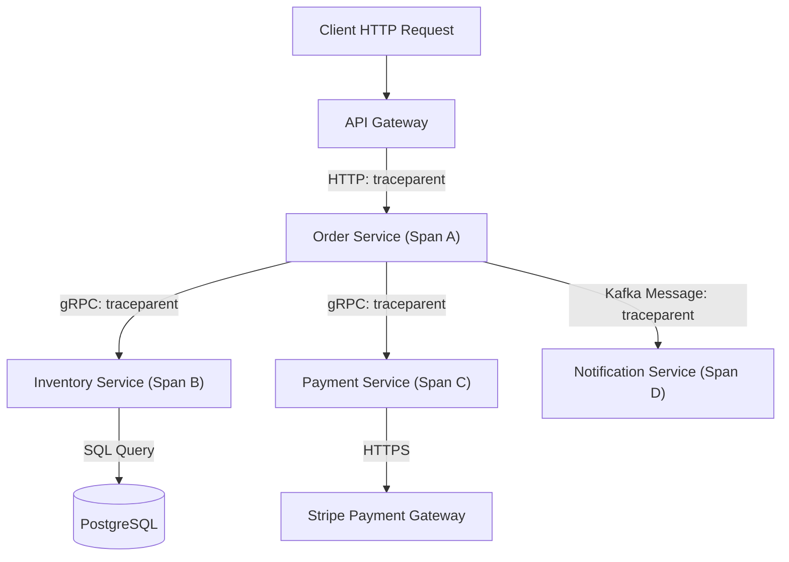
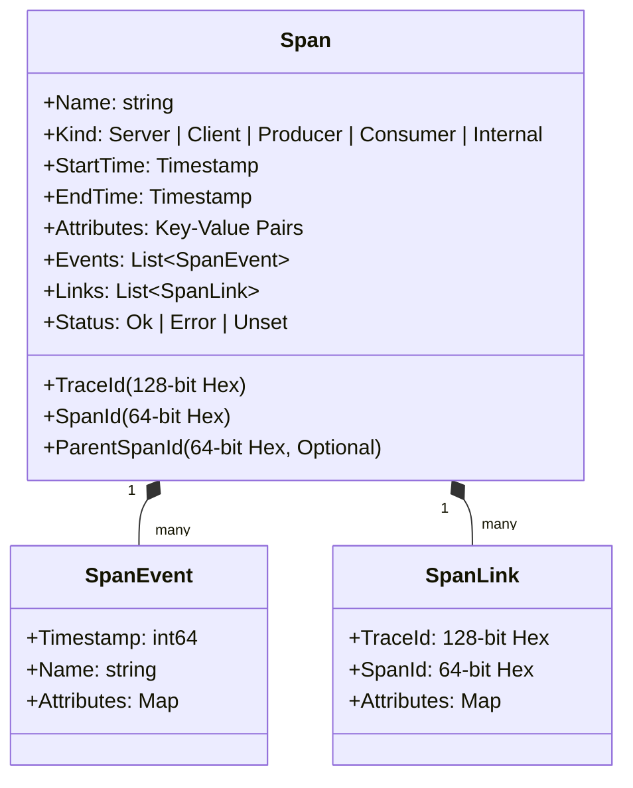
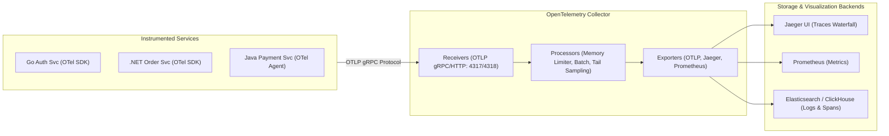
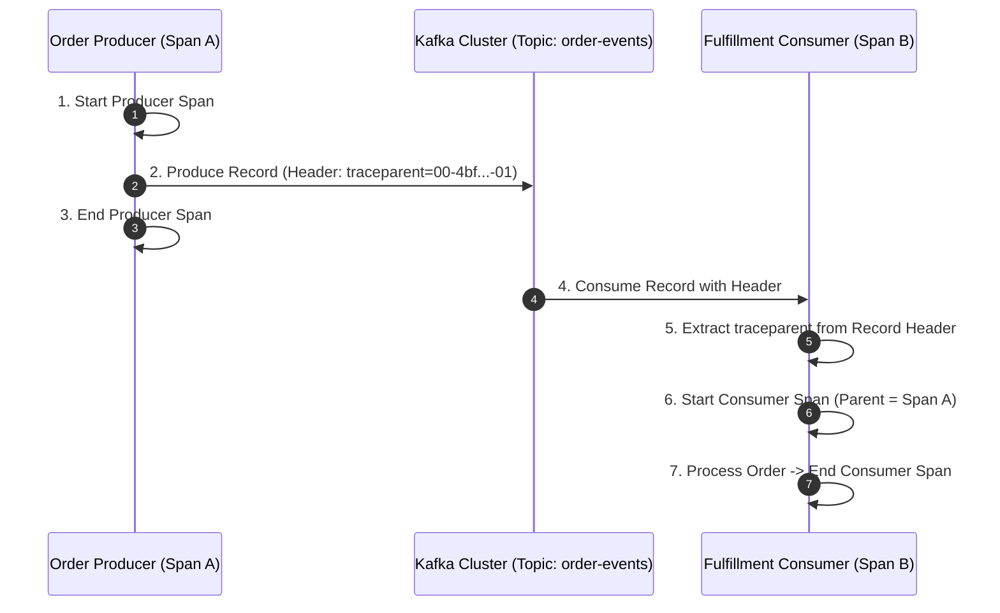

---


title: "Distributed Tracing Architecture & OpenTelemetry (OTel)"
description: "Production guide to distributed tracing, W3C TraceContext (traceparent), OpenTelemetry SDK, context propagation across HTTP/gRPC/Kafka, tail-based sampling, and Jaeger waterfall analysis."
category: "Observability, Logging & Tracing"
tags: [observability, logging, tracing, opentelemetry, jaeger, microservices, w3c-trace-context, performance, kafka-tracing, technical-skills, software-engineering, learning-note]
date: "2026-08-21"
---

# 🔭 Distributed Tracing Architecture & OpenTelemetry (OTel)

> 🔙 **Folder Hub**: [[00_Meta/05_folder_nodes/node_09_Backend_Logging_and_Tracing|09 Backend Logging & Tracing Hub]]
> ⬅️ **Previous Module**: [[02_Technical_Skills/01_theory_and_concepts/09_Backend_Logging_and_Tracing/structured_logging|Structured Logging]]
> ➡️ **Next Module**: [[02_Technical_Skills/01_theory_and_concepts/09_Backend_Logging_and_Tracing/elk_stack_integration|ELK Stack Integration]]
> 🔀 **Related Modules**: [[02_Technical_Skills/01_theory_and_concepts/10_Web_and_Frontend/restful_api_design_http_methods_status_codes|RESTful API Design]] | [[02_Technical_Skills/01_theory_and_concepts/12_Databases_and_SQL/transactions_concurrency|Transactions & Concurrency]]

---

## 1. The Microservice Observability Dilemma & Core Concepts

In modern distributed microservice architectures, a single end-user interaction (e.g. clicking "Place Order") can fan out into dozens of asynchronous RPC calls across polyglot microservices, database transactions, Redis cache lookups, and message broker queues (Kafka/RabbitMQ). When a request fails or experiences unacceptable $p99$ tail latency (e.g. 3.2 seconds instead of 50 ms), monolithic log searching fails completely because logs are scattered across isolated server nodes.

**Distributed Tracing** reconstructs the exact causal execution graph of a distributed transaction across process and network boundaries.



### 1.1 The Span Data Model & Terminology

A **Trace** is a directed acyclic graph (DAG) composed of one or more **Spans**.



1. **Trace ID**: A globally unique 128-bit cryptographic random hexadecimal identifier shared by all spans belonging to the same root transaction.
2. **Span ID**: A unique 64-bit hexadecimal identifier for an individual atomic unit of work.
3. **Parent Span ID**: Identifies the direct caller span. A span without a `ParentSpanId` is the **Root Span**.
4. **Attributes (Tags)**: Structured key-value metadata (e.g., `http.status_code = 200`, `db.statement = "SELECT * FROM users WHERE id = ?"`, `user.id = "usr_99182"`).
5. **Events**: In-memory timed log entries attached to the span with microsecond precision (e.g. cache miss, retry attempt).
6. **Span Links**: Connects independent traces (e.g. batch queue consumer linking back to 50 individual incoming message producers).
7. **Span Kind**: Specifies whether the span is `SERVER` (handling an incoming request), `CLIENT` (dispatching an outgoing request), `PRODUCER` (sending a queue message), or `CONSUMER` (processing a message).

---

## 2. W3C TraceContext & Context Propagation Mechanics

To correlate requests across disparate technological boundaries (Go, Java, .NET, Python, Envoy proxies), the World Wide Web Consortium (W3C) established the standard **TraceContext** specification.

### 2.1 The `traceparent` Header Format

The HTTP header `traceparent` encodes trace metadata into a compact 4-field string:

```
traceparent: 00-4bf92f3577b34da6a3ce929d0e0e4736-00f067aa0ba902b7-01
             ^^ -------------------------------- ---------------- ^^
          Version            Trace ID                 Parent Span ID   Flags
```

1. **Version (`00`)**: Currently `00` (8-bit hex).
2. **Trace ID (`4bf92f3577b34da6a3ce929d0e0e4736`)**: 32-character hex string representing 16 bytes.
3. **Parent Span ID (`00f067aa0ba902b7`)**: 16-character hex string representing 8 bytes.
4. **Trace Flags (`01`)**: 8-bit bitmap. `01` means the trace is **Sampled** (recorded and exported); `00` means unsampled.

### 2.2 The `tracestate` and `baggage` Headers

- **`tracestate`**: Vendor-specific routing tags (e.g. `congo=t61rcWkgMzE,rojo=00f067a`).
- **`baggage`** (W3C Baggage): Key-value pairs propagated across the entire downstream call chain (e.g. `baggage: userId=alice,datacenter=us-east-1`). Unlike span attributes, Baggage travels through all downstream network hops automatically.

---

## 3. OpenTelemetry (OTel) Architecture & Sampling Strategies

**OpenTelemetry (OTel)** is the Cloud Native Computing Foundation (CNCF) standard unifying Tracing, Metrics, and Logging into a vendor-neutral observability framework.



### 3.1 Head-Based vs. Tail-Based Sampling

High-throughput systems processing 100,000 requests/second cannot export and store $100\%$ of spans without massive network bandwidth and storage costs.

| Sampling Strategy | Mechanics | Pros | Cons |
| :--- | :--- | :--- | :--- |
| **Head-Based Sampling** | Sampling decision is made at the **Root Span** before work begins (e.g. `TraceIdRatioBased(0.01)` = 1%). | Zero memory overhead; decision propagates immediately via `traceparent` flag `01`. | May drop rare $500\text{ Internal Server Error}$ traces or high-latency outlier spans. |
| **Tail-Based Sampling** | All spans are buffered in memory inside the **OpenTelemetry Collector** until the entire trace completes. The collector evaluates the trace DAG. | Guaranteed $100\%$ capture of all errors and high-latency spans ($> 1.5\text{s}$). | Requires stateful OpenTelemetry Collector clustering with memory buffering. |

### 3.2 Tail-Based Sampling Configuration in OTel Collector

```yaml
processors:
  tail_sampling:
    decision_wait: 10s
    num_traces: 100000
    expected_new_traces_per_sec: 2000
    policies:
      # 1. Sample 100% of traces that contain error status
      - name: error-policy
        type: status_code
        status_code: { status_codes: [ERROR] }

      # 2. Sample 100% of traces exceeding 1.5 seconds latency
      - name: high-latency-policy
        type: latency
        latency: { threshold_ms: 1500 }

      # 3. Sample 1% of normal background requests
      - name: probabilistic-fallback
        type: probabilistic
        probabilistic: { sampling_percentage: 1.0 }
```

---

## 4. Asynchronous Message Broker Context Propagation (Kafka & RabbitMQ)

In event-driven architectures, HTTP calls terminate at the publisher. Traces must jump across asynchronous message broker boundaries by injecting W3C TraceContext headers into **Kafka Record Headers**:



---

## 5. Production Polyglot Instrumentation Implementations

### 5.1 C# (.NET 8) OpenTelemetry & `ActivitySource` Implementation

.NET 8 natively integrates distributed tracing via the `System.Diagnostics.ActivitySource` API:

```csharp
using System.Diagnostics;
using Microsoft.AspNetCore.Builder;
using Microsoft.Extensions.DependencyInjection;
using OpenTelemetry.Resources;
using OpenTelemetry.Trace;

var builder = WebApplication.CreateBuilder(args);

// Define custom ActivitySource for domain spans
public static class TelemetryConstants
{
    public const string ServiceName = "OrderProcessingService";
    public static readonly ActivitySource OrderSource = new(ServiceName, "1.0.0");
}

// Configure OpenTelemetry Tracing Pipeline
builder.Services.AddOpenTelemetry()
    .ConfigureResource(resource => resource.AddService(TelemetryConstants.ServiceName))
    .WithTracing(tracing => tracing
        .AddAspNetCoreInstrumentation(opts => opts.RecordException = true)
        .AddHttpClientInstrumentation()
        .AddEntityFrameworkCoreInstrumentation()
        .AddSource(TelemetryConstants.ServiceName)
        .AddOtlpExporter(opt => opt.Endpoint = new Uri("http://otel-collector:4317")));

var app = builder.Build();

app.MapPost("/api/orders", async (OrderRequest request, HttpClient httpClient) =>
{
    using var activity = TelemetryConstants.OrderSource.StartActivity(
        "ProcessOrderTransaction", 
        ActivityKind.Server);

    activity?.SetTag("order.id", request.OrderId);
    activity?.SetTag("order.amount", request.Amount);

    try
    {
        var paymentResponse = await httpClient.PostAsJsonAsync("http://payment-service/charge", request);
        paymentResponse.EnsureSuccessStatusCode();

        activity?.AddEvent(new ActivityEvent("PaymentVerified"));
        return Results.Created($"/api/orders/{request.OrderId}", new { status = "Success" });
    }
    catch (Exception ex)
    {
        activity?.SetStatus(ActivityStatusCode.Error, ex.Message);
        activity?.RecordException(ex);
        throw;
    }
});

app.Run();
```

### 5.2 Go Production OpenTelemetry with Context Propagation

```go
package main

import (
	"context"
	"net/http"

	"go.opentelemetry.io/otel"
	"go.opentelemetry.io/otel/attribute"
	"go.opentelemetry.io/otel/codes"
	"go.opentelemetry.io/otel/propagation"
	semconv "go.opentelemetry.io/otel/semconv/v1.24.0"
	"go.opentelemetry.io/otel/trace"
)

var tracer = otel.Tracer("inventory-service")

func handleCheckInventory(w http.ResponseWriter, r *http.Request) {
	// Extract incoming W3C traceparent from HTTP Request Headers
	ctx := otel.GetTextMapPropagator().Extract(r.Context(), propagation.HeaderCarrier(r.Header))

	// Start child span linked to extracted context
	ctx, span := tracer.Start(ctx, "CheckStockDatabase",
		trace.WithSpanKind(trace.SpanKindServer),
		trace.WithAttributes(
			semconv.HTTPRequestMethodKey.String("GET"),
			attribute.String("inventory.item_id", r.URL.Query().Get("itemId")),
		),
	)
	defer span.End()

	err := queryDatabase(ctx)
	if err != nil {
		span.RecordError(err)
		span.SetStatus(codes.Error, "Database query failed")
		http.Error(w, "Out of stock or internal error", http.StatusInternalServerError)
		return
	}

	span.SetStatus(codes.Ok, "Stock available")
	w.WriteHeader(http.StatusOK)
	w.Write([]byte(`{"available": true}`))
}

func queryDatabase(ctx context.Context) error {
	_, dbSpan := tracer.Start(ctx, "SELECT stock FROM inventory WHERE id = ?",
		trace.WithSpanKind(trace.SpanKindClient),
		trace.WithAttributes(semconv.DBSystemPostgreSQL),
	)
	defer dbSpan.End()
	
	// Execute database query...
	return nil
}
```

---

## 6. Jaeger & Waterfall Latency Bottleneck Analysis

When spans are exported to an observability platform (such as Jaeger or Grafana Tempo), the system constructs an interactive **Waterfall Timeline Chart**:

```
[Trace ID: 4bf92f3577b34da6a3ce929d0e0e4736] Total Duration: 420ms
========================================================================================
1. API-Gateway: POST /orders                         [0ms -------------------- 420ms] (420ms)
2.  └─ OrderService: ProcessOrderTransaction           [10ms ------------------ 410ms] (400ms)
3.      ├─ PaymentService: POST /charge                [20ms --------- 280ms]          (260ms) [BOTTLENECK]
4.      │   └─ StripeAPI: HTTPS /v1/charges            [30ms ------- 275ms]            (245ms)
5.      ├─ InventoryService: GET /stock?id=12          [285ms -- 320ms]                (35ms)
6.      │   └─ PostgreSQL: SELECT stock FROM items     [290ms - 315ms]                 (25ms)
7.      └─ KafkaProducer: order-placed-topic           [325ms - 340ms]                 (15ms)
========================================================================================
```

### 6.1 Diagnosing Anti-Patterns via Waterfall Spans

1. **The N+1 Database Query Anti-Pattern**: If a single incoming HTTP request reveals 200 consecutive, sequential 5ms spans reading individual database rows instead of 1 batched `WHERE IN (...)` query span.
2. **Serial Network RPC Calls**: Sequential calls that have no data dependencies (e.g. validating user profile and fetching exchange rates) can be refactored into concurrent `Task.WhenAll()` / `errgroup` executions.
3. **Uninstrumented Blind Spots**: Gaps between the end of child Span $A$ and the start of child Span $B$ indicate synchronous CPU-heavy work (e.g., JSON parsing or cryptographic hashing) that needs a dedicated internal span.

---

## 🔗 Graph-Linked Knowledge Base

- [[00_Meta/05_folder_nodes/node_09_Backend_Logging_and_Tracing|09 Backend Logging & Tracing Hub]]
- [[02_Technical_Skills/01_theory_and_concepts/09_Backend_Logging_and_Tracing/structured_logging|Structured Logging & Context Enrichment]]
- [[02_Technical_Skills/01_theory_and_concepts/09_Backend_Logging_and_Tracing/elk_stack_integration|ELK Stack Centralized Logging Architecture]]
- [[02_Technical_Skills/01_theory_and_concepts/10_Web_and_Frontend/restful_api_design_http_methods_status_codes|RESTful API Design & HTTP Status Codes]]
