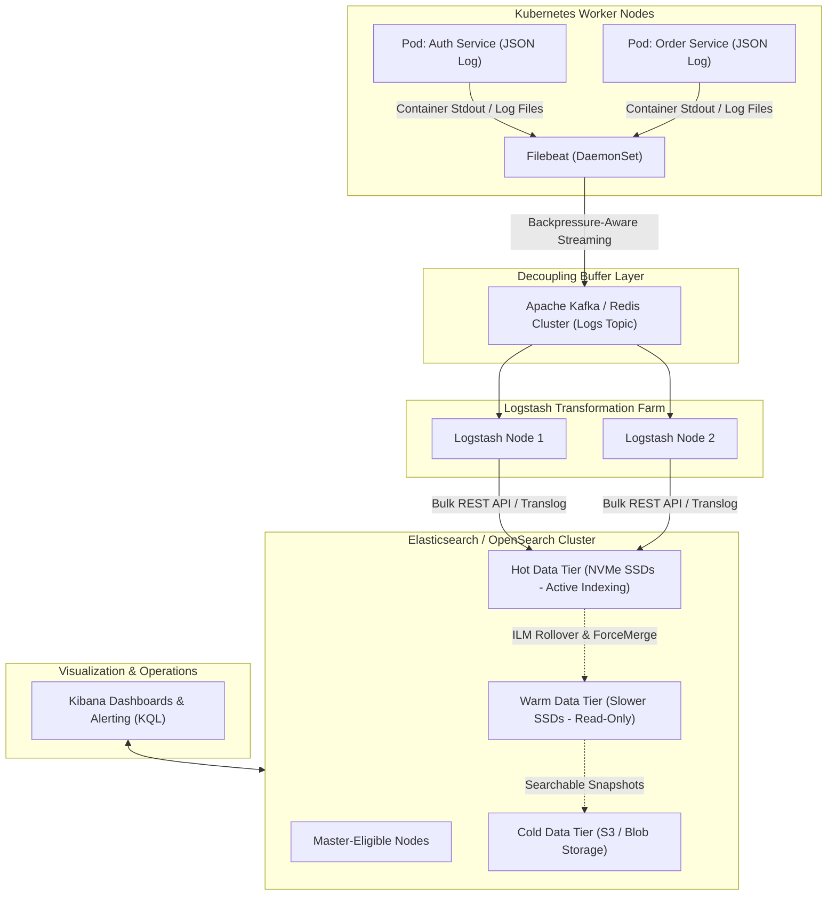
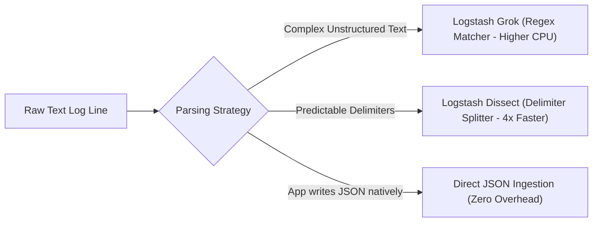

---


title: "ELK Stack Integration: Centralized Logging & Enterprise Observability"
description: "Master guide to Elasticsearch, Logstash, Kibana, Filebeat ingestion pipelines, Kafka buffering, Index Lifecycle Management (ILM), and KQL analytics."
category: "Observability, Logging & Tracing"
tags: [observability, logging, elk-stack, elasticsearch, logstash, kibana, filebeat, ilm, devops, opensearch, technical-skills, software-engineering, learning-note]
date: "2026-08-21"
---

# 📊 ELK Stack Integration: Centralized Logging & Analytics

> 🔙 **Folder Hub**: [[00_Meta/05_folder_nodes/node_09_Backend_Logging_and_Tracing|09 Backend Logging & Tracing Hub]]
> ⬅️ **Previous Module**: [[02_Technical_Skills/01_theory_and_concepts/09_Backend_Logging_and_Tracing/distributed_tracing|Distributed Tracing]]
> ➡️ **Next Module**: [[02_Technical_Skills/01_theory_and_concepts/09_Backend_Logging_and_Tracing/structured_logging|Structured Logging]]
> 🔀 **Related Modules**: [[02_Technical_Skills/01_theory_and_concepts/11_Backend_Search_Engine_Elasticsearch/elasticsearch_basics|Elasticsearch Basics]] | [[02_Technical_Skills/01_theory_and_concepts/11_Backend_Search_Engine_Elasticsearch/advanced_search_features|Advanced Search Features]]

---

## 1. Enterprise Centralized Logging Architecture

In large-scale production environments with hundreds of containerized microservices across Kubernetes clusters, collecting logs directly from individual application pods or writing directly to database stores causes fatal I/O bottlenecks and data loss during network partitions.

The **ELK Stack** (Elasticsearch, Logstash, Kibana), augmented by lightweight edge forwarders (**Filebeat**) and distributed streaming buffers (**Apache Kafka**), provides a horizontally scalable, zero-loss centralized logging infrastructure.



### 1.1 Architectural Component Responsibilities

1. **Filebeat**: A lightweight Go binary running as a daemon on each host/node. Tails logs with minimal CPU/RAM footprint ($\sim 15\text{MB}$ RAM), handles multiline stack traces, tracks byte offsets in a local registry file, and respects backpressure from downstream consumers.
2. **Apache Kafka (Buffer)**: Acts as an elastic queue between edge shippers and heavyweight log transformers. If Elasticsearch slows down during maintenance, Kafka buffers gigabytes of log streams without dropping a single event.
3. **Logstash**: A high-throughput transformation engine that extracts structured fields via grok/dissect, normalizes timestamps, enriches IP addresses with GeoIP metadata, and redacts sensitive PII information before indexing.
4. **Elasticsearch / OpenSearch**: A distributed search engine storing JSON documents in Lucene segments, building Inverted Indexes for full-text search and Doc Values for numerical aggregation.
5. **Kibana / OpenSearch Dashboards**: Web interface providing real-time log querying via KQL (Kibana Query Language), anomaly detection, and operational metric dashboards.

---

## 2. Ingestion & Transformation: Grok vs. Dissect vs. Ingest Pipelines

Transforming raw log lines into structured JSON documents is the primary CPU bottleneck of the logging pipeline.



### 2.1 Performance Comparison: Grok vs. Dissect

- **Grok**: Uses regular expressions to match arbitrary patterns. Flexible but incurs significant CPU backtracking overhead on large payloads.
- **Dissect**: Splits strings strictly by static delimiters (spaces, brackets, commas) without regular expressions. Operates **4 to 5 times faster** than Grok with near-zero CPU overhead.

### 2.2 Production Logstash Configuration (`logstash.conf`)

```ruby
input {
  kafka {
    bootstrap_servers => "kafka-cluster:9092"
    topics => ["app-logs-production"]
    codec => "json"
    consumer_threads => 4
    auto_offset_reset => "latest"
  }
}

filter {
  # 1. Parse JSON payloads if embedded inside a message field
  if [message] =~ /^\{.*\}$/ {
    json {
      source => "message"
      target => "parsed_json"
      remove_field => ["message"]
    }
  }

  # 2. Extract timestamp and convert to ISO8601
  date {
    match => [ "[parsed_json][timestamp]", "ISO8601", "yyyy-MM-dd HH:mm:ss.SSS" ]
    target => "@timestamp"
    timezone => "UTC"
  }

  # 3. Mask Credit Card / Sensitive PII numbers
  mutate {
    gsub => [
      "[parsed_json][credit_card]", "\b(?:\d{4}[ -]?){3}(?=\d{4}\b)", "****-****-****-"
    ]
  }

  # 4. Enrich with geo-location metadata for client IP
  if [parsed_json][client_ip] {
    geoip {
      source => "[parsed_json][client_ip]"
      target => "client_geo"
    }
  }
}

output {
  elasticsearch {
    hosts => ["https://es-node-01:9200", "https://es-node-02:9200"]
    ssl => true
    cacert => "/etc/logstash/certs/ca.crt"
    user => "logstash_internal"
    password => "${LOGSTASH_PASSWORD}"
    
    # Route dynamically by environment and date
    index => "logs-%{[parsed_json][service]}-%{+YYYY.MM.dd}"
    
    # Performance tuning
    bulk_max_size => 2000
    workers => 4
  }
}
```

---

## 3. Logstash Persistent Queues (PQ) for Zero-Loss Crash Resilience

By default, Logstash buffers incoming events in an in-memory queue. If the Logstash process terminates unexpectedly, unindexed in-flight events are lost. Enabling **Persistent Queues (PQ)** writes incoming events sequentially to disk before processing:

```ini
# logstash.yml Persistent Queue Configuration
queue.type: persisted
path.queue: /var/lib/logstash/data/queue
queue.page_capacity: 64mb
queue.max_bytes: 8gb
queue.checkpoint.writes: 1024
```

---

## 4. Index Lifecycle Management (ILM) & Data Tiering

Log data volume grows monotonically. Without automated **Index Lifecycle Management (ILM)**, clusters exhaust disk storage and suffer catastrophic out-of-memory (OOM) heap crashes.

```mermaid
stateDiagram-v2
    [*] --> HotPhase: New Index Created (logs-app-000001)
    
    state "Hot Phase (Active Writes & Searches)" as HotPhase {
        note right of HotPhase: High-IOPS NVMe SSDs\nPrimary Shards + Replicas\nRollover: age >= 1d OR size >= 50GB
    }

    state "Warm Phase (Read-Only Analytics)" as WarmPhase {
        note right of WarmPhase: Slower SSDs / Reduced Replicas\nForce-Merge to 1 Segment\nRead-Only Mode
    }

    state "Cold Phase (Long-Term Retention)" as ColdPhase {
        note right of ColdPhase: Searchable Snapshots on S3/GCS\nZero local storage cost
    }

    state "Delete Phase" as DeletePhase {
        note right of DeletePhase: Automatic Deletion after 90 Days
    }

    HotPhase --> WarmPhase: After 7 Days / Rollover
    WarmPhase --> ColdPhase: After 30 Days
    ColdPhase --> DeletePhase: After 90 Days
    DeletePhase --> [*]
```

### 4.1 Defining an ILM Policy via REST API

```json
PUT _ilm/policy/enterprise_logging_policy
{
  "policy": {
    "phases": {
      "hot": {
        "min_age": "0ms",
        "actions": {
          "rollover": {
            "max_primary_shard_size": "50gb",
            "max_age": "1d"
          },
          "set_priority": { "priority": 100 }
        }
      },
      "warm": {
        "min_age": "7d",
        "actions": {
          "forcemerge": { "max_num_segments": 1 },
          "allocate": { "number_of_replicas": 1 },
          "set_priority": { "priority": 50 }
        }
      },
      "cold": {
        "min_age": "30d",
        "actions": {
          "searchable_snapshot": {
            "snapshot_repository": "s3_backup_repo"
          },
          "set_priority": { "priority": 0 }
        }
      },
      "delete": {
        "min_age": "90d",
        "actions": {
          "delete": {}
        }
      }
    }
  }
}
```

---

## 5. Production Filebeat Configuration with Multiline Handling

Stack traces from Java, C#, or Python span multiple physical lines. Filebeat must be configured with multiline regex to aggregate stack trace exceptions into a single logical document:

```yaml
filebeat.inputs:
  - type: container
    paths:
      - /var/log/containers/*.log
    multiline.type: pattern
    multiline.pattern: '^[0-9]{4}-[0-9]{2}-[0-9]{2}' # Match ISO timestamp start
    multiline.negate: true
    multiline.match: after
    multiline.max_lines: 500
    multiline.timeout: 5s

    processors:
      - add_kubernetes_metadata:
          host: "${NODE_NAME}"
          matchers:
            - logs_path:
                logs_path: "/var/log/containers/"

output.kafka:
  hosts: ["kafka-01:9200", "kafka-02:9200"]
  topic: "app-logs-production"
  partition.round_robin:
    reachable_only: true
  required_acks: 1
  compression: gzip
  max_message_bytes: 1000000
```

---

## 6. Kibana Query Language (KQL) & Lucene Querying

Kibana uses **KQL** for rapid discovery and filtering.

### 6.1 KQL Query Cheat Sheet

| Use Case | KQL Syntax | Equivalent SQL Syntax |
| :--- | :--- | :--- |
| **Exact Field Filter** | `service.name: "payment-api"` | `WHERE service_name = 'payment-api'` |
| **Numeric Range** | `http.response.status_code >= 500` | `WHERE status_code >= 500` |
| **Boolean Conjunction** | `service.name: "order-api" and not http.response.status_code: 200` | `WHERE service_name = 'order-api' AND status_code != 200` |
| **Wildcard Match** | `error.message: *NullReferenceException*` | `WHERE error_message LIKE '%NullReferenceException%'` |
| **Nested Field Exists** | `client_geo.country_iso_code: *` | `WHERE country_iso_code IS NOT NULL` |

---

## 🔗 Graph-Linked Knowledge Base

- [[00_Meta/05_folder_nodes/node_09_Backend_Logging_and_Tracing|09 Backend Logging & Tracing Hub]]
- [[02_Technical_Skills/01_theory_and_concepts/09_Backend_Logging_and_Tracing/structured_logging|Structured Logging & Elastic Common Schema (ECS)]]
- [[02_Technical_Skills/01_theory_and_concepts/09_Backend_Logging_and_Tracing/distributed_tracing|Distributed Tracing Architecture & OpenTelemetry]]
- [[02_Technical_Skills/01_theory_and_concepts/11_Backend_Search_Engine_Elasticsearch/elasticsearch_basics|Elasticsearch Basics: Shards & Cluster Topologies]]
