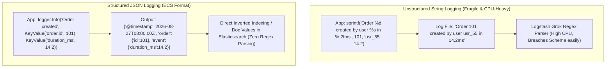
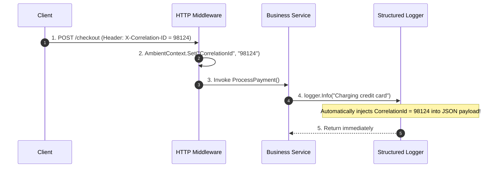
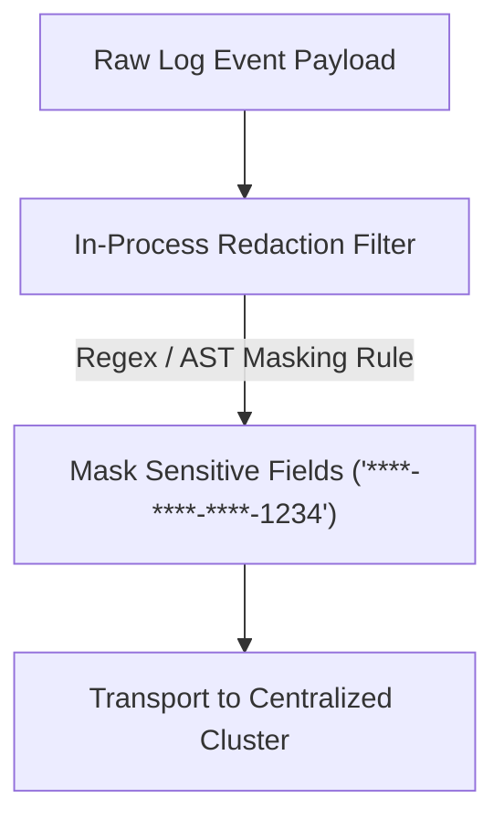

---


title: "Structured Logging Architecture & Elastic Common Schema (ECS)"
description: "Master guide to structured logging, JSON event modeling, zero-allocation log engines (Zap/Serilog/spdlog), asynchronous ring buffers, context enrichment, and PII masking."
category: "Observability, Logging & Tracing"
tags: [observability, logging, structured-logging, ecs, serilog, zap, spdlog, security, pii-masking, technical-skills, software-engineering, learning-note]
date: "2026-08-21"
---

# 📝 Structured Logging Architecture & Elastic Common Schema (ECS)

> 🔙 **Folder Hub**: [[00_Meta/05_folder_nodes/node_09_Backend_Logging_and_Tracing|09 Backend Logging & Tracing Hub]]
> ⬅️ **Previous Module**: [[02_Technical_Skills/01_theory_and_concepts/09_Backend_Logging_and_Tracing/elk_stack_integration|ELK Stack Integration]]
> ➡️ **Next Module**: [[02_Technical_Skills/01_theory_and_concepts/09_Backend_Logging_and_Tracing/distributed_tracing|Distributed Tracing]]
> 🔀 **Related Modules**: [[02_Technical_Skills/01_theory_and_concepts/10_Web_and_Frontend/web_security_xss_csrf_cors_csp_hardening|Web Security Hardening]] | [[02_Technical_Skills/01_theory_and_concepts/08_Systems_and_CPlusPlus/04_cpp_memory_barriers_atomics_lock_free|Memory Barriers & Atomics]]

---

## 1. Unstructured Text vs. Structured Event Models

Traditional backend logging relied on ad-hoc string concatenation (`printf("User %s logged in with IP %s\n", user, ip)`). While easily readable by human operators in a terminal, parsing unstructured text across billions of log lines requires brittle, compute-intensive regular expressions.

**Structured Logging** treats every log entry as a first-class, typed JSON data event formatted according to standardized schemas like the **Elastic Common Schema (ECS)** or **OpenTelemetry Log Data Model**.



### 1.1 Elastic Common Schema (ECS) Core Taxonomy

| ECS Field Hierarchy | Data Type | Description & Purpose |
| :--- | :--- | :--- |
| **`@timestamp`** | `date` (ISO 8601 UTC) | High-precision microsecond/nanosecond event timestamp. |
| **`log.level`** | `keyword` | Normalized log severity (`trace`, `debug`, `info`, `warn`, `error`, `fatal`). |
| **`message`** | `text` | Human-readable event description. |
| **`service.name`** | `keyword` | Canonical microservice name (e.g. `billing-engine`). |
| **`service.version`** | `keyword` | Application semantic build version (e.g. `v2.4.1`). |
| **`trace.id`** | `keyword` | 128-bit W3C Distributed Trace ID connecting log to distributed spans. |
| **`span.id`** | `keyword` | 64-bit W3C Span ID connecting log to specific atomic RPC step. |
| **`error.type`** | `keyword` | Exception class name (e.g. `System.NullReferenceException`). |
| **`error.stack_trace`** | `text` | Unwound exception stack frame listing. |
| **`host.hostname`** | `keyword` | Physical server or virtual machine identifier. |
| **`container.id`** | `keyword` | Docker / containerd container hash identifier. |

```json
{
  "@timestamp": "2026-08-27T08:15:30.124Z",
  "log.level": "error",
  "message": "Payment processing failed via Stripe gateway",
  "service": {
    "name": "checkout-service",
    "version": "v3.1.0",
    "environment": "production"
  },
  "trace": {
    "id": "4bf92f3577b34da6a3ce929d0e0e4736"
  },
  "span": {
    "id": "00f067aa0ba902b7"
  },
  "customer": {
    "id": "usr_99812",
    "tier": "PLATINUM"
  },
  "order": {
    "id": "ord_88129",
    "amount": 299.99,
    "currency": "USD"
  },
  "error": {
    "type": "GatewayTimeoutException",
    "message": "Upstream bank server failed to respond within 5000ms",
    "stack_trace": "at Billing.StripeClient.ChargeAsync() in /src/StripeClient.cs:line 104"
  }
}
```

---

## 2. High-Throughput Asynchronous Logging Engine Mechanics

Writing log messages synchronously to disk or standard output (`stdout`) directly blocks active worker threads. Under high-throughput conditions, filesystem I/O stalls or kernel write locks can cascade into total application lockup.

Modern high-performance logging frameworks (such as **Uber Zap** in Go, **ZLogger / Serilog** in .NET, and **spdlog** in C++) decouple log creation from physical I/O via **Lock-Free Asynchronous Ring Buffers** (the LMAX Disruptor pattern).

```mermaid
flowchart LR
    subgraph WorkerThreads["Application Worker Threads (Low Latency)"]
        W1["Thread 1"]
        W2["Thread 2"]
        W3["Thread 3"]
    end

    subgraph RingBuffer["Lock-Free SPSC/MPMC Ring Buffer (Memory)"]
        Slot1["Event Slot 0"]
        Slot2["Event Slot 1"]
        Slot3["Event Slot 2"]
        SlotN["Event Slot N"]
    end

    subgraph DedicatedFlusher["Dedicated Background I/O Thread"]
        Flusher["Batch Formatter & OS Writer (fsync / writev)"]
        Disk[("Physical Disk File / /dev/stdout")]
    end

    W1 & W2 & W3 -->|Zero-Allocation Atomic Emplace (10-50ns)| RingBuffer
    RingBuffer -->|Batched Chunk Drain| Flusher
    Flusher -->|Vectorized Write| Disk
```

### 2.1 Zero-Allocation Logging Mechanics

High-frequency loggers eliminate garbage collection pauses and heap allocations by:
1. Formatting string payloads into pre-allocated stack buffers using string views and compile-time format strings (`std::format` / string interpolation handlers).
2. Avoiding boxing of primitive types (e.g., passing `int`, `double`, `bool` directly rather than as boxed `object` interfaces).
3. Utilizing thread-local memory pools for JSON field serialization before publishing to the asynchronous queue.

---

## 3. Contextual Enrichment & Mapped Diagnostic Context (MDC)

To trace business events without passing logging parameters through every intermediate function signature, modern platforms use ambient execution context primitives:
- **Java / Kotlin**: `org.slf4j.MDC` (backed by `ThreadLocal`).
- **.NET**: `Serilog.Context.LogContext.PushProperty()` (backed by `AsyncLocal<T>`).
- **Go**: `context.Context` propagation with custom logger extractors.



---

## 4. Production Polyglot Implementations

### 4.1 C# (.NET 8) High-Performance Serilog with ECS Formatting

```csharp
using Serilog;
using Serilog.Formatting.Elasticsearch;
using Serilog.Context;

// 1. Configure High-Throughput Asynchronous Serilog Pipeline
Log.Logger = new LoggerConfiguration()
    .MinimumLevel.Information()
    .Enrich.FromLogContext()
    .Enrich.WithProperty("service.name", "payments-engine")
    .Enrich.WithProperty("environment", "production")
    .WriteTo.Async(a => a.Console(new ElasticsearchJsonFormatter(
        omitEnclosingObject: false,
        renderMessage: true
    )))
    .CreateLogger();

try
{
    // 2. Simulate Incoming Request with Ambient Context Enrichment
    using (LogContext.PushProperty("trace.id", "4bf92f3577b34da6a3ce929d0e0e4736"))
    using (LogContext.PushProperty("user.id", "usr_88192"))
    {
        Log.Information("Processing payment transaction for order {OrderId} with amount {Amount:C}", 
            "ord_9901", 149.50m);
        
        try
        {
            throw new InvalidOperationException("Payment gateway timeout");
        }
        catch (Exception ex)
        {
            Log.Error(ex, "Transaction failed for order {OrderId}", "ord_9901");
        }
    }
}
finally
{
    await Log.CloseAndFlushAsync(); // Drain all asynchronous ring buffers to disk
}
```

### 4.2 C++20 High-Performance Asynchronous `spdlog` Setup

```cpp
#include <spdlog/spdlog.h>
#include <spdlog/async.h>
#include <spdlog/sinks/rotating_file_sink.h>
#include <spdlog/sinks/stdout_color_sinks.h>

void init_logging_subsystem() {
    // 1. Initialize lock-free ring buffer: 64KB message capacity, 1 background flusher thread
    spdlog::init_thread_pool(65536, 1);

    auto console_sink = std::make_shared<spdlog::sinks::stdout_color_sink_mt>();
    
    // Rotating file sink: 50MB max file size, 5 backup files
    auto file_sink = std::make_shared<spdlog::sinks::rotating_file_sink_mt>(
        "logs/app.log", 50 * 1024 * 1024, 5);

    std::vector<spdlog::sink_ptr> sinks {console_sink, file_sink};

    auto async_logger = std::make_shared<spdlog::async_logger>(
        "async_prod_logger", 
        sinks.begin(), sinks.end(), 
        spdlog::thread_pool(), 
        spdlog::async_overflow_policy::block); // Block or drop on queue saturation

    // Set ECS-compliant custom pattern
    async_logger->set_pattern("{\"@timestamp\":\"%Y-%m-%dT%H:%M:%S.%fZ\",\"log.level\":\"%l\",\"thread.id\":%t,\"message\":\"%v\"}");
    spdlog::set_default_logger(async_logger);
}
```

### 4.3 Go Zero-Allocation Uber-Zap Implementation

```go
package main

import (
	"os"
	"time"

	"go.uber.org/zap"
	"go.uber.org/zap/zapcore"
)

func main() {
	// 1. Configure Production Encoder Config (ECS Aligned)
	encoderConfig := zap.NewProductionEncoderConfig()
	encoderConfig.TimeKey = "@timestamp"
	encoderConfig.EncodeTime = zapcore.ISO8601TimeEncoder
	encoderConfig.LevelKey = "log.level"
	encoderConfig.MessageKey = "message"

	core := zapcore.NewCore(
		zapcore.NewJSONEncoder(encoderConfig),
		zapcore.AddSync(zapcore.Lock(os.Stdout)),
		zap.InfoLevel,
	)

	logger := zap.New(core, zap.AddCaller(), zap.AddStacktrace(zap.ErrorLevel))
	defer logger.Sync()

	// 2. Emit strongly-typed, zero-allocation structured events
	logger.Info("User authentication succeeded",
		zap.String("user.id", "usr_7721"),
		zap.String("client.ip", "192.168.1.100"),
		zap.Duration("latency", 12*time.Millisecond),
		zap.Int("http.response.status_code", 200),
	)
}
```

---

## 5. PII Masking, Redaction & Security Hardening (GDPR / PCI-DSS)

Logging raw payloads risks leaking sensitive Personally Identifiable Information (PII) or financial credentials (credit cards, passwords, JWT tokens, social security numbers) into persistent storage.



### 5.1 Common Redaction Patterns & Regex Rules

| Target Data | Pattern / Regex | Redacted Form |
| :--- | :--- | :--- |
| **Credit Card Numbers** | `\b(?:\d{4}[ -]?){3}(?=\d{4}\b)` | `****-****-****-1234` |
| **Email Addresses** | `(?<=.)[^@\n](?=[^@\n]*?[^@\n]@)|(?<=@.)[^.\n](?=[^.\n]*?\.)` | `a***e@d***n.com` |
| **JWT Bearer Tokens** | `Bearer\s+[A-Za-z0-9\-_=]+\.[A-Za-z0-9\-_=]+\.?[A-Za-z0-9\-_=]*` | `Bearer [REDACTED]` |
| **Social Security Number (SSN)** | `\b\d{3}-\d{2}-\d{4}\b` | `***-**-1234` |

---

## 🔗 Graph-Linked Knowledge Base

- [[00_Meta/05_folder_nodes/node_09_Backend_Logging_and_Tracing|09 Backend Logging & Tracing Hub]]
- [[02_Technical_Skills/01_theory_and_concepts/09_Backend_Logging_and_Tracing/elk_stack_integration|ELK Stack Integration: Centralized Logging]]
- [[02_Technical_Skills/01_theory_and_concepts/09_Backend_Logging_and_Tracing/distributed_tracing|Distributed Tracing Architecture & OpenTelemetry]]
- [[02_Technical_Skills/01_theory_and_concepts/10_Web_and_Frontend/web_security_xss_csrf_cors_csp_hardening|Web Security Hardening: Data Protection]]
