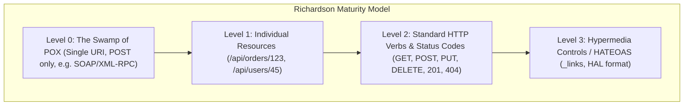
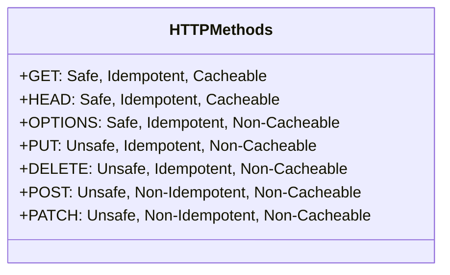
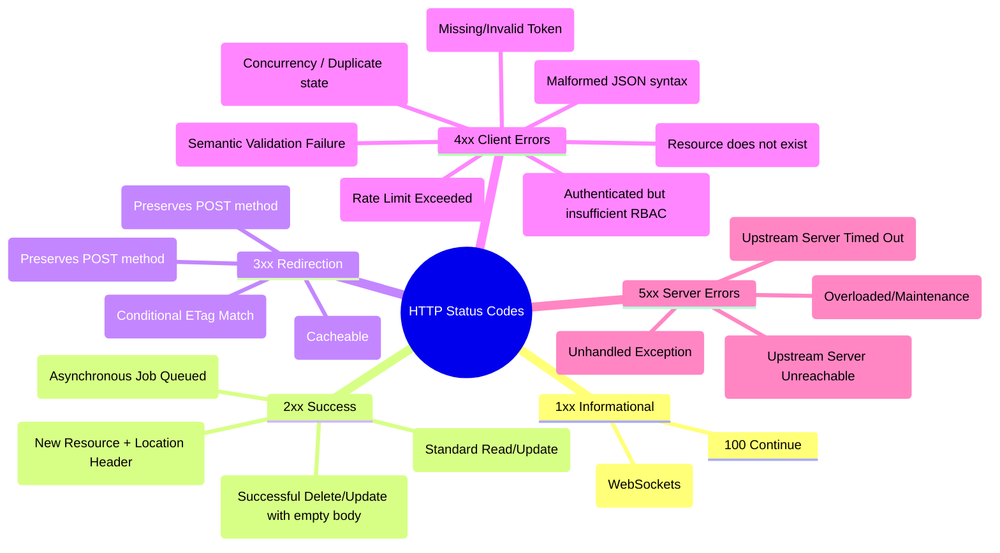
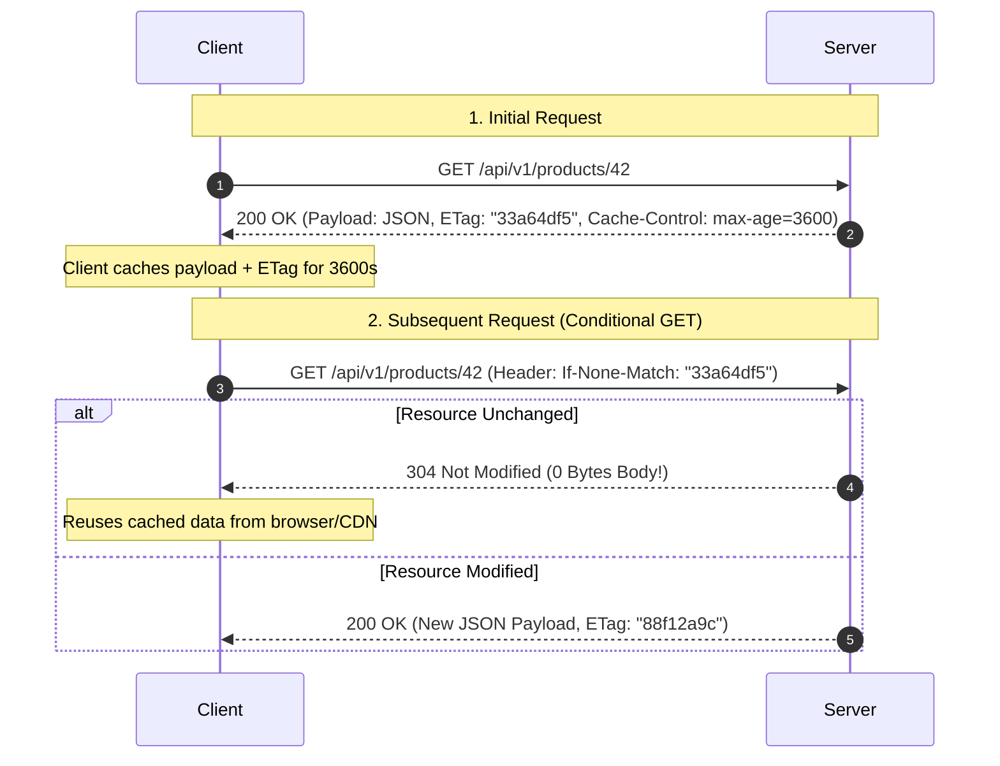
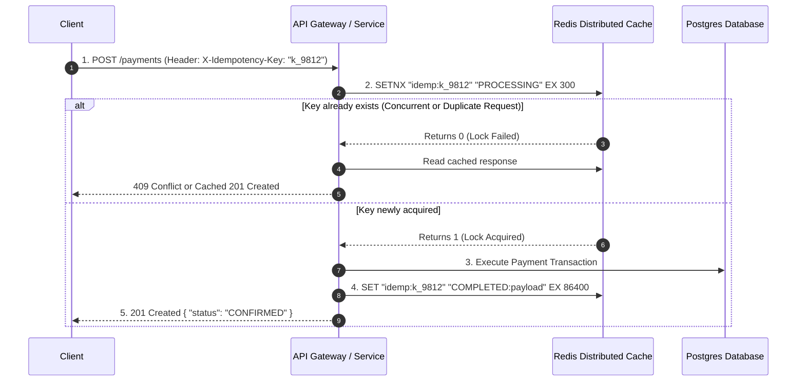

---


title: "RESTful API Architecture - HTTP Methods, Status Codes, Caching & Idempotency"
description: "Comprehensive guide to REST architectural principles, Richardson Maturity Model, HTTP verb semantics, status codes taxonomy, Redis Idempotency Key patterns, HTTP caching (ETags), and Token Bucket rate limiting."
category: "Web Technologies & Frontend Architecture"
tags: [web, api-design, rest, http, idempotency, fastapi, architecture, backend, rate-limiting, etag, caching, technical-skills, software-engineering, learning-note]
date: "2026-08-21"
---

# 🌐 RESTful API Architecture: HTTP Methods, Status Codes & Caching

> 🔙 **Folder Hub**: [[00_Meta/05_folder_nodes/node_10_Web_and_Frontend|10 Web & Frontend Hub]]
> ➡️ **Next Module**: [[02_Technical_Skills/01_theory_and_concepts/10_Web_and_Frontend/web_security_xss_csrf_cors_csp_hardening|Web Security Hardening]]
> 🔀 **Related Modules**: [[02_Technical_Skills/01_theory_and_concepts/09_Backend_Logging_and_Tracing/distributed_tracing|Distributed Tracing Architecture]] | [[02_Technical_Skills/01_theory_and_concepts/12_Databases_and_SQL/transactions_concurrency|Transactions & Concurrency]]

---

## 1. REST Architectural Constraints & The Richardson Maturity Model

**REST (Representational State Transfer)** is an architectural style formulated by Roy Fielding (2000) governing networked hypermedia applications. REST is governed by six fundamental architectural constraints:
1. **Client-Server Separation**: Strict separation of concerns between user interface/presentation and data storage/state persistence.
2. **Statelessness**: Every request from client to server must contain all contextual metadata and authentication credentials necessary to understand and authorize the request without server-side ambient session storage.
3. **Cacheability**: Responses must declare explicit cache semantics (`Cache-Control`, `ETag`, `Last-Modified`) to eliminate redundant server round-trips.
4. **Uniform Interface**: Resource identification via URIs, resource manipulation through representations, self-descriptive messages, and hypermedia controls (HATEOAS).
5. **Layered System**: The client cannot determine whether it is communicating directly with the origin server or intermediate caching proxies, load balancers, or API gateways.
6. **Code on Demand (Optional)**: Servers may temporarily extend client functionality by transmitting executable code (e.g. JavaScript).



### 1.1 Level 3 HATEOAS (Hypermedia As The Engine Of Application State)

In a fully mature REST Level 3 API, the client requires zero out-of-band hardcoded knowledge of downstream endpoints. The server provides contextual navigation links dynamically:

```json
{
  "order_id": "ord_99812",
  "status": "AWAITING_PAYMENT",
  "amount": 250.00,
  "_links": {
    "self": { "href": "/api/v1/orders/ord_99812", "method": "GET" },
    "cancel": { "href": "/api/v1/orders/ord_99812/cancel", "method": "POST" },
    "payment": { "href": "/api/v1/orders/ord_99812/payments", "method": "POST" }
  }
}
```

---

## 2. HTTP Method Semantics: Safety, Idempotency & Cacheability

A method is **Safe** if executing it never modifies the server state ($f(S) = S$).
A method is **Idempotent** if executing it $N > 1$ times produces identical server state as executing it once ($f(f(S)) = f(S)$).



### 2.1 Detailed Method Matrix

| HTTP Method | Target Action | Safe? | Idempotent? | Cacheable? | Success Status Codes |
| :--- | :--- | :---: | :---: | :---: | :--- |
| **`GET`** | Retrieve resource representation | ✅ Yes | ✅ Yes | ✅ Yes | `200 OK`, `304 Not Modified` |
| **`HEAD`** | Retrieve headers only (identical to `GET` without body) | ✅ Yes | ✅ Yes | ✅ Yes | `200 OK` |
| **`OPTIONS`**| Preflight query for CORS allowed methods and headers | ✅ Yes | ✅ Yes | ❌ No | `204 No Content` |
| **`POST`** | Process payload, create subordinate resource, trigger job | ❌ No | ❌ No | ❌ No | `201 Created`, `202 Accepted` |
| **`PUT`** | Full replacement / creation at exact URI | ❌ No | ✅ Yes | ❌ No | `200 OK`, `204 No Content` |
| **`PATCH`** | Partial modification of resource fields | ❌ No | ❌ No* | ❌ No | `200 OK`, `204 No Content` |
| **`DELETE`** | Remove resource at designated URI | ❌ No | ✅ Yes | ❌ No | `200 OK`, `204 No Content` |

---

## 3. Comprehensive HTTP Status Codes Taxonomy



---

## 4. HTTP Caching, Conditional Requests & ETags

HTTP conditional requests eliminate redundant payload transfers via **Entity Tags (ETags)** and conditional validation headers (`If-None-Match`, `If-Match`):



---

## 5. Distributed Token Bucket Rate Limiting with Redis & Lua

To protect APIs against DDoS attacks and brute-force flooding, distributed gateways enforce rate limits using the **Token Bucket** algorithm executed atomically via Redis Lua scripts:

```lua
-- Atomic Redis Token Bucket Script
local key = KEYS[1]
local capacity = tonumber(ARGV[1])
local refill_rate = tonumber(ARGV[2]) -- tokens per second
local now = tonumber(ARGV[3])
local requested = tonumber(ARGV[4])

local data = redis.call("HMGET", key, "tokens", "last_updated")
local tokens = tonumber(data[1])
local last_updated = tonumber(data[2])

if tokens == nil then
    tokens = capacity
    last_updated = now
else
    local delta = math.max(0, now - last_updated)
    tokens = math.min(capacity, tokens + (delta * refill_rate))
    last_updated = now
end

if tokens >= requested then
    tokens = tokens - requested
    redis.call("HMSET", key, "tokens", tokens, "last_updated", last_updated)
    redis.call("EXPIRE", key, math.ceil(capacity / refill_rate))
    return {1, math.floor(tokens)} -- Allowed
else
    return {0, math.floor(tokens)} -- Rate Limited (429)
end
```

---

## 6. Idempotency Key Pattern & Distributed Locks in Payment Processing

When a client submits a non-idempotent `POST /api/v1/payments` request and the network connection drops before the HTTP `200 OK` response is received, the client automatically retries. Without an **Idempotency Key**, the customer is charged twice.



### 6.1 Production Python FastAPI Idempotency Key Middleware

```python
import json
import uuid
from fastapi import FastAPI, Request, HTTPException, status, Response
from pydantic import BaseModel, Field
import redis

app = FastAPI(title="High-Reliability Payments API", version="v1")
redis_client = redis.Redis(host='localhost', port=6379, db=0, decode_responses=True)

class PaymentRequest(BaseModel):
    account_id: str = Field(..., example="acc_1009")
    amount: float = Field(..., gt=0, example=99.50)
    currency: str = Field("USD", min_length=3, max_length=3)

@app.post("/api/v1/payments", status_code=status.HTTP_201_CREATED)
async def process_payment(request: Request, response: Response, payload: PaymentRequest):
    idempotency_key = request.headers.get("X-Idempotency-Key")
    if not idempotency_key:
        raise HTTPException(
            status_code=status.HTTP_400_BAD_REQUEST,
            detail="Header 'X-Idempotency-Key' is required for payment operations."
        )

    redis_lock_key = f"idempotency:{idempotency_key}"
    
    acquired = redis_client.set(redis_lock_key, "IN_FLIGHT", nx=True, ex=300)
    
    if not acquired:
        cached_value = redis_client.get(redis_lock_key)
        if cached_value == "IN_FLIGHT":
            raise HTTPException(
                status_code=status.HTTP_409_CONFLICT,
                detail="A concurrent transaction with this idempotency key is actively processing."
            )
        return json.loads(cached_value)

    try:
        transaction_id = f"tx_{uuid.uuid4().hex[:12]}"
        result = {
            "transaction_id": transaction_id,
            "account_id": payload.account_id,
            "amount": payload.amount,
            "currency": payload.currency,
            "status": "SETTLED"
        }

        redis_client.set(redis_lock_key, json.dumps(result), ex=86400)
        response.headers["Location"] = f"/api/v1/payments/{transaction_id}"
        return result

    except Exception as ex:
        redis_client.delete(redis_lock_key)
        raise HTTPException(status_code=status.HTTP_500_INTERNAL_SERVER_ERROR, detail=str(ex))
```

---

## 7. API Pagination: Offset-Based vs. Keyset / Cursor Pagination

```
Offset-Based Pagination:   SELECT * FROM orders ORDER BY id LIMIT 20 OFFSET 1000000;
  -> Forces database to scan and discard 1,000,000 index entries (O(N) Degradation)

Cursor-Based Pagination:   SELECT * FROM orders WHERE id > 1000000 ORDER BY id LIMIT 20;
  -> Direct B-Tree index seek in O(log N) constant time regardless of page depth!
```

---

## 🔗 Graph-Linked Knowledge Base

- [[00_Meta/05_folder_nodes/node_10_Web_and_Frontend|10 Web & Frontend Hub]]
- [[02_Technical_Skills/01_theory_and_concepts/10_Web_and_Frontend/web_security_xss_csrf_cors_csp_hardening|Web Security Hardening: XSS, CSRF & CSP]]
- [[02_Technical_Skills/01_theory_and_concepts/09_Backend_Logging_and_Tracing/distributed_tracing|Distributed Tracing Architecture & OpenTelemetry]]
- [[02_Technical_Skills/01_theory_and_concepts/12_Databases_and_SQL/transactions_concurrency|Transactions & Concurrency Control]]
