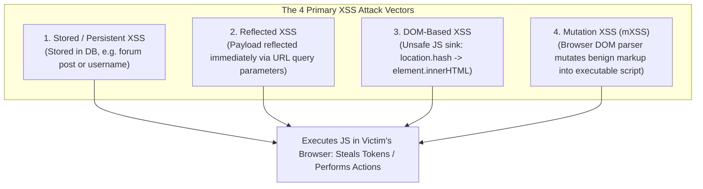
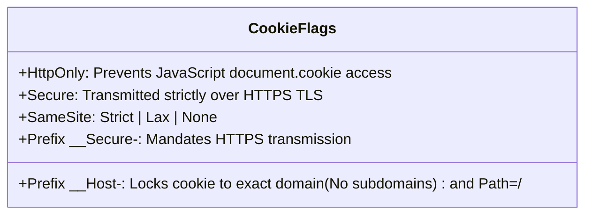
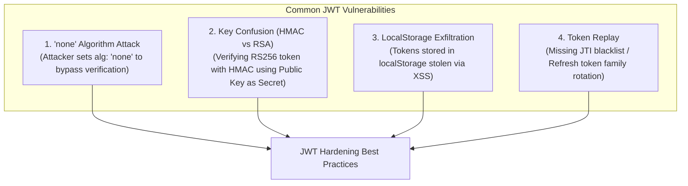
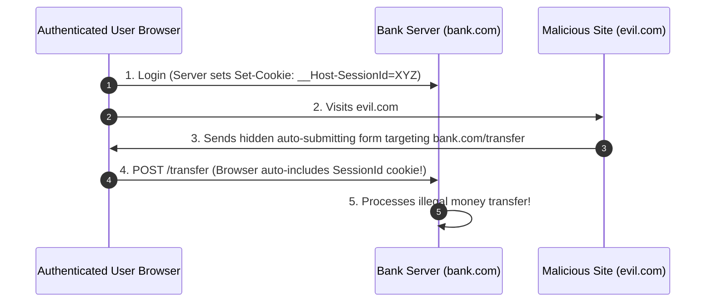
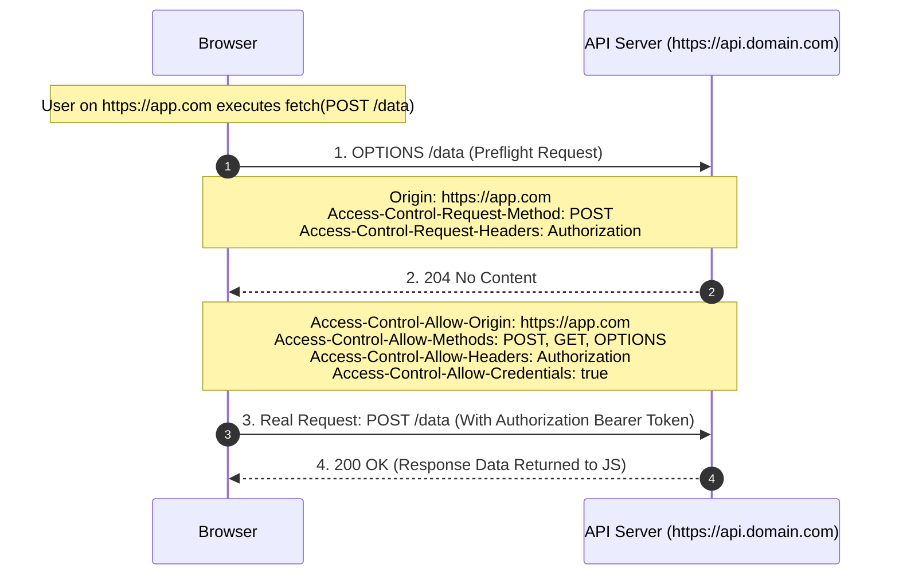
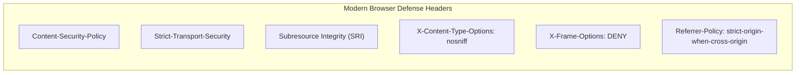

---


title: "Web Security Hardening - XSS, CSRF, CORS, CSP, JWT Security & Cookie Prefixes"
description: "Comprehensive enterprise guide to web application security: XSS sanitization, SameSite & anti-CSRF tokens, CORS preflight mechanics, Subresource Integrity (SRI), JWT vulnerability hardening, and CSP Level 3."
category: "Web Technologies & Frontend Architecture"
tags: [web, security, xss, csrf, cors, csp, hsts, owasp, browser-security, cookie-prefixes, jwt-security, technical-skills, software-engineering, learning-note]
date: "2026-08-21"
---

# 🛡️ Web Security Hardening: XSS, CSRF, CORS, CSP & JWT Security

> 🔙 **Folder Hub**: [[00_Meta/05_folder_nodes/node_10_Web_and_Frontend|10 Web & Frontend Hub]]
> ⬅️ **Previous Module**: [[02_Technical_Skills/01_theory_and_concepts/10_Web_and_Frontend/restful_api_design_http_methods_status_codes|RESTful API Design & HTTP Status Codes]]
> 🔀 **Related Modules**: [[02_Technical_Skills/01_theory_and_concepts/09_Backend_Logging_and_Tracing/structured_logging|Structured Logging & PII Masking]] | [[02_Technical_Skills/01_theory_and_concepts/12_Databases_and_SQL/security_permissions|Database Security & Permissions]]

---

## 1. Cross-Site Scripting (XSS) Mechanics & Defenses

**Cross-Site Scripting (XSS)** occurs when an application accepts untrusted data and renders it into the browser's Document Object Model (DOM) without proper contextual encoding or sanitization, executing arbitrary JavaScript within the victim's session context.



### 1.1 Context-Aware Encoding & Sanitization Rules

A common developer mistake is applying HTML entity encoding universally. Context dictates encoding strategy:

| Injection Context | Vulnerable Example | Required Defense Mechanism |
| :--- | :--- | :--- |
| **HTML Body Context** | `<div>{{ userInput }}</div>` | HTML Entity Encoding (`&` $\rightarrow$ `&amp;`, `<` $\rightarrow$ `&lt;`, `>` $\rightarrow$ `&gt;`). |
| **HTML Attribute Context** | `<input value="{{ userInput }}"/>` | Attribute Encoding (Encode all non-alphanumeric chars with `&#xHH;`). |
| **JavaScript Context** | `<script>let id = '{{ userInput }}';</script>`| JSON Serializer (`JSON.stringify()`) or strict numeric casting. |
| **URI / URL Context** | `<a href="{{ userInput }}">Profile</a>` | Validate protocol (`http://` or `https://` only; reject `javascript:` pseudo-protocol). |

```javascript
// ✅ Client-Side HTML Sanitization with DOMPurify
import DOMPurify from 'dompurify';

function renderUserComment(untrustedMarkup) {
    const cleanHTML = DOMPurify.sanitize(untrustedMarkup, {
        ALLOWED_TAGS: ['b', 'i', 'em', 'strong', 'a', 'p'],
        ALLOWED_ATTR: ['href', 'target'],
        FORBID_TAGS: ['script', 'style', 'iframe', 'object', 'embed']
    });
    document.getElementById('comment-box').innerHTML = cleanHTML;
}
```

---

## 2. Cookie Hardening & Security Prefixes (`__Host-` and `__Secure-`)

Cookies remain the dominant medium for browser session management. Without explicit security flags, cookies are vulnerable to XSS exfiltration and subdomain hijacking.



### 2.1 The Special Cookie Name Prefixes

1. **`__Host-` Prefix**:
   - Must have `Secure` flag set.
   - Must originate from a secure HTTPS origin.
   - **Must NOT include a `Domain` attribute** (restricting cookie strictly to the host, preventing sibling subdomain attackers from overwriting it).
   - **Must have `Path=/`**.
2. **`__Secure-` Prefix**:
   - Must have `Secure` flag set and originate from HTTPS.

```http
# Production Hardened Session Cookie
Set-Cookie: __Host-SessionId=a8f92b7c4d1e; Path=/; Secure; HttpOnly; SameSite=Strict; Max-Age=86400
```

---

## 3. JSON Web Token (JWT) Security Hardening

When utilizing JWTs for stateless authentication, multiple cryptographic and implementation attack vectors must be defended against:



### 3.1 JWT Hardening Best Practices

1. **Strict Algorithm Whitelisting**: Explicitly reject `alg: "none"` or unapproved algorithms during verification.
2. **Store Access Tokens in Memory, Refresh Tokens in `__Host-` HttpOnly Cookies**: Never store JWTs in browser `localStorage` or `sessionStorage` where any XSS vulnerability can read them.
3. **Refresh Token Rotation with Reuse Detection (Family Revocation)**: Every time a refresh token is exchanged, invalidate the entire token family if a revoked or duplicate token is presented.

---

## 4. Cross-Site Request Forgery (CSRF) & Modern Mitigations

**CSRF** exploits the browser's default behavior of automatically attaching session cookies to cross-origin requests.



### 4.1 Defenses Against CSRF

1. **`SameSite` Cookie Attribute**:
   - `SameSite=Strict`: Cookie is never sent on cross-site requests.
   - `SameSite=Lax`: Omitted on cross-site subrequests (images, iframes, `POST` forms), sent only on top-level navigation `GET` requests.
2. **Synchronizer Token Pattern (Anti-CSRF Token)**:
   The server generates a cryptographically random token stored in the user session. All mutating requests (`POST`, `PUT`, `DELETE`) must include this token in a custom HTTP header (`X-CSRF-Token`).
3. **Double Submit Cookie Pattern**:
   For stateless SPA architectures, a pseudorandom token is stored in a cookie (`csrf_token`) and must be read by JavaScript and mirrored into the `X-CSRF-Token` request header.

---

## 5. Cross-Origin Resource Sharing (CORS) Architecture

The **Same-Origin Policy (SOP)** enforces that a web application running on origin $A$ (`https://example.com:443`) cannot read raw HTTP response payloads fetched from origin $B$ (`https://api.partner.com:443`).



---

## 6. Content Security Policy (CSP Level 3), SRI & Hardening Headers



### 6.1 Subresource Integrity (SRI)

When loading third-party scripts from CDNs, attackers compromising the CDN can inject malicious payloads. **SRI** verifies the cryptographic hash of external assets:

```html
<!-- Subresource Integrity check prevents CDN supply-chain attacks -->
<script 
  src="https://cdn.example.com/react.18.2.0.min.js" 
  integrity="sha384-kLt+kX3q6bL7K8b/2DkY7m7sH7q2f5g=" 
  crossorigin="anonymous">
</script>
```

### 6.2 Production HTTP Response Security Headers

```http
HTTP/1.1 200 OK
Content-Type: text/html; charset=utf-8

# 1. Enforce HTTPS with 1-year duration and preload submission
Strict-Transport-Security: max-age=31536000; includeSubDomains; preload

# 2. Prevent MIME-sniffing
X-Content-Type-Options: nosniff

# 3. Prevent Clickjacking
X-Frame-Options: DENY

# 4. Referrer header sanitization
Referrer-Policy: strict-origin-when-cross-origin

# 5. Disable sensitive hardware APIs
Permissions-Policy: camera=(), microphone=(), geolocation=(), payment=()

# 6. Strict Nonce-Based CSP Level 3
Content-Security-Policy: default-src 'self'; script-src 'self' 'nonce-rAnd0m123456789' 'strict-dynamic'; object-src 'none'; base-uri 'self'; frame-ancestors 'none';
```

---

## 7. Production Python FastAPI Security Middleware Implementation

```python
from fastapi import FastAPI, Request, Response, HTTPException, status
from starlette.middleware.base import BaseHTTPMiddleware
import secrets

class SecurityHeadersMiddleware(BaseHTTPMiddleware):
    async def dispatch(self, request: Request, call_next):
        nonce = secrets.token_urlsafe(16)
        request.state.csp_nonce = nonce

        response: Response = await call_next(request)

        # Hardened HTTP response headers
        response.headers["Strict-Transport-Security"] = "max-age=31536000; includeSubDomains; preload"
        response.headers["X-Content-Type-Options"] = "nosniff"
        response.headers["X-Frame-Options"] = "DENY"
        response.headers["Referrer-Policy"] = "strict-origin-when-cross-origin"
        response.headers["Permissions-Policy"] = "camera=(), microphone=(), geolocation=()"
        
        csp_policy = (
            f"default-src 'self'; "
            f"script-src 'self' 'nonce-{nonce}' 'strict-dynamic'; "
            f"object-src 'none'; "
            f"base-uri 'self'; "
            f"frame-ancestors 'none';"
        )
        response.headers["Content-Security-Policy"] = csp_policy

        return response

app = FastAPI()
app.add_middleware(SecurityHeadersMiddleware)
```

---

## 🔗 Graph-Linked Knowledge Base

- [[00_Meta/05_folder_nodes/node_10_Web_and_Frontend|10 Web & Frontend Hub]]
- [[02_Technical_Skills/01_theory_and_concepts/10_Web_and_Frontend/restful_api_design_http_methods_status_codes|RESTful API Design & HTTP Status Codes]]
- [[02_Technical_Skills/01_theory_and_concepts/09_Backend_Logging_and_Tracing/structured_logging|Structured Logging & PII Masking]]
- [[02_Technical_Skills/01_theory_and_concepts/12_Databases_and_SQL/security_permissions|Database Security & Permissions]]
