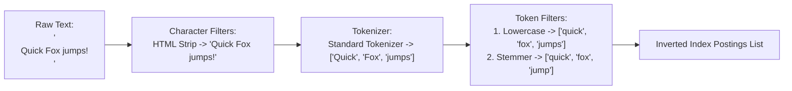
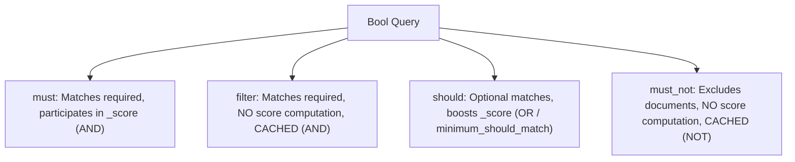
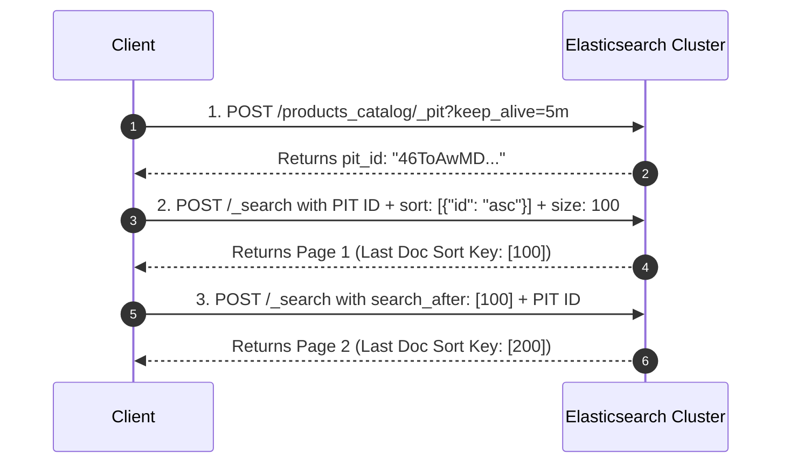
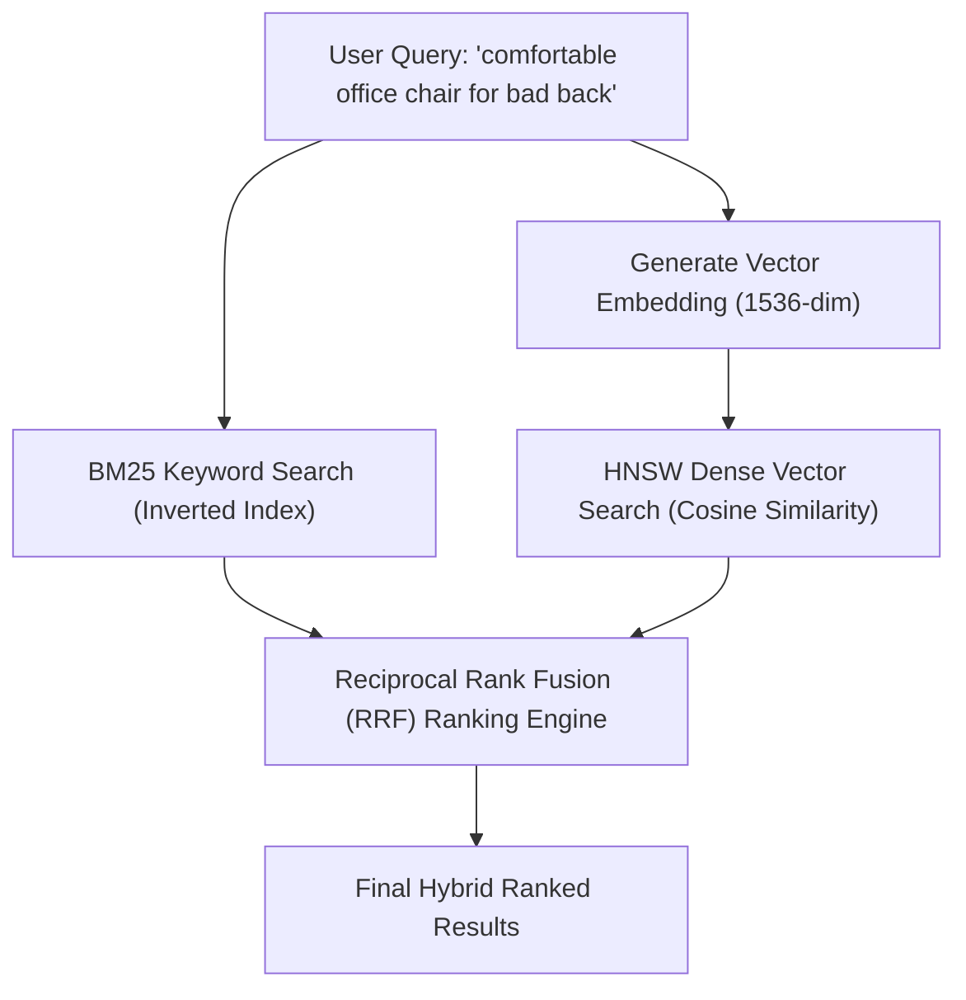

---


title: "Advanced Elasticsearch Features: Text Analysis, Query DSL, Aggregations, PIT & Hybrid Vector Search"
description: "Master guide to Elasticsearch text analysis pipelines, custom analyzers, complex Query DSL, metric/bucket aggregations, Point-in-Time (PIT) search_after pagination, and kNN hybrid vector search."
category: "Search Engines & Distributed Indexing"
tags: [search, elasticsearch, full-text-search, aggregations, vector-search, knn, query-dsl, lucene, painless-scripting, search-after, technical-skills, software-engineering, learning-note]
date: "2026-08-21"
---

# 🔍 Advanced Elasticsearch Features: Text Analysis, DSL & Vector Search

> 🔙 **Folder Hub**: [[00_Meta/05_folder_nodes/node_11_Backend_Search_Engine_Elasticsearch|11 Elasticsearch & Search Engine Hub]]
> ⬅️ **Previous Module**: [[02_Technical_Skills/01_theory_and_concepts/11_Backend_Search_Engine_Elasticsearch/elasticsearch_basics|Elasticsearch Basics]]
> ➡️ **Next Module**: [[02_Technical_Skills/01_theory_and_concepts/11_Backend_Search_Engine_Elasticsearch/search_engine_vs_db|Search Engine vs Database]]
> 🔀 **Related Modules**: [[02_Technical_Skills/01_theory_and_concepts/09_Backend_Logging_and_Tracing/elk_stack_integration|ELK Stack Integration]] | [[02_Technical_Skills/01_theory_and_concepts/12_Databases_and_SQL/elasticsearch_inverted_index_segment_merging|Inverted Index & Segment Merging]]

---

## 1. The Full-Text Analysis Pipeline Mechanics

When text is ingested into an Elasticsearch `text` field, or when a full-text query executes, the string passes through an **Analysis Pipeline** converting human language into normalized searchable tokens.



### 1.1 The Three Processing Stages

1. **Character Filters**: Pre-process the raw character stream before tokenization (e.g. `html_strip` removes tags, `mapping` replaces `&` with `and`, `pattern_replace` cleans regex artifacts).
2. **Tokenizer**: Splits the character stream into discrete tokens and records token positions, character start/end offsets, and token types (e.g. `standard`, `whitespace`, `edge_ngram`, `pattern`).
3. **Token Filters**: Mutates, enriches, or drops tokens emitted by the tokenizer:
   - **`lowercase`**: Normalizes all characters to lowercase.
   - **`stop`**: Discards high-frequency stop words (`the`, `and`, `is`, `of`).
   - **`stemmer`** / **`kstem`**: Reduces words to root lemmas (`running`, `runs` $\rightarrow$ `run`).
   - **`synonym_graph`**: Injects multi-word synonym tokens accurately across positions without corrupting phrase queries.

### 1.2 Vietnamese & Multi-Lingual Compound Word Analysis

Languages like Vietnamese require compound word segmentation. For example, `"học sinh"` must be treated as a single token rather than separating into `"học"` (study) and `"sinh"` (birth). Specialized plugins (such as `analysis-vietnamese` / `vi_analyzer`) use dictionary-based boundary detection to produce coherent compound tokens.

```json
PUT /products_catalog
{
  "settings": {
    "analysis": {
      "filter": {
        "autocomplete_edge_ngram": {
          "type": "edge_ngram",
          "min_gram": 2,
          "max_gram": 15
        },
        "english_stemmer": {
          "type": "stemmer",
          "language": "english"
        },
        "synonym_filter": {
          "type": "synonym_graph",
          "synonyms": [
            "phone, mobile, smartphone",
            "laptop, notebook, computer"
          ]
        }
      },
      "analyzer": {
        "custom_product_analyzer": {
          "type": "custom",
          "char_filter": ["html_strip"],
          "tokenizer": "standard",
          "filter": [
            "lowercase",
            "asciifolding",
            "synonym_filter",
            "english_stemmer"
          ]
        },
        "autocomplete_index_analyzer": {
          "type": "custom",
          "tokenizer": "standard",
          "filter": [
            "lowercase",
            "asciifolding",
            "autocomplete_edge_ngram"
          ]
        }
      }
    }
  },
  "mappings": {
    "properties": {
      "title": {
        "type": "text",
        "analyzer": "custom_product_analyzer",
        "fields": {
          "keyword": { "type": "keyword", "ignore_above": 256 },
          "autocomplete": {
            "type": "text",
            "analyzer": "autocomplete_index_analyzer",
            "search_analyzer": "standard"
          }
        }
      }
    }
  }
}
```

---

## 2. Advanced Query DSL: Compound Filtering & Relevance Tuning

Elasticsearch separates query clauses into **Query Context** (computes relevance `_score`) and **Filter Context** (exact yes/no boolean decisions cached in memory as bitsets).



### 2.1 Production Compound Search with Decay Functions & Function Score

```json
POST /products_catalog/_search
{
  "query": {
    "function_score": {
      "query": {
        "bool": {
          "must": [
            {
              "multi_match": {
                "query": "wireless noise cancelling headphones",
                "fields": ["title^3", "description", "brand^2"],
                "type": "best_fields",
                "tie_breaker": 0.3
              }
            }
          ],
          "filter": [
            { "term": { "status.keyword": "IN_STOCK" } },
            { "range": { "price": { "gte": 50.0, "lte": 400.0 } } }
          ]
        }
      },
      "functions": [
        {
          "field_value_factor": {
            "field": "rating",
            "factor": 1.2,
            "modifier": "sqrt",
            "missing": 1.0
          }
        },
        {
          "gauss": {
            "release_date": {
              "origin": "now",
              "scale": "30d",
              "decay": 0.5
            }
          }
        }
      ],
      "score_mode": "multiply",
      "boost_mode": "multiply"
    }
  }
}
```

---

## 3. Deep Pagination via Point-in-Time (PIT) & `search_after`

Using standard `from + size` pagination for deep queries (e.g. `from = 100000`) triggers the **Deep Paging Penalty**: every shard must sort and return 100,000 documents to the coordinating node, causing out-of-memory crashes.

The **Point-in-Time (PIT) + `search_after`** pattern creates a lightweight, frozen view of index segments, streaming through billions of documents in $O(1)$ memory:



---

## 4. High-Performance Aggregations: Metrics, Buckets & Pipelines

Aggregations compute multi-dimensional analytical summaries across millions of documents. In Elasticsearch, aggregations execute over **Doc Values** (columnar on-disk data structures stored alongside Lucene inverted indexes).


### 4.1 Advanced Multi-Tier Analytical Aggregation Query

```json
POST /orders/_search
{
  "size": 0,
  "aggs": {
    "sales_per_category": {
      "terms": {
        "field": "category.keyword",
        "size": 10
      },
      "aggs": {
        "monthly_histogram": {
          "date_histogram": {
            "field": "order_date",
            "calendar_interval": "month"
          },
          "aggs": {
            "revenue_sum": {
              "sum": { "field": "total_amount" }
            },
            "latency_percentiles": {
              "percentiles": {
                "field": "fulfillment_time_hours",
                "percents": [50.0, 95.0, 99.0]
              }
            },
            "revenue_growth": {
              "derivative": {
                "buckets_path": "revenue_sum"
              }
            }
          }
        }
      }
    }
  }
}
```

---

## 5. Autocomplete Patterns: FST Suggesters vs. Edge N-Grams

| Approach | Mechanics | Latency | Typo Tolerance | Mid-Word Match | Memory Footprint |
| :--- | :--- | :--- | :--- | :--- | :--- |
| **Completion Suggester** | In-memory **Finite State Transducer (FST)** | **$< 1\text{ ms}$** | Limited | ❌ Prefix only | Medium (Held in JVM Heap) |
| **Edge N-Gram Tokenizer** | Inverted Index prefix tokens (e.g. `he`, `hea`, `head`) | 2–8 ms | Supported (`fuzziness`) | ❌ Prefix of words | High (Disk segment growth) |
| **Search-As-You-Type** | Automated 2-gram, 3-gram shingles + prefix queries | 2–5 ms | Supported | ✅ Shingle matching | High |

---

## 6. Modern Vector Search & Hybrid Retrieval (BM25 + kNN)

Elasticsearch supports dense vector embeddings generated by machine learning transformers (e.g. BERT / OpenAI `text-embedding-3-small`), executing Approximate Nearest Neighbor (ANN) search via Hierarchical Navigable Small World (**HNSW**) graphs.



### 6.1 Production Hybrid RRF Query

```json
POST /catalog_items/_search
{
  "retriever": {
    "rrf": {
      "retrievers": [
        {
          "standard": {
            "query": {
              "match": { "description": "ergonomic lumbar mesh chair" }
            }
          }
        },
        {
          "knn": {
            "field": "item_vector",
            "query_vector": [0.0124, -0.0452, 0.0891, 0.1245],
            "k": 50,
            "num_candidates": 100
          }
        }
      ],
      "rank_window_size": 50,
      "rank_constant": 60
    }
  }
}
```

---

## 🔗 Graph-Linked Knowledge Base

- [[00_Meta/05_folder_nodes/node_11_Backend_Search_Engine_Elasticsearch|11 Elasticsearch & Search Engine Hub]]
- [[02_Technical_Skills/01_theory_and_concepts/11_Backend_Search_Engine_Elasticsearch/elasticsearch_basics|Elasticsearch Basics: Sharding & Routing]]
- [[02_Technical_Skills/01_theory_and_concepts/11_Backend_Search_Engine_Elasticsearch/search_engine_vs_db|Search Engine vs Database: Inverted Index vs B-Tree]]
- [[02_Technical_Skills/01_theory_and_concepts/12_Databases_and_SQL/elasticsearch_inverted_index_segment_merging|Inverted Index & Segment Merging Mechanics]]
