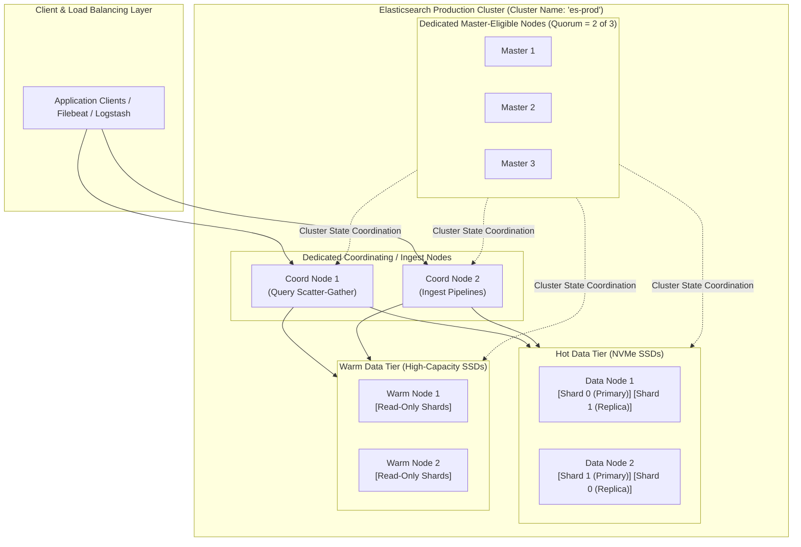
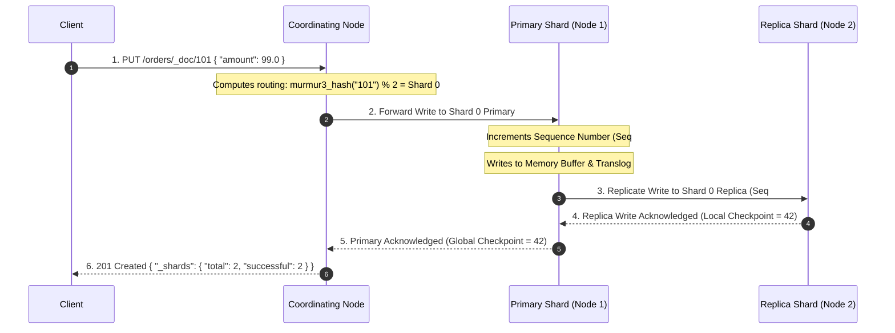
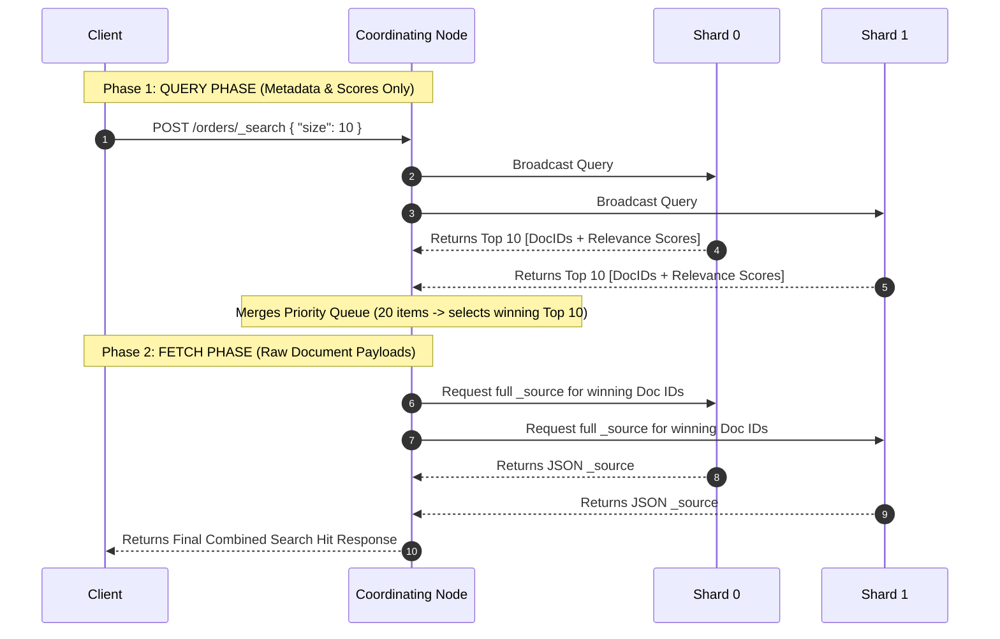

---


title: "Elasticsearch Basics: Cluster Topologies, Sharding, Routing & Ingestion Internals"
description: "Master guide to Elasticsearch distributed architecture: node roles, master election, PacificA replication, routing mechanics, JVM heap memory tuning, and NRT search."
category: "Search Engines & Distributed Indexing"
tags: [search, elasticsearch, distributed-systems, sharding, lucene, architecture, cluster, pacifica, technical-skills, software-engineering, learning-note]
date: "2026-08-21"
---

# ⚙️ Elasticsearch Basics: Cluster Topologies, Sharding & Routing

> 🔙 **Folder Hub**: [[00_Meta/05_folder_nodes/node_11_Backend_Search_Engine_Elasticsearch|11 Elasticsearch & Search Engine Hub]]
> ➡️ **Next Module**: [[02_Technical_Skills/01_theory_and_concepts/11_Backend_Search_Engine_Elasticsearch/advanced_search_features|Advanced Search Features]]
> 🔀 **Related Modules**: [[02_Technical_Skills/01_theory_and_concepts/11_Backend_Search_Engine_Elasticsearch/search_engine_vs_db|Search Engine vs Database]] | [[02_Technical_Skills/01_theory_and_concepts/12_Databases_and_SQL/elasticsearch_inverted_index_segment_merging|Inverted Index & Segment Merging]]

---

## 1. Distributed Architecture & Node Topologies

Elasticsearch is a horizontally distributed, document-oriented search and analytics engine built on Apache Lucene. A single instance is called a **Node**, and a collection of cooperating nodes with a shared cluster state forms a **Cluster**.



### 1.1 Node Roles Taxonomy

| Node Role | Primary Responsibilities | Resource Allocation Guidelines |
| :--- | :--- | :--- |
| **`master_eligible`** | Manages cluster state, index creation, shard allocation, node membership. | Low CPU, fast low-latency disk, strictly dedicated (no data storage). |
| **`data_content` / `data_hot`**| Holds shard data, executes search queries and aggregations, writes to Lucene segments. | High CPU, heavy RAM (31GB Heap + 32GB OS Page Cache), fast NVMe SSDs. |
| **`coordinating`** | Receives client HTTP REST requests, parses DSL, routes queries, merges results. | Medium CPU, high network bandwidth, 0 local persistent storage. |
| **`ingest`** | Runs ingest pipelines (Grok, script processors, date normalization). | High CPU for regex processing, decoupled from data nodes. |

---

## 2. Sharding, Routing & The PacificA Replication Protocol

An **Index** is a logical namespace representing a collection of JSON documents. Physically, each index is partitioned across one or more **Primary Shards** (each an independent Apache Lucene instance), replicated across **Replica Shards** for fault tolerance.



### 2.1 The PacificA Replication Model: Sequence Numbers & Global Checkpoints

Elasticsearch employs a replication model derived from Microsoft's **PacificA** algorithm:
1. **Primary Terms**: A monotonic integer incremented whenever a new primary shard is elected. It distinguishes operations generated by old vs new primaries.
2. **Sequence Numbers (`seq_no`)**: Each operation assigned by the primary receives a sequential integer ID.
3. **Local Checkpoint**: The highest `seq_no` for which all previous operations are confirmed on that local shard.
4. **Global Checkpoint**: The highest sequence number guaranteed acknowledged across all in-sync assigned replicas. During recovery, only operations past the Global Checkpoint need re-synchronization.

### 2.2 The Routing Equation & Shard Count Immutability

$$\text{Shard ID} = |\text{Murmur3Hash}(\text{Routing Key})| \pmod{\text{Number of Primary Shards}}$$

> [!WARNING]
> Because the modulo operation depends strictly on the total number of primary shards, **`number_of_shards` cannot be changed after index creation**. Altering the primary shard count would invalidate the hash routing of existing documents, causing lookups to point to the wrong shard.

---

## 3. Near-Real-Time (NRT) Search: Refresh vs. Flush vs. Segment Merging

Lucene indexes are written as **immutable segments**. New documents are initially buffered in JVM heap memory before becoming searchable or durable.

```mermaid
flowchart TD
    DocWrite["Document Write Request"] --> MemBuf["1. JVM Memory Indexing Buffer"]
    DocWrite --> Translog["2. Translog (Write-Ahead Log on Disk)"]

    MemBuf -->|Refresh (Every 1s)| PageCache["3. OS Page Cache (New Searchable Lucene Segment)"]
    PageCache -->|Searchable!| NRT["Near-Real-Time Queries Active"]

    Translog -->|Flush (Every 30m or 512MB)| Fsync["4. Hardware fsync to Physical Storage"]
    PageCache -->|Flush| Fsync
    Fsync --> PurgeTranslog["5. Purge Old Translog"]
```

### 3.1 Three Core Lifecycle Operations

1. **Refresh (`refresh_interval = 1s`)**:
   - Copies buffered documents from JVM memory into a new Lucene segment residing in the **OS Page Cache**.
   - Makes new documents searchable within 1 second (**Near Real-Time**).
   - *Does NOT write to physical disk (relies on RAM)*.
2. **Flush (`index.translog.flush_threshold_size = 512mb`)**:
   - Executes physical `fsync` system calls on all in-memory Lucene segments to commit them permanently to non-volatile disk.
   - Clears the internal Translog (Write-Ahead Log) to prevent unbounded WAL growth.
3. **Segment Merging (TieredMergePolicy)**:
   - Background threads asynchronously merge multiple small immutable Lucene segments into single larger segments.
   - Permanently deletes documents marked with `.del` deletion tombstones, reclaiming disk space and optimizing query speeds.

---

## 4. JVM Heap Memory Sizing & Compressed Ordinary Object Pointers (OOPs)

A foundational rule of Elasticsearch operational engineering is:

$$\text{JVM Heap Size} \le \mathbf{31\text{ GB}} \quad (\approx 50\% \text{ Total Node RAM})$$


1. **Compressed OOPs (Ordinary Object Pointers)**: If the JVM heap is $\le 31.5\text{GB}$, the 64-bit JVM uses 32-bit compressed pointers, doubling effective memory density. Allocating 33GB drops compressed OOPs, requiring 64-bit pointers and wasting $\sim 8\text{GB}$ of RAM on pointer bloat.
2. **OS Page Cache**: Lucene relies on the operating system page cache to hold inverted indexes, postings lists, and Doc Values in memory without JVM GC pause overhead.

---

## 5. Distributed Query Execution: Query Phase vs. Fetch Phase



---

## 6. Cluster Health & Operational Diagnostics

Elasticsearch reports cluster status as a three-state health traffic light:
- 🟢 **GREEN**: All Primary and Replica shards are active and fully allocated.
- 🟡 **YELLOW**: All Primary shards are active, but one or more Replica shards are unassigned (e.g. single-node development cluster or failed slave node). Search and write operations function normally without fault tolerance.
- 🔴 **RED**: One or more **Primary Shards** are missing/unassigned due to node crashes or disk corruption. Data loss has occurred and certain queries will fail.

```bash
# Diagnostic command for cluster health
curl -X GET "http://localhost:9200/_cluster/health?pretty"
curl -X GET "http://localhost:9200/_cat/shards?v=true&h=index,shard,prirep,state,unassigned.reason"
```

---

## 🔗 Graph-Linked Knowledge Base

- [[00_Meta/05_folder_nodes/node_11_Backend_Search_Engine_Elasticsearch|11 Elasticsearch & Search Engine Hub]]
- [[02_Technical_Skills/01_theory_and_concepts/11_Backend_Search_Engine_Elasticsearch/advanced_search_features|Advanced Elasticsearch Features]]
- [[02_Technical_Skills/01_theory_and_concepts/11_Backend_Search_Engine_Elasticsearch/search_engine_vs_db|Search Engine vs Database: Inverted Index vs B-Tree]]
- [[02_Technical_Skills/01_theory_and_concepts/09_Backend_Logging_and_Tracing/elk_stack_integration|ELK Stack Centralized Logging Architecture]]
