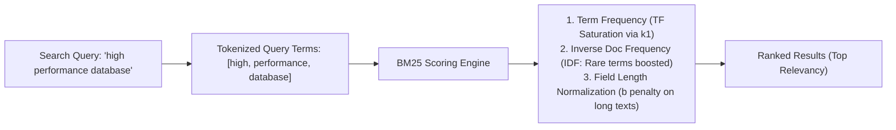
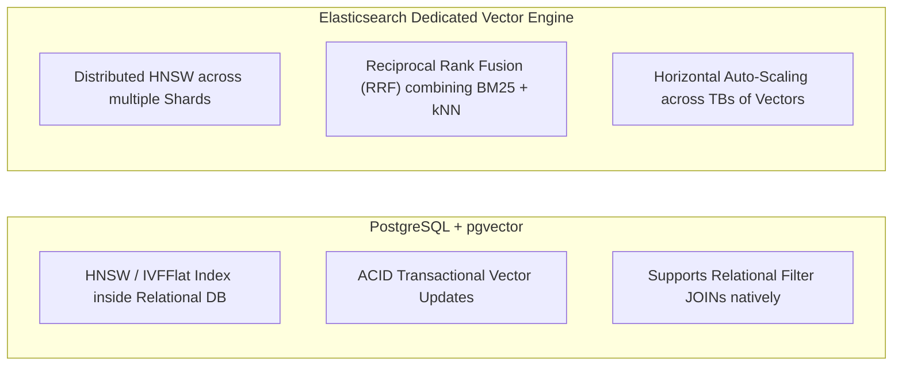

---


title: "Search Engine vs Database: Inverted Index vs B-Tree & Synchronization Patterns"
description: "Comprehensive architectural comparison between Search Engines (Elasticsearch) and Relational Databases (PostgreSQL): Inverted Indexes, BM25 scoring, pgvector, Transactional Outbox, and Debezium CDC synchronization."
category: "Search Engines & Distributed Indexing"
tags: [search, database, elasticsearch, postgresql, inverted-index, btree, bm25, debezium, outbox-pattern, pgvector, technical-skills, software-engineering, learning-note]
date: "2026-08-21"
---
# ⚖️ Search Engine vs. Database: Inverted Index vs. B-Tree & CDC Sync

> 🔙 **Folder Hub**: [[00_Meta/05_folder_nodes/node_11_Backend_Search_Engine_Elasticsearch|11 Elasticsearch & Search Engine Hub]]
> ⬅️ **Previous Module**: [[02_Technical_Skills/01_theory_and_concepts/11_Backend_Search_Engine_Elasticsearch/advanced_search_features|Advanced Search Features]]
> ➡️ **Next Module**: [[02_Technical_Skills/01_theory_and_concepts/11_Backend_Search_Engine_Elasticsearch/elasticsearch_basics|Elasticsearch Basics]]
> 🔀 **Related Modules**: [[02_Technical_Skills/01_theory_and_concepts/12_Databases_and_SQL/btree_bplus_tree_page_layout_node_splitting|B-Tree & B+ Tree Internals]] | [[02_Technical_Skills/01_theory_and_concepts/12_Databases_and_SQL/elasticsearch_inverted_index_segment_merging|Inverted Index & Segment Merging]]

---

## 1. Storage Paradigms: Inverted Index vs. B-Tree & LSM-Tree

Relational Databases (PostgreSQL, MySQL, Oracle) and Full-Text Search Engines (Elasticsearch, OpenSearch, Meilisearch) are engineered for fundamentally opposing access patterns:


### 1.1 Why `LIKE '%text%'` Breaks Relational B-Trees

A **B-Tree** index maintains keys in sorted lexicographical order. While a B-Tree can resolve exact lookups (`WHERE id = 105`) in $O(\log N)$ time and prefix matches (`WHERE name LIKE 'Tech%'`) via range scans, it cannot index wildcard queries with leading wildcards (`WHERE name LIKE '%concurrency%'`).

To evaluate `LIKE '%keyword%'`, an RDBMS must perform a **Full Table Scan ($O(N)$)**, loading every single page from disk into the buffer pool and executing linear substring searches across millions of strings.

### 1.2 The Inverted Index Architecture

An **Inverted Index** reverses the document-to-word relationship: instead of storing documents containing words, it stores unique normalized **Terms** pointing to all the **Document IDs** in which they occur.

```
Document 1: "Distributed transactions with PostgreSQL"
Document 2: "Distributed tracing with OpenTelemetry"
Document 3: "PostgreSQL administration and backups"

INVERTED INDEX POSTINGS LISTS:
"administration"  -> [Doc 3]
"backups"         -> [Doc 3]
"distributed"     -> [Doc 1, Doc 2]
"opentelemetry"   -> [Doc 2]
"postgresql"      -> [Doc 1, Doc 3]
"tracing"         -> [Doc 2]
"transactions"    -> [Doc 1]
```

1. **Term Dictionary**: Stored as an in-memory **Finite State Transducer (FST)**, enabling instantaneous $O(\text{term length})$ prefix searches and typo fuzzy match traversals.
2. **Postings Lists**: Compressed integer arrays of Document IDs, term frequencies, and token position offsets.
3. **Compression Engines**:
   - **Frame of Reference (FoR)**: Compresses monotonic integers into delta-encoded bit-packed blocks.
   - **Roaring Bitmaps**: Employs hybrid container arrays (dense bitsets vs sparse sorted arrays) to execute boolean `AND` / `OR` set intersections directly on compressed bit arrays in CPU L1 cache.

---

## 2. Relevance Scoring Mechanics: TF-IDF vs. Okapi BM25

Relational databases evaluate queries with binary boolean logic: a row either matches or does not. Search engines rank results by computing a continuous **Relevance Score** using the **Okapi BM25** probabilistic scoring formula.



### 2.1 The Okapi BM25 Formula

$$\text{Score}(D, Q) = \sum_{i=1}^{N} \text{IDF}(q_i) \cdot \frac{f(q_i, D) \cdot (k_1 + 1)}{f(q_i, D) + k_1 \cdot \left(1 - b + b \cdot \frac{|D|}{\text{avgdl}}\right)}$$

- $f(q_i, D)$: Term Frequency of term $q_i$ inside document $D$.
- $|D| / \text{avgdl}$: Ratio of current document length to average document length in the index.
- **$k_1$ (Term Saturation Parameter, Default $\approx 1.2$)**: Controls how rapidly score plateaus as term occurrences increase. In classic TF-IDF, repeating a keyword 100 times multiplies the score by 100 (keyword stuffing). In BM25, the score asymptotically approaches $(k_1 + 1)$.
- **$b$ (Length Normalization Parameter, Default $\approx 0.75$)**: Penalizes lengthy documents containing hundreds of extraneous words relative to short, highly focused titles.

---

## 3. PostgreSQL `pgvector` vs. Elasticsearch Vector Search

With the rise of GenAI and semantic embeddings, PostgreSQL with the `pgvector` extension supports vector operations alongside relational data:



| Dimension | PostgreSQL `pgvector` | Elasticsearch Vector Search |
| :--- | :--- | :--- |
| **Index Types** | HNSW, IVFFlat | HNSW, Flat |
| **Hybrid Search** | SQL query combining `tsvector` with vector distance operator `<=>` | Native **Reciprocal Rank Fusion (RRF)** |
| **Consistency** | **Immediate ACID Consistency** | Near-Real-Time (1-second refresh lag) |
| **Scalability** | Best up to ~10M vectors per instance | Scales to billions of vectors via distributed shards |

---

## 4. Comprehensive Feature & Trade-Off Matrix

| Architectural Dimension | Relational Database (e.g. PostgreSQL) | Search Engine (e.g. Elasticsearch) |
| :--- | :--- | :--- |
| **Primary Index Structure** | **B+ Tree** (Page-oriented, sorted) | **Inverted Index + Doc Values** (Lucene segments) |
| **Data Consistency Guarantee** | **ACID** (Strict Serializable / Snapshot Isolation) | **BASE** (Eventual Consistency, Near-Real-Time) |
| **Mutation Pattern** | In-place page updates with WAL durability | Append-only immutable segments with deletion tombstones |
| **Relational JOIN Capability**| $O(N \log M)$ Hash/Merge Joins across normalized tables | Highly discouraged; requires flat denormalized schemas |
| **Full-Text Ranking** | Rudimentary / Slow (`tsvector` / GIN) | **Native BM25 + Vector kNN Hybrid Ranking** |
| **Typo Tolerance & Fuzzy Search** | Levenshtein distance query functions (Very slow) | Native FST automaton traversals ($< 5\text{ ms}$) |
| **Aggregations & Analytics** | $O(N)$ Group By with heavy memory sorting | Native Columnar **Doc Values** across billions of rows |
| **Schema Evolution** | `ALTER TABLE` with strict data constraints | Dynamic Mapping (Risk of Mapping Explosion) |

---

## 5. Change Data Capture (CDC) & The Transactional Outbox Pattern

Because search engines lack robust ACID multi-table transactions, enterprise architectures retain an RDBMS (PostgreSQL) as the **System of Record** and synchronize data asynchronously to Elasticsearch for full-text search.

```mermaid
flowchart TD
    App["Application Backend"] -->|ACID Transaction: INSERT/UPDATE| Postgres[("PostgreSQL (System of Record)")]
    Postgres -->|Write-Ahead Log (WAL Stream)| Debezium["Debezium CDC Connector (pgoutput)"]
    Debezium -->|JSON Change Events| Kafka["Apache Kafka Cluster (orders-cdc topic)"]
    Kafka -->|Consumer / Sink Connector| ES[("Elasticsearch Search Cluster")]
```

### 5.1 Why Direct Application Dual-Writing Fails

```
❌ NAIVE DUAL-WRITE:
1. App executes: DB.Save(order)  -> SUCCESS
2. Network timeout or App crash!
3. App never calls: ES.Index(order) -> FAILED!
==> Result: Database and Search Engine permanently out of sync (Split-Brain)!
```

### 5.2 Architectural Solution: Transactional Outbox vs. Debezium CDC

1. **Transactional Outbox Pattern**:
   - The application writes the business record and an outbox event into an `outbox_events` table within the **same atomic database transaction**.
   - An asynchronous relay worker polls the outbox table or listens via `LISTEN/NOTIFY` and pushes events to Elasticsearch.
2. **Change Data Capture (CDC) with Debezium**:
   - Debezium connects to PostgreSQL via **Logical Decoding (`pgoutput`)**, reading committed WAL segments directly from the WAL stream.
   - Requires zero modifications to application transaction logic, guarantees sub-second synchronization latency, and ensures zero lost updates.

---

## 🔗 Graph-Linked Knowledge Base

- [[00_Meta/05_folder_nodes/node_11_Backend_Search_Engine_Elasticsearch|11 Elasticsearch & Search Engine Hub]]
- [[02_Technical_Skills/01_theory_and_concepts/11_Backend_Search_Engine_Elasticsearch/elasticsearch_basics|Elasticsearch Basics: Shards & Cluster Topologies]]
- [[02_Technical_Skills/01_theory_and_concepts/11_Backend_Search_Engine_Elasticsearch/advanced_search_features|Advanced Elasticsearch Features & Hybrid Vector Search]]
- [[02_Technical_Skills/01_theory_and_concepts/12_Databases_and_SQL/btree_bplus_tree_page_layout_node_splitting|B-Tree & B+ Tree Page Layout Internals]]
