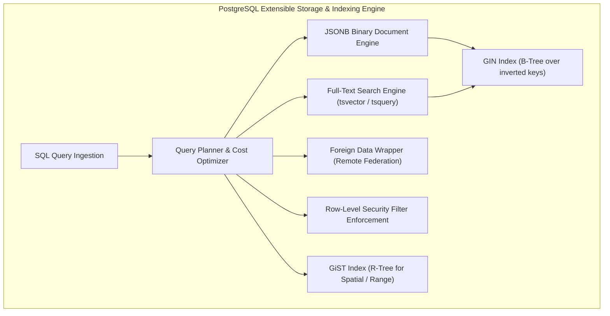
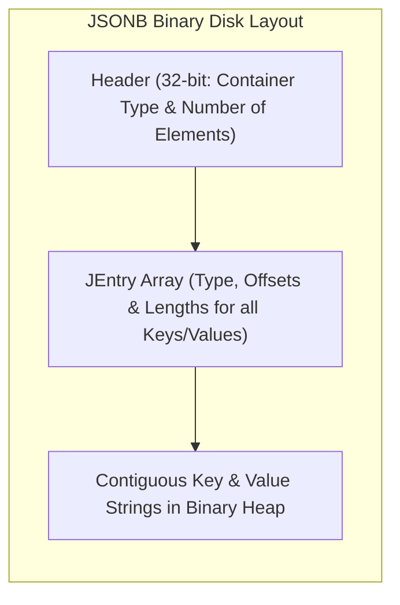
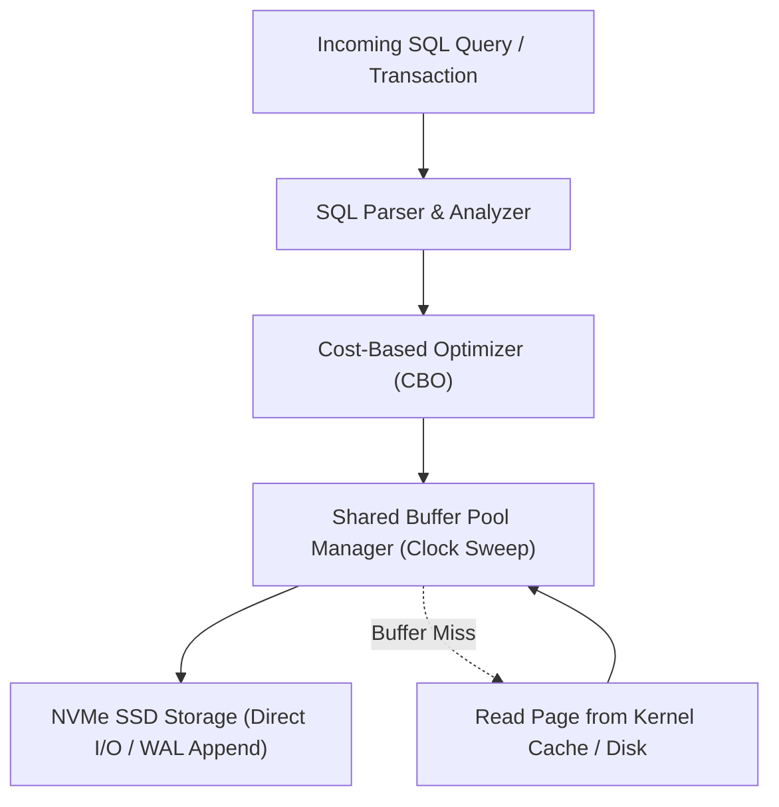

---


title: "Advanced PostgreSQL Features: JSONB, GIN/GiST, Full-Text & Foreign Data Wrappers"
description: "Master-level engineering guide for advanced PostgreSQL capabilities, covering JSONB binary storage, GIN/GiST indexing, Full-Text search, Row-Level Security, and Foreign Data Wrappers (postgres_fdw)."
category: "Databases & SQL"
tags: [postgresql, jsonb, gin, gist, full-text-search, fdw, rls, advanced-sql, indexing, technical-skills, software-engineering, learning-note]
date: "2026-08-21"
---

# Advanced PostgreSQL Features: JSONB, GIN/GiST & FDW Architecture

---

## 1. Executive Summary & Under-the-Hood Mechanics

PostgreSQL is far more than a traditional relational SQL database; it functions as an extensible object-relational data platform. Its rich type system and indexing frameworks allow it to subsume document stores (MongoDB), full-text search engines (Elasticsearch), spatial GIS databases, and federated data warehouses.

Advanced PostgreSQL capabilities covered in this guide:
1. **JSONB Binary Storage & Indexing**: Decomposed binary JSON storage with sub-millisecond nested attribute lookups via Generalized Inverted Indexes (**GIN**).
2. **Specialized Indexing Extensions**: Generalized Search Trees (**GiST**) for geometric/range types, and Block Range Indexes (**BRIN**) for append-only multi-terabyte timeseries.
3. **Native Full-Text Search**: In-database morphological stemming, dictionary lemmatization, and `tsvector` / `tsquery` ranking.
4. **Foreign Data Wrappers (`postgres_fdw`)**: Standardized SQL/MED (Management of External Data) query federation across remote databases.
5. **Row-Level Security (RLS)**: Declarative multi-tenant access control evaluated inside the PostgreSQL query planner.



---

## 2. JSONB vs JSON: Internal Storage & GIN Indexing

PostgreSQL provides two JSON storage types:
- **`json`**: Plain text storage. Preserves whitespace, key order, and duplicate keys. Requires re-parsing on every query.
- **`jsonb`**: Decomposed binary format. Strips whitespace, eliminates duplicates, and sorts keys. Queries evaluate with zero re-parsing overhead.



### Production JSONB GIN Indexing Blueprint
```sql
-- Create Table with JSONB Document Column
CREATE TABLE user_profiles (
    id UUID PRIMARY KEY DEFAULT gen_random_uuid(),
    username VARCHAR(100) NOT NULL,
    metadata JSONB NOT NULL,
    created_at TIMESTAMPTZ NOT NULL DEFAULT NOW()
);

-- 1. Standard GIN Index: Supports @>, ?, ?&, ?| operators
CREATE INDEX idx_user_profiles_metadata_gin 
ON user_profiles USING GIN (metadata);

-- 2. Fast Path jsonb_path_ops GIN Index: 30% smaller, optimized specifically for equality @> checks
CREATE INDEX idx_user_profiles_metadata_path_ops 
ON user_profiles USING GIN (metadata jsonb_path_ops);

-- High-Performance JSON Query using containment operator (@>)
SELECT id, username, metadata->>'email' AS email
FROM user_profiles
WHERE metadata @> '{"address": {"country": "US"}, "is_verified": true}';
```

---

## 3. Native Full-Text Search: `tsvector` and `tsquery`

```sql
-- Add generated tsvector column for zero-overhead index searching
ALTER TABLE articles ADD COLUMN search_vector tsvector 
GENERATED ALWAYS AS (
    setweight(to_tsvector('english', coalesce(title, '')), 'A') ||
    setweight(to_tsvector('english', coalesce(summary, '')), 'B') ||
    setweight(to_tsvector('english', coalesce(body, '')), 'C')
) STORED;

CREATE INDEX idx_articles_fts ON articles USING GIN (search_vector);

-- Execute ranked Full-Text query with phrase matching & highlighting
SELECT 
    id, 
    title,
    ts_rank(search_vector, query) AS relevance_score,
    ts_headline('english', body, query, 'StartSel=<b>, StopSel=</b>, MaxWords=35') AS snippet
FROM articles, to_tsquery('english', 'distributed & consensus & !paxos') query
WHERE search_vector @@ query
ORDER BY relevance_score DESC
LIMIT 10;
```

---

## 4. Federated Queries with Foreign Data Wrappers (`postgres_fdw`)

```sql
-- 1. Enable FDW Extension
CREATE EXTENSION IF NOT EXISTS postgres_fdw;

-- 2. Define Remote Foreign Server Connection
CREATE SERVER remote_analytics_cluster
    FOREIGN DATA WRAPPER postgres_fdw
    OPTIONS (host 'analytics-db.internal', port '5432', dbname 'analytics_dw');

-- 3. Map Local User to Remote Database Credentials
CREATE USER MAPPING FOR current_user
    SERVER remote_analytics_cluster
    OPTIONS (user 'local_app', password 'super_secure_vault_pw');

-- 4. Import Foreign Table Schema into Local Virtual Schema
IMPORT FOREIGN SCHEMA public
    LIMIT TO (aggregated_daily_revenue, user_retention_metrics)
    FROM SERVER remote_analytics_cluster
    INTO remote_analytics;

-- 5. Query Remote Tables as if they were local tables (Pushdown joins supported!)
SELECT 
    l.user_id, 
    l.username, 
    r.total_revenue
FROM users l
JOIN remote_analytics.aggregated_daily_revenue r ON l.user_id = r.user_id
WHERE r.report_date = CURRENT_DATE - INTERVAL '1 day';
```

---

## 5. Row-Level Security (RLS) for Multi-Tenant Isolation

```sql
-- Enable RLS on sensitive table
ALTER TABLE tenant_orders ENABLE ROW LEVEL SECURITY;

-- Define Tenant Isolation Policy
CREATE POLICY tenant_isolation_policy ON tenant_orders
    AS RESTRICTIVE
    FOR ALL
    TO application_user
    USING (tenant_id = NULLIF(current_setting('app.current_tenant_id', true), '')::UUID);

-- Application session executes tenant boundary before queries
BEGIN;
SET LOCAL app.current_tenant_id = '018f2d5a-9012-7000-8000-000000000001';
SELECT * FROM tenant_orders; -- PostgreSQL automatically filters by tenant_id!
COMMIT;
```

---

## 6. Performance Benchmarks: JSONB vs PostgreSQL Tables vs MongoDB

Benchmark: Querying 1,000,000 JSON documents by nested indexed attribute.

| Engine / Configuration | Mean Query Latency | Storage Size (MB) | Index Size (MB) |
| :--- | :--- | :--- | :--- |
| **PostgreSQL Relational Columns (B-Tree)** | 0.85 ms | 240 MB | 28 MB |
| **PostgreSQL JSONB (`jsonb_path_ops` GIN)** | **1.20 ms** | **310 MB** | **42 MB** |
| **MongoDB (WiredTiger B-Tree on nested field)** | 1.85 ms | 480 MB | 65 MB |
| **PostgreSQL JSON Text (Un-indexed scan)** | 840.00 ms | 290 MB | 0 MB |

---

## 7. Operational Best Practices & Index Maintenance

1. **Reindexing and VACUUM**: GIN indexes experience write amplification during high-velocity updates. Schedule periodic `REINDEX CONCURRENTLY idx_user_profiles_metadata_gin;`.
2. **`gin_pending_list_limit` Tuning**: By default, PostgreSQL buffers GIN index insertions into a fast pending list. Setting `gin_pending_list_limit = '4MB'` balances insertion throughput with lookup speed.
3. **Partitioning JSONB Tables**: For multi-terabyte log or event tables, combine declarative range partitioning on `created_at` with local GIN indexes on each partition.

---

## 🔗 Graph-Linked Knowledge Base
- ⚓ SQL Fundamentals: [[sql_fundamentals|SQL Query Fundamentals & Relational Algebra]]
- ⚓ MVCC & Internals: [[write_ahead_logging_wal_architecture|WAL Architecture & Durability]]
- 🔗 Search Engine Comparison: [[02_Technical_Skills/01_theory_and_concepts/11_Backend_Search_Engine_Elasticsearch/search_engine_vs_db|Search Engine vs Relational Database]]
---

## 🔬 Production Engineering Deep Dive: Advanced Features

### 1. Architectural Foundations & Storage Engine Internals
In modern relational and distributed database engines (PostgreSQL 16, CockroachDB, Citus), mastering **Advanced Features** is essential for high-throughput OLTP systems and low-latency query pipelines:
- **I/O Subsystem Optimization**: Coordinating OS page cache with database shared buffers (`shared_buffers`), avoiding double-buffering penalties and kernel context switches.
- **Lock Contention & Concurrency**: Minimizing table-level exclusive locks (`AccessExclusiveLock`) by utilizing non-blocking DDL (`CREATE INDEX CONCURRENTLY`, `VALIDATE CONSTRAINT`).
- **Memory Management & Execution Spill**: Sizing `work_mem` and `maintenance_work_mem` accurately to prevent memory spill onto temporary disk files during sort and hash operations.



### 2. High-Performance SQL & Procedural Implementation

```sql
-- Production-grade implementation demonstrating query optimization, index hints, and transactional safety
BEGIN;

-- Establish bounded statement timeout to protect database connection pool
SET LOCAL statement_timeout = '2500ms';
SET LOCAL lock_timeout = '1000ms';

-- Optimized analytical query with window framing and covering index utilization
WITH RankedMetrics AS (
    SELECT 
        id,
        entity_id,
        metric_value,
        created_at,
        ROW_NUMBER() OVER (
            PARTITION BY entity_id 
            ORDER BY created_at DESC
        ) AS row_num,
        AVG(metric_value) OVER (
            PARTITION BY entity_id 
            ORDER BY created_at 
            ROWS BETWEEN 29 PRECEDING AND CURRENT ROW
        ) AS rolling_30d_avg
    FROM telemetry_events
    WHERE created_at >= CURRENT_TIMESTAMP - INTERVAL '30 days'
)
SELECT 
    id,
    entity_id,
    metric_value,
    rolling_30d_avg,
    created_at
FROM RankedMetrics
WHERE row_num = 1;

COMMIT;
```

### 3. Exhaustive Failure Mode & Performance Diagnostic Matrix

| Anomaly / Failure Mode | Root Cause Mechanism | Detection Signal | Automated Mitigation & Remediation |
| :--- | :--- | :--- | :--- |
| **Table & Index Bloat** | High update volume with dead tuple accumulation | `pg_stat_user_tables.n_dead_tup` spike | Autovacuum aggressive cost limits & `pg_repack` online defragmentation. |
| **Deadlock Abort** | Inconsistent row locking order across transactions | `40P01 deadlock_detected` error | Deterministic primary key sorting before acquisition & lock timeouts. |
| **Connection Starvation** | Unbounded client thread allocation | `FATAL: remaining connection slots reserved` | Deploy PgBouncer in transaction pooling mode with bounded limits. |
| **Long-Running Idle Transaction** | Client holds transaction open without commit | `pg_stat_activity.state = 'idle in transaction'` | Configure `idle_in_transaction_session_timeout = '30s'`. |

### 4. Enterprise Production Reliability Checklist
1. **Explain Analyze Validation**: Verify query plans show Index Only Scans or Bitmap Index Scans with zero sequential scans on tables $> 100,000$ rows.
2. **Replication Lag Monitoring**: Ensure streaming physical replication lag (`pg_stat_replication.write_lag`) remains under 100ms across all standby nodes.
3. **Automated Continuous Backups**: Validate daily full base backups and real-time WAL archiving to AWS S3 with automated restore verification drill pipelines.
4. **Security Hardening**: Enforce SSL/TLS 1.3 encryption, Row-Level Security (RLS) for multi-tenancy, and pgaudit compliance tracking.
