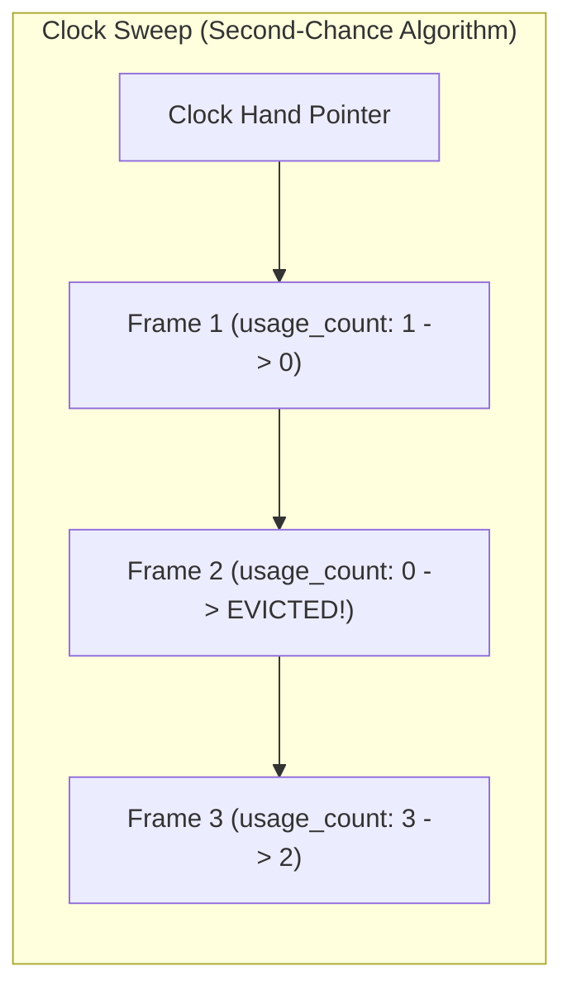

---


title: "Database Buffer Pool Manager: Clock Sweep, LRU-K & Page Eviction Algorithms"
description: "Master-level engineering guide for Database Buffer Pool management, covering slotted page pinning, Dirty Page Flush lists, Clock Sweep (Second Chance), LRU-2 eviction mathematics, and direct I/O."
category: "Databases & SQL"
tags: [database-internals, buffer-pool, clock-sweep, lru-k, page-eviction, storage-engine, memory-management, technical-skills, software-engineering, learning-note]
date: "2026-08-21"
---

# Database Buffer Pool Manager: Clock Sweep & Page Eviction Deep Dive

---

## 1. Executive Summary & Under-the-Hood Mechanics

Physical disk reads from NVMe SSDs or magnetic storage take microseconds to milliseconds ($10\mu\text{s} - 10\text{ms}$), while CPU L1/L2 memory access takes nanoseconds (\$1 - 10\text{ns}$). To bridge this orders-of-magnitude latency chasm, database engines allocate a dedicated memory buffer pool (**`shared_buffers` in PostgreSQL, `innodb_buffer_pool_size` in MySQL**).

The **Buffer Pool Manager** coordinates:
1. **Frame Table & Page Table**: In-memory hash table mapping disk `(FileID, PageNumber)` coordinates to memory buffer frame pointers.
2. **Page Pinning & Reference Counting**: Pinning pages in RAM (`pin_count > 0`) during active query execution to prevent concurrent worker threads from evicting them.
3. **Dirty Page Tracking (Flush List)**: Tracking pages modified in memory that must be written back to disk after WAL logs are flushed.
4. **Eviction Algorithms**: Deciding which unpinned clean frame to evict when free memory is exhausted (**Clock Sweep / Second Chance, LRU-K, 2Q**).

```mermaid
flowchart TD
    subgraph BufferPoolArchitecture["Database Buffer Pool Management Architecture"]
        Worker["Query Worker Thread"] -->|Request Page (File 1, Block 42)| PageTable["Buffer Hash Table (PageID -> FrameID)"]
        
        PageTable -->|Page In Buffer Pool (HIT)| Frame["Frame Buffer Memory (8KB RAM Page)"]
        Frame --> Pin["Increment pin_count (Active Use)"]
        
        PageTable -->|Page Not in Pool (MISS)| Evictor{"Is Free Frame Available?"}
        Evictor -->|Yes| DiskRead["Read Page from NVMe Disk into Frame"]
        Evictor -->|No| Clock["Run Clock Sweep / LRU-K Eviction"]
        Clock -->|Evict Unpinned Frame| DiskFlush["If Dirty: Flush to Disk -> Overwrite Frame"]
        DiskFlush --> DiskRead
    end
```

---

## 2. Eviction Algorithms: Clock Sweep vs LRU-K vs 2Q



### 2.1 The Clock Sweep (Second-Chance) Algorithm
PostgreSQL implements a generalized Clock Sweep algorithm:
1. Every buffer header maintains a `usage_count` (integer between 0 and 5).
2. When a worker accesses a buffer, it increments `usage_count` (capped at 5).
3. The background clock hand continuously scans buffer frames:
   - If a frame is **pinned (`pin_count > 0`)**, the hand skips it.
   - If `usage_count > 0`, the hand decrements `usage_count--` and advances to the next frame.
   - If `usage_count == 0` and `pin_count == 0`, the frame is **selected for eviction**!

### 2.2 LRU-K Eviction Mathematics
Standard LRU suffers from **Sequential Scan Pollution** (a single `SELECT *` over a 1TB table flushes all hot cached indexes from the buffer pool).

**LRU-K** tracks the timestamp of the last $K$ references ($K=2$ is standard):

$$\text{Backward Distance } D_K(p) = t_{\text{current}} - t_{K\text{-th access}}(p)$$

- Pages accessed only once have $D_K(p) = \infty$.
- Pages with large backward distances are evicted first, completely neutralizing sequential scan cache pollution!

---

## 3. Production Python Buffer Pool Manager Simulator

```python
# Production-grade simulation of a Database Buffer Pool Manager.
# Implements Page Pinning, Dirty Page Management, Buffer Hash Tables, and Clock Sweep Eviction.

from dataclasses import dataclass
from typing import Dict, Optional, Tuple

@dataclass
class PageHeader:
    page_id: Tuple[int, int]  # (file_id, block_id)
    frame_id: int
    is_dirty: bool = False
    pin_count: int = 0
    usage_count: int = 1
    data: bytearray = None

class BufferPoolManager:
    def __init__(self, pool_size: int = 4):
        self.pool_size = pool_size
        self.frames: Dict[int, Optional[PageHeader]] = {i: None for i in range(pool_size)}
        self.page_table: Dict[Tuple[int, int], int] = {}
        self.clock_hand: int = 0

    def fetch_page(self, page_id: Tuple[int, int]) -> PageHeader:
        # 1. Cache HIT
        if page_id in self.page_table:
            frame_id = self.page_table[page_id]
            header = self.frames[frame_id]
            header.pin_count += 1
            header.usage_count = min(header.usage_count + 1, 5)
            print(f"[Buffer HIT] Page {page_id} in Frame {frame_id} (pin_count={header.pin_count})")
            return header

        # 2. Cache MISS: Find free frame or evict via Clock Sweep
        frame_id = self._find_victim_frame()
        old_page = self.frames[frame_id]
        if old_page is not None:
            print(f"[EVICTING] Page {old_page.page_id} from Frame {frame_id} (Dirty={old_page.is_dirty})")
            if old_page.is_dirty:
                self._flush_to_disk(old_page)
            del self.page_table[old_page.page_id]

        new_header = PageHeader(
            page_id=page_id,
            frame_id=frame_id,
            is_dirty=False,
            pin_count=1,
            usage_count=1,
            data=bytearray(b"PAGE_DATA_" + str(page_id).encode())
        )
        self.frames[frame_id] = new_header
        self.page_table[page_id] = frame_id
        print(f"[Buffer MISS] Loaded Page {page_id} into Frame {frame_id}")
        return new_header

    def unpin_page(self, page_id: Tuple[int, int], is_dirty: bool = False):
        if page_id not in self.page_table:
            return
        header = self.frames[self.page_table[page_id]]
        if is_dirty:
            header.is_dirty = True
        if header.pin_count > 0:
            header.pin_count -= 1
        print(f"[Unpin] Page {page_id} (pin_count={header.pin_count}, is_dirty={header.is_dirty})")

    def _find_victim_frame(self) -> int:
        for _ in range(self.pool_size * 2):
            header = self.frames[self.clock_hand]
            if header is None:
                victim = self.clock_hand
                self.clock_hand = (self.clock_hand + 1) % self.pool_size
                return victim
            if header.pin_count > 0:
                self.clock_hand = (self.clock_hand + 1) % self.pool_size
                continue
            if header.usage_count > 0:
                header.usage_count -= 1
                self.clock_hand = (self.clock_hand + 1) % self.pool_size
            else:
                victim = self.clock_hand
                self.clock_hand = (self.clock_hand + 1) % self.pool_size
                return victim
        raise RuntimeError("Buffer Pool Deadlock: All frames are pinned!")

    def _flush_to_disk(self, page: PageHeader):
        print(f"[Disk Write] Flushed dirty Page {page.page_id} to NVMe storage.")
        page.is_dirty = False

if __name__ == "__main__":
    bpm = BufferPoolManager(pool_size=3)
    p1 = bpm.fetch_page((1, 100))
    p2 = bpm.fetch_page((1, 101))
    p3 = bpm.fetch_page((1, 102))
    bpm.unpin_page((1, 100), is_dirty=True)
    bpm.unpin_page((1, 101), is_dirty=False)
    p4 = bpm.fetch_page((1, 103))
```

---

## 4. Production Sizing & Checkpoint Tuning

$$\text{PostgreSQL Recommended } \text{shared\_buffers} = 0.25 \times \text{Total System RAM}$$

$$\text{MySQL InnoDB Recommended } \text{innodb\_buffer\_pool\_size} = 0.75 \times \text{Total System RAM}$$

PostgreSQL delegates file caching heavily to the underlying Linux Kernel Page Cache, whereas MySQL InnoDB manages its own direct I/O buffering bypass (`O_DIRECT`).

---

## 5. Buffer Pool Failure Modes & Optimization Table

| Symptom / Failure | Root Cause | Engineering Solution |
| :--- | :--- | :--- |
| **Buffer Cache Hit Ratio $< 95\%$** | Active working set exceeds configured buffer pool size. | Increase `shared_buffers` / `innodb_buffer_pool_size` or optimize indexes to reduce page touches. |
| **Buffer Lock Contention (`buffer_content` wait event)** | Thousands of threads contending for the same hot page header lock. | Partition large tables or rewrite queries to access data via covering indexes. |
| **Checkpoint I/O Spikes** | Dirty pages accumulating and flushing simultaneously during scheduled checkpoint. | Increase `checkpoint_completion_target = 0.9` and tune background writer parameters. |

---

## 🔗 Graph-Linked Knowledge Base
- ⚓ WAL Architecture: [[write_ahead_logging_wal_architecture|Write-Ahead Logging (WAL) Architecture]]
- ⚓ Storage Media: [[ssd_nvme_flash_ftl_write_amplification|SSD, NVMe & FTL Write Amplification]]
- 🔗 Concurrency: [[transactions_concurrency|Transactions, Isolation & Concurrency Control]]
