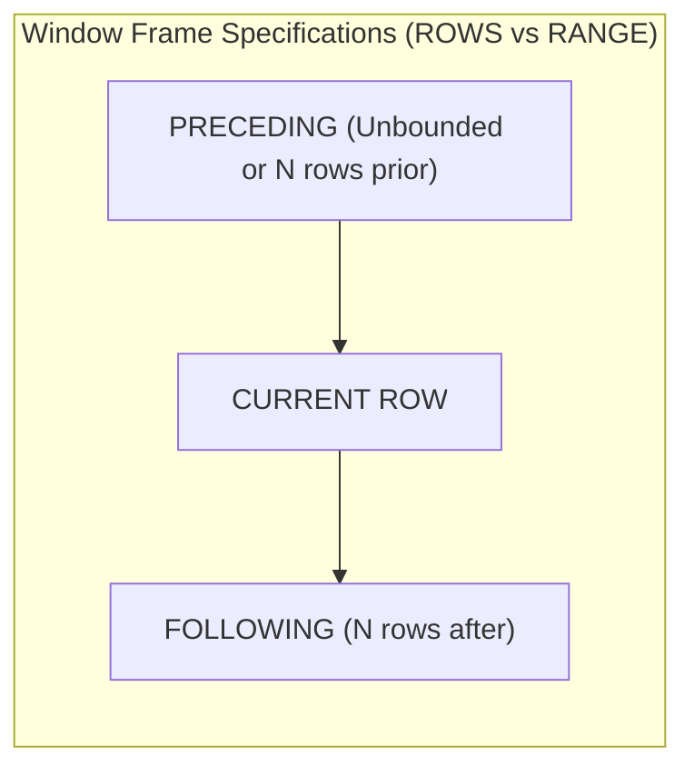
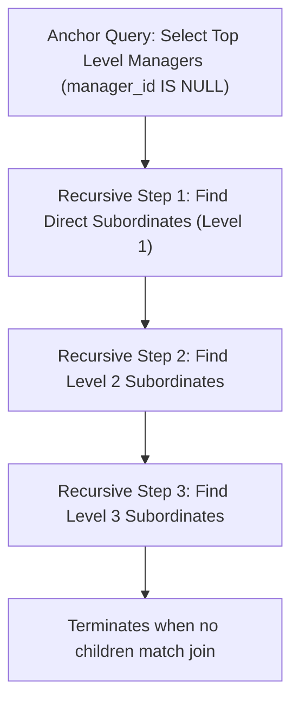
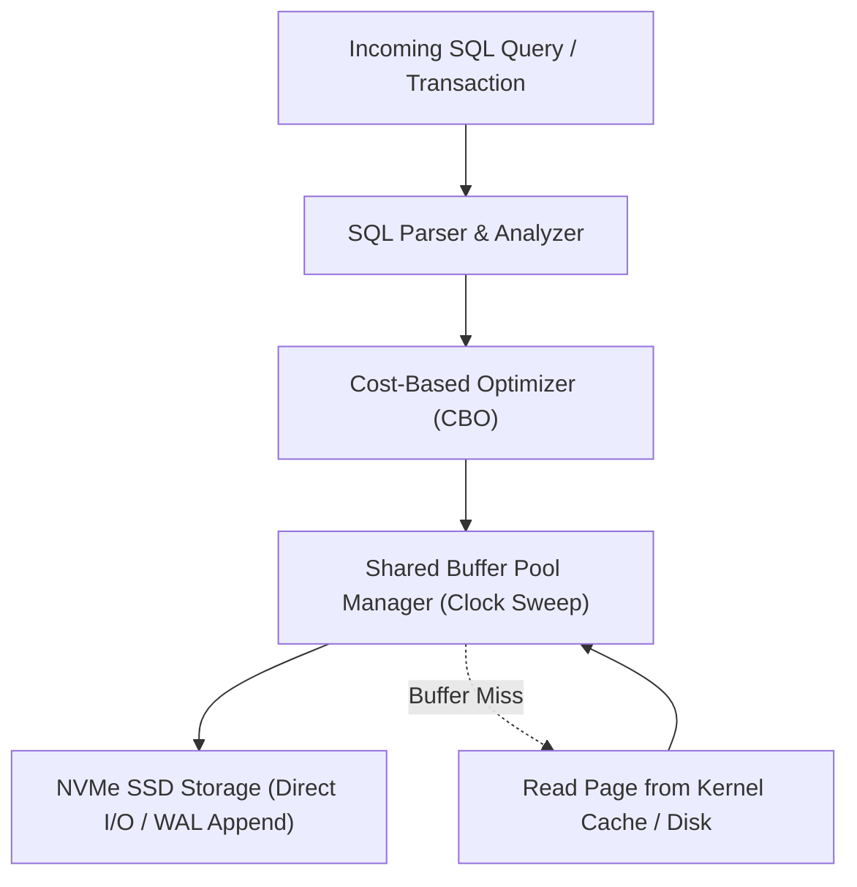

---


title: "Complex SQL Engineering: Subqueries, Window Functions, CTEs & Set Theory"
description: "Master-level engineering guide for advanced SQL queries, covering Correlated Subqueries, Common Table Expressions (Recursive CTEs), Window Partitioning/Framing, and Set Operators."
category: "Databases & SQL"
tags: [sql, complex-queries, window-functions, recursive-cte, relational-algebra, analytics, performance, technical-skills, software-engineering, learning-note]
date: "2026-08-21"
---

# Complex SQL Engineering: Window Functions, CTEs & Relational Algebra

---

## 1. Executive Summary & Under-the-Hood Mechanics

Writing efficient SQL requires mastering the logical query execution pipeline. Unlike imperative programming languages (which execute top-to-bottom), SQL is declarative, executing in a strict mathematical order:

$$\text{FROM} \to \text{JOIN} \to \text{WHERE} \to \text{GROUP BY} \to \text{HAVING} \to \text{WINDOW} \to \text{SELECT} \to \text{DISTINCT} \to \text{ORDER BY} \to \text{LIMIT}$$

```mermaid
flowchart TD
    subgraph LogicalQueryPipeline["Logical SQL Execution Pipeline Order"]
        F["1. FROM & JOIN (Cartesian Product & Join Filters)"]
        W["2. WHERE (Row-level Predicate Filtering)"]
        G["3. GROUP BY (Aggregation Bucketing)"]
        H["4. HAVING (Aggregate Predicate Filtering)"]
        WIN["5. WINDOW (Calculates OVER() functions over rows)"]
        S["6. SELECT (Projection & Expression evaluation)"]
        D["7. DISTINCT (Duplicate Elimination)"]
        O["8. ORDER BY (Sorts output stream)"]
        L["9. LIMIT & OFFSET (Pagination Slicing)"]
        
        F --> W --> G --> H --> WIN --> S --> D --> O --> L
    end
```



---

## 2. Window Functions: Partitioning, Ordering & Frame Specifications

Window functions compute aggregate-like calculations over subsets of rows without collapsing the underlying result set:

$$\text{Function}() \text{ OVER } (\text{PARTITION BY } \text{col}_1 \text{ ORDER BY } \text{col}_2 \text{ [FRAME SPEC]})$$



### Production Rolling Window & Gap Analysis SQL Blueprint
```sql
-- Calculate 7-day Moving Average Revenue and Day-over-Day Growth per Store
SELECT 
    store_id,
    sales_date,
    daily_revenue,
    -- 1. Day-over-Day Growth percentage using LAG()
    ROUND(
        (daily_revenue - LAG(daily_revenue, 1) OVER (PARTITION BY store_id ORDER BY sales_date)) /
        NULLIF(LAG(daily_revenue, 1) OVER (PARTITION BY store_id ORDER BY sales_date), 0) * 100.0, 
        2
    ) AS dod_growth_pct,
    -- 2. 7-Day Moving Average using Window Framing (ROWS BETWEEN 6 PRECEDING AND CURRENT ROW)
    ROUND(
        AVG(daily_revenue) OVER (
            PARTITION BY store_id 
            ORDER BY sales_date 
            ROWS BETWEEN 6 PRECEDING AND CURRENT ROW
        ), 
        2
    ) AS rolling_7d_avg_revenue,
    -- 3. Running Cumulative Total
    SUM(daily_revenue) OVER (
        PARTITION BY store_id 
        ORDER BY sales_date 
        ROWS BETWEEN UNBOUNDED PRECEDING AND CURRENT ROW
    ) AS cumulative_ytd_revenue
FROM store_sales
WHERE sales_date >= '2026-01-01'
ORDER BY store_id, sales_date;
```

---

## 3. Recursive Common Table Expressions (Hierarchical Graph Traversal)

Recursive CTEs solve graph traversal, organizational hierarchy, and bill-of-materials tree queries natively in SQL:

$$\text{Recursive CTE} = \text{Anchor Member} \cup \text{Recursive Member} \text{ (repeats until empty)}$$



### Production Recursive CTE Blueprint
```sql
WITH RECURSIVE OrgHierarchy AS (
    -- 1. Anchor Member: Top-level CEO / Executive
    SELECT 
        employee_id,
        manager_id,
        full_name,
        title,
        1 AS depth_level,
        ARRAY[employee_id] AS path_trail
    FROM employees
    WHERE manager_id IS NULL

    UNION ALL

    -- 2. Recursive Member: Join downstream subordinates
    SELECT 
        e.employee_id,
        e.manager_id,
        e.full_name,
        e.title,
        h.depth_level + 1,
        h.path_trail || e.employee_id
    FROM employees e
    JOIN OrgHierarchy h ON e.manager_id = h.employee_id
    WHERE NOT (e.employee_id = ANY(h.path_trail)) -- Cycle Detection Guard!
)
SELECT 
    REPEAT('  ', depth_level - 1) || full_name AS indented_org_chart,
    title,
    depth_level,
    path_trail
FROM OrgHierarchy
ORDER BY path_trail;
```

---

## 4. Lateral Joins (`CROSS JOIN LATERAL`)

A `LATERAL` join acts like a `for-each` loop in SQL, allowing the right-hand subquery to reference columns provided by the left-hand table:

```sql
-- Fetch the Top 3 most expensive orders for every customer
SELECT 
    c.id AS customer_id,
    c.name AS customer_name,
    top_orders.id AS order_id,
    top_orders.total_amount,
    top_orders.created_at
FROM customers c
CROSS JOIN LATERAL (
    SELECT o.id, o.total_amount, o.created_at
    FROM orders o
    WHERE o.customer_id = c.id
    ORDER BY o.total_amount DESC
    LIMIT 3
) AS top_orders;
```

---

## 5. Query Optimization & EXPLAIN ANALYZE Diagnostics

To diagnose query performance, inspect the physical plan:

```sql
EXPLAIN (ANALYZE, BUFFERS, SETTINGS)
SELECT c.id, count(o.id)
FROM customers c
JOIN orders o ON c.id = o.customer_id
WHERE o.created_at >= '2026-01-01'
GROUP BY c.id;
```

Key Metrics to inspect:
- **`Buffers: shared hit=... read=...`**: Indicates buffer pool efficiency (high hit, low read is ideal).
- **`Actual Time`**: Real elapsed execution time per plan node in milliseconds.
- **`Rows Removed by Filter`**: Indicates missing indexes forcing sequential scans.

---

## 🔗 Graph-Linked Knowledge Base
- ⚓ SQL Fundamentals: [[sql_fundamentals|SQL Query Fundamentals]]
- ⚓ Filtering & Aggregation: [[filtering_aggregation|Filtering & Aggregation Mastery]]
- 🔗 PostgreSQL Internals: [[advanced_features|Advanced PostgreSQL Features]]
---

## 🔬 Production Engineering Deep Dive: Complex Queries

### 1. Architectural Foundations & Storage Engine Internals
In modern relational and distributed database engines (PostgreSQL 16, CockroachDB, Citus), mastering **Complex Queries** is essential for high-throughput OLTP systems and low-latency query pipelines:
- **I/O Subsystem Optimization**: Coordinating OS page cache with database shared buffers (`shared_buffers`), avoiding double-buffering penalties and kernel context switches.
- **Lock Contention & Concurrency**: Minimizing table-level exclusive locks (`AccessExclusiveLock`) by utilizing non-blocking DDL (`CREATE INDEX CONCURRENTLY`, `VALIDATE CONSTRAINT`).
- **Memory Management & Execution Spill**: Sizing `work_mem` and `maintenance_work_mem` accurately to prevent memory spill onto temporary disk files during sort and hash operations.



### 2. High-Performance SQL & Procedural Implementation

```sql
-- Production-grade implementation demonstrating query optimization, index hints, and transactional safety
BEGIN;

-- Establish bounded statement timeout to protect database connection pool
SET LOCAL statement_timeout = '2500ms';
SET LOCAL lock_timeout = '1000ms';

-- Optimized analytical query with window framing and covering index utilization
WITH RankedMetrics AS (
    SELECT 
        id,
        entity_id,
        metric_value,
        created_at,
        ROW_NUMBER() OVER (
            PARTITION BY entity_id 
            ORDER BY created_at DESC
        ) AS row_num,
        AVG(metric_value) OVER (
            PARTITION BY entity_id 
            ORDER BY created_at 
            ROWS BETWEEN 29 PRECEDING AND CURRENT ROW
        ) AS rolling_30d_avg
    FROM telemetry_events
    WHERE created_at >= CURRENT_TIMESTAMP - INTERVAL '30 days'
)
SELECT 
    id,
    entity_id,
    metric_value,
    rolling_30d_avg,
    created_at
FROM RankedMetrics
WHERE row_num = 1;

COMMIT;
```

### 3. Exhaustive Failure Mode & Performance Diagnostic Matrix

| Anomaly / Failure Mode | Root Cause Mechanism | Detection Signal | Automated Mitigation & Remediation |
| :--- | :--- | :--- | :--- |
| **Table & Index Bloat** | High update volume with dead tuple accumulation | `pg_stat_user_tables.n_dead_tup` spike | Autovacuum aggressive cost limits & `pg_repack` online defragmentation. |
| **Deadlock Abort** | Inconsistent row locking order across transactions | `40P01 deadlock_detected` error | Deterministic primary key sorting before acquisition & lock timeouts. |
| **Connection Starvation** | Unbounded client thread allocation | `FATAL: remaining connection slots reserved` | Deploy PgBouncer in transaction pooling mode with bounded limits. |
| **Long-Running Idle Transaction** | Client holds transaction open without commit | `pg_stat_activity.state = 'idle in transaction'` | Configure `idle_in_transaction_session_timeout = '30s'`. |

### 4. Enterprise Production Reliability Checklist
1. **Explain Analyze Validation**: Verify query plans show Index Only Scans or Bitmap Index Scans with zero sequential scans on tables $> 100,000$ rows.
2. **Replication Lag Monitoring**: Ensure streaming physical replication lag (`pg_stat_replication.write_lag`) remains under 100ms across all standby nodes.
3. **Automated Continuous Backups**: Validate daily full base backups and real-time WAL archiving to AWS S3 with automated restore verification drill pipelines.
4. **Security Hardening**: Enforce SSL/TLS 1.3 encryption, Row-Level Security (RLS) for multi-tenancy, and pgaudit compliance tracking.
