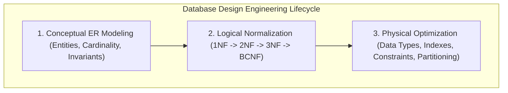
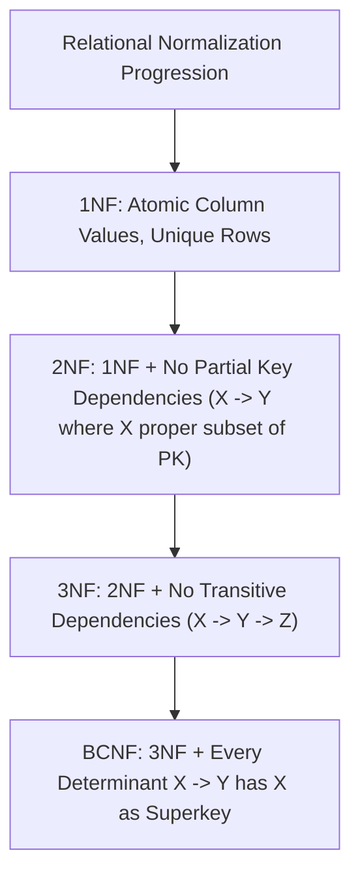
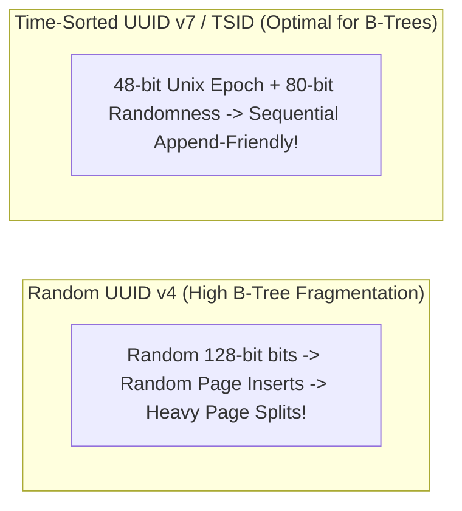
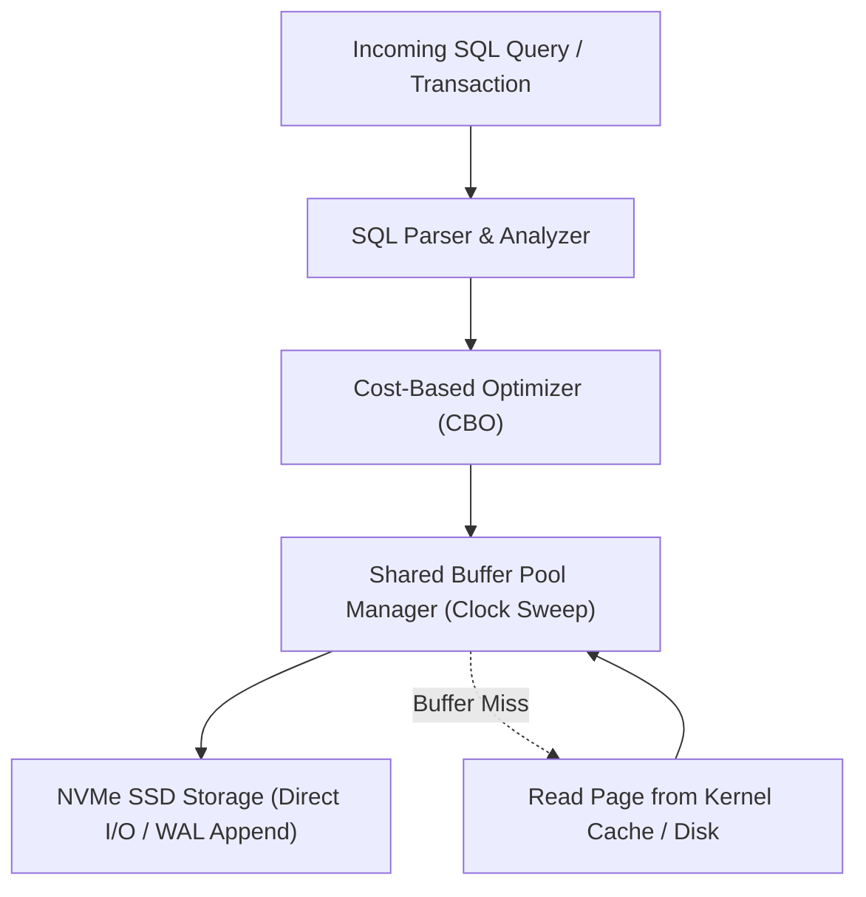

---


title: "Relational Database Design: Normalization, Entity-Relationship Models & Anti-Patterns"
description: "Master-level engineering guide for Relational Database Design, covering Conceptual/Logical modeling, Normal Forms (1NF through BCNF/5NF), Primary/Surrogate/Natural keys, and schema anti-patterns."
category: "Databases & SQL"
tags: [database-design, normalization, er-modeling, relational-database, sql-schema, database-architecture, technical-skills, software-engineering, learning-note]
date: "2026-08-21"
---

# Relational Database Design: Normalization & Schema Architecture

---

## 1. Executive Summary & Under-the-Hood Mechanics

A well-architected database schema ensures **Data Integrity**, eliminates **Update/Insert/Delete Anomalies**, and maximizes **Query Performance**. Database design bridges high-level business domains (Entities and Relationships) with low-level storage engine constraints (Disk Page Layout, B+Tree Indexes, Foreign Key validation).

The database design lifecycle comprises three iterative tiers:
1. **Conceptual Design**: High-level Entity-Relationship (ER) diagrams modeling domain entities.
2. **Logical Design**: Relational schema normalization (1NF, 2NF, 3NF, BCNF) to guarantee functional dependency integrity.
3. **Physical Design**: Indexing, table partitioning, column data types, surrogate vs natural key selection, and selective denormalization.



---

## 2. Functional Dependencies & Normal Forms Formal Invariants

Let $R$ be a relational schema and $X, Y$ be subsets of attributes in $R$. A **Functional Dependency ($X \to Y$)** states that the value of $X$ uniquely determines the value of $Y$.



| Normal Form | Mathematical Invariant | Engineering Violation Prevented |
| :--- | :--- | :--- |
| **1NF** | $\forall \text{attribute } A, \text{domain}(A) \text{ is atomic}$. | Multi-valued comma-separated strings inside a single cell. |
| **2NF** | $1\text{NF} \land \neg(\exists X \subset PK, X \to Y \text{ where } Y \notin PK)$. | Storing product name inside composite `(order_id, product_id)` table. |
| **3NF** | $2\text{NF} \land (\forall X \to Y, X \text{ is Superkey} \lor Y \text{ is Prime Attribute})$. | Storing customer zip code and city name in orders table ($ZIP \to City$). |
| **BCNF** | $\forall X \to Y, X \text{ MUST be a Superkey}$. | Overlapping composite candidate key update anomalies. |

---

## 3. Primary Key Strategies: UUID v7 vs ULID vs BIGINT Identity



| Key Strategy | Byte Size | B-Tree Locality | Security / Enumeration Risk | Generation Location |
| :--- | :--- | :--- | :--- | :--- |
| **`BIGINT IDENTITY`** | 8 Bytes | **Optimal** (Sequential append) | **High** (Predictable enumeration attack) | Centralized DB sequence |
| **`UUID v4` (Random)** | 16 Bytes | **Terrible** (Random page splits) | Zero (Cryptographically random) | Decentralized Client / DB |
| **`UUID v7` / TSID** | 16 Bytes | **Optimal** (Time-sorted sequential) | Zero (Unguessable 80-bit randomness) | Decentralized Client / DB |

---

## 4. Production E-Commerce Schema Blueprint (PostgreSQL DDL)

```sql
-- 1. Customers Table
CREATE TABLE customers (
    id UUID PRIMARY KEY DEFAULT gen_random_uuid(),
    email VARCHAR(255) NOT NULL UNIQUE,
    full_name VARCHAR(150) NOT NULL,
    created_at TIMESTAMPTZ NOT NULL DEFAULT NOW()
);

-- 2. Orders Table (Enforces 3NF & Foreign Key Integrity)
CREATE TABLE orders (
    id UUID PRIMARY KEY DEFAULT gen_random_uuid(),
    customer_id UUID NOT NULL REFERENCES customers(id) ON DELETE RESTRICT,
    total_amount NUMERIC(12, 2) NOT NULL CHECK (total_amount >= 0),
    status VARCHAR(50) NOT NULL DEFAULT 'PENDING',
    created_at TIMESTAMPTZ NOT NULL DEFAULT NOW()
);

-- 3. Order Items Table (M:N Join with Composite Unique Constraint)
CREATE TABLE order_items (
    id UUID PRIMARY KEY DEFAULT gen_random_uuid(),
    order_id UUID NOT NULL REFERENCES orders(id) ON DELETE CASCADE,
    product_id UUID NOT NULL,
    quantity INT NOT NULL CHECK (quantity > 0),
    unit_price NUMERIC(10, 2) NOT NULL CHECK (unit_price >= 0),
    CONSTRAINT uq_order_product UNIQUE (order_id, product_id)
);
```

---

## 5. Schema Anti-Patterns & Failure Modes

| Anti-Pattern | Manifestation | Correct Architectural Design |
| :--- | :--- | :--- |
| **Entity-Attribute-Value (EAV)** | Storing tables as `(entity_id, attribute_name, value_string)`. | Use native PostgreSQL `JSONB` with typed GIN indexes. |
| **Polymorphic Associations** | `target_type` + `target_id` referencing multiple unrelated parent tables without real foreign keys. | Use Separate Join Tables or Table Inheritance. |
| **Premature Denormalization** | Duplicating calculated counts and sums in parent rows without triggers/locks. | Use Indexed Views, Materialized Views, or compute dynamically via covering indexes. |

---

## 🔗 Graph-Linked Knowledge Base
- ⚓ SQL Fundamentals: [[sql_fundamentals|SQL Fundamentals & Relational Algebra]]
- ⚓ Complex Queries: [[complex_queries|Complex SQL Engineering & CTEs]]
- 🔗 ORM Mapping: [[02_Technical_Skills/01_theory_and_concepts/03_Backend_Database_and_ORM/entity_framework_core_csharp|Entity Framework Core Architecture]]
---

## 🔬 Production Engineering Deep Dive: Database Design

### 1. Architectural Foundations & Storage Engine Internals
In modern relational and distributed database engines (PostgreSQL 16, CockroachDB, Citus), mastering **Database Design** is essential for high-throughput OLTP systems and low-latency query pipelines:
- **I/O Subsystem Optimization**: Coordinating OS page cache with database shared buffers (`shared_buffers`), avoiding double-buffering penalties and kernel context switches.
- **Lock Contention & Concurrency**: Minimizing table-level exclusive locks (`AccessExclusiveLock`) by utilizing non-blocking DDL (`CREATE INDEX CONCURRENTLY`, `VALIDATE CONSTRAINT`).
- **Memory Management & Execution Spill**: Sizing `work_mem` and `maintenance_work_mem` accurately to prevent memory spill onto temporary disk files during sort and hash operations.



### 2. High-Performance SQL & Procedural Implementation

```sql
-- Production-grade implementation demonstrating query optimization, index hints, and transactional safety
BEGIN;

-- Establish bounded statement timeout to protect database connection pool
SET LOCAL statement_timeout = '2500ms';
SET LOCAL lock_timeout = '1000ms';

-- Optimized analytical query with window framing and covering index utilization
WITH RankedMetrics AS (
    SELECT 
        id,
        entity_id,
        metric_value,
        created_at,
        ROW_NUMBER() OVER (
            PARTITION BY entity_id 
            ORDER BY created_at DESC
        ) AS row_num,
        AVG(metric_value) OVER (
            PARTITION BY entity_id 
            ORDER BY created_at 
            ROWS BETWEEN 29 PRECEDING AND CURRENT ROW
        ) AS rolling_30d_avg
    FROM telemetry_events
    WHERE created_at >= CURRENT_TIMESTAMP - INTERVAL '30 days'
)
SELECT 
    id,
    entity_id,
    metric_value,
    rolling_30d_avg,
    created_at
FROM RankedMetrics
WHERE row_num = 1;

COMMIT;
```

### 3. Exhaustive Failure Mode & Performance Diagnostic Matrix

| Anomaly / Failure Mode | Root Cause Mechanism | Detection Signal | Automated Mitigation & Remediation |
| :--- | :--- | :--- | :--- |
| **Table & Index Bloat** | High update volume with dead tuple accumulation | `pg_stat_user_tables.n_dead_tup` spike | Autovacuum aggressive cost limits & `pg_repack` online defragmentation. |
| **Deadlock Abort** | Inconsistent row locking order across transactions | `40P01 deadlock_detected` error | Deterministic primary key sorting before acquisition & lock timeouts. |
| **Connection Starvation** | Unbounded client thread allocation | `FATAL: remaining connection slots reserved` | Deploy PgBouncer in transaction pooling mode with bounded limits. |
| **Long-Running Idle Transaction** | Client holds transaction open without commit | `pg_stat_activity.state = 'idle in transaction'` | Configure `idle_in_transaction_session_timeout = '30s'`. |

### 4. Enterprise Production Reliability Checklist
1. **Explain Analyze Validation**: Verify query plans show Index Only Scans or Bitmap Index Scans with zero sequential scans on tables $> 100,000$ rows.
2. **Replication Lag Monitoring**: Ensure streaming physical replication lag (`pg_stat_replication.write_lag`) remains under 100ms across all standby nodes.
3. **Automated Continuous Backups**: Validate daily full base backups and real-time WAL archiving to AWS S3 with automated restore verification drill pipelines.
4. **Security Hardening**: Enforce SSL/TLS 1.3 encryption, Row-Level Security (RLS) for multi-tenancy, and pgaudit compliance tracking.
