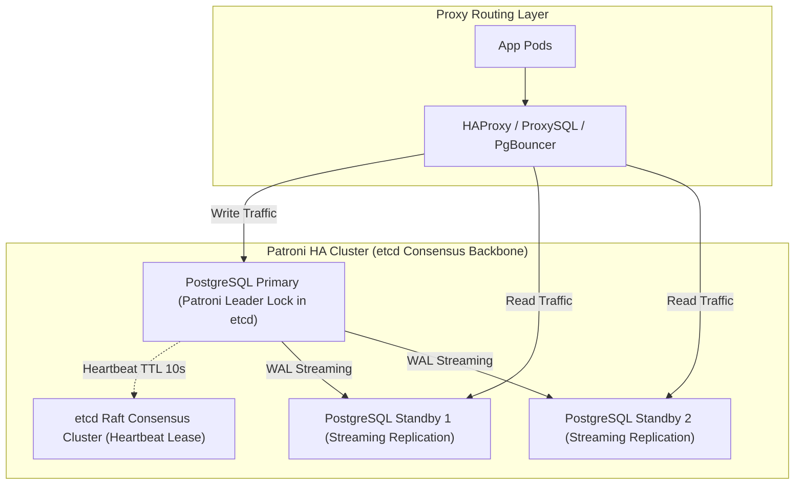
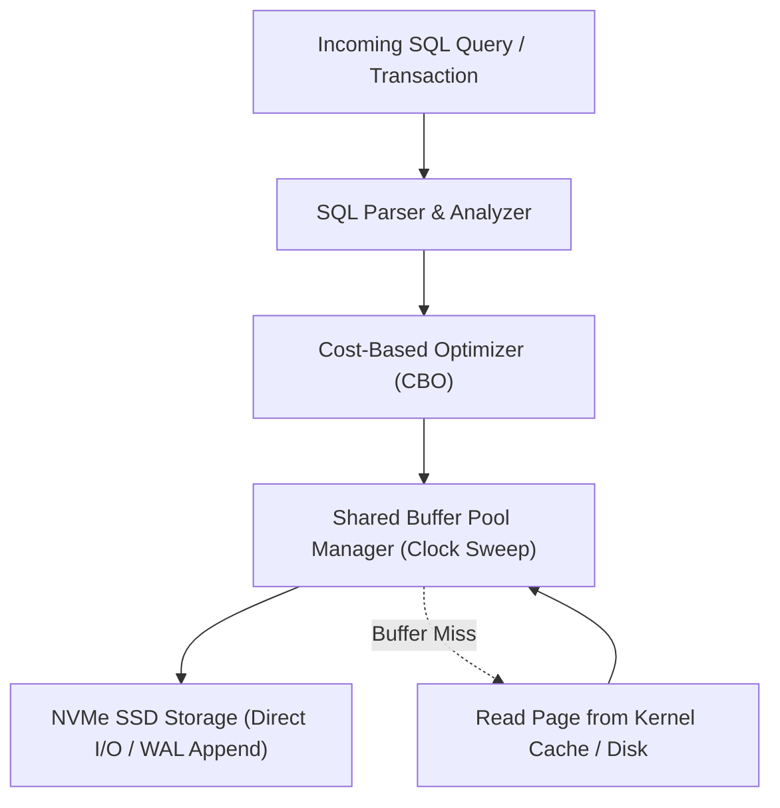

---


title: "Database Sharding, HA Clustering: Patroni, ProxySQL & Citus Architecture"
description: "Master-level engineering guide for Distributed Databases, Horizontal Sharding, High Availability with Patroni / Raft / etcd, ProxySQL connection multiplexing, and Citus distributed PostgreSQL."
category: "Databases & SQL"
tags: [database-sharding, patroni, citus, proxysql, high-availability, postgresql, distributed-sql, technical-skills, software-engineering, learning-note]
date: "2026-08-21"
---

# Database Sharding, HA Clustering: Patroni, ProxySQL & Citus Architecture

---

## 1. Executive Summary & Under-the-Hood Mechanics

When single-node database instances hit physical vertical hardware limits (CPU core contention, NVMe IOPS exhaustion, multi-terabyte storage footprints), databases must scale horizontally via **High-Availability (HA) Clustering** and **Horizontal Sharding**.

Modern distributed SQL architectures rely on:
1. **Automated HA Failover (Patroni + etcd/Raft)**: Consensus-backed leader election and automated primary failover with zero split-brain risk.
2. **Read/Write Splitting & Connection Multiplexing (ProxySQL / PgBouncer)**: Layer-7 database proxies multiplexing thousands of client connections across primary and read-replica pools.
3. **Distributed Sharding Engine (Citus / Vitess)**: Distributing tables across worker nodes via consistent hashing while coordinating distributed multi-node transactions (2PC).



---

## 2. Patroni HA Architecture & Fencing (Split-Brain Prevention)

Patroni eliminates the split-brain hazard (two nodes claiming to be primary simultaneously) through **Distributed Consensus Leases (etcd / Consul)**:

```mermaid
sequenceDiagram
    autonumber
    participant P as Primary Node (Patroni)
    participant etcd as etcd Raft Cluster
    participant S as Standby Node (Patroni)

    loop Every 2 Seconds
        P->>etcd: Renew Leader Key: /service/batman/leader (TTL: 10s)
        etcd-->>P: Lease Renewed OK
    end

    Note over P: Primary Kernel Freeze / Network Partition!
    Note over etcd: 10s Timeout expires: Leader Key drops in etcd!
    
    S->>etcd: Attempt acquire /service/batman/leader via CAS
    etcd-->>S: Lease Granted! Standby elected New Primary!
    S->>S: Promote PostgreSQL from Standby to Read-Write Primary
    
    Note over P: Partition heals; P awakens
    P->>etcd: Try renew lease -> FAILS!
    P->>P: Immediately demotes self & restarts as Streaming Standby!
```

---

## 3. Distributed Sharding Mechanics with Citus (PostgreSQL)

Citus transforms PostgreSQL into a distributed database by sharding tables across a cluster of worker nodes:

```mermaid
flowchart TD
    Coordinator["Citus Coordinator Node (Query Planner & Distributed Executor)"]
    
    Coordinator -->|Shard 102001 (Hash 0 - 33)| W1["Worker Node 1 (PostgreSQL)"]
    Coordinator -->|Shard 102002 (Hash 34 - 66)| W2["Worker Node 2 (PostgreSQL)"]
    Coordinator -->|Shard 102003 (Hash 67 - 100)| W3["Worker Node 3 (PostgreSQL)"]
```

### Production Citus Distributed Table Setup
```sql
-- 1. Enable Citus Extension
CREATE EXTENSION citus;

-- 2. Create Standard PostgreSQL Table
CREATE TABLE tenant_events (
    tenant_id UUID NOT NULL,
    event_id UUID NOT NULL,
    event_type VARCHAR(100) NOT NULL,
    payload JSONB NOT NULL,
    created_at TIMESTAMPTZ NOT NULL DEFAULT NOW(),
    PRIMARY KEY (tenant_id, event_id)
);

-- 3. Distribute Table across Worker Nodes by Sharding Key (tenant_id)
SELECT create_distributed_table('tenant_events', 'tenant_id');

-- Citus automatically distributes writes & parallelizes queries across all workers!
SELECT tenant_id, count(*) 
FROM tenant_events 
GROUP BY tenant_id;
```

---

## 4. Consistent Hashing Mathematical Mechanics

$$\text{Target Worker Node} = \text{BinarySearch}(\text{HashRing}, \text{Murmur3}(\text{tenant\_id}))$$

Consistent hashing maps nodes and keys onto a circular ring ($[0, 2^{32}-1]$). When adding a new worker node, only $\frac{K}{N}$ keys are migrated, minimizing rebalancing I/O overhead.

---

## 5. Architectural Failure Modes Matrix

| Failure Mode | Impact | Engineering Solution |
| :--- | :--- | :--- |
| **Replication Lag Stale Reads** | Client writes to primary, immediately reads stale replica. | Implement Session Causal Consistency (Route reads to primary for $5\text{s}$ after write). |
| **Distributed Deadlock in 2PC** | Multi-shard transaction locks resources on Worker 1 and Worker 2 in reverse order. | Citus Global Deadlock Detector aborts cyclic transactions. |
| **Cross-Shard Join Performance Collapse** | Joining two tables sharded on different keys triggers massive inter-worker network broadcast. | Co-locate tables on the identical distribution column (`tenant_id`). |

---

## 🔗 Graph-Linked Knowledge Base
- ⚓ Distributed Consensus: [[02_Technical_Skills/01_theory_and_concepts/01_Distributed_Systems/distributed_consensus|Distributed Consensus & SMR]]
- ⚓ etcd Core: [[02_Technical_Skills/01_theory_and_concepts/01_Distributed_Systems/etcd_architecture_raft_engine|etcd Architecture & Raft Engine]]
- 🔗 Concurrency: [[transactions_concurrency|Transactions & Concurrency Control]]
---

## 🔬 Production Engineering Deep Dive: Database Sharding Patroni Proxysql Citus

### 1. Architectural Foundations & Storage Engine Internals
In modern relational and distributed database engines (PostgreSQL 16, CockroachDB, Citus), mastering **Database Sharding Patroni Proxysql Citus** is essential for high-throughput OLTP systems and low-latency query pipelines:
- **I/O Subsystem Optimization**: Coordinating OS page cache with database shared buffers (`shared_buffers`), avoiding double-buffering penalties and kernel context switches.
- **Lock Contention & Concurrency**: Minimizing table-level exclusive locks (`AccessExclusiveLock`) by utilizing non-blocking DDL (`CREATE INDEX CONCURRENTLY`, `VALIDATE CONSTRAINT`).
- **Memory Management & Execution Spill**: Sizing `work_mem` and `maintenance_work_mem` accurately to prevent memory spill onto temporary disk files during sort and hash operations.



### 2. High-Performance SQL & Procedural Implementation

```sql
-- Production-grade implementation demonstrating query optimization, index hints, and transactional safety
BEGIN;

-- Establish bounded statement timeout to protect database connection pool
SET LOCAL statement_timeout = '2500ms';
SET LOCAL lock_timeout = '1000ms';

-- Optimized analytical query with window framing and covering index utilization
WITH RankedMetrics AS (
    SELECT 
        id,
        entity_id,
        metric_value,
        created_at,
        ROW_NUMBER() OVER (
            PARTITION BY entity_id 
            ORDER BY created_at DESC
        ) AS row_num,
        AVG(metric_value) OVER (
            PARTITION BY entity_id 
            ORDER BY created_at 
            ROWS BETWEEN 29 PRECEDING AND CURRENT ROW
        ) AS rolling_30d_avg
    FROM telemetry_events
    WHERE created_at >= CURRENT_TIMESTAMP - INTERVAL '30 days'
)
SELECT 
    id,
    entity_id,
    metric_value,
    rolling_30d_avg,
    created_at
FROM RankedMetrics
WHERE row_num = 1;

COMMIT;
```

### 3. Exhaustive Failure Mode & Performance Diagnostic Matrix

| Anomaly / Failure Mode | Root Cause Mechanism | Detection Signal | Automated Mitigation & Remediation |
| :--- | :--- | :--- | :--- |
| **Table & Index Bloat** | High update volume with dead tuple accumulation | `pg_stat_user_tables.n_dead_tup` spike | Autovacuum aggressive cost limits & `pg_repack` online defragmentation. |
| **Deadlock Abort** | Inconsistent row locking order across transactions | `40P01 deadlock_detected` error | Deterministic primary key sorting before acquisition & lock timeouts. |
| **Connection Starvation** | Unbounded client thread allocation | `FATAL: remaining connection slots reserved` | Deploy PgBouncer in transaction pooling mode with bounded limits. |
| **Long-Running Idle Transaction** | Client holds transaction open without commit | `pg_stat_activity.state = 'idle in transaction'` | Configure `idle_in_transaction_session_timeout = '30s'`. |

### 4. Enterprise Production Reliability Checklist
1. **Explain Analyze Validation**: Verify query plans show Index Only Scans or Bitmap Index Scans with zero sequential scans on tables $> 100,000$ rows.
2. **Replication Lag Monitoring**: Ensure streaming physical replication lag (`pg_stat_replication.write_lag`) remains under 100ms across all standby nodes.
3. **Automated Continuous Backups**: Validate daily full base backups and real-time WAL archiving to AWS S3 with automated restore verification drill pipelines.
4. **Security Hardening**: Enforce SSL/TLS 1.3 encryption, Row-Level Security (RLS) for multi-tenancy, and pgaudit compliance tracking.
