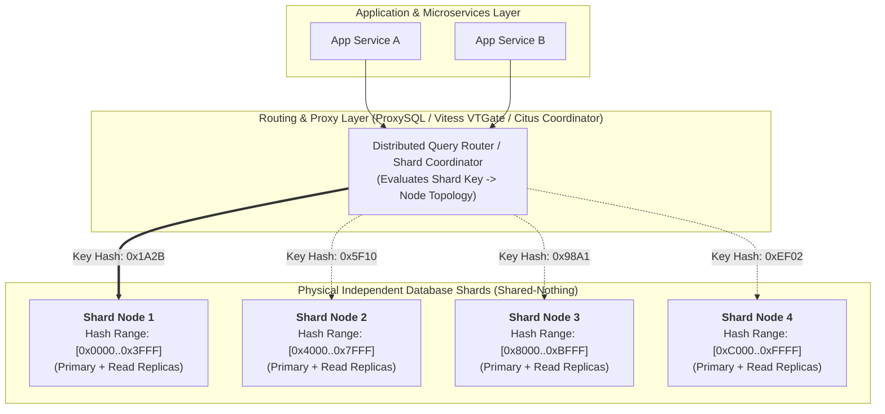
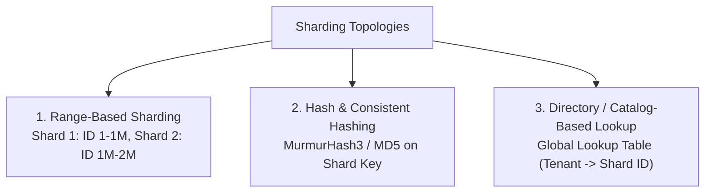
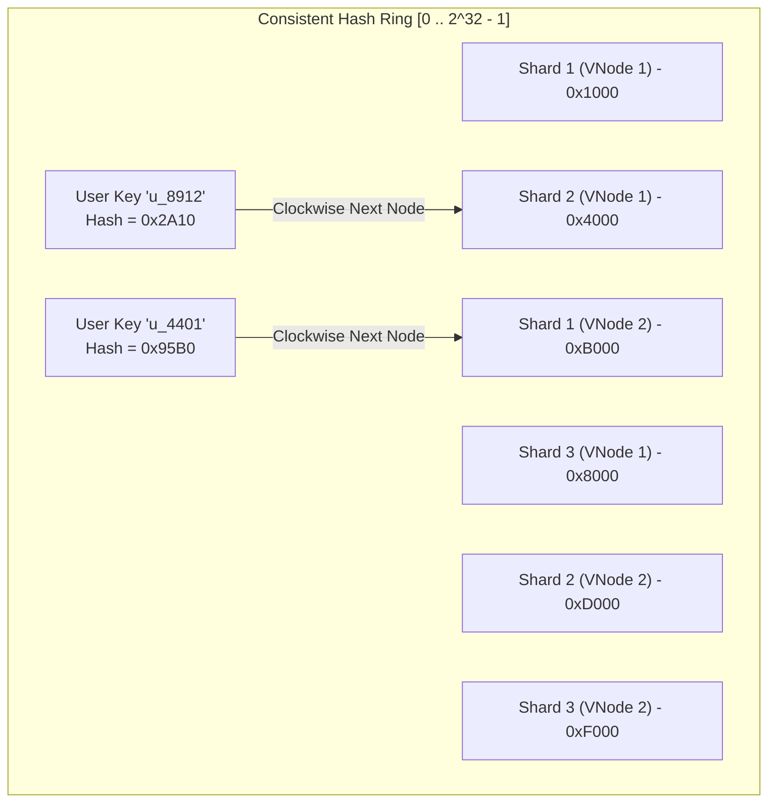
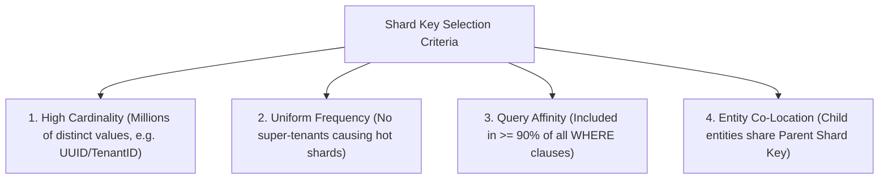
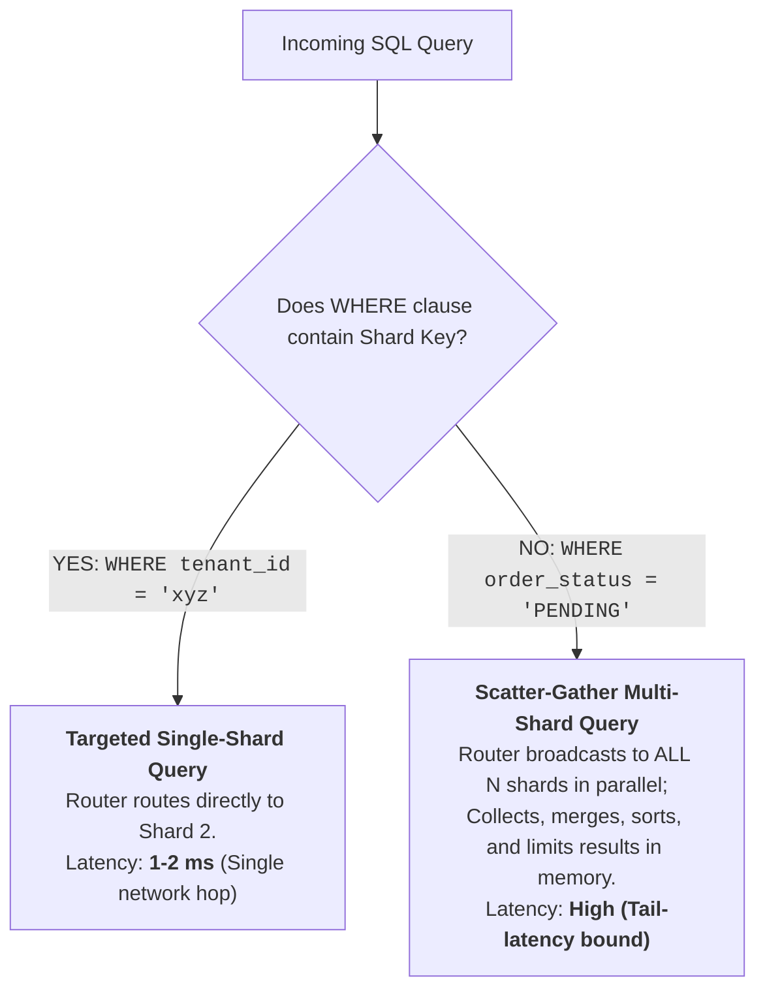
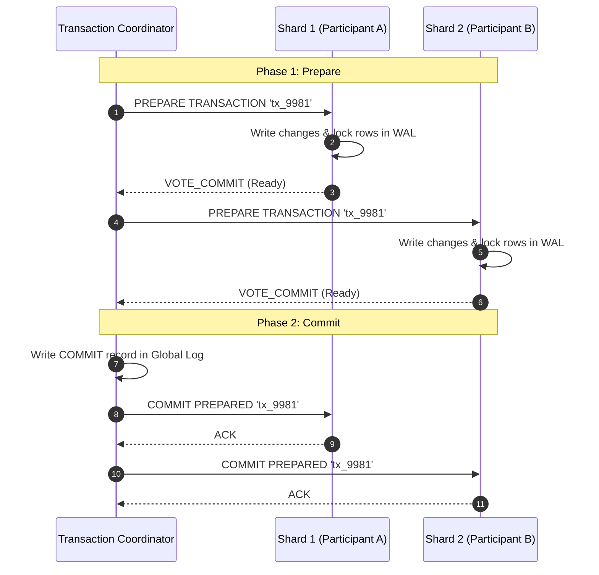
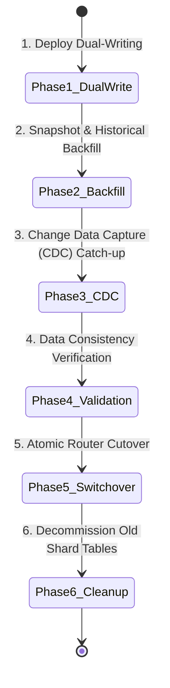
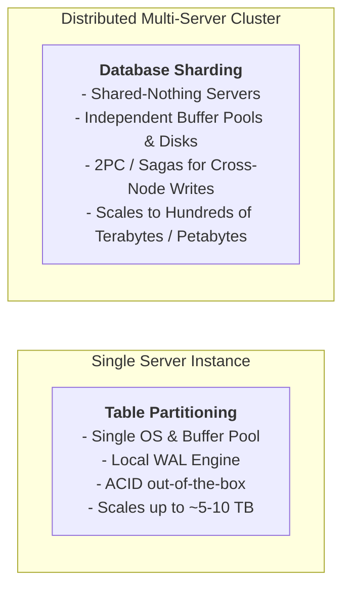

---


title: "Database Sharding Patterns & Distributed Routing: Consistent Hashing, 2PC & Online Resharding"
description: "Master-level engineering guide for Database Sharding, covering Horizontal Sharding Topologies, Consistent Hashing Rings, Shard Key Invariants, Distributed Query Routing, Scatter-Gather Queries, Two-Phase Commit (2PC), and Zero-Downtime Online Resharding."
category: "Databases & SQL"
tags: [database-sharding, distributed-sql, consistent-hashing, horizontal-scaling, proxysql, citus, vitess, 2pc, technical-skills, software-engineering, learning-note]
date: "2026-08-29"
---

# Database Sharding Patterns & Distributed Routing Architecture

---

## 1. Executive Summary & Under-the-Hood Mechanics

When single-node database instances reach physical vertical limits—exhausting CPU thread pools, exceeding NVMe disk controller bus throughput, or managing multi-terabyte working sets—architectures must scale horizontally via **Database Sharding**.

Unlike **Table Partitioning** (which splits tables across files within a *single* database instance), **Database Sharding** partitions data across multiple *independent* database instances (physical servers or isolated database clusters) with zero shared disk or CPU (Shared-Nothing Architecture).



---

## 2. Horizontal Sharding Topologies



### Topologies Comparison Matrix

| Topology | Mechanics | Pros | Cons & Hotspots |
| :--- | :--- | :--- | :--- |
| **Range-Based** | Discrete ID or timestamp intervals mapped to physical shard nodes. | Range scans (`BETWEEN`) stay localized to 1 or 2 shards. | **Monotonic Write Hotspot**: All current writes hit the newest shard. |
| **Hash-Based (Modulus)** | $\text{ShardID} = \text{hash}(\text{key}) \pmod N$. | Uniform write/read distribution across all nodes. | Adding 1 node forces re-hashing of $\approx \frac{N-1}{N} \times 100\%$ of all data. |
| **Consistent Hashing (Ring)** | Keys and virtual nodes mapped to continuous ring $[0, 2^{32}-1]$. | Adding/removing a node only moves $\frac{1}{N}$ fraction of keys. | Requires virtual node balancing and complex topology coordinators. |
| **Directory / Catalog Lookup** | Query a central fast key-value store / DB to resolve `EntityID -> ShardURI`. | Extreme flexibility; allows moving single noisy tenants to dedicated hardware. | Central catalog lookup is a single point of failure and adds network hop latency. |

---

## 3. Consistent Hashing & Virtual Nodes

In high-scale systems, simple modulus sharding causes cascading data migration during scaling. **Consistent Hashing with Virtual Nodes** (e.g., Ketama algorithm) solves this by mapping each physical shard node to multiple virtual points on a 32-bit ring.



### Production Consistent Hashing Algorithm Blueprint

```python
import hashlib
import bisect

class ConsistentHashRing:
    def __init__(self, replicas=128):
        self.replicas = replicas  # Number of virtual nodes per physical shard
        self.ring = []            # Sorted list of virtual node hashes
        self.node_map = {}        # Hash -> Physical Shard URI

    def _hash(self, key: str) -> int:
        return int(hashlib.md5(key.encode('utf-8')).hexdigest()[:8], 16)

    def add_node(self, node_uri: str):
        for i in range(self.replicas):
            vnode_key = f"{node_uri}#vnode_{i}"
            h = self._hash(vnode_key)
            bisect.insort(self.ring, h)
            self.node_map[h] = node_uri

    def remove_node(self, node_uri: str):
        for i in range(self.replicas):
            vnode_key = f"{node_uri}#vnode_{i}"
            h = self._hash(vnode_key)
            idx = bisect.bisect_left(self.ring, h)
            if idx < len(self.ring) and self.ring[idx] == h:
                del self.ring[idx]
                del self.node_map[h]

    def get_node(self, key: str) -> str:
        if not self.ring:
            raise RuntimeError("Consistent hash ring is empty")
        h = self._hash(key)
        idx = bisect.bisect_right(self.ring, h)
        if idx == len(self.ring):
            idx = 0  # Wrap around ring
        return self.node_map[self.ring[idx]]
```

---

## 4. Shard Key Selection Invariants & Co-Location

The choice of **Shard Key** is the single most critical architectural decision. A poorly chosen shard key leads to cross-shard scatter-gather queries, distributed deadlocks, and write hotspots.



### Entity Co-Location Pattern (Table Hierarchies)

To execute fast $O(1)$ joins without network hops across physical shards, related tables must be co-located using the same Shard Key (`tenant_id` or `company_id`):

```sql
-- Shard Node 1 Schema (Citus / Vitess / Native SQL)

-- Primary Entity
CREATE TABLE tenants (
    tenant_id UUID PRIMARY KEY,
    name VARCHAR(255) NOT NULL,
    created_at TIMESTAMPTZ NOT NULL DEFAULT NOW()
);

-- Child Entity 1: Co-located by tenant_id
CREATE TABLE users (
    tenant_id UUID NOT NULL REFERENCES tenants(tenant_id),
    user_id UUID NOT NULL,
    email VARCHAR(255) NOT NULL,
    PRIMARY KEY (tenant_id, user_id)
);

-- Child Entity 2: Co-located by tenant_id
CREATE TABLE orders (
    tenant_id UUID NOT NULL,
    order_id UUID NOT NULL,
    user_id UUID NOT NULL,
    total_cents BIGINT NOT NULL,
    PRIMARY KEY (tenant_id, order_id),
    FOREIGN KEY (tenant_id, user_id) REFERENCES users(tenant_id, user_id)
);

-- Queries filtering on tenant_id execute purely on a SINGLE shard:
SELECT o.order_id, u.email, o.total_cents
FROM orders o
JOIN users u ON o.tenant_id = u.tenant_id AND o.user_id = u.user_id
WHERE o.tenant_id = 'a1b2c3d4-0000-0000-0000-000000000001';
```

---

## 5. Distributed Query Execution: Targeted vs Scatter-Gather



### Scatter-Gather Pagination Hazards

When issuing `SELECT * FROM orders ORDER BY created_at DESC LIMIT 20 OFFSET 10000` across 16 shards without a shard key:
1. Every shard must fetch and sort \$10,020$ rows locally.
2. Router receives \$16 \times 10,020 = 160,320$ rows over the network.
3. Router sorts all \$160,320$ rows and discards the first \$10,000$.
4. **Fix**: Use keyset/cursor pagination (`WHERE (created_at, order_id) < ($last_time, $last_id) LIMIT 20`).

---

## 6. Distributed Transactions: Two-Phase Commit (2PC) vs Sagas

When a write spans multiple physical shards (e.g. transferring money from Account A on Shard 1 to Account B on Shard 2), traditional single-instance ACID transactions are insufficient.



### 2PC vs Saga Comparison

| Dimension | Two-Phase Commit (2PC / XA) | Saga Pattern (Orchestrated / Choreographed) |
| :--- | :--- | :--- |
| **Consistency** | Strict Linearizable / Serializable ($C$ in CAP). | Eventual Consistency ($A$ & $P$ in CAP). |
| **Lock Holding** | Row locks held across all shards throughout network roundtrips. | Short local transactions; no distributed locks. |
| **Throughput** | Degrades exponentially as node count grows ($O(N^2)$ network sync). | High throughput; scales linearly. |
| **Failure Recovery** | Automatic rollback or manual coordinator recovery. | Requires explicit Compensating Transactions (`RefundPayment`, `CancelReservation`). |

---

## 7. Zero-Downtime Online Resharding Protocol

Adding shards to an active database under heavy production load requires a multi-phase migration protocol:



### The 6-Step Migration Protocol

1. **Dual-Writing (Shadow Mode)**: Application writes to both Old Shards and New Shards (swallowing New Shard errors to avoid breaking production).
2. **Historical Backfill**: Stream data prior to Migration Timestamp $T_0$ from Old Shards to New Shards via consistent point-in-time snapshots.
3. **Change Data Capture (CDC) Catch-Up**: Replay the WAL/binlog stream to apply all mutations that occurred during the backfill phase until replication lag reaches $< 10\text{ ms}$.
4. **Validation Check**: Run asynchronous MD5/CRC32 checksum sweeps comparing key ranges between old and new shards.
5. **Atomic Switchover**: Update the router topology config (via etcd/Consul or ProxySQL reload) to point read/write traffic to the new shards.
6. **Cleanup**: Remove dual-write logic from application code and drop migrated tables on old nodes.

---

## 8. Sharding vs Table Partitioning Comparison



| Dimension | Table Partitioning | Database Sharding |
| :--- | :--- | :--- |
| **Physical Topology** | 1 Database Engine, multiple sub-tables on 1 machine. | Multiple independent Database Engines on $N$ separate servers. |
| **Scaling Axis** | Vertical (Storage capacity, B-tree depth management). | Horizontal (Write throughput, aggregate CPU/RAM, network IOPS). |
| **Query Routing** | Built into database query optimizer (declarative). | Handled by Layer-7 proxy (ProxySQL, Vitess) or App routing logic. |
| **Cross-Unit Joins** | Trivial ($O(1)$ memory joins, partition-wise joins). | Complex ($O(N)$ network scatter-gather or requires co-location). |
| **Operational Overhead** | Low (standard backups, single replication stream). | High (orchestrating $N$ backups, distributed failovers, rebalancing). |

---

## 9. Related Graph Nodes & Further Reading

- 🔙 [[node_12_Databases_and_SQL|📁 Databases & SQL Hub]]
- 🔗 [[sql_table_partitioning_and_pruning|SQL Table Partitioning & Partition Pruning]]
- 🔗 [[database_sharding_patroni_proxysql_citus|Database Sharding with Patroni, ProxySQL & Citus]]
- 🔗 [[distributed_sql_cockroachdb_spanner_consensus|Distributed SQL: CockroachDB & Spanner Consensus]]
- 🔗 [[redis_cluster_sharding_slot_hash_resharding|Redis Cluster Sharding & Slot Rebalancing]]
