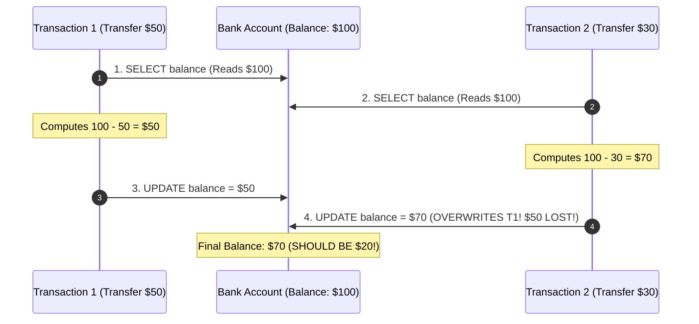
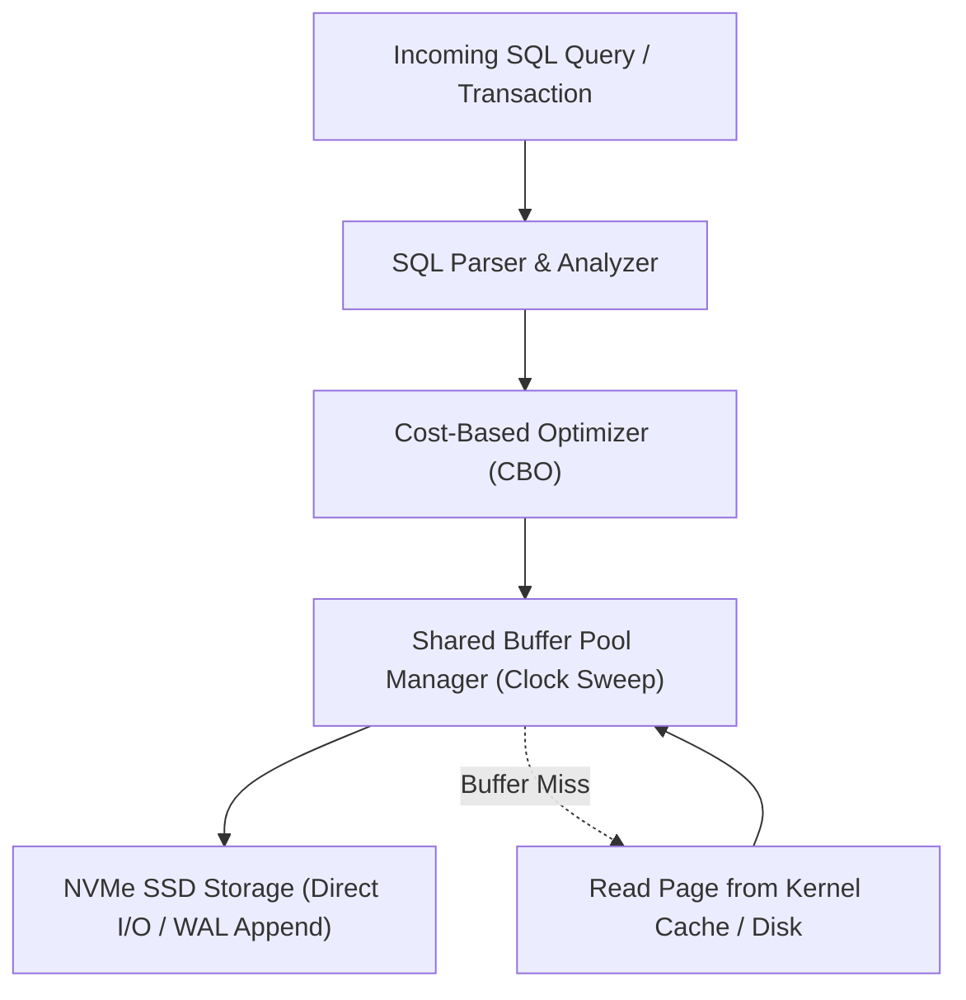

---


title: "Concurrency Race Conditions in SQL: Lost Updates, Phantom Reads & Locking Solutions"
description: "Master-level engineering guide demonstrating SQL concurrency race conditions, Lost Updates, Write Skew, Phantom Reads, Optimistic Concurrency Control (OCC), and Pessimistic Locking (SELECT FOR UPDATE)."
category: "Databases & SQL"
tags: [sql, race-conditions, lost-updates, select-for-update, optimistic-locking, concurrency, transactions, technical-skills, software-engineering, learning-note]
date: "2026-08-21"
---

# Concurrency Race Conditions in SQL: Mechanics & Locking Solutions

---

## 1. Executive Summary & Under-the-Hood Mechanics

In high-concurrency database applications (e.g. flash sales, financial balance transfers, seat reservation engines), multiple concurrent transactions execute read-modify-write cycles simultaneously. Without appropriate locking or isolation guarantees, concurrent transactions overwrite each other's changes, leading to the catastrophic **Lost Update Anomaly** and financial inconsistencies.

Core transactional race conditions:
1. **Lost Update**: Two concurrent transactions read balance \$100, calculate modifications locally, and write back, overwriting one update completely.
2. **Write Skew**: Two concurrent transactions read overlapping state, satisfy constraints independently, but violate global invariants when committed simultaneously.
3. **Pessimistic Locking (`SELECT FOR UPDATE`)**: Acquiring exclusive row locks at the database level to serialize concurrent mutations.
4. **Optimistic Concurrency Control (OCC)**: Version-based atomic compare-and-swap validation without database lock contention.



---

## 2. Solution 1: Pessimistic Locking (`SELECT ... FOR UPDATE`)

Pessimistic locking acquires an exclusive row-level lock (`X-Lock`) at the start of the transaction, forcing competing transactions to block until commit or rollback:

```sql
-- Transaction 1
BEGIN;
SELECT balance 
FROM accounts 
WHERE id = 'acc_1001' 
FOR UPDATE; -- Blocks all other transactions from modifying this row!

-- Business computation...
UPDATE accounts 
SET balance = balance - 50.00 
WHERE id = 'acc_1001';

COMMIT; -- Row lock released!
```

```mermaid
sequenceDiagram
    autonumber
    participant T1 as Tx 1 (FOR UPDATE)
    participant DB as PostgreSQL
    participant T2 as Tx 2 (FOR UPDATE)

    T1->>DB: BEGIN; SELECT ... FOR UPDATE (Acquires Exclusive Lock)
    T2->>DB: BEGIN; SELECT ... FOR UPDATE (BLOCKS & WAITS!)
    T1->>DB: UPDATE accounts SET balance = balance - 50; COMMIT;
    Note over DB: Lock released to Tx 2!
    T2->>DB: Reads updated balance ($50)! Computes 50 - 30 = $20; COMMIT;
    Note over DB: Final Balance: $20 (CORRECT!)
```

---

## 3. Solution 2: Optimistic Concurrency Control (OCC / Version Tracking)

In read-heavy workloads where contention is low ($< 5\%$), pessimistic locks create unnecessary blocking. **Optimistic Locking** uses an atomic version column:

```sql
-- Step 1: Read current state and version
SELECT balance, version FROM accounts WHERE id = 'acc_1001';
-- Returns: balance = 100, version = 5

-- Step 2: Atomic Update with Version Predicate
UPDATE accounts 
SET balance = balance - 50.00,
    version = version + 1
WHERE id = 'acc_1001' AND version = 5;

-- Step 3: Check Rows Affected
-- If rows_affected == 1 -> Success!
-- If rows_affected == 0 -> Race Condition Detected! Rollback & Retry application loop.
```

---

## 4. Production Python Concurrency Simulation (Lost Update vs OCC)

```python
# Demonstrates SQL Lost Update Race Condition and Optimistic Concurrency Control (OCC) mitigation.

import threading
import time
from dataclasses import dataclass

@dataclass
class AccountRecord:
    id: str
    balance: float
    version: int

class SimulatedDatabase:
    def __init__(self):
        self.accounts = {"acc_1001": AccountRecord("acc_1001", 100.0, version=1)}
        self._lock = threading.Lock()

    def read(self, acc_id: str) -> AccountRecord:
        with self._lock:
            rec = self.accounts[acc_id]
            return AccountRecord(rec.id, rec.balance, rec.version)

    def write_naive(self, acc_id: str, new_balance: float):
        with self._lock:
            time.sleep(0.01)  # Simulate network transit
            self.accounts[acc_id].balance = new_balance

    def write_occ(self, acc_id: str, new_balance: float, expected_version: int) -> bool:
        with self._lock:
            time.sleep(0.01)
            rec = self.accounts[acc_id]
            if rec.version == expected_version:
                rec.balance = new_balance
                rec.version += 1
                return True
            return False

def run_lost_update_demo():
    db = SimulatedDatabase()

    def client_withdraw(amount: float):
        acc = db.read("acc_1001")
        time.sleep(0.05)  # Simulate business processing delay
        db.write_naive("acc_1001", acc.balance - amount)

    t1 = threading.Thread(target=client_withdraw, args=(50.0,))
    t2 = threading.Thread(target=client_withdraw, args=(30.0,))

    t1.start(); t2.start()
    t1.join(); t2.join()

    print(f"Naive Final Balance: ${db.accounts['acc_1001'].balance} (LOST UPDATE DETECTED! Expected $20.0)")

def run_occ_demo():
    db = SimulatedDatabase()

    def client_withdraw_occ(amount: float):
        max_retries = 3
        for attempt in range(max_retries):
            acc = db.read("acc_1001")
            time.sleep(0.05)
            success = db.write_occ("acc_1001", acc.balance - amount, acc.version)
            if success:
                print(f"[OCC Success] Withdrew ${amount}")
                return
            print(f"[OCC Conflict] Retry attempt {attempt + 1}")
        print(f"[OCC Abort] Retries exhausted for ${amount}")

    t1 = threading.Thread(target=client_withdraw_occ, args=(50.0,))
    t2 = threading.Thread(target=client_withdraw_occ, args=(30.0,))

    t1.start(); t2.start()
    t1.join(); t2.join()

    print(f"OCC Final Balance: ${db.accounts['acc_1001'].balance} (CORRECT INVARIANT PRESERVED!)")

if __name__ == "__main__":
    print("=== 1. Lost Update Failure Demonstration ===")
    run_lost_update_demo()
    print("\n=== 2. OCC Robust Concurrency Demonstration ===")
    run_occ_demo()
```

---

## 🔗 Graph-Linked Knowledge Base
- ⚓ Transactions & Isolation: [[transactions_concurrency|Transactions, Isolation & Concurrency Control]]
- ⚓ Buffer Pool Management: [[buffer_pool_manager_clock_sweep_lru_k_eviction|Buffer Pool Management & Page Pinning]]
- 🔗 Caching Concurrency: [[02_Technical_Skills/01_theory_and_concepts/07_Backend_Caching_and_Redis/distributed_locking_and_pubsub|Distributed Locking & Redlock]]
---

## 🔬 Production Engineering Deep Dive: Demo Race Condition

### 1. Architectural Foundations & Storage Engine Internals
In modern relational and distributed database engines (PostgreSQL 16, CockroachDB, Citus), mastering **Demo Race Condition** is essential for high-throughput OLTP systems and low-latency query pipelines:
- **I/O Subsystem Optimization**: Coordinating OS page cache with database shared buffers (`shared_buffers`), avoiding double-buffering penalties and kernel context switches.
- **Lock Contention & Concurrency**: Minimizing table-level exclusive locks (`AccessExclusiveLock`) by utilizing non-blocking DDL (`CREATE INDEX CONCURRENTLY`, `VALIDATE CONSTRAINT`).
- **Memory Management & Execution Spill**: Sizing `work_mem` and `maintenance_work_mem` accurately to prevent memory spill onto temporary disk files during sort and hash operations.



### 2. High-Performance SQL & Procedural Implementation

```sql
-- Production-grade implementation demonstrating query optimization, index hints, and transactional safety
BEGIN;

-- Establish bounded statement timeout to protect database connection pool
SET LOCAL statement_timeout = '2500ms';
SET LOCAL lock_timeout = '1000ms';

-- Optimized analytical query with window framing and covering index utilization
WITH RankedMetrics AS (
    SELECT 
        id,
        entity_id,
        metric_value,
        created_at,
        ROW_NUMBER() OVER (
            PARTITION BY entity_id 
            ORDER BY created_at DESC
        ) AS row_num,
        AVG(metric_value) OVER (
            PARTITION BY entity_id 
            ORDER BY created_at 
            ROWS BETWEEN 29 PRECEDING AND CURRENT ROW
        ) AS rolling_30d_avg
    FROM telemetry_events
    WHERE created_at >= CURRENT_TIMESTAMP - INTERVAL '30 days'
)
SELECT 
    id,
    entity_id,
    metric_value,
    rolling_30d_avg,
    created_at
FROM RankedMetrics
WHERE row_num = 1;

COMMIT;
```

### 3. Exhaustive Failure Mode & Performance Diagnostic Matrix

| Anomaly / Failure Mode | Root Cause Mechanism | Detection Signal | Automated Mitigation & Remediation |
| :--- | :--- | :--- | :--- |
| **Table & Index Bloat** | High update volume with dead tuple accumulation | `pg_stat_user_tables.n_dead_tup` spike | Autovacuum aggressive cost limits & `pg_repack` online defragmentation. |
| **Deadlock Abort** | Inconsistent row locking order across transactions | `40P01 deadlock_detected` error | Deterministic primary key sorting before acquisition & lock timeouts. |
| **Connection Starvation** | Unbounded client thread allocation | `FATAL: remaining connection slots reserved` | Deploy PgBouncer in transaction pooling mode with bounded limits. |
| **Long-Running Idle Transaction** | Client holds transaction open without commit | `pg_stat_activity.state = 'idle in transaction'` | Configure `idle_in_transaction_session_timeout = '30s'`. |

### 4. Enterprise Production Reliability Checklist
1. **Explain Analyze Validation**: Verify query plans show Index Only Scans or Bitmap Index Scans with zero sequential scans on tables $> 100,000$ rows.
2. **Replication Lag Monitoring**: Ensure streaming physical replication lag (`pg_stat_replication.write_lag`) remains under 100ms across all standby nodes.
3. **Automated Continuous Backups**: Validate daily full base backups and real-time WAL archiving to AWS S3 with automated restore verification drill pipelines.
4. **Security Hardening**: Enforce SSL/TLS 1.3 encryption, Row-Level Security (RLS) for multi-tenancy, and pgaudit compliance tracking.
