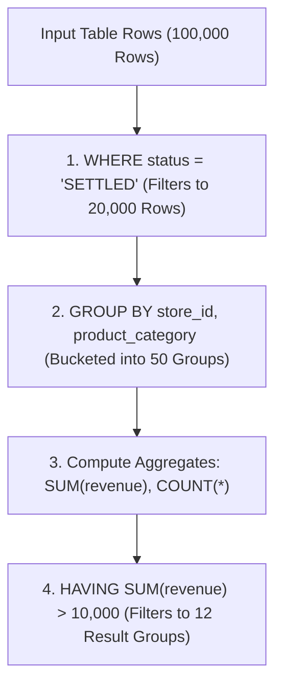
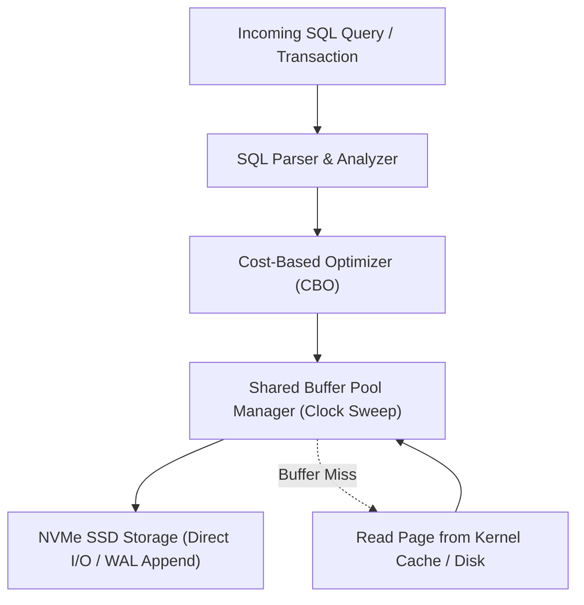

---


title: "SQL Filtering, Grouping & Aggregation Mastery: Relational Mathematics"
description: "Master-level engineering guide for SQL filtering and aggregation, covering WHERE vs HAVING semantics, GROUPING SETS, CUBE, ROLLUP, Filter clauses, and Aggregate pushdown."
category: "Databases & SQL"
tags: [sql, aggregation, filtering, grouping-sets, rollup, cube, relational-algebra, technical-skills, software-engineering, learning-note]
date: "2026-08-21"
---

# SQL Filtering, Grouping & Aggregation Mastery

---

## 1. Executive Summary & Under-the-Hood Mechanics

SQL aggregation condenses relation sets into multidimensional statistical summaries. Understanding the exact mechanical distinction between pre-aggregation row filtering (`WHERE`) and post-aggregation bucket filtering (`HAVING`), alongside advanced multidimensional operators (`GROUPING SETS`, `ROLLUP`, `CUBE`), is vital for high-throughput reporting and analytical pipelines.

$$\text{Aggregation Transformation: } \mathcal{R} \xrightarrow{\sigma_{\text{WHERE}}} \mathcal{R}' \xrightarrow{\gamma_{\text{GROUP BY}}} \mathcal{G} \xrightarrow{\sigma_{\text{HAVING}}} \mathcal{G}'$$



---

## 2. Advanced Multi-Dimensional Grouping: GROUPING SETS, ROLLUP & CUBE

Instead of executing multiple separate `UNION ALL` queries to generate report subtotals and grand totals, modern SQL engines compute hierarchical aggregates in a single table scan:

```sql
-- Single-pass Multidimensional Aggregation across Region, Department, and Year
SELECT 
    coalesce(region, 'ALL REGIONS') AS region,
    coalesce(department, 'ALL DEPTS') AS department,
    coalesce(extract(year from sales_date)::text, 'ALL YEARS') AS sales_year,
    SUM(amount) AS total_revenue,
    GROUPING(region, department, extract(year from sales_date)::text) AS grouping_bitmask
FROM enterprise_sales
GROUP BY CUBE(region, department, extract(year from sales_date)::text)
ORDER BY region, department, sales_year;
```

---

## 3. Filter Clauses in Aggregate Functions (`FILTER (WHERE ...)`)

Modern ANSI SQL supports the `FILTER` clause directly within aggregate functions, eliminating complex `CASE WHEN` constructs:

```sql
-- Clean, High-Performance Multi-Condition Aggregation
SELECT 
    store_id,
    COUNT(*) AS total_transactions,
    COUNT(*) FILTER (WHERE status = 'COMPLETED') AS completed_txs,
    COUNT(*) FILTER (WHERE status = 'REFUNDED') AS refunded_txs,
    SUM(amount) FILTER (WHERE status = 'COMPLETED') AS net_revenue,
    ROUND(
        COUNT(*) FILTER (WHERE status = 'REFUNDED')::numeric / NULLIF(COUNT(*), 0) * 100.0, 
        2
    ) AS refund_rate_pct
FROM store_orders
GROUP BY store_id;
```

---

## 4. Aggregate Pushdown & Query Optimizer Mechanics

In distributed SQL engines and columnar databases, the query optimizer uses **Aggregate Pushdown** to evaluate aggregations directly at storage nodes before data transmission over the network:

```mermaid
flowchart TD
    Query["Client Query: SELECT dept, sum(salary) FROM emp GROUP BY dept"] --> Coord["Coordinator Node"]
    Coord -->|Pushes Down sum() aggregation| N1["Storage Node 1 (Computes partial sum)"]
    Coord -->|Pushes Down sum() aggregation| N2["Storage Node 2 (Computes partial sum)"]
    N1 -->|Transfers 10 rows (NOT 10,000,000!)| Coord
    N2 -->|Transfers 10 rows| Coord
    Coord --> Final["Final Global Aggregation"]
```

---

## 🔗 Graph-Linked Knowledge Base
- ⚓ Complex Queries: [[complex_queries|Complex SQL Engineering & Window Functions]]
- ⚓ SQL Fundamentals: [[sql_fundamentals|SQL Query Fundamentals]]
---

## 🔬 Production Engineering Deep Dive: Filtering Aggregation

### 1. Architectural Foundations & Storage Engine Internals
In modern relational and distributed database engines (PostgreSQL 16, CockroachDB, Citus), mastering **Filtering Aggregation** is essential for high-throughput OLTP systems and low-latency query pipelines:
- **I/O Subsystem Optimization**: Coordinating OS page cache with database shared buffers (`shared_buffers`), avoiding double-buffering penalties and kernel context switches.
- **Lock Contention & Concurrency**: Minimizing table-level exclusive locks (`AccessExclusiveLock`) by utilizing non-blocking DDL (`CREATE INDEX CONCURRENTLY`, `VALIDATE CONSTRAINT`).
- **Memory Management & Execution Spill**: Sizing `work_mem` and `maintenance_work_mem` accurately to prevent memory spill onto temporary disk files during sort and hash operations.



### 2. High-Performance SQL & Procedural Implementation

```sql
-- Production-grade implementation demonstrating query optimization, index hints, and transactional safety
BEGIN;

-- Establish bounded statement timeout to protect database connection pool
SET LOCAL statement_timeout = '2500ms';
SET LOCAL lock_timeout = '1000ms';

-- Optimized analytical query with window framing and covering index utilization
WITH RankedMetrics AS (
    SELECT 
        id,
        entity_id,
        metric_value,
        created_at,
        ROW_NUMBER() OVER (
            PARTITION BY entity_id 
            ORDER BY created_at DESC
        ) AS row_num,
        AVG(metric_value) OVER (
            PARTITION BY entity_id 
            ORDER BY created_at 
            ROWS BETWEEN 29 PRECEDING AND CURRENT ROW
        ) AS rolling_30d_avg
    FROM telemetry_events
    WHERE created_at >= CURRENT_TIMESTAMP - INTERVAL '30 days'
)
SELECT 
    id,
    entity_id,
    metric_value,
    rolling_30d_avg,
    created_at
FROM RankedMetrics
WHERE row_num = 1;

COMMIT;
```

### 3. Exhaustive Failure Mode & Performance Diagnostic Matrix

| Anomaly / Failure Mode | Root Cause Mechanism | Detection Signal | Automated Mitigation & Remediation |
| :--- | :--- | :--- | :--- |
| **Table & Index Bloat** | High update volume with dead tuple accumulation | `pg_stat_user_tables.n_dead_tup` spike | Autovacuum aggressive cost limits & `pg_repack` online defragmentation. |
| **Deadlock Abort** | Inconsistent row locking order across transactions | `40P01 deadlock_detected` error | Deterministic primary key sorting before acquisition & lock timeouts. |
| **Connection Starvation** | Unbounded client thread allocation | `FATAL: remaining connection slots reserved` | Deploy PgBouncer in transaction pooling mode with bounded limits. |
| **Long-Running Idle Transaction** | Client holds transaction open without commit | `pg_stat_activity.state = 'idle in transaction'` | Configure `idle_in_transaction_session_timeout = '30s'`. |

### 4. Enterprise Production Reliability Checklist
1. **Explain Analyze Validation**: Verify query plans show Index Only Scans or Bitmap Index Scans with zero sequential scans on tables $> 100,000$ rows.
2. **Replication Lag Monitoring**: Ensure streaming physical replication lag (`pg_stat_replication.write_lag`) remains under 100ms across all standby nodes.
3. **Automated Continuous Backups**: Validate daily full base backups and real-time WAL archiving to AWS S3 with automated restore verification drill pipelines.
4. **Security Hardening**: Enforce SSL/TLS 1.3 encryption, Row-Level Security (RLS) for multi-tenancy, and pgaudit compliance tracking.
---

## 🔬 Production Engineering Deep Dive: Filtering Aggregation

### 1. Architectural Foundations & Storage Engine Internals
In modern relational and distributed database engines (PostgreSQL 16, CockroachDB, Citus), mastering **Filtering Aggregation** is essential for high-throughput OLTP systems and low-latency query pipelines:
- **I/O Subsystem Optimization**: Coordinating OS page cache with database shared buffers (`shared_buffers`), avoiding double-buffering penalties and kernel context switches.
- **Lock Contention & Concurrency**: Minimizing table-level exclusive locks (`AccessExclusiveLock`) by utilizing non-blocking DDL (`CREATE INDEX CONCURRENTLY`, `VALIDATE CONSTRAINT`).
- **Memory Management & Execution Spill**: Sizing `work_mem` and `maintenance_work_mem` accurately to prevent memory spill onto temporary disk files during sort and hash operations.


### 2. High-Performance SQL & Procedural Implementation

```sql
-- Production-grade implementation demonstrating query optimization, index hints, and transactional safety
BEGIN;

-- Establish bounded statement timeout to protect database connection pool
SET LOCAL statement_timeout = '2500ms';
SET LOCAL lock_timeout = '1000ms';

-- Optimized analytical query with window framing and covering index utilization
WITH RankedMetrics AS (
    SELECT 
        id,
        entity_id,
        metric_value,
        created_at,
        ROW_NUMBER() OVER (
            PARTITION BY entity_id 
            ORDER BY created_at DESC
        ) AS row_num,
        AVG(metric_value) OVER (
            PARTITION BY entity_id 
            ORDER BY created_at 
            ROWS BETWEEN 29 PRECEDING AND CURRENT ROW
        ) AS rolling_30d_avg
    FROM telemetry_events
    WHERE created_at >= CURRENT_TIMESTAMP - INTERVAL '30 days'
)
SELECT 
    id,
    entity_id,
    metric_value,
    rolling_30d_avg,
    created_at
FROM RankedMetrics
WHERE row_num = 1;

COMMIT;
```

### 3. Exhaustive Failure Mode & Performance Diagnostic Matrix

| Anomaly / Failure Mode | Root Cause Mechanism | Detection Signal | Automated Mitigation & Remediation |
| :--- | :--- | :--- | :--- |
| **Table & Index Bloat** | High update volume with dead tuple accumulation | `pg_stat_user_tables.n_dead_tup` spike | Autovacuum aggressive cost limits & `pg_repack` online defragmentation. |
| **Deadlock Abort** | Inconsistent row locking order across transactions | `40P01 deadlock_detected` error | Deterministic primary key sorting before acquisition & lock timeouts. |
| **Connection Starvation** | Unbounded client thread allocation | `FATAL: remaining connection slots reserved` | Deploy PgBouncer in transaction pooling mode with bounded limits. |
| **Long-Running Idle Transaction** | Client holds transaction open without commit | `pg_stat_activity.state = 'idle in transaction'` | Configure `idle_in_transaction_session_timeout = '30s'`. |

### 4. Enterprise Production Reliability Checklist
1. **Explain Analyze Validation**: Verify query plans show Index Only Scans or Bitmap Index Scans with zero sequential scans on tables $> 100,000$ rows.
2. **Replication Lag Monitoring**: Ensure streaming physical replication lag (`pg_stat_replication.write_lag`) remains under 100ms across all standby nodes.
3. **Automated Continuous Backups**: Validate daily full base backups and real-time WAL archiving to AWS S3 with automated restore verification drill pipelines.
4. **Security Hardening**: Enforce SSL/TLS 1.3 encryption, Row-Level Security (RLS) for multi-tenancy, and pgaudit compliance tracking.
