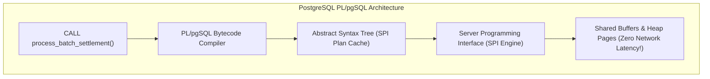
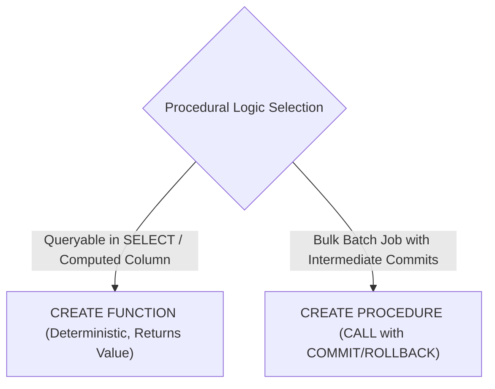
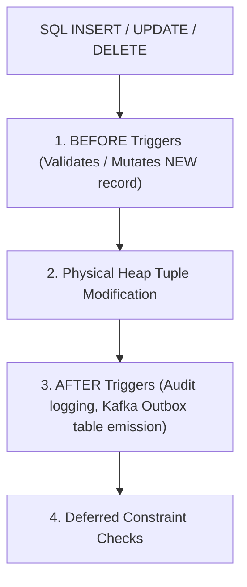

---


title: "PL/pgSQL Programming: Stored Procedures, Triggers & Architecture"
description: "Master-level engineering guide for PostgreSQL procedural programming (PL/pgSQL), covering SPI execution engine, Stored Procedures vs Functions, SECURITY DEFINER hardening, Trigger graphs, Dynamic SQL injection prevention, and Cursors."
category: "Databases & SQL"
tags: [plpgsql, postgresql, stored-procedures, triggers, database-programming, procedures, spi, security, technical-skills, software-engineering, learning-note]
date: "2026-08-21"
---

# PL/pgSQL Programming: Stored Procedures, Triggers & Architecture

---

## 1. Executive Summary & Under-the-Hood Mechanics

**PL/pgSQL (Procedural Language / PostgreSQL Structured Query Language)** is PostgreSQL's built-in, block-structured procedural programming language. It enables developers to execute complex procedural algorithms, batch transformations, audit triggers, and transactional state machines directly inside the database kernel.

Unlike client-side database drivers that issue sequential queries over TCP connections, PL/pgSQL executes inside the PostgreSQL backend worker process via the **Server Programming Interface (SPI)**:
- **Zero Network Latency**: Iterative loops, validation checks, and data updates execute in kernel memory with zero network round-trip time (RTT).
- **SPI Plan Caching**: SQL queries inside PL/pgSQL functions are parsed, planned, and cached as prepared statements across invocations within the same session.
- **Transactional State Boundaries**: Stored procedures (PostgreSQL 11+) support explicit intermediate `COMMIT` and `ROLLBACK` commands.



---

## 2. Functions (`CREATE FUNCTION`) vs. Stored Procedures (`CREATE PROCEDURE`)

| Dimension | `CREATE FUNCTION` | `CREATE PROCEDURE` (PostgreSQL 11+) |
| :--- | :--- | :--- |
| **Invocation** | `SELECT my_function(...)` | `CALL my_procedure(...)` |
| **Return Value** | Must return a scalar, `RECORD`, `TABLE`, or `VOID`. | Does not return a direct value; supports `INOUT` parameters. |
| **Transaction Control** | **Cannot** manage transactions (`COMMIT`/`ROLLBACK` forbidden). | **Can** execute intermediate `COMMIT` and `ROLLBACK` statements. |
| **Usability in SQL** | Can be called inside `SELECT`, `WHERE`, and `JOIN` clauses. | Cannot be called inside standard `SELECT` statements. |



---

## 3. High-Performance Trigger Architecture & Transition Tables

Triggers automate integrity checks, audit ledgers, and denormalized cache updates:



### 3.1 Production Tamper-Evident JSONB Audit Trigger

```sql
-- 1. Create Universal Audit Ledger
CREATE TABLE audit_ledger (
    audit_id BIGSERIAL PRIMARY KEY,
    target_table VARCHAR(64) NOT NULL,
    operation VARCHAR(10) NOT NULL,
    record_id UUID NOT NULL,
    actor_user VARCHAR(64) NOT NULL,
    client_ip INET,
    executed_at TIMESTAMPTZ NOT NULL DEFAULT NOW(),
    old_state JSONB,
    new_state JSONB,
    diff_state JSONB
);

-- 2. Trigger Function with JSONB State Diffs
CREATE OR REPLACE FUNCTION fn_audit_table_mutations()
RETURNS TRIGGER
LANGUAGE plpgsql
SECURITY DEFINER
SET search_path = pg_temp, public
AS $$
DECLARE
    v_old_json JSONB := NULL;
    v_new_json JSONB := NULL;
    v_diff_json JSONB := NULL;
    v_record_id UUID;
BEGIN
    IF (TG_OP = 'INSERT') THEN
        v_new_json := to_jsonb(NEW);
        v_record_id := NEW.id;
    ELSIF (TG_OP = 'UPDATE') THEN
        v_old_json := to_jsonb(OLD);
        v_new_json := to_jsonb(NEW);
        v_record_id := NEW.id;
        -- Calculate exact modified fields JSON diff
        v_diff_json := (
            SELECT jsonb_object_agg(key, value)
            FROM jsonb_each(v_new_json)
            WHERE v_old_json -> key IS DISTINCT FROM value
        );
    ELSIF (TG_OP = 'DELETE') THEN
        v_old_json := to_jsonb(OLD);
        v_record_id := OLD.id;
    END IF;

    INSERT INTO audit_ledger (
        target_table, operation, record_id, actor_user, client_ip, old_state, new_state, diff_state
    ) VALUES (
        TG_TABLE_NAME, TG_OP, v_record_id, CURRENT_USER, inet_client_addr(), v_old_json, v_new_json, v_diff_json
    );

    RETURN COALESCE(NEW, OLD);
END;
$$;

-- 3. Attach Trigger to Customers Table
CREATE TRIGGER trg_audit_customers
AFTER INSERT OR UPDATE OR DELETE ON customers
FOR EACH ROW EXECUTE FUNCTION fn_audit_table_mutations();
```

---

## 4. `SECURITY DEFINER` Hardening & `search_path` Protection

A `SECURITY DEFINER` function executes with the privileges of the user that **created** the function (analogous to Linux `setuid`).

> [!CAUTION]
> If a `SECURITY DEFINER` function does not explicitly hardcode `search_path`, an attacker can create a malicious table/function in a schema preceding `public` on the search path, executing arbitrary code with superuser privileges (Search Path Hijacking).

```sql
-- SECURE SECURITY DEFINER BLUEPRINT
CREATE OR REPLACE FUNCTION admin_reset_password(p_user_id UUID, p_new_hash VARCHAR)
RETURNS VOID
LANGUAGE plpgsql
SECURITY DEFINER
-- CRITICAL HARDENING: Lock search_path to prevent schema hijacking
SET search_path = pg_temp, public
AS $$
BEGIN
    UPDATE user_credentials 
    SET password_hash = p_new_hash, updated_at = NOW()
    WHERE user_id = p_user_id;
END;
$$;
```

---

## 5. Dynamic SQL & Injection Prevention (`EXECUTE ... USING`)

When constructing dynamic queries (e.g. querying dynamically partitioned tables or building custom reporting filters), **never concatenate untrusted user inputs directly into SQL strings**.

```mermaid
flowchart LR
    UserInput["User String: 'Alex' OR 1=1'"] --> Sanitizer{"Dynamic SQL Formatter"}
    Sanitizer -->|format('%I', table_name)| SafeTable["Safely Escaped Identifier (quote_ident)"]
    Sanitizer -->|USING user_input| SafeLiteral["Parameterized SPI Parameter (Zero SQL Injection)"]
    SafeTable & SafeLiteral --> EXEC["EXECUTE query_string USING params"]
```

### 5.1 Safe Dynamic SQL Implementation
```sql
CREATE OR REPLACE FUNCTION query_partition_safely(
    p_partition_suffix TEXT,
    p_status TEXT,
    p_min_amount NUMERIC
)
RETURNS TABLE(order_id UUID, total_amount NUMERIC)
LANGUAGE plpgsql
AS $$
DECLARE
    v_sql TEXT;
BEGIN
    -- format('%I') safely escapes SQL identifiers (tables/columns)
    -- format('%s') is only for static query structure
    -- Input values MUST be passed via USING parameters ($1, $2)
    v_sql := format(
        'SELECT id, total_amount FROM %I WHERE status = $1 AND total_amount >= $2',
        'orders_' || p_partition_suffix
    );

    RETURN QUERY EXECUTE v_sql USING p_status, p_min_amount;
END;
$$;
```

---

## 6. Batch Processing & Cursor Management (`FOR UPDATE SKIP LOCKED`)

When processing massive queues (\$100,000+$ rows), holding a single transaction open locks resources and causes WAL bloat. Use **Stored Procedures with Chunked Transactions and `SKIP LOCKED`**:

```sql
CREATE OR REPLACE PROCEDURE pr_process_order_settlement_batch(
    IN p_batch_size INT DEFAULT 500
)
LANGUAGE plpgsql
AS $$
DECLARE
    v_processed_count INT := 0;
    v_record RECORD;
    c_pending_orders CURSOR FOR 
        SELECT id, customer_id, total_amount 
        FROM customer_orders 
        WHERE status = 'PENDING'
        ORDER BY created_at ASC
        FOR UPDATE SKIP LOCKED; -- Allows multiple concurrent worker pods without locking collisions!
BEGIN
    OPEN c_pending_orders;
    
    LOOP
        FETCH NEXT FROM c_pending_orders INTO v_record;
        EXIT WHEN NOT FOUND;

        -- Process business debit
        UPDATE customer_wallets 
        SET balance = balance - v_record.total_amount 
        WHERE customer_id = v_record.customer_id;

        UPDATE customer_orders 
        SET status = 'SETTLED', settled_at = NOW() 
        WHERE id = v_record.id;

        v_processed_count := v_processed_count + 1;

        -- Commit every batch_size iterations to free locks & clean WAL
        IF (v_processed_count % p_batch_size = 0) THEN
            COMMIT;
            RAISE NOTICE 'Processed chunk of % orders...', v_processed_count;
        END IF;
    END LOOP;

    CLOSE c_pending_orders;
    COMMIT; -- Final commit
    RAISE NOTICE 'Batch execution complete. Total processed: %', v_processed_count;
END;
$$;
```

---

## 7. Exception Handling & Subtransaction (`SAVEPOINT`) Overhead

PL/pgSQL blocks containing `EXCEPTION` clauses establish an implicit internal **Savepoint (Subtransaction)**:
```sql
BEGIN
    -- Implicit SAVEPOINT plpgsql_savepoint_1 created here!
    UPDATE accounts SET balance = balance - 100 WHERE id = 1;
EXCEPTION
    WHEN OTHERS THEN
        -- Rolls back to plpgsql_savepoint_1
        RAISE WARNING 'Operation failed: %', SQLERRM;
END;
```

> [!WARNING]
> Creating thousands of savepoints inside a tight loop causes heavy CPU and transaction log overhead. Keep `EXCEPTION` blocks outside tight iteration loops or batch operations.

---

## 8. Operational Troubleshooting Matrix

| Incident | Root Cause | Engineering Solution |
| :--- | :--- | :--- |
| **`stack depth limit exceeded`** | Recursive PL/pgSQL function without termination condition. | Set `max_stack_depth` or refactor recursion into an iterative `WHILE` loop. |
| **Lock Escalation / Table Lockup** | Procedural batch job holding row locks across millions of uncommitted rows. | Add intermediate `COMMIT` statements inside `CREATE PROCEDURE` loops. |
| **Slow Dynamic SQL Execution** | Dynamic SQL with string concatenation preventing SPI statement caching. | Use `EXECUTE ... USING` parameterization to allow generic plan caching. |

---

## 🔗 Graph-Linked Knowledge Base
- ⚓ Advanced PostgreSQL: [[advanced_features|Advanced PostgreSQL Features]]
- ⚓ Complex Queries: [[complex_queries|Complex SQL Engineering & CTEs]]
- 🔗 Concurrency: [[transactions_concurrency|Transactions & Concurrency Control]]
