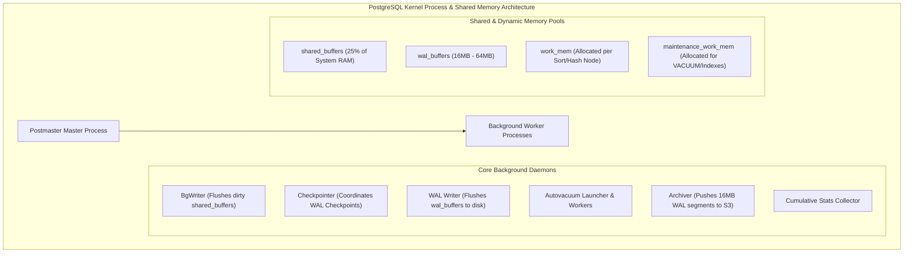
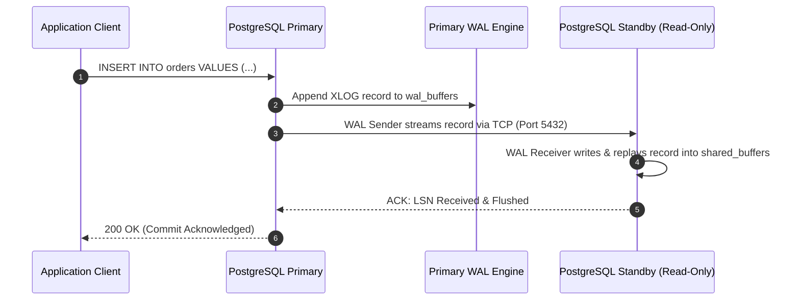
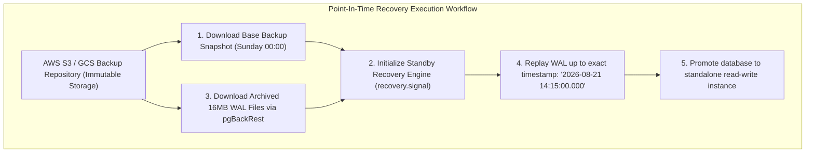
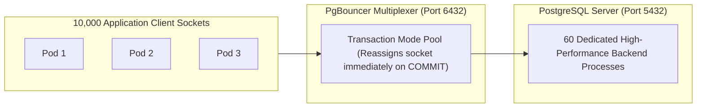

---


title: "PostgreSQL Administration: Backup (pg_dump/WAL-G), Replication & Tuning"
description: "Master-level engineering guide for PostgreSQL database administration, covering Physical/Logical streaming replication, Continuous Archiving with WAL-G/pgBackRest, PITR recovery, PgBouncer transaction pooling, and postgresql.conf performance sizing."
category: "Databases & SQL"
tags: [postgresql, replication, backup, wal-g, pgbackrest, pgbouncer, performance-tuning, sysadmin, pitr, technical-skills, software-engineering, learning-note]
date: "2026-08-21"
---
# PostgreSQL Administration: Replication, Backups & Sizing Deep Dive

---

## 1. Executive Summary & Core DBA Subsystems

Operating PostgreSQL in mission-critical enterprise environments requires deep mastery over the database kernel's memory management, background worker processes, streaming replication pipelines, and disaster recovery architectures.



---

## 2. Physical Streaming Replication Architecture

PostgreSQL physical streaming replication continuously streams binary Write-Ahead Log (WAL) records from a Primary writer to one or more Standby readers.



### 2.1 `synchronous_commit` Levels & Trade-Offs

| Level | Durability Guarantee | Write Latency Overhead | Data Loss on Primary Crash |
| :--- | :--- | :--- | :--- |
| **`off`** | Low | **Ultra-Low** (Asynchronous RAM flush) | Up to \$3 \times \text{wal\_writer\_delay}$ ($\sim 600\text{ ms}$) |
| **`local`** (Default) | Medium | Moderate (Local disk `fsync`) | WAL transactions not yet transmitted to standby are lost |
| **`remote_write`** | High | Low-to-Moderate (Standby OS buffer) | Survives primary hardware crash; lost only if standby also crashes |
| **`on`** (Sync Replication) | **Very High** | High (Waits for standby disk `fsync`) | **Zero Data Loss (RPO = 0)** |
| **`remote_apply`** | **Strict Causal** | Highest (Waits for Standby replay) | Zero Data Loss & **Zero Stale Reads on Standby** |

### 2.2 Replication Slots (`pg_create_physical_replication_slot`)
Without replication slots, if a standby temporarily disconnects, the primary may recycle old WAL files, forcing a full base backup rebuild. **Replication Slots** instruct the primary to retain WAL segments on disk until the standby explicitly acknowledges consumption:

```sql
-- On Primary: Create permanent replication slot
SELECT pg_create_physical_replication_slot('standby_node_1_slot');
```

---

## 3. Continuous Archiving, Backups & Point-In-Time Recovery (PITR)

Disaster recovery requires the ability to recover from catastrophic hardware loss or human error (e.g. `DROP TABLE customers;`) up to any specific microsecond timestamp using **Point-In-Time Recovery (PITR)**:

$$\text{Database State at } T_{\text{target}} = \text{Full Base Backup Snapshot} + \sum_{k=1}^{N} \text{Replayed WAL Segments up to } T_{\text{target}}$$



### 3.1 Production `pgBackRest` Configuration (`pgbackrest.conf`)

```ini
[global]
repo1-type=s3
repo1-s3-bucket=enterprise-postgres-backups
repo1-s3-endpoint=s3.us-east-1.amazonaws.com
repo1-s3-region=us-east-1
repo1-s3-key-type=auto
repo1-cipher-type=aes-256-cbc
repo1-cipher-pass=EnterpriseMasterEncryptionSecret_2026
repo1-retention-full=4
repo1-retention-diff=14
process-max=8
compress-type=lz4

[prod-db]
pg1-path=/var/lib/postgresql/16/main
pg1-user=postgres
```

### 3.2 Executing Point-In-Time Recovery Command
```bash
# Restore database to 10 seconds before accidental table deletion
pgbackrest --stanza=prod-db \
           --type=time \
           "--target=2026-08-21 14:14:50" \
           --target-action=promote \
           restore
```

---

## 4. Connection Multiplexing Architecture with PgBouncer

Because PostgreSQL forks a dedicated 10MB process per connection, managing thousands of microservice connections requires **PgBouncer** in **Transaction Pooling** mode:



### 4.1 Production `pgbouncer.ini` Configuration

```ini
[databases]
app_production = host=127.0.0.1 port=5432 dbname=app_production auth_user=pgbouncer

[pgbouncer]
listen_addr = 0.0.0.0
listen_port = 6432
auth_type = scram-sha-256
auth_file = /etc/pgbouncer/userlist.txt

# Transaction pooling mode guarantees maximum connection density
pool_mode = transaction
max_client_conn = 15000
default_pool_size = 60
min_pool_size = 20
reserve_pool_size = 10
reserve_pool_timeout = 5
max_db_connections = 100

# Performance & Security
server_reset_query = DISCARD ALL
server_check_query = SELECT 1
server_check_delay = 30
max_prepared_statements = 1000 # Supported in PgBouncer 1.21+
```

---

## 5. Production `postgresql.conf` Tuning Formulas (32GB / 64GB Server)

```ini
# =========================================================================
# PostgreSQL 16 Production Sizing (Tuned for 64GB RAM / 16 vCPU / NVMe SSD)
# =========================================================================

# Memory Configuration
shared_buffers = 16GB                  # 25% of Total Physical RAM
effective_cache_size = 48GB           # 75% of Total RAM (Estimates OS filesystem cache)
work_mem = 64MB                       # Per-sort/hash operation memory
maintenance_work_mem = 2GB            # VACUUM, CREATE INDEX, ALTER TABLE memory
max_connections = 300                 # Direct limit (All app traffic routed via PgBouncer)

# Checkpointer & Write-Ahead Logging
wal_level = replica
max_wal_size = 32GB
min_wal_size = 4GB
checkpoint_completion_target = 0.9    # Spread checkpoint I/O over 90% of duration
checkpoint_timeout = 15min
wal_buffers = 64MB
archive_mode = on
archive_command = 'pgbackrest --stanza=prod-db archive-push %p'

# Query Planner Disk Cost Constants (Tuned for NVMe SSD)
random_page_cost = 1.1                # Fast SSD random read seek cost
seq_page_cost = 1.0
effective_io_concurrency = 256        # Concurrent asynchronous disk operations

# Background Writer Tuning (Reduces checkpoint write spikes)
bgwriter_delay = 20ms
bgwriter_lru_maxpages = 400
bgwriter_lru_multiplier = 3.0

# Autovacuum Resource Allocation (Aggressive Bloat Cleanup)
autovacuum = on
autovacuum_max_workers = 6
autovacuum_vacuum_cost_limit = 3000
autovacuum_vacuum_cost_delay = 2ms
autovacuum_vacuum_scale_factor = 0.05
autovacuum_analyze_scale_factor = 0.02
```

---

## 6. Diagnostic Runbook for Production Incidents

```sql
-- 1. Identify Top Active Blocking Transactions and Lock Waits
SELECT 
    blocked_locks.pid AS blocked_pid,
    blocked_activity.usename AS blocked_user,
    blocking_locks.pid AS blocking_pid,
    blocking_activity.usename AS blocking_user,
    blocked_activity.query AS blocked_query,
    blocking_activity.query AS blocking_query,
    NOW() - blocked_activity.query_start AS duration
FROM pg_catalog.pg_locks blocked_locks
JOIN pg_catalog.pg_stat_activity blocked_activity ON blocked_activity.pid = blocked_locks.pid
JOIN pg_catalog.pg_locks blocking_locks 
    ON blocking_locks.locktype = blocked_locks.locktype
    AND blocking_locks.database IS NOT DISTINCT FROM blocked_locks.database
    AND blocking_locks.relation IS NOT DISTINCT FROM blocked_locks.relation
    AND blocking_locks.page IS NOT DISTINCT FROM blocked_locks.page
    AND blocking_locks.tuple IS NOT DISTINCT FROM blocked_locks.tuple
    AND blocking_locks.virtualxid IS NOT DISTINCT FROM blocked_locks.virtualxid
    AND blocking_locks.transactionid IS NOT DISTINCT FROM blocked_locks.transactionid
    AND blocking_locks.pid != blocked_locks.pid
JOIN pg_catalog.pg_stat_activity blocking_activity ON blocking_activity.pid = blocking_locks.pid
WHERE NOT blocked_locks.granted;

-- 2. Inspect Replication Lag across Standbys
SELECT 
    client_addr,
    application_name,
    state,
    sync_state,
    sync_priority,
    pg_wal_lsn_diff(pg_current_wal_lsn(), sent_lsn) AS sent_lag_bytes,
    pg_wal_lsn_diff(sent_lsn, write_lsn) AS write_lag_bytes,
    pg_wal_lsn_diff(write_lsn, flush_lsn) AS flush_lag_bytes,
    pg_wal_lsn_diff(flush_lsn, replay_lsn) AS replay_lag_bytes
FROM pg_stat_replication;
```

---

## 7. Operational Troubleshooting Matrix

| Incident | Root Cause | Production Remediation |
| :--- | :--- | :--- |
| **Primary Disk Exhaustion in `pg_wal`** | Standby node disconnected, and its replication slot is holding old WAL files indefinitely. | Drop inactive replication slot via `SELECT pg_drop_replication_slot('slot_name');`. |
| **`FATAL: remaining connection slots are reserved for non-replicated superuser`** | Direct microservice connection leak saturated `max_connections`. | Route all application traffic through PgBouncer in transaction pooling mode. |
| **Extreme Replication Lag Spikes** | Long-running analytical query or DDL lock on Standby node conflicting with primary WAL replay. | Set `max_standby_streaming_delay = 30s` and enable `hot_standby_feedback = on`. |

---

## 🔗 Graph-Linked Knowledge Base
- ⚓ WAL Architecture: [[write_ahead_logging_wal_architecture|WAL Architecture & Durability]]
- ⚓ Sharding & HA: [[database_sharding_patroni_proxysql_citus|Database Sharding & HA with Patroni]]
- 🔗 Concurrency: [[transactions_concurrency|Transactions & Concurrency Control]]
