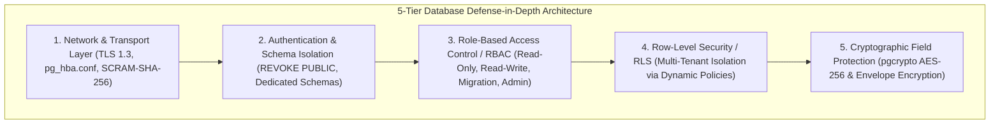
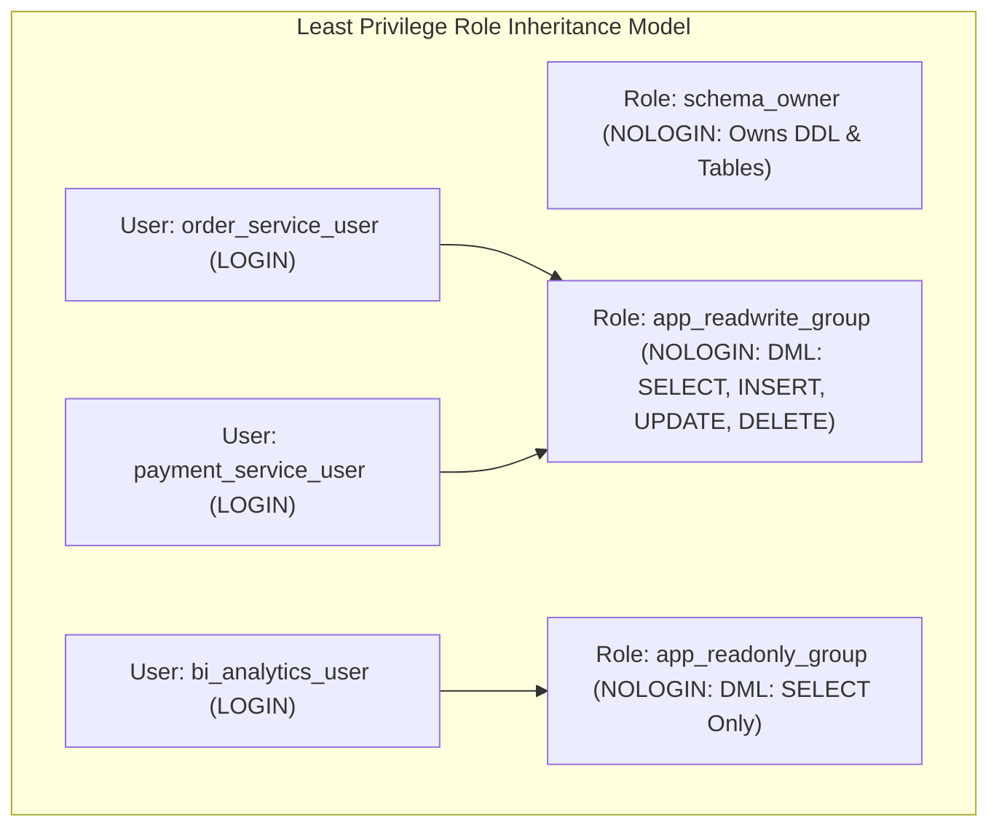
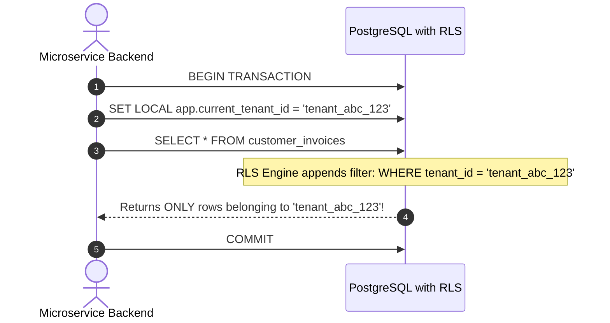
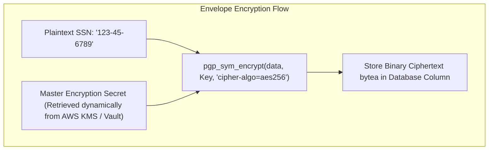

---


title: "Database Security & Access Control: RBAC, Grants & Column/Row Encryption"
description: "Master-level engineering guide for PostgreSQL database security, covering Role-Based Access Control (RBAC), Row-Level Security (RLS) multi-tenancy, pg_hba.conf network hardening, pgcrypto column encryption, and pgaudit compliance."
category: "Databases & SQL"
tags: [database-security, postgresql, rbac, permissions, pgcrypto, encryption, access-control, rls, pgaudit, scram, technical-skills, software-engineering, learning-note]
date: "2026-08-21"
---

# Database Security & Access Control: RBAC & Data Encryption

---

## 1. Executive Summary & Defense-in-Depth Security Model

Securing enterprise relational databases requires a multi-layered **Defense-in-Depth Architecture** that protects data at every physical and logical layer of the data lifecycle. A single misconfiguration—such as granting overly permissive default `PUBLIC` rights or storing plaintext sensitive attributes—can result in catastrophic data leaks and regulatory non-compliance (GDPR, HIPAA, PCI-DSS).



---

## 2. Network & Authentication Hardening: `pg_hba.conf` & SCRAM-SHA-256

PostgreSQL controls client connection authorization through the **Host-Based Authentication configuration (`pg_hba.conf`)**.

```mermaid
flowchart LR
    Client["Client Connection"] --> HBA{"pg_hba.conf Evaluation"}
    HBA -->|Match 1: Local Unix Socket| Peer["peer (Local OS User)"]
    HBA -->|Match 2: App Subnet (10.0.0.0/16)| SCRAM["hostssl + scram-sha-256 (Mandatory TLS)"]
    HBA -->|Match 3: Admin Bastion| Cert["hostssl + cert clientcert=verify-full (mTLS)"]
    HBA -->|No Match| Reject["REJECT Immediately & Log Alert"]
```

### 2.1 Production `pg_hba.conf` Security Template

```ini
# TYPE  DATABASE        USER            ADDRESS                 METHOD

# 1. Local administrative maintenance (Local Unix Domain Socket only)
local   all             postgres                                peer

# 2. Application Microservices (Private VPC Subnet only, Enforce TLS + SCRAM)
hostssl all             app_backend     10.244.0.0/16           scram-sha-256
hostssl all             read_only_user  10.244.0.0/16           scram-sha-256

# 3. Dedicated Migration Runner (CI/CD Deployment Runner)
hostssl all             migration_user  10.100.5.20/32          scram-sha-256

# 4. DBA Admin via Mutual TLS Client Certificate Verification
hostssl all             dba_admin       10.100.1.0/24           cert clientcert=verify-full

# 5. Default Fallback: Reject everything else
host    all             all             0.0.0.0/0               reject
```

---

## 3. Production Role-Based Access Control (RBAC) Architecture

Default PostgreSQL installations allow any connected user to create objects in the `public` schema. A hardened RBAC model establishes strict role segregation:



### 3.1 Hardened RBAC Setup Script
```sql
-- 1. Create NOLOGIN Group Roles
CREATE ROLE schema_owner NOLOGIN;
CREATE ROLE app_readwrite_group NOLOGIN;
CREATE ROLE app_readonly_group NOLOGIN;

-- 2. Revoke default insecure PUBLIC schema privileges
REVOKE CREATE ON SCHEMA public FROM PUBLIC;
REVOKE ALL ON ALL TABLES IN SCHEMA public FROM PUBLIC;
REVOKE ALL ON ALL FUNCTIONS IN SCHEMA public FROM PUBLIC;

-- 3. Grant Explicit Access to Application Schemas
GRANT USAGE ON SCHEMA public TO app_readwrite_group, app_readonly_group;

-- 4. Grant DML to Read-Write Group
GRANT SELECT, INSERT, UPDATE, DELETE ON ALL TABLES IN SCHEMA public TO app_readwrite_group;
GRANT USAGE, SELECT ON ALL SEQUENCES IN SCHEMA public TO app_readwrite_group;

-- 5. Grant DML to Read-Only Group
GRANT SELECT ON ALL TABLES IN SCHEMA public TO app_readonly_group;

-- 6. Enforce Default Privileges on Future Tables Created by schema_owner
ALTER DEFAULT PRIVILEGES FOR ROLE schema_owner IN SCHEMA public 
    GRANT SELECT, INSERT, UPDATE, DELETE ON TABLES TO app_readwrite_group;

ALTER DEFAULT PRIVILEGES FOR ROLE schema_owner IN SCHEMA public 
    GRANT USAGE, SELECT ON SEQUENCES TO app_readwrite_group;

ALTER DEFAULT PRIVILEGES FOR ROLE schema_owner IN SCHEMA public 
    GRANT SELECT ON TABLES TO app_readonly_group;

-- 7. Create Login Users with SCRAM Passwords
CREATE USER order_service WITH PASSWORD 'Strong_Scram_Order_Pw_2026' IN ROLE app_readwrite_group;
CREATE USER analytics_user WITH PASSWORD 'Strong_Scram_Analyst_Pw_2026' IN ROLE app_readonly_group;
```

---

## 4. Multi-Tenant Isolation with Row-Level Security (RLS)

**Row-Level Security (RLS)** allows database administrators to define granular security policies that restrict which table rows can be viewed or modified based on the executing user's session context:



### 4.1 Production RLS Multi-Tenant Blueprint
```sql
-- 1. Create Multi-Tenant Table
CREATE TABLE tenant_invoices (
    id UUID PRIMARY KEY DEFAULT gen_random_uuid(),
    tenant_id UUID NOT NULL,
    invoice_number VARCHAR(50) NOT NULL,
    amount NUMERIC(12, 2) NOT NULL,
    status VARCHAR(30) NOT NULL DEFAULT 'UNPAID',
    created_at TIMESTAMPTZ NOT NULL DEFAULT NOW()
);

-- Index on tenant_id is CRITICAL for RLS performance!
CREATE INDEX idx_tenant_invoices_tenant_id ON tenant_invoices (tenant_id);

-- 2. Enable Row Level Security on the table
ALTER TABLE tenant_invoices ENABLE ROW LEVEL SECURITY;

-- Enforce RLS even for the table owner (prevents accidental data exposure)
ALTER TABLE tenant_invoices FORCE ROW LEVEL SECURITY;

-- 3. Define RLS Policy using Session Variable
CREATE POLICY tenant_isolation_policy ON tenant_invoices
    FOR ALL
    USING (tenant_id = NULLIF(current_setting('app.current_tenant_id', true), '')::uuid)
    WITH CHECK (tenant_id = NULLIF(current_setting('app.current_tenant_id', true), '')::uuid);
```

---

## 5. Column-Level Envelope Encryption with `pgcrypto`

For strictly confidential attributes (Social Security Numbers, Credit Card PANs, Medical records), storing ciphertext protects data even if database backup files or disk snapshots are compromised:



### 5.1 Production Column Encryption Implementation
```sql
CREATE EXTENSION IF NOT EXISTS pgcrypto;

-- Insert encrypted PII data
INSERT INTO user_tax_records (user_id, encrypted_ssn)
VALUES (
    '018f2d5a-0000-7000-8000-000000000001',
    pgp_sym_encrypt('123-45-6789', current_setting('app.master_encryption_key'), 'cipher-algo=aes256,compress-algo=1')
);

-- Query and decrypt PII data inside authorized transaction session
SET LOCAL app.master_encryption_key = 'EnterpriseKmsDerivedMasterKey_2026';

SELECT 
    user_id,
    pgp_sym_decrypt(encrypted_ssn, current_setting('app.master_encryption_key')) AS decrypted_ssn
FROM user_tax_records
WHERE user_id = '018f2d5a-0000-7000-8000-000000000001';
```

---

## 6. Comprehensive Audit Logging with `pgaudit`

To satisfy regulatory compliance standards (SOC 2, ISO 27001), enable the **`pgaudit`** extension to capture fine-grained audit trails directly into PostgreSQL log files:

```ini
# postgresql.conf pgaudit configuration
shared_preload_libraries = 'pgaudit'
pgaudit.log = 'role, ddl, write, misc'
pgaudit.log_catalog = off
pgaudit.log_parameter = on              # Logs parameterized SQL values
pgaudit.log_relation = on               # Logs distinct tables accessed
```

---

## 7. Security Incident Matrix & Operational Runbook

| Security Incident | Attack Vector | Production Remediation |
| :--- | :--- | :--- |
| **SQL Injection Data Exfiltration** | Dynamic string concatenation bypassing parameterization. | Enforce parameterized queries (`PreparedStatement`), enable RLS to confine blast radius. |
| **Credential Sniffing over Network** | Plaintext unencrypted TCP database connection. | Enforce `hostssl` with `scram-sha-256` and require client TLS certificate validation. |
| **Cross-Tenant Data Leak** | Developer forgot `WHERE tenant_id = ...` in microservice query. | Enable PostgreSQL Row-Level Security (`FORCE ROW LEVEL SECURITY`) on all multi-tenant tables. |
| **Unauthorized Superuser Elevation** | Attacker compromised application credentials. | Revoke `SUPERUSER` and `CREATEDB` rights from all application connection roles. |

---

## 🔗 Graph-Linked Knowledge Base
- ⚓ PostgreSQL Admin: [[postgresql_administration|PostgreSQL Administration & Sizing]]
- ⚓ PL/pgSQL: [[plpgsql_programming|PL/pgSQL Procedures & Audit Triggers]]
- 🔗 Web Security: [[02_Technical_Skills/01_theory_and_concepts/24_Security_and_Hardening/applied_cryptography_pki_tls_aes_rsa|Applied Cryptography, PKI & TLS]]
