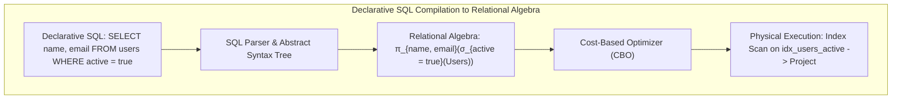
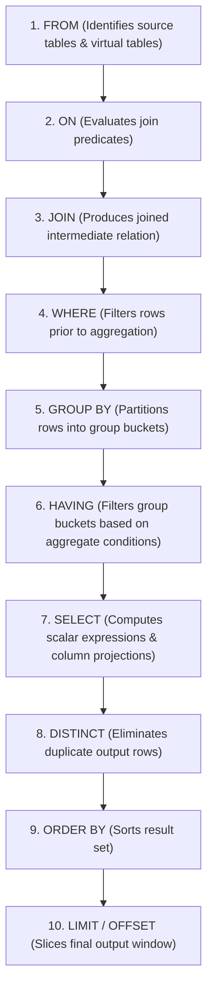
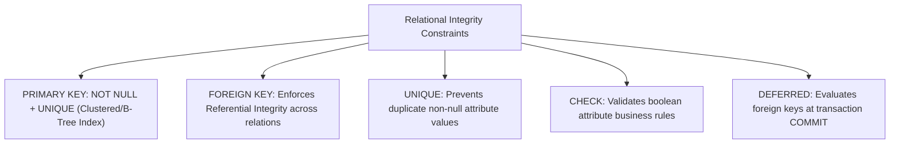
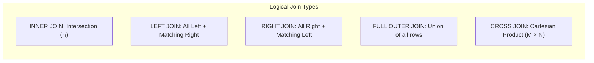
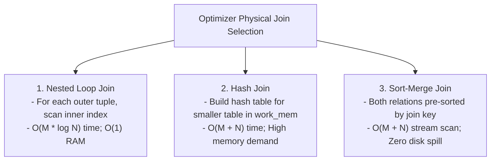
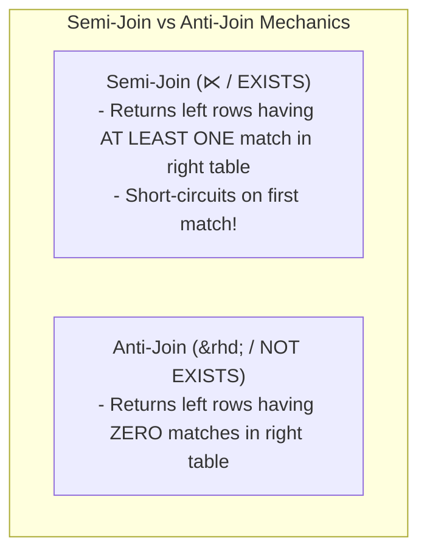

---


title: "SQL Fundamentals: Relational Algebra, DDL, DML & Join Mechanics"
description: "Master-level engineering guide for SQL fundamentals, covering Codd's Relational Algebra foundations, Logical execution pipelines, ANSI SQL DDL/DML, Join algorithms (Nested Loop, Hash Join, Merge Join), and Three-Valued Logic (3VL)."
category: "Databases & SQL"
tags: [sql, relational-algebra, sql-fundamentals, joins, ddl, dml, query-engine, three-valued-logic, technical-skills, software-engineering, learning-note]
date: "2026-08-21"
---

# SQL Fundamentals: Relational Algebra & Join Mechanics Deep Dive

---

## 1. Executive Summary & Codd's Relational Foundations

**Structured Query Language (SQL)** is the declarative domain-specific language for defining, querying, and manipulating data residing in relational database management systems (RDBMS). Introduced in 1970 by mathematician **Edgar F. Codd**, relational theory models data as mathematical **Relations** (tables), which are sets of unordered **Tuples** (rows) conforming to defined **Attributes** (columns).

A relational database engine translates declarative SQL text into formal **Relational Algebra Trees**:
- **Selection ($\sigma_\phi$)**: Filters tuples satisfying a propositional formula $\phi$ (`WHERE` clause).
- **Projection ($\pi_{A_1, \dots, A_n}$)**: Slices relations into a specified subset of attributes (`SELECT` clause).
- **Cartesian Product ($R \times S$)**: Generates all pairwise tuple combinations from relations $R$ and $S$.
- **Theta-Join ($R \bowtie_\theta S$)**: Combines Cartesian product with an attribute condition $\theta$ (`ON / JOIN`).
- **Set Operations ($\cup, \cap, -$ )**: `UNION`, `INTERSECT`, and `EXCEPT` (preserves relational set theory).



---

## 2. Logical Query Processing Order

Unlike imperative programming languages that execute statements top-to-bottom, a relational query engine processes clauses in a mathematically mandated logical order:

$$\text{1. FROM} \to \text{2. ON} \to \text{3. JOIN} \to \text{4. WHERE} \to \text{5. GROUP BY} \to \text{6. HAVING} \to \text{7. SELECT} \to \text{8. DISTINCT} \to \text{9. ORDER BY} \to \text{10. LIMIT / OFFSET}$$



> [!NOTE]
> Because `WHERE` (Step 4) executes **before** `SELECT` (Step 7), column aliases declared in the `SELECT` list cannot be referenced within the `WHERE` clause.

---

## 3. Data Definition Language (DDL) & Constraint Mechanics

DDL defines and modifies the physical and logical structure of database relations. Relational integrity is enforced through schema-level **Integrity Constraints**:



### 3.1 Foreign Key Cascade Actions Matrix

| Referential Action | Behavior on Parent Row `DELETE` or `UPDATE` | Optimal Production Use Case |
| :--- | :--- | :--- |
| **`ON DELETE RESTRICT`** | Aborts operation immediately if any child row exists. | Core business entities (e.g. Prevent deleting Customers with active Orders). |
| **`ON DELETE CASCADE`** | Automatically deletes all matching child rows. | Child dependent line items (e.g. Deleting Order deletes OrderItems). |
| **`ON DELETE SET NULL`** | Sets foreign key column in child rows to `NULL`. | Optional relationships (e.g. Deleting User unassigns SupportTickets). |
| **`ON DELETE NO ACTION`** | Checks constraint at end of statement/transaction (Supports `DEFERRABLE`). | Self-referencing trees, cyclic dependencies. |

### 3.2 Production DDL Blueprint (PostgreSQL)

```sql
-- 1. Create Enums & Domains
CREATE TYPE order_status_enum AS ENUM ('PENDING', 'PAID', 'SHIPPED', 'CANCELLED');

-- 2. Master Table with Strong Invariants
CREATE TABLE customer_accounts (
    id UUID PRIMARY KEY DEFAULT gen_random_uuid(),
    account_number VARCHAR(32) NOT NULL UNIQUE,
    email VARCHAR(255) NOT NULL UNIQUE,
    credit_limit NUMERIC(12, 2) NOT NULL CHECK (credit_limit >= 0.00),
    is_active BOOLEAN NOT NULL DEFAULT TRUE,
    created_at TIMESTAMPTZ NOT NULL DEFAULT NOW()
);

-- 3. Dependent Detail Table with Cascades & Check Constraints
CREATE TABLE customer_orders (
    id UUID PRIMARY KEY DEFAULT gen_random_uuid(),
    account_id UUID NOT NULL REFERENCES customer_accounts(id) ON DELETE RESTRICT,
    total_amount NUMERIC(12, 2) NOT NULL CHECK (total_amount >= 0.01),
    status order_status_enum NOT NULL DEFAULT 'PENDING',
    shipping_address JSONB NOT NULL,
    created_at TIMESTAMPTZ NOT NULL DEFAULT NOW(),
    
    -- Deferrable Foreign Key constraint for complex multi-row batch mutations
    CONSTRAINT fk_customer_orders_account FOREIGN KEY (account_id) 
        REFERENCES customer_accounts(id) DEFERRABLE INITIALLY IMMEDIATE
);

-- Indexing foreign keys is MANDATORY to prevent table locks during parent updates
CREATE INDEX idx_customer_orders_account_id ON customer_orders(account_id);
```

---

## 4. Join Mechanics: Logical Joins & Physical Execution Engines



### 4.1 Physical Join Algorithms in Database Engines



| Physical Algorithm | Best Production Scenario | Worst Case / Failure Mode |
| :--- | :--- | :--- |
| **Nested Loop** | Tiny outer table ($< 500$ rows) probing a B-Tree indexed inner table. | Unindexed inner table forcing $O(M \times N)$ sequential disk scans. |
| **Hash Join** | Large unsorted tables with equality join operators (`=`). | Hash table exceeds `work_mem`, spilling temporary batch files to disk. |
| **Sort-Merge Join** | Large tables already sorted by primary key or B-Tree indexes. | Non-indexed input forcing expensive $O(N \log N)$ sorting passes. |

---

## 5. Three-Valued Logic (3VL) & `NULL` Semantics

In relational database theory, `NULL` represents the **absence of a value** or an **unknown state**, not zero or an empty string. Consequently, boolean logic in SQL evaluates to **`TRUE`**, **`FALSE`**, or **`UNKNOWN`**.

### 5.1 3VL Truth Tables

| Operator | Left Operand | Right Operand | Result |
| :--- | :--- | :--- | :--- |
| **`=`** | `NULL` | `NULL` | **`UNKNOWN`** (Evaluates to FALSE in `WHERE`!) |
| **`!=`** | `42` | `NULL` | **`UNKNOWN`** |
| **`AND`** | `TRUE` | `UNKNOWN` | **`UNKNOWN`** |
| **`AND`** | `FALSE` | `UNKNOWN` | **`FALSE`** |
| **`OR`** | `TRUE` | `UNKNOWN` | **`TRUE`** |
| **`OR`** | `FALSE` | `UNKNOWN` | **`UNKNOWN`** |
| **`NOT`** | `UNKNOWN` | — | **`UNKNOWN`** |

> [!IMPORTANT]
> Because `NULL = NULL` yields `UNKNOWN`, SQL statements filtering on nullable columns must use `IS NULL`, `IS NOT NULL`, or the null-safe comparison `IS DISTINCT FROM`:
> ```sql
> -- Correct Null-Safe Equality check in PostgreSQL
> SELECT * FROM products WHERE discount IS DISTINCT FROM 0.00;
> ```

---

## 6. Subqueries vs. Joins: Semi-Joins & Anti-Joins



### 6.1 The Dangerous `NOT IN` with Nullable Columns Trap
```sql
-- DANGEROUS BUG: If ANY row in inactive_users has NULL id, this query returns ZERO rows!
SELECT * FROM users 
WHERE id NOT IN (SELECT user_id FROM inactive_users);

-- PRODUCTION STANDARD: Hash Anti-Join via NOT EXISTS (Safe against NULLs)
SELECT u.* 
FROM users u 
WHERE NOT EXISTS (
    SELECT 1 FROM inactive_users iu WHERE iu.user_id = u.id
);
```

---

## 7. Operational Troubleshooting & SQL Failure Modes

| SQL Anti-Pattern | Root Cause | Engineering Solution |
| :--- | :--- | :--- |
| **Unintentional Cartesian Product** | Missing `ON` join condition in multi-table query. | Use explicit `INNER JOIN ... ON` syntax; never use comma-separated `FROM A, B`. |
| **`NOT IN (NULL)` Silent Data Drop** | Subquery returned at least one `NULL` value, making predicate `UNKNOWN`. | Replace `NOT IN` with `NOT EXISTS` or `WHERE col IS NOT NULL`. |
| **Foreign Key Lock Escalation** | Child foreign key column lacks an index; parent `DELETE` locks full child table. | Always create a B-Tree index on all foreign key columns. |

---

## 🔗 Graph-Linked Knowledge Base
- ⚓ Complex Queries: [[complex_queries|Complex SQL Engineering & CTEs]]
- ⚓ Filtering & Aggregation: [[filtering_aggregation|Filtering & Aggregation Mastery]]
- 🔗 Concurrency: [[transactions_concurrency|Transactions & Concurrency Control]]
