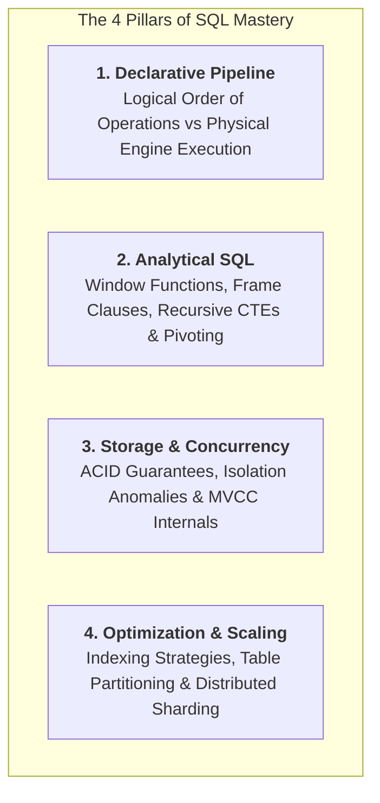
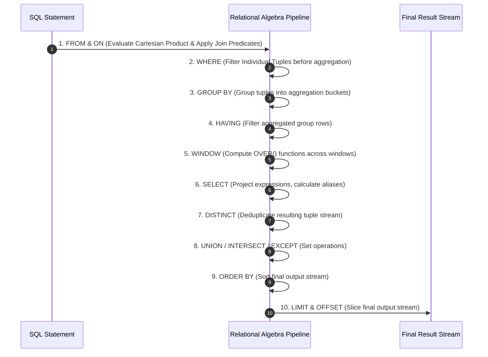
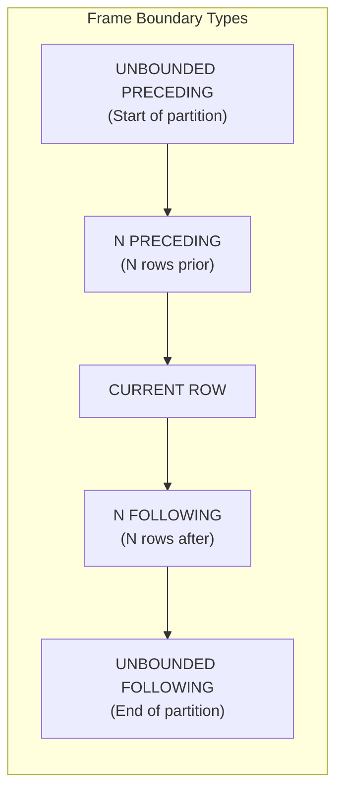
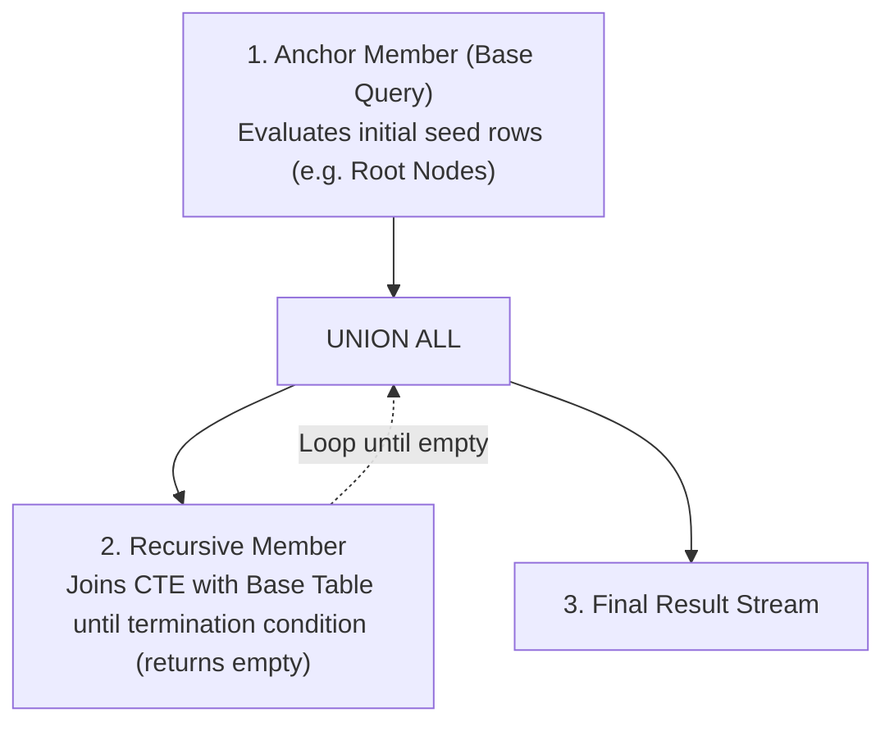
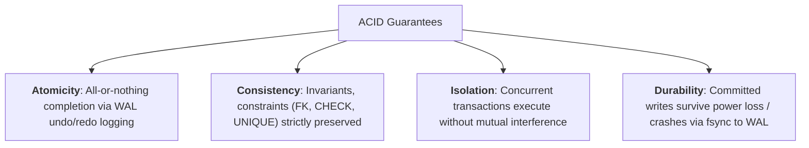
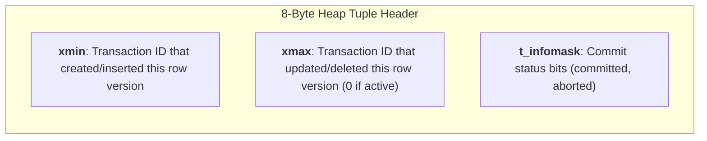

---


title: "SQL Master Review & Senior Interview Handbook: Query Mechanics, MVCC, Isolation Levels & Analytical Patterns"
description: "Comprehensive master review and interview preparation handbook for SQL and Relational Database Internals, covering Logical Query Execution, Window Framing, Recursive CTEs, ACID & MVCC Isolation Phenomena, and Top 10 Production SQL Interview Challenges."
category: "Databases & SQL"
tags: [sql, sql-review, interview-prep, window-functions, recursive-cte, mvcc, transaction-isolation, relational-algebra, technical-skills, software-engineering, learning-note]
date: "2026-08-29"
---

# SQL Master Review & Senior Interview Handbook

---

## 1. Executive Summary & Quick-Reference Cheat Sheet

This handbook serves as an end-to-end technical review of SQL and relational database internals for senior backend engineers, database administrators, and technical interview candidates.



---

## 2. Logical Query Execution Pipeline

Unlike imperative languages (which evaluate top-to-bottom), SQL is evaluated by relational engines in a strict mathematical order:

$$\text{FROM} \to \text{JOIN} \to \text{WHERE} \to \text{GROUP BY} \to \text{HAVING} \to \text{WINDOW} \to \text{SELECT} \to \text{DISTINCT} \to \text{UNION/EXCEPT} \to \text{ORDER BY} \to \text{LIMIT/OFFSET}$$



> [!IMPORTANT]
> **Why Aliases Fail in `WHERE`**: Because `WHERE` evaluates in Step 2, column aliases created in Step 6 (`SELECT price * 1.1 AS new_price`) do not exist yet when `WHERE` executes. They *can*, however, be referenced in `ORDER BY` (Step 9).

---

## 3. Window Functions & Frame Specifications Masterclass

Window functions perform calculations across related rows without collapsing the underlying result set.

### Syntax & Framing Structure

$$\text{FUNCTION}() \text{ OVER } (\text{PARTITION BY } \text{col}_1 \text{ ORDER BY } \text{col}_2 \text{ [ROWS | RANGE] BETWEEN } \text{frame\_start} \text{ AND } \text{frame\_end})$$



### Window Functions Quick-Reference

| Function Category | Function | Purpose & Behavior |
| :--- | :--- | :--- |
| **Ranking** | `ROW_NUMBER()` | Monotonically increasing integer (\$1, 2, 3, 4$). Ties get unique arbitrary numbers. |
| **Ranking** | `RANK()` | Same rank for ties, skips subsequent values (\$1, 2, 2, 4$). |
| **Ranking** | `DENSE_RANK()` | Same rank for ties, does **not** skip values (\$1, 2, 2, 3$). |
| **Ranking** | `NTILE(k)` | Divides partition into $k$ equal frequency buckets (\$1 \dots k$). |
| **Value (Positional)** | `LAG(col, offset, default)` | Fetches value from row $N$ rows *before* current row. |
| **Value (Positional)** | `LEAD(col, offset, default)`| Fetches value from row $N$ rows *after* current row. |
| **Value (Boundary)** | `FIRST_VALUE(col)` / `LAST_VALUE(col)` | Returns first/last value in the current window frame. |

---

## 4. Recursive Common Table Expressions (Recursive CTEs)

Recursive CTEs solve hierarchical, tree-structured, and graph traversal problems in pure SQL:



### Production Example: Organizational Hierarchy Traversal & Depth

```sql
WITH RECURSIVE org_hierarchy AS (
    -- 1. Anchor Member: Top-level CEO (manager_id IS NULL)
    SELECT 
        employee_id, 
        manager_id, 
        name, 
        title,
        1 AS org_level,
        ARRAY[employee_id] AS path
    FROM employees
    WHERE manager_id IS NULL

    UNION ALL

    -- 2. Recursive Member: Direct reports of employees in previous level
    SELECT 
        e.employee_id, 
        e.manager_id, 
        e.name, 
        e.title,
        oh.org_level + 1,
        oh.path || e.employee_id
    FROM employees e
    JOIN org_hierarchy oh ON e.manager_id = oh.employee_id
    WHERE NOT (e.employee_id = ANY(oh.path)) -- Cycle prevention safeguard
)
SELECT org_level, name, title, path
FROM org_hierarchy
ORDER BY path;
```

---

## 5. ACID & Transaction Isolation Levels



### ANSI SQL Isolation Levels vs Anomalies

| Isolation Level | Dirty Read | Non-Repeatable Read | Phantom Read | Serialization Anomaly (Write Skew) |
| :--- | :---: | :---: | :---: | :---: |
| **Read Uncommitted** | ❌ Allowed | ❌ Allowed | ❌ Allowed | ❌ Allowed |
| **Read Committed** *(PG Default)* | ✅ Prevented | ❌ Allowed | ❌ Allowed | ❌ Allowed |
| **Repeatable Read** | ✅ Prevented | ✅ Prevented | ✅ Prevented *(in PG)* | ❌ Allowed (Write Skew) |
| **Serializable** (SSI) | ✅ Prevented | ✅ Prevented | ✅ Prevented | ✅ Prevented |

### Under the Hood: PostgreSQL MVCC & Tuple Header Mechanics

In PostgreSQL, updates and deletes do not overwrite data in place. Instead, Multi-Version Concurrency Control (**MVCC**) stores multiple physical tuple versions with metadata headers:



- **Snapshot Visibility Rule**: Transaction $T_{\text{curr}}$ can read tuple version if:
  1. `xmin` is committed and $\text{xmin} < \text{snapshot.xmin}$ (committed before snapshot creation).
  2. `xmax` is $0$, aborted, or $\text{xmax} > \text{snapshot.xmax}$ (not deleted before snapshot).

---

## 6. Top 10 Senior SQL Interview Challenges & Patterns

### 1. N-th Highest Salary (Handling Duplicates & NULLs)
```sql
SELECT COALESCE(
    (SELECT DISTINCT salary 
     FROM employee 
     ORDER BY salary DESC 
     LIMIT 1 OFFSET (N - 1)), 
    NULL
) AS nth_highest_salary;
```

### 2. Finding Active Streak / Consecutive Logins (Gaps & Islands)
```sql
WITH numbered_logins AS (
    SELECT 
        user_id,
        login_date,
        -- Subtract row_number days from login_date to form grouping island key
        login_date - (ROW_NUMBER() OVER (PARTITION BY user_id ORDER BY login_date))::int AS island_group
    FROM (SELECT DISTINCT user_id, login_date::date FROM user_logins) distinct_logins
)
SELECT 
    user_id,
    MIN(login_date) AS streak_start,
    MAX(login_date) AS streak_end,
    COUNT(*) AS streak_length_days
FROM numbered_logins
GROUP BY user_id, island_group
HAVING COUNT(*) >= 5
ORDER BY streak_length_days DESC;
```

### 3. Sessionization (Grouping Events with 30-Minute Inactivity Threshold)
```sql
WITH event_gaps AS (
    SELECT 
        user_id,
        event_time,
        CASE 
            WHEN event_time - LAG(event_time) OVER (PARTITION BY user_id ORDER BY event_time) > INTERVAL '30 minutes' 
            THEN 1 
            ELSE 0 
        END AS is_new_session
    FROM user_clickstream
),
session_tags AS (
    SELECT 
        user_id,
        event_time,
        SUM(is_new_session) OVER (PARTITION BY user_id ORDER BY event_time) AS session_id
    FROM event_gaps
)
SELECT 
    user_id, 
    session_id, 
    MIN(event_time) AS session_start, 
    MAX(event_time) AS session_end,
    COUNT(*) AS total_clicks
FROM session_tags
GROUP BY user_id, session_id;
```

### 4. Running Total & 7-Day Moving Average Revenue
```sql
SELECT 
    store_id,
    sales_date,
    daily_revenue,
    -- Running Cumulative Total from beginning of time
    SUM(daily_revenue) OVER (
        PARTITION BY store_id 
        ORDER BY sales_date 
        ROWS BETWEEN UNBOUNDED PRECEDING AND CURRENT ROW
    ) AS running_total,
    -- 7-Day Moving Average (Current day + 6 days prior)
    AVG(daily_revenue) OVER (
        PARTITION BY store_id 
        ORDER BY sales_date 
        ROWS BETWEEN 6 PRECEDING AND CURRENT ROW
    ) AS moving_avg_7d
FROM daily_store_sales;
```

### 5. Year-over-Year (YoY) & Month-over-Month (MoM) Growth
```sql
WITH monthly_metrics AS (
    SELECT 
        DATE_TRUNC('month', order_date) AS report_month,
        SUM(total_amount) AS revenue
    FROM orders
    GROUP BY DATE_TRUNC('month', order_date)
)
SELECT 
    report_month,
    revenue,
    LAG(revenue, 1) OVER (ORDER BY report_month) AS prev_month_revenue,
    ROUND(((revenue - LAG(revenue, 1) OVER (ORDER BY report_month)) / NULLIF(LAG(revenue, 1) OVER (ORDER BY report_month), 0)) * 100, 2) AS mom_growth_pct,
    LAG(revenue, 12) OVER (ORDER BY report_month) AS prev_year_revenue,
    ROUND(((revenue - LAG(revenue, 12) OVER (ORDER BY report_month)) / NULLIF(LAG(revenue, 12) OVER (ORDER BY report_month), 0)) * 100, 2) AS yoy_growth_pct
FROM monthly_metrics
ORDER BY report_month;
```

### 6. Top 3 Selling Products Per Category (Deduplicated)
```sql
WITH ranked_products AS (
    SELECT 
        category_id,
        product_id,
        product_name,
        units_sold,
        DENSE_RANK() OVER (PARTITION BY category_id ORDER BY units_sold DESC) AS rank_pos
    FROM product_sales_summary
)
SELECT category_id, product_id, product_name, units_sold, rank_pos
FROM ranked_products
WHERE rank_pos <= 3
ORDER BY category_id, rank_pos;
```

### 7. Pivot Relational Rows to Columnar Summary (Crosstab)
```sql
-- Count orders by status per quarter using Conditional Aggregation
SELECT 
    EXTRACT(YEAR FROM order_date) AS order_year,
    COUNT(CASE WHEN status = 'COMPLETED' THEN 1 END) AS completed_count,
    COUNT(CASE WHEN status = 'REFUNDED' THEN 1 END) AS refunded_count,
    COUNT(CASE WHEN status = 'CANCELLED' THEN 1 END) AS cancelled_count,
    COUNT(*) AS total_orders
FROM orders
GROUP BY EXTRACT(YEAR FROM order_date)
ORDER BY order_year DESC;
```

### 8. Find Overlapping Time Intervals / Room Booking Conflicts
```sql
SELECT 
    b1.booking_id AS booking_a,
    b2.booking_id AS booking_b,
    b1.room_id,
    b1.start_time,
    b1.end_time
FROM room_bookings b1
JOIN room_bookings b2 ON b1.room_id = b2.room_id 
  AND b1.booking_id < b2.booking_id -- Avoid self-join & mirror pairs
  AND b1.start_time < b2.end_time 
  AND b1.end_time > b2.start_time;
```

### 9. Relational Division: Find Users Who Purchased All Products in Category X
```sql
SELECT o.user_id
FROM orders o
JOIN order_items oi ON o.order_id = oi.order_id
JOIN products p ON oi.product_id = p.product_id
WHERE p.category_name = 'Enterprise Cloud'
GROUP BY o.user_id
HAVING COUNT(DISTINCT p.product_id) = (
    SELECT COUNT(*) FROM products WHERE category_name = 'Enterprise Cloud'
);
```

### 10. Preventing Lost Updates with Optimistic vs Pessimistic Locking
```sql
-- Option A: Pessimistic Locking (SELECT FOR UPDATE)
BEGIN;
SELECT account_id, balance FROM accounts WHERE account_id = 'ACC-100' FOR UPDATE;
UPDATE accounts SET balance = balance - 50 WHERE account_id = 'ACC-100';
COMMIT;

-- Option B: Optimistic Locking with Version Invariant
UPDATE accounts 
SET balance = balance - 50, version = version + 1 
WHERE account_id = 'ACC-100' AND version = 4;
-- If rows_affected == 0, application triggers retry backoff
```

---

## 7. Related Graph Nodes & Further Reading

- 🔙 [[node_12_Databases_and_SQL|📁 Databases & SQL Hub]]
- 🔗 [[sql_table_partitioning_and_pruning|SQL Table Partitioning & Partition Pruning]]
- 🔗 [[database_sharding_patterns_and_distributed_routing|Database Sharding Patterns & Distributed Routing]]
- 🔗 [[sql_query_optimization_and_execution_plans|SQL Query Optimization & Execution Plans]]
- 🔗 [[transactions_concurrency|Database Transactions, Concurrency & MVCC]]
- 🔗 [[complex_queries|Complex SQL Engineering: Window Functions & CTEs]]
