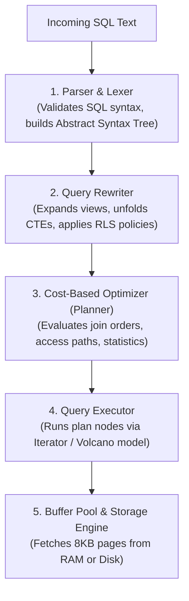
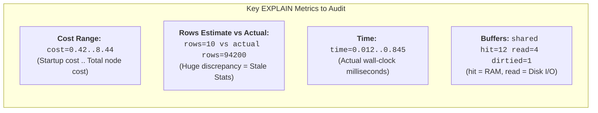
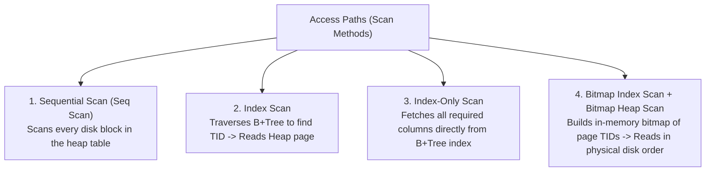
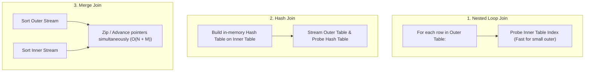
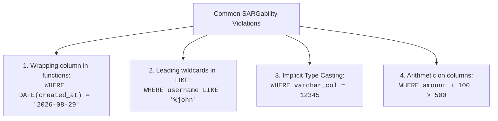
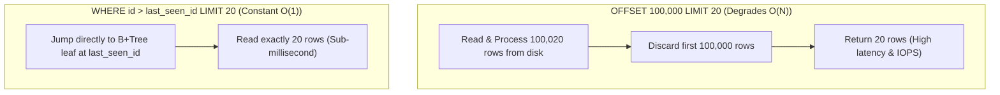

---


title: "SQL Query Optimization & Execution Plans: EXPLAIN ANALYZE, Access Paths & Index Engineering"
description: "Master-level engineering guide for SQL Query Performance Optimization, covering EXPLAIN ANALYZE interpretation, Access Paths (Seq vs Index vs Bitmap Scan), Join Algorithms (Hash vs Merge vs Nested Loop), Cost Estimations, and Advanced Indexing Architectures."
category: "Databases & SQL"
tags: [sql, query-optimization, explain-analyze, indexing, postgresql, database-performance, query-planner, technical-skills, software-engineering, learning-note]
date: "2026-08-29"
---

# SQL Query Optimization & Execution Plans Architecture

---

## 1. Executive Summary & The Query Optimization Pipeline

Relational database engines are declarative: developers declare *what* data is needed, and the **Cost-Based Optimizer (CBO)** determines *how* to execute the retrieval with minimum physical resource consumption (disk I/O, CPU cycles, buffer pool memory).



### The Cost Model Formula

PostgreSQL calculates estimated plan node cost using linear cost functions:

$$\text{Total Cost} = (N_{\text{pages}} \times C_{\text{seq\_page}}) + (N_{\text{random}} \times C_{\text{random\_page}}) + (N_{\text{tuples}} \times C_{\text{cpu\_tuple}}) + (N_{\text{operators}} \times C_{\text{cpu\_operator}})$$

- `seq_page_cost` (default \$1.0$): Cost of reading a disk page sequentially.
- `random_page_cost` (default \$4.0$ on HDD, tuned to \$1.1$ on modern NVMe SSDs).
- `cpu_tuple_cost` (default \$0.01$): CPU cost to process one tuple header.
- `cpu_operator_cost` (default \$0.0025$): CPU cost to evaluate an operator/function (e.g. `WHERE` filter).

---

## 2. Reading `EXPLAIN (ANALYZE, BUFFERS)`

The definitive tool for inspecting query performance is `EXPLAIN (ANALYZE, BUFFERS, VERBOSE, SETTINGS)`.



### Production Example & Line-by-Line Breakdown

```sql
EXPLAIN (ANALYZE, BUFFERS, SETTINGS)
SELECT c.customer_id, c.email, COUNT(o.order_id) AS order_count, SUM(o.total_amount) AS lifetime_value
FROM customers c
JOIN orders o ON c.customer_id = o.customer_id
WHERE c.country_code = 'US'
  AND o.created_at >= '2026-01-01 00:00:00+00'
GROUP BY c.customer_id, c.email
HAVING SUM(o.total_amount) > 1000
ORDER BY lifetime_value DESC
LIMIT 50;
```

**Annotated Execution Plan Trace:**
```text
Limit (cost=4215.12..4215.24 rows=50 width=88) (actual time=14.215..14.225 rows=50 loops=1)
  Buffers: shared hit=3410 read=12
  ->  Sort (cost=4215.12..4218.62 rows=1400 width=88) (actual time=14.213..14.219 rows=50 loops=1)
        Sort Key: (sum(o.total_amount)) DESC
        Sort Method: top-N heapsort  Memory: 32kB
        Buffers: shared hit=3410 read=12
        ->  HashAggregate (cost=3920.00..4144.00 rows=1400 width=88) (actual time=11.840..13.620 rows=2800 loops=1)
              Group Key: c.customer_id, c.email
              Filter: (sum(o.total_amount) > '1000'::numeric)
              Rows Removed by Filter: 1540
              Planned Partitions: 0  Memory Usage: 450kB
              Buffers: shared hit=3410 read=12
              ->  Hash Join (cost=1250.00..3710.00 rows=14000 width=56) (actual time=2.810..9.420 rows=18500 loops=1)
                    Hash Cond: (o.customer_id = c.customer_id)
                    Buffers: shared hit=3410 read=12
                    ->  Seq Scan on orders o (cost=0.00..2100.00 rows=35000 width=24) (actual time=0.040..4.120 rows=36200 loops=1)
                          Filter: (created_at >= '2026-01-01 00:00:00+00'::timestamptz)
                          Rows Removed by Filter: 84000
                          Buffers: shared hit=1820 read=12
                    ->  Hash (cost=980.00..980.00 rows=8000 width=40) (actual time=2.650..2.650 rows=8200 loops=1)
                          Buckets: 16384  Batches: 1  Memory Usage: 540kB
                          Buffers: shared hit=1590
                          ->  Bitmap Heap Scan on customers c (cost=95.00..980.00 rows=8000 width=40) (actual time=0.420..1.850 rows=8200 loops=1)
                                Recheck Cond: (country_code = 'US'::text)
                                Buffers: shared hit=1590
                                ->  Bitmap Index Scan on idx_customers_country (cost=0.00..93.00 rows=8000 width=0) (actual time=0.380..0.380 rows=8200 loops=1)
                                      Index Cond: (country_code = 'US'::text)
                                      Buffers: shared hit=18
Planning Time: 0.342 ms
Execution Time: 14.310 ms
```

---

## 3. Physical Access Paths: Scan Methods



### Access Path Decision Matrix

| Scan Type | When Selected by Planner | Pros | Cons / Traps |
| :--- | :--- | :--- | :--- |
| **Seq Scan** | High selectivity (>10-20% of table matched) or small table (< 100 pages). | Maximum throughput on sequential NVMe read ahead; no random I/O. | Disastrous on large tables (millions of rows) for point lookups. |
| **Index Scan** | Low selectivity (< 1-5% of table matched). Point lookups. | Fetches exact matching rows rapidly. | Causes random I/O hopping between index pages and heap data pages. |
| **Index-Only Scan** | All columns in `SELECT` & `WHERE` exist in the index, and visibility map shows pages are clean. | **Fastest possible**: Zero reads from heap table pages. | Degrades to regular index scan if heap pages have un-vacuumed dead tuples. |
| **Bitmap Scan** | Intermediate selectivity (5-15% of table) or combining multiple indexes (`OR`/`AND`). | Converts random I/O into sequential disk reads by sorting TIDs. | Memory overhead for TID bitmap (`work_mem` / lossy bitmaps). |

---

## 4. Join Algorithms Under the Hood



### Join Mechanics & Resource Tuning

| Join Algorithm | Complexity | Memory Requirement | Best Suited For |
| :--- | :--- | :--- | :--- |
| **Nested Loop Join** | $O(N \times \log M)$ with index, $O(N \times M)$ without. | Negligible ($O(1)$ memory). | Small outer table joined against large indexed inner table. |
| **Hash Join** | $O(N + M)$ build + probe. | High ($O(M)$ in `work_mem`). | Large, unsorted, unindexed tables with equality conditions (`=`). |
| **Merge Join** | $O(N \log N + M \log M)$ (or $O(N+M)$ if pre-sorted). | Low to moderate. | Very large pre-sorted streams (e.g. range scans or B+Tree indexed keys). |

> [!TIP]
> If `EXPLAIN ANALYZE` shows Hash Join using `Batches > 1` and spilling to disk (`Disk: 45000kB`), increase `work_mem` (`SET work_mem = '128MB';`) to keep the hash table entirely in RAM.

---

## 5. Advanced Indexing Strategies

### A. Covering Indexes (`INCLUDE` Clause)

Avoid heap table lookups by appending payload columns to the B+Tree leaf nodes without adding them to the index search key:

```sql
-- Standard Index: Index Scan must jump to heap to get total_cents and status
CREATE INDEX idx_orders_customer_id ON orders (customer_id);

-- Covering Index: Guarantees Index-Only Scan
CREATE INDEX idx_orders_covering_cust_date 
ON orders (customer_id, created_at DESC) 
INCLUDE (total_cents, status);

-- This query runs 100% inside RAM via Index-Only Scan:
SELECT total_cents, status 
FROM orders 
WHERE customer_id = '018f-customer-uuid' 
ORDER BY created_at DESC 
LIMIT 10;
```

### B. Partial Indexes (Filtered Indexing)

Index only a subset of rows meeting a specific condition to reduce index size by 90%+ and accelerate common queries:

```sql
-- Only index active/unprocessed jobs instead of 100M completed historical jobs
CREATE INDEX idx_jobs_pending 
ON background_jobs (scheduled_at) 
WHERE status IN ('PENDING', 'RETRYING');

-- Planner automatically uses this compact index for:
SELECT * FROM background_jobs 
WHERE status = 'PENDING' AND scheduled_at <= NOW();
```

### C. Expression / Functional Indexes

Index the computed result of an expression to ensure queries with functions remain SARGable:

```sql
-- Without functional index, LOWER(email) causes full Seq Scan
CREATE INDEX idx_users_lower_email ON users (LOWER(email));

-- Optimized lookup:
SELECT user_id, display_name FROM users WHERE LOWER(email) = 'engineer@example.com';
```

### D. Composite Index Column Ordering Rule (The Left-Prefix Invariant)

When creating a composite index `(col_A, col_B, col_C)`:
1. **Equality columns first**: Columns evaluated with `=` must come before range columns.
2. **Range/Inequality column next**: Only the first range column (`>`, `<`, `BETWEEN`) can utilize the B-Tree index.
3. **Sort columns last**: Align remaining index order with `ORDER BY` clause to avoid an in-memory Sort node.

```sql
-- Optimal index for: WHERE tenant_id = 'X' AND status = 'ACTIVE' AND created_at >= '2026-01-01' ORDER BY created_at DESC
CREATE INDEX idx_orders_tenant_status_date 
ON orders (tenant_id, status, created_at DESC);
```

---

## 6. SARGability & Query Anti-Patterns

A query predicate is **SARGable** (Search Argument Able) when the database engine can directly exploit an index range scan rather than evaluating expressions per row.



### Anti-Pattern Transformation Table

| Non-SARGable Query (Seq Scan) | SARGable Optimized Query (Index Scan) | Rationale |
| :--- | :--- | :--- |
| `WHERE DATE(created_at) = '2026-08-29'` | `WHERE created_at >= '2026-08-29 00:00:00' AND created_at < '2026-08-30 00:00:00'` | Preserves raw column value for B+Tree boundary search. |
| `WHERE amount * 1.1 > 100` | `WHERE amount > (100 / 1.1)` | Isolates column on left side of comparison. |
| `WHERE phone_number = 1234567890` *(Column is VARCHAR)* | `WHERE phone_number = '1234567890'` | Eliminates implicit `CAST(phone_number AS integer)` per row. |
| `WHERE status != 'DELETED'` | `WHERE status IN ('ACTIVE', 'PENDING', 'SUSPENDED')` | B+Tree cannot navigate negative inequality efficiently. |

---

## 7. Keyset (Cursor) Pagination vs OFFSET Bloat



```sql
-- ANTI-PATTERN: Scans 500,020 rows
SELECT order_id, total_amount FROM orders 
ORDER BY order_id ASC 
LIMIT 20 OFFSET 500000;

-- OPTIMIZED KEYSET PATTERN: Scans exactly 20 rows via B+Tree direct seek
SELECT order_id, total_amount FROM orders 
WHERE order_id > 500000 
ORDER BY order_id ASC 
LIMIT 20;
```

---

## 8. Related Graph Nodes & Further Reading

- 🔙 [[node_12_Databases_and_SQL|📁 Databases & SQL Hub]]
- 🔗 [[btree_bplus_tree_page_layout_node_splitting|B+Tree Index Page Layout & Node Splitting]]
- 🔗 [[sql_table_partitioning_and_pruning|SQL Table Partitioning & Partition Pruning]]
- 🔗 [[complex_queries|Complex SQL Engineering: Window Functions & CTEs]]
- 🔗 [[buffer_pool_manager_clock_sweep_lru_k_eviction|Buffer Pool Manager & Eviction Strategies]]
