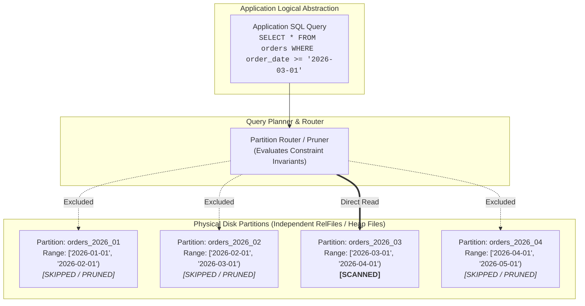
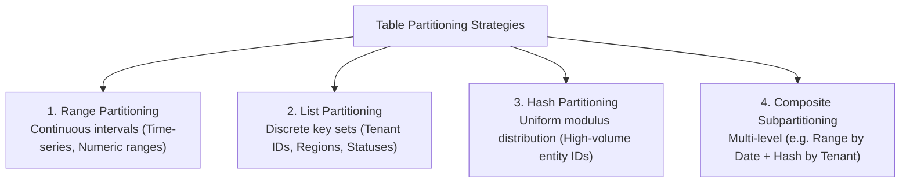
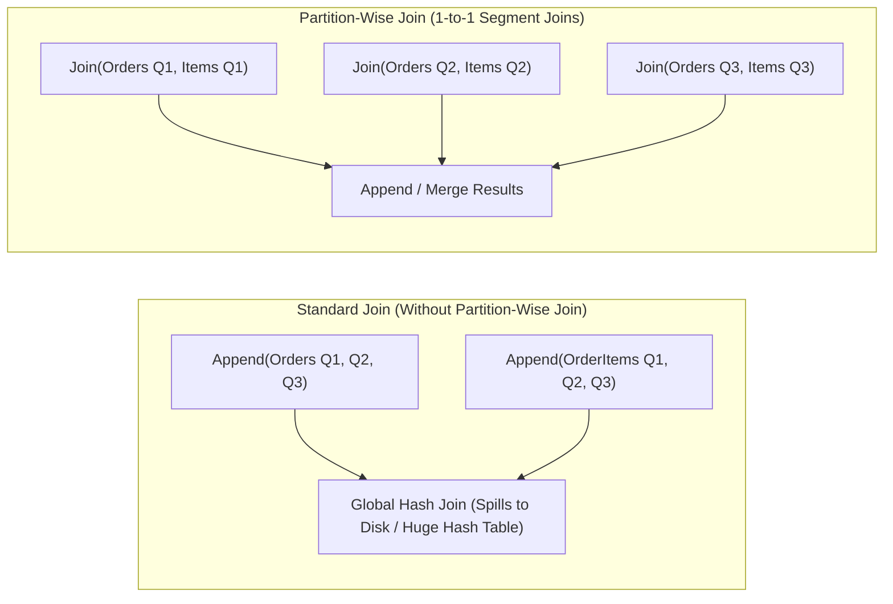
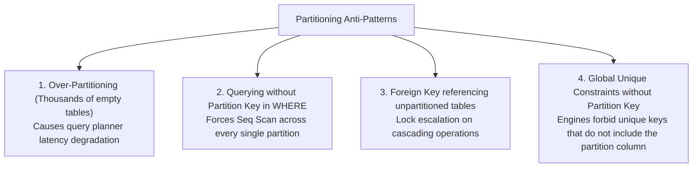

---


title: "SQL Table Partitioning & Partition Pruning: Declarative Range, List, Hash & Subpartitioning"
description: "Master-level engineering guide for Table Partitioning, covering Declarative Range, List, Hash, Composite Subpartitioning, Compile-time vs Run-time Partition Pruning, Partition-Wise Joins, and Zero-Downtime Maintenance."
category: "Databases & SQL"
tags: [sql, table-partitioning, partition-pruning, postgresql, mysql, database-performance, query-optimization, storage-engine, technical-skills, software-engineering, learning-note]
date: "2026-08-29"
---

# SQL Table Partitioning & Partition Pruning Architecture

---

## 1. Executive Summary & Under-the-Hood Mechanics

As relational database tables scale from millions to hundreds of millions or billions of rows (hundreds of gigabytes to terabytes), single monolithic tables exhaust operating system file buffer caches, degrade $B^+$-Tree index search efficiency (index depth increases and working sets exceed RAM), and make index maintenance (`VACUUM`, `REINDEX`, `OPTIMIZE TABLE`) prohibitively slow.

**Table Partitioning** is the physical division of one logical table into distinct, independent sub-tables (partitions) on disk, while presenting a single unified relational abstraction to application queries.



### Key Engineering Benefits

1. **Partition Pruning ($O(1)$ or $O(K)$ Sub-Table Elimination)**: The query planner identifies and excludes irrelevant partitions during query optimization and execution, reducing disk I/O and buffer pool churn by orders of magnitude.
2. **Independent Working Sets in RAM**: Each active partition has its own compact $B^+$-Tree index that fits fully into the database buffer pool cache (`shared_buffers` or `innodb_buffer_pool_size`), avoiding random disk page reads.
3. **Instantaneous Data Lifecycle Operations ($O(1)$ Drop/Detach)**: Purging cold or expired data requires a simple metadata operation (`ALTER TABLE ... DETACH PARTITION` or `DROP TABLE orders_2025_01`) rather than a catastrophic multi-hour `DELETE FROM orders WHERE ...` that triggers massive Write-Ahead Logging (WAL) and table bloat.
4. **Partition-Wise Joins & Aggregations**: Enables matching partitions from two partitioned tables to be joined independently in parallel without scanning global intermediate hash tables.

---

## 2. Partitioning Strategies & Formal Invariants

Relational database engines (such as PostgreSQL 10+ declarative partitioning, MySQL 8+, Oracle) support four primary partitioning topologies:



### Mathematical Invariants by Strategy

| Strategy | Invariant Definition | Primary Use Case | Pruning Efficiency |
| :--- | :--- | :--- | :--- |
| **Range** | Each partition $P_i$ covers half-open interval $[L_i, U_i)$ where $L_i \le x < U_i$, with $\bigcap P_i = \emptyset$. | Audit logs, financial transactions, time-series metrics. | **Maximum** for range filters (`>=`, `<=`, `BETWEEN`). |
| **List** | Each partition $P_i$ is mapped to a discrete set $V_i = \{v_{i,1}, v_{i,2}, \dots\}$, with $V_i \cap V_j = \emptyset$. | Multi-tenant SaaS (`tenant_id`), geography/jurisdiction compliance (`region_code`). | **Maximum** for equality and `IN (...)` predicates. |
| **Hash** | Modulus hash routing: $P_k = \text{hash}(x) \pmod M$, where $M$ is modulus divisor and $k \in [0, M-1]$. | Even write distribution across disks; high-concurrency inserts with no natural time ordering. | **High** for strict equality (`=`); cannot prune inequality/range queries. |
| **Composite** | $P_{i,j} = \text{Range}(Date) \times \text{Hash}(UserID)$ (Multi-dimensional partitioning). | Massive hyper-scale datasets (>100TB) needing time retention + tenant isolation. | **Ultra-granular** dual-axis elimination. |

---

## 3. Production Declarative SQL Implementations

### A. Range Partitioning (Time-Series / Financial Ledger)

```sql
-- 1. Create Parent Partitioned Table
CREATE TABLE financial_transactions (
    transaction_id UUID NOT NULL,
    account_id UUID NOT NULL,
    transaction_date TIMESTAMPTZ NOT NULL,
    amount NUMERIC(18, 4) NOT NULL,
    currency VARCHAR(3) NOT NULL DEFAULT 'USD',
    status VARCHAR(32) NOT NULL,
    metadata JSONB,
    -- PRIMARY KEY MUST include the partition key!
    CONSTRAINT pk_financial_transactions PRIMARY KEY (transaction_date, transaction_id)
) PARTITION BY RANGE (transaction_date);

-- 2. Create Concrete Child Partitions for 2026 Q1 - Q3
CREATE TABLE transactions_2026_q1 PARTITION OF financial_transactions
    FOR VALUES FROM ('2026-01-01 00:00:00+00') TO ('2026-04-01 00:00:00+00');

CREATE TABLE transactions_2026_q2 PARTITION OF financial_transactions
    FOR VALUES FROM ('2026-04-01 00:00:00+00') TO ('2026-07-01 00:00:00+00');

CREATE TABLE transactions_2026_q3 PARTITION OF financial_transactions
    FOR VALUES FROM ('2026-07-01 00:00:00+00') TO ('2026-10-01 00:00:00+00');

-- 3. Default Catch-All Partition (Prevents insert errors if date is out of range)
CREATE TABLE transactions_default PARTITION OF financial_transactions DEFAULT;

-- 4. Local Indexes on Child Partitions are Automatically Propagated
CREATE INDEX idx_trans_account_date 
ON financial_transactions (account_id, transaction_date DESC);
```

### B. List Partitioning (Multi-Tenant Isolation)

```sql
-- Partitioning by tenant territory/region
CREATE TABLE tenant_audit_events (
    event_id BIGINT GENERATED ALWAYS AS IDENTITY,
    tenant_region VARCHAR(16) NOT NULL,
    tenant_id VARCHAR(64) NOT NULL,
    action_name VARCHAR(128) NOT NULL,
    payload JSONB NOT NULL,
    logged_at TIMESTAMPTZ NOT NULL DEFAULT NOW(),
    PRIMARY KEY (tenant_region, event_id)
) PARTITION BY LIST (tenant_region);

-- Dedicated Regional Partitions
CREATE TABLE audit_events_us PARTITION OF tenant_audit_events
    FOR VALUES IN ('US_EAST', 'US_WEST', 'US_CENTRAL');

CREATE TABLE audit_events_eu PARTITION OF tenant_audit_events
    FOR VALUES IN ('EU_WEST', 'EU_CENTRAL', 'EU_NORTH');

CREATE TABLE audit_events_apac PARTITION OF tenant_audit_events
    FOR VALUES IN ('APAC_SINGAPORE', 'APAC_TOKYO', 'APAC_SYDNEY');
```

### C. Hash Partitioning (High-Concurrency Key-Value Store)

```sql
-- 4-Way Hash Partitioned Table on user_id
CREATE TABLE user_session_state (
    user_id UUID NOT NULL,
    session_token VARCHAR(256) NOT NULL,
    last_heartbeat TIMESTAMPTZ NOT NULL,
    session_data JSONB,
    PRIMARY KEY (user_id, session_token)
) PARTITION BY HASH (user_id);

-- Create 4 Modulus Slices
CREATE TABLE user_session_state_p0 PARTITION OF user_session_state
    FOR VALUES WITH (MODULUS 4, REMAINDER 0);

CREATE TABLE user_session_state_p1 PARTITION OF user_session_state
    FOR VALUES WITH (MODULUS 4, REMAINDER 1);

CREATE TABLE user_session_state_p2 PARTITION OF user_session_state
    FOR VALUES WITH (MODULUS 4, REMAINDER 2);

CREATE TABLE user_session_state_p3 PARTITION OF user_session_state
    FOR VALUES WITH (MODULUS 4, REMAINDER 3);
```

### D. Multi-Level Composite Partitioning (Range + Hash)

```sql
-- Level 1: Range Partitioned by Month
CREATE TABLE metrics_hypertable (
    metric_name VARCHAR(64) NOT NULL,
    device_id UUID NOT NULL,
    recorded_at TIMESTAMPTZ NOT NULL,
    metric_value DOUBLE PRECISION NOT NULL,
    PRIMARY KEY (recorded_at, device_id, metric_name)
) PARTITION BY RANGE (recorded_at);

-- Level 2: Subpartition for 2026-08 (Partitioned by HASH on device_id)
CREATE TABLE metrics_2026_08 PARTITION OF metrics_hypertable
    FOR VALUES FROM ('2026-08-01 00:00:00+00') TO ('2026-09-01 00:00:00+00')
    PARTITION BY HASH (device_id);

-- Subpartition Concrete Leaf Nodes
CREATE TABLE metrics_2026_08_h0 PARTITION OF metrics_2026_08
    FOR VALUES WITH (MODULUS 2, REMAINDER 0);

CREATE TABLE metrics_2026_08_h1 PARTITION OF metrics_2026_08
    FOR VALUES WITH (MODULUS 2, REMAINDER 1);
```

---

## 4. Partition Pruning Internals & EXPLAIN ANALYZE

### Pruning Phases: Static vs Dynamic

```mermaid
flowchart TD
    Query["Incoming SQL Query"] --> Parse["Query Parsing & Analysis"]
    Parse --> Plan{"Are predicates constant or parameterized?"}
    
    Plan -->|Constant Predicate:<br/><code>recorded_at >= '2026-08-01'</code>| StaticPrune["<b>Static Pruning (Plan-Time)</b><br/>Planner inspects Partition Constraints;<br/>Unneeded child relation nodes omitted from plan tree."]
    
    Plan -->|Parameterized / Subquery:<br/><code>recorded_at >= $1</code> or <code>NOW() - interval '1 day'</code>| DynamicPrune["<b>Dynamic Pruning (Run-Time / Exec-Time)</b><br/>Plan contains Append/MergeAppend node;<br/>Executor evaluates expression at init/execution step and skips partitions."]
```

### Verifying Partition Pruning via Execution Plans

#### Scenario 1: Plan-Time Static Pruning

```sql
EXPLAIN (ANALYZE, BUFFERS, COSTS OFF)
SELECT * 
FROM financial_transactions
WHERE transaction_date >= '2026-04-15 00:00:00+00' 
  AND transaction_date < '2026-05-01 00:00:00+00'
  AND amount > 10000;
```

**Execution Plan Output:**
```text
Append (actual time=0.042..0.891 rows=142 loops=1)
  Buffers: shared hit=89
  ->  Bitmap Heap Scan on transactions_2026_q2 (actual time=0.041..0.872 rows=142 loops=1)
        Recheck Cond: ((transaction_date >= '2026-04-15 00:00:00+00'::timestamptz) AND (transaction_date < '2026-05-01 00:00:00+00'::timestamptz))
        Filter: (amount > '10000'::numeric)
        Buffers: shared hit=89
        ->  Bitmap Index Scan on transactions_2026_q2_account_date_idx (actual time=0.028..0.028 rows=180 loops=1)
              Index Cond: ((transaction_date >= '2026-04-15 00:00:00+00'::timestamptz) AND (transaction_date < '2026-05-01 00:00:00+00'::timestamptz))
Planning Time: 0.185 ms
Execution Time: 0.945 ms
```
*(Notice that `transactions_2026_q1`, `transactions_2026_q3`, and `transactions_default` are completely absent from the plan tree!)*

#### Scenario 2: Run-Time Dynamic Pruning (Parameterized Prepared Statement)

```sql
PREPARE get_tx_window(timestamptz, timestamptz) AS
SELECT * FROM financial_transactions 
WHERE transaction_date BETWEEN $1 AND $2;

EXPLAIN (ANALYZE, COSTS OFF) 
EXECUTE get_tx_window('2026-07-10 00:00:00+00', '2026-07-20 00:00:00+00');
```

**Execution Plan Output:**
```text
Append (actual time=0.035..0.412 rows=87 loops=1)
  Subplans Removed: 3
  ->  Seq Scan on transactions_2026_q3 (actual time=0.034..0.395 rows=87 loops=1)
        Filter: ((transaction_date >= '2026-07-10 00:00:00+00'::timestamptz) AND (transaction_date <= '2026-07-20 00:00:00+00'::timestamptz))
Planning Time: 0.120 ms
Execution Time: 0.440 ms
```
*(The engine outputs `Subplans Removed: 3`, confirming 3 non-matching partitions were pruned at runtime initialization).*

---

## 5. Partition-Wise Operations: Joins & Aggregations

PostgreSQL offers two query planner switches that transform distributed queries over identically partitioned tables into parallel intra-partition operations:

```sql
-- Enable Advanced Partition-Wise Query Features
SET enable_partitionwise_join = ON;
SET enable_partitionwise_aggregate = ON;
```



---

## 6. Zero-Downtime Partition Maintenance & Automation

### Concurrent Attach & Detach Pattern

When attaching or detaching partitions on active high-throughput tables, standard `ALTER TABLE ... ATTACH PARTITION` requires an `ACCESS EXCLUSIVE` lock to validate existing data against the partition constraint.

#### Zero-Downtime Safe Attach Protocol:
```sql
-- Step 1: Create standalone table
CREATE TABLE transactions_2026_q4 (LIKE financial_transactions INCLUDING ALL);

-- Step 2: Add CHECK constraint as NOT VALID (Takes minimal lock, zero scan time)
ALTER TABLE transactions_2026_q4 
ADD CONSTRAINT check_q4_bounds 
CHECK (transaction_date >= '2026-10-01 00:00:00+00' AND transaction_date < '2027-01-01 00:00:00+00') NOT VALID;

-- Step 3: Validate constraint concurrently (Does NOT block incoming reads/writes)
ALTER TABLE transactions_2026_q4 VALIDATE CONSTRAINT check_q4_bounds;

-- Step 4: Attach partition (PostgreSQL recognizes the pre-validated constraint and skips full-table lock validation)
ALTER TABLE financial_transactions 
ATTACH PARTITION transactions_2026_q4 
FOR VALUES FROM ('2026-10-01 00:00:00+00') TO ('2027-01-01 00:00:00+00');
```

#### Zero-Downtime Detach Protocol (PostgreSQL 14+ CONCURRENTLY):
```sql
-- Detach old historical partition without blocking reader queries
ALTER TABLE financial_transactions 
DETACH PARTITION transactions_2026_q1 CONCURRENTLY;

-- Now archive or drop the standalone table without impacting parent table traffic
DROP TABLE transactions_2026_q1;
```

---

## 7. Automated Partition Lifecycle with `pg_partman`

In enterprise production environments, manual partition management is replaced by extensions like `pg_partman`:

```sql
-- Install and configure pg_partman
CREATE EXTENSION IF NOT EXISTS pg_partman SCHEMA partman;

-- Automate daily range partitioning for audit_logs
SELECT partman.create_parent(
    p_parent_table => 'public.financial_transactions',
    p_control => 'transaction_date',
    p_type => 'native',
    p_interval => 'daily',
    p_premake => 7 -- Keep 7 future partitions pre-created
);

-- Configure retention policy (Auto-drop partitions older than 90 days)
UPDATE partman.part_config 
SET retention = '90 days', 
    retention_keep_table = false 
WHERE parent_table = 'public.financial_transactions';

-- Maintenance worker trigger (run hourly via pg_cron or background worker)
SELECT partman.run_maintenance_proc();
```

---

## 8. Anti-Patterns & Engineering Traps



| Anti-Pattern | Root Cause | Engineering Solution |
| :--- | :--- | :--- |
| **Over-Partitioning** (> 5,000 partitions) | Creating hourly partitions for years of data causes planner memory explosion. | Coalesce older partitions into monthly/yearly partitions; aim for < 500 active partitions. |
| **Missing Partition Key in Query** | Querying `SELECT * FROM orders WHERE customer_id = '...'` without `order_date`. | Include partition key in query predicates, or use Composite / Hash partitioning. |
| **Monolithic DELETE Bloat** | Running `DELETE FROM table WHERE date < NOW() - interval '1 year'` on non-partitioned tables. | Migrate to Range Partitioning and issue instant metadata `DETACH` / `DROP`. |
| **Imbalanced Hash Partitions** | Hash key has low cardinality (e.g. status flag with 3 values across 16 hash buckets). | Use high-entropy keys (`UUID`, `account_id`, `device_id`) for hash partitioning. |

---

## 9. Related Graph Nodes & Further Reading

- 🔙 [[node_12_Databases_and_SQL|📁 Databases & SQL Hub]]
- 🔗 [[database_sharding_patterns_and_distributed_routing|Database Sharding Patterns & Distributed Routing]]
- 🔗 [[sql_query_optimization_and_execution_plans|SQL Query Optimization, Indexing & Execution Plans]]
- 🔗 [[btree_bplus_tree_page_layout_node_splitting|B+Tree Index Page Layout & Node Splitting]]
- 🔗 [[transactions_concurrency|Database Transactions, Concurrency & MVCC]]
