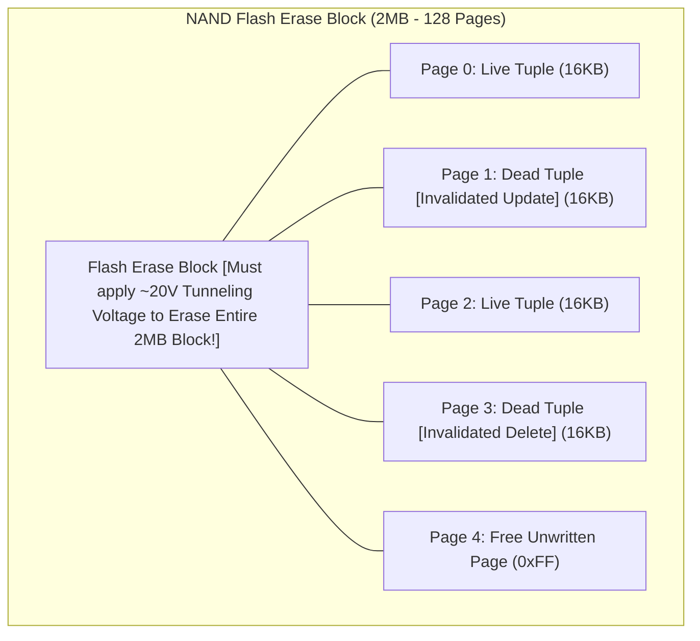
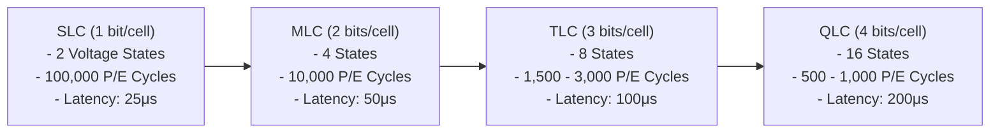
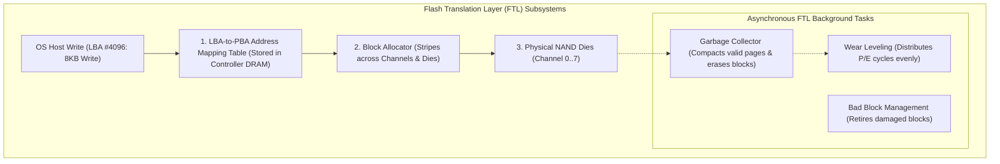
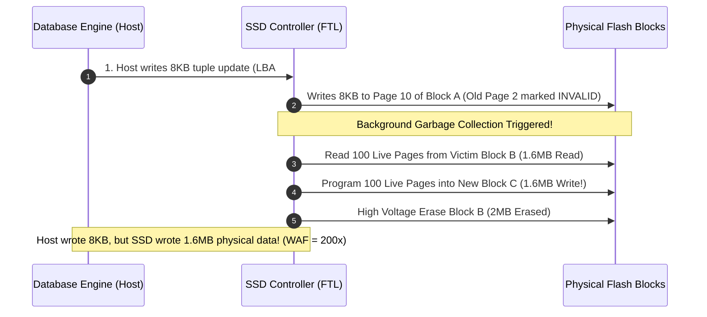
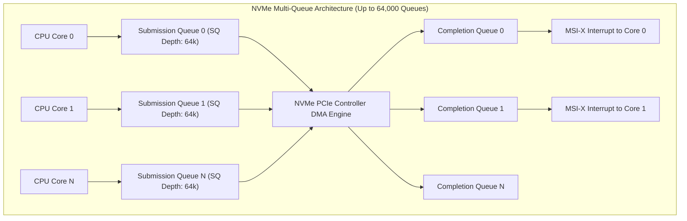

---


title: "SSD, NVMe & Flash Storage Architecture: FTL, Trim & Write Amplification"
description: "Master-level systems engineering guide for SSD and NVMe storage engines, Flash Translation Layer (FTL) address mapping, NAND flash physics, Garbage Collection, and Write Amplification Factor (WAF) mathematical modeling."
category: "Databases & SQL"
tags: [nvme, ssd, flash-storage, ftl, write-amplification, database-storage, hardware, storage-engine, io-uring, rocksdb, technical-skills, software-engineering, learning-note]
date: "2026-08-21"
---

# SSD, NVMe & Flash Storage: FTL & Write Amplification Deep Dive

---

## 1. Executive Summary & Solid-State Storage Physics

High-throughput enterprise databases (PostgreSQL, MySQL InnoDB, RocksDB, Aerospike, ClickHouse) rely on **Solid-State Drives (SSDs)** utilizing the **NVMe (Non-Volatile Memory Express)** protocol over high-bandwidth PCIe bus lanes.

Unlike legacy rotating magnetic hard disk drives (HDDs) that allow direct in-place overwriting of 512-byte sectors, NAND Flash memory is governed by a fundamental physical asymmetry: **Erase-Before-Write**.
1. **Reads & Program (Write) Operations**: Occur at the granular **Page Level** (typically $4\text{KB}, 8\text{KB}, \text{ or } 16\text{KB}$).
2. **Erase Operations**: Can only occur at the coarse **Block Level** (typically $2\text{MB} - 8\text{MB}$, encompassing \$128 - 512\text{ pages}$).
3. **Out-of-Place Updates**: Overwriting an existing Logical Block Address (LBA) requires marking the old physical page invalid (dead), writing the updated tuple to a new free page, and relying on asynchronous **Garbage Collection (GC)** to reclaim the block.



---

## 2. NAND Cell Physics: SLC, MLC, TLC, QLC & PLC

NAND flash stores data as trapped electrons inside floating gate or Charge Trap Transistors (CTF). The number of voltage thresholds per cell dictates capacity and write endurance:



| NAND Flash Type | Bits / Cell | Program/Erase (P/E) Endurance Cycles | Read Latency | Write Latency | Optimal Database Workload |
| :--- | :--- | :--- | :--- | :--- | :--- |
| **SLC (Single-Level Cell)** | 1 | $\sim 100,000$ | $25\ \mu\text{s}$ | $200\ \mu\text{s}$ | Hardware write buffers, military, enterprise cache tier. |
| **TLC (Triple-Level Cell)** | 3 | \$1,500 - 3,000$ | \$50 - 100\ \mu\text{s}$ | \$600 - 900\ \mu\text{s}$ | **Primary OLTP Databases (PostgreSQL, MySQL, Redis)**. |
| **QLC (Quad-Level Cell)** | 4 | \$500 - 1,000$ | \$100 - 200\ \mu\text{s}$ | \$2,000\ \mu\text{s}$ | Read-heavy data warehouses, object storage, cold analytics. |

---

## 3. Flash Translation Layer (FTL) Internals

The **Flash Translation Layer (FTL)** is embedded firmware running on the SSD controller's multi-core ARM/RISC-V processor that presents a standard linear block device (LBA $0$ to $N$) to the operating system kernel:



### 3.1 Page-Level Mapping vs Demand-Based Page Mapping (DFTL)
- **Page-Level Mapping**: Maps every 4KB logical page to a physical block and page. Requires $1\text{GB}$ of onboard SSD DRAM per $1\text{TB}$ of storage capacity ($4\text{ bytes per 4KB mapping entry}$).
- **Host Memory Buffer (HMB)**: DRAM-less NVMe drives allocate a slice of host system RAM over PCIe DMA to cache active LBA mapping tables.

---

## 4. Write Amplification Factor (WAF) Mathematical Modeling

**Write Amplification Factor (WAF)** is the fundamental metric measuring how many physical bytes are written to NAND flash for every byte submitted by the host database application:

$$\text{WAF} = \frac{\text{Bytes Written to Physical NAND Flash}}{\text{Bytes Written by Host Application}} = 1 + \frac{\text{Bytes Written during Internal GC Re-writes}}{\text{Bytes Written by Host}}$$



### 4.1 Mathematical Impact of Over-Provisioning ($OP$)
With uniform random write distributions, WAF is modeled asymptotically as a function of drive **Over-Provisioning ($OP$)**:

$$\text{WAF}_{\text{uniform}} \approx \frac{1}{2 \times OP} + \frac{1}{2} \quad \text{where} \quad OP = \frac{\text{Physical Capacity} - \text{User Capacity}}{\text{User Capacity}}$$

For an enterprise drive with $28\%$ Over-Provisioning:
$$\text{WAF} \approx \frac{1}{2 \times 0.28} + 0.5 \approx 1.78 + 0.5 = 2.28$$
Without over-provisioning ($OP \to 0$), random writes cause WAF to explode beyond \$10.0$, collapsing SSD IOPS and causing catastrophic P99 write latency stalls!

---

## 5. NVMe Protocol Architecture: Queues, Doorbells & Interrupts

Unlike legacy SATA AHCI (which supported only a single command queue with a depth of 32 commands), NVMe is architected specifically for multi-core parallelism:



---

## 6. Database Storage Engine Optimizations for Flash

| Database Architecture | Storage Engine Pattern | Flash Interaction & WAF Profile |
| :--- | :--- | :--- |
| **In-Place B+Tree** (PostgreSQL Heap, MySQL InnoDB) | Modifies 8KB/16KB pages in shared buffers, flushes dirty pages randomly. | **High WAF (\$3.0 - 8.0$)**. Requires Doublewrite Buffers / Full Page Writes (FPW) to prevent torn pages. |
| **LSM-Tree** (RocksDB, LevelDB, Cassandra) | Sequential append-only MemTable flushes to immutable SSTables. | **Low Write WAF (\$1.2 - 2.5$)**, but introduces Read Amplification (Bloom filters required). |
| **Append-Only Columnar** (ClickHouse, Parquet) | Batched immutable compressed columnar chunk writes. | **Optimal WAF ($\approx 1.0$)**. High sequential flash bandwidth utilization. |

---

## 7. Linux Kernel & NVMe Drive Hardening Runbook

```bash
# 1. Verify NVMe Health, Endurance (TBW) and Wear via nvme-cli
nvme smart-log /dev/nvme0n1

# Key Metrics to Monitor:
# - percentage_used: Current wear status (0% to 100% rated endurance)
# - data_units_written: Total TB written to device
# - media_errors: Uncorrectable NAND flash errors

# 2. Set Linux I/O Scheduler to 'none' (Bypasses OS CPU queuing overhead for NVMe)
echo none > /sys/block/nvme0n1/queue/scheduler

# 3. Configure Continuous TRIM Discard in /etc/fstab
# Enables asynchronous filesystem notification when database rows are dropped
/dev/nvme0n1p1  /var/lib/postgresql/data  ext4  noatime,nodiratime,discard,errors=remount-ro  0  2

# 4. Tune Linux Kernel Read-Ahead for Fast Random OLTP
echo 64 > /sys/block/nvme0n1/queue/read_ahead_kb
```

---

## 8. Operational Failure Modes & Troubleshooting

| Incident | Root Cause | Production Remediation |
| :--- | :--- | :--- |
| **P99 Write Latency Spikes ($> 100\text{ ms}$)** | FTL Garbage Collection backlog; SSD running out of free erased blocks during heavy writes. | Increase drive Over-Provisioning ($20\%+$), enable OS `TRIM`, or migrate to LSM storage. |
| **Torn Page Corruption on Power Outage** | 8KB database page was half-written to flash when power failed. | Enable PostgreSQL `full_page_writes = on` or MySQL `innodb_doublewrite = 1`. |
| **SSD Drive Read-Only Lockup** | NAND cells exceeded maximum rated P/E write cycles ($100\%$ endurance consumed). | Monitor `smart-log` wear indicators and proactively replace drives at $80\%$ wear rating. |

---

## 🔗 Graph-Linked Knowledge Base
- ⚓ Buffer Pool Management: [[buffer_pool_manager_clock_sweep_lru_k_eviction|Buffer Pool Manager & Page Eviction]]
- ⚓ WAL Architecture: [[write_ahead_logging_wal_architecture|WAL Architecture & fsync Durability]]
- 🔗 LSM Engines: [[lsm_tree_leveldb_rocksdb_compaction_strategies|LSM-Tree & RocksDB Compaction]]
