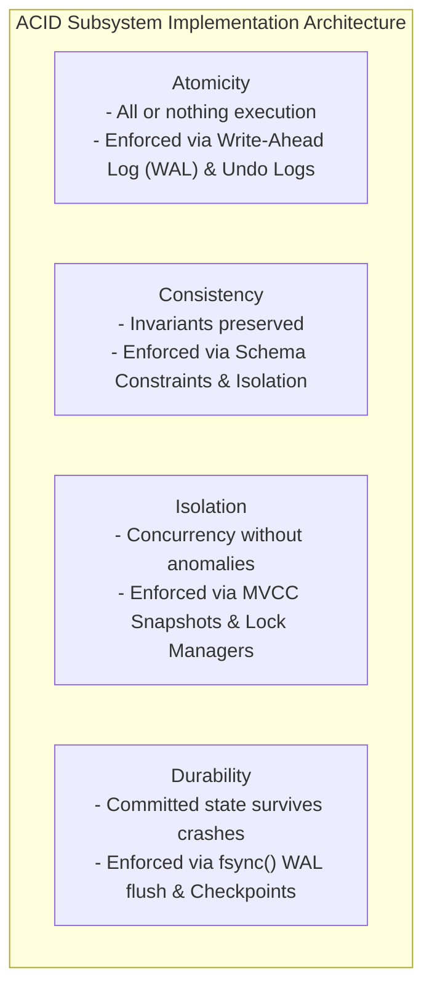
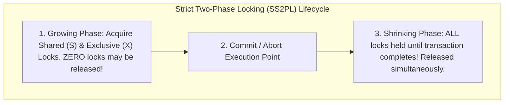
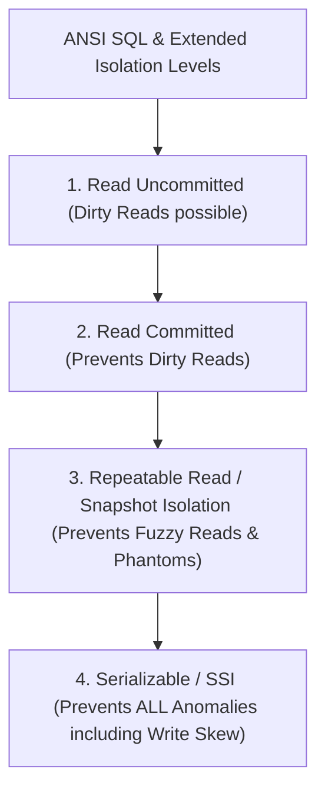
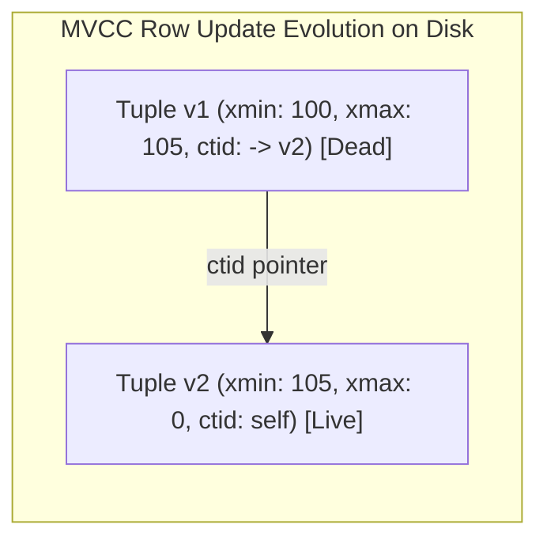
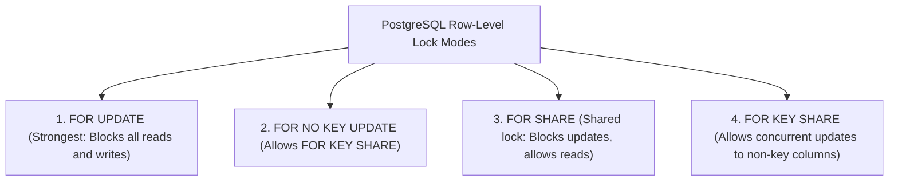

---


title: "Database Transactions & Concurrency: ACID, Isolation Levels & 2PL"
description: "Master-level engineering guide for Database Transactions, ACID guarantees, Two-Phase Locking (2PL), Multi-Version Concurrency Control (MVCC), Tuple Header mechanics, and Serializable Snapshot Isolation (SSI)."
category: "Databases & SQL"
tags: [transactions, acid, concurrency, 2pl, mvcc, serializability, ssi, write-skew, postgresql, database-internals, technical-skills, software-engineering, learning-note]
date: "2026-08-21"
---

# Database Transactions & Concurrency: ACID & Isolation Levels

---

## 1. Executive Summary & The ACID Foundations

In database systems engineering, a **Transaction** is a logical sequence of operations executed as a single atomic unit of work. Relational databases maintain data correctness in high-concurrency environments and amidst unexpected node crashes by guaranteeing the **ACID Properties**:



---

## 2. Lock-Based Concurrency: Two-Phase Locking (2PL) Protocols

Traditional relational databases enforce serializability through **Two-Phase Locking (2PL)**:



### 2.1 2PL Hierarchy Matrix

| Protocol Variant | Lock Release Rule | Cascading Abort Risk | Production Usage |
| :--- | :--- | :--- | :--- |
| **Basic 2PL** | Locks may be released during shrinking phase before commit. | **High** (If $T_1$ aborts after releasing lock, reading transactions must abort). | Historical / Theoretical. |
| **Strict 2PL (S2PL)** | **Exclusive (X) locks** held until `COMMIT`/`ROLLBACK`. | **Zero** | Enterprise Locking Engines. |
| **Rigorous 2PL (SS2PL)** | **Both Shared (S) and Exclusive (X) locks** held until end of transaction. | **Zero** | Guarantees strict serializability without phantom dependencies. |

---

## 3. Concurrency Anomalies & ANSI SQL Isolation Hierarchy

When concurrent transactions execute without strict serializability, subtle data anomalies emerge:



### 3.1 Concurrency Anomaly Matrix & Mathematical Definitions

| Anomaly Name | Anomaly Formulation | Prevented in Read Committed | Prevented in Repeatable Read | Prevented in Serializable |
| :--- | :--- | :--- | :--- | :--- |
| **Dirty Read ($G_1$)** | $w_1(x) \dots r_2(x) \dots (a_1 \text{ and } c_2)$ | **YES** | **YES** | **YES** |
| **Non-Repeatable / Fuzzy Read ($G_{2a}$)** | $r_1(x) \dots w_2(x) \dots c_2 \dots r_1(x) \dots c_1$ | NO | **YES** | **YES** |
| **Phantom Read ($A3$)** | $r_1(P) \dots w_2(y \in P) \dots c_2 \dots r_1(P) \dots c_1$ | NO | **YES** (in PostgreSQL MVCC) | **YES** |
| **Lost Update ($P4$)** | $r_1(x) \dots r_2(x) \dots w_1(x) \dots c_1 \dots w_2(x) \dots c_2$ | NO | **YES** | **YES** |
| **Write Skew ($A5B$)** | $r_1(P_1) \land r_1(P_2) \dots w_1(P_1) \dots w_2(P_2) \dots c_1 \land c_2$ | NO | NO | **YES** |

---

## 4. Multi-Version Concurrency Control (MVCC) Internals

PostgreSQL avoids read-write lock contention by implementing **Multi-Version Concurrency Control (MVCC)**:

> [!IMPORTANT]
> **The Golden Rule of MVCC**:
> **Readers never block writers, and writers never block readers.**

### 4.1 Tuple Header Memory Layout (`HeapTupleHeaderData`)
Every row on an 8KB disk page contains a 23-byte metadata header tracking transaction visibility:

```c
struct HeapTupleHeaderData {
    TransactionId xmin;       // Transaction ID that INSERTED this tuple
    TransactionId xmax;       // Transaction ID that DELETED or UPDATED this tuple (0 if active)
    ItemPointerData t_ctid;   // Physical disk pointer to newest tuple version (for HOT updates)
    uint16 t_infomask;        // Status bitflags: HEAP_XMIN_COMMITTED, HEAP_XMAX_INVALID...
};
```



### 4.2 Snapshot Visibility Formula
A snapshot in PostgreSQL is represented as:

$$\text{Snapshot} = [\text{xmin} : \text{xmax} : \text{xip\_list}]$$

Where:
- $\text{xmin}$: All transactions with $\text{XID} < \text{xmin}$ are committed and visible.
- $\text{xmax}$: All transactions with $\text{XID} \ge \text{xmax}$ are uncommitted and invisible.
- $\text{xip\_list}$: Active in-progress transactions between $\text{xmin}$ and $\text{xmax}$ at snapshot creation time (invisible).

---

## 5. Explicit Locking Primitives & Pessimistic Row Locking

When application workflows require strong mutual exclusion over specific rows (e.g. inventory reservation), developers use explicit row-level locking clauses:



### 5.1 Production Inventory Decrement with `FOR UPDATE SKIP LOCKED`
```sql
BEGIN;

-- Lock and fetch exactly 1 available ticket without blocking concurrent threads
SELECT id, seat_number, price
FROM concert_seats
WHERE event_id = 'e100' AND status = 'AVAILABLE'
ORDER BY seat_number ASC
LIMIT 1
FOR UPDATE SKIP LOCKED;

-- Mark seat reserved
UPDATE concert_seats 
SET status = 'RESERVED', reserved_by = 'user_99', reserved_at = NOW()
WHERE id = 'seat_42';

COMMIT;
```

---

## 6. Serializable Snapshot Isolation (SSI) & SIREAD Locks

PostgreSQL implements **Serializable Snapshot Isolation (SSI)**, achieving full serializability without heavy read locks. SSI tracks **rw-antidependencies (si-locks)** to detect dangerous execution cycles at runtime:

```mermaid
flowchart LR
    T1["Transaction 1 (On-Call Doctor A)"] -->|rw-antidependency| T2["Transaction 2 (On-Call Doctor B)"]
    T2 -->|rw-antidependency| T1
    
    Note over T1,T2: Cycle Detected (Dangerous Structure)! PostgreSQL aborts T2 with 40001 serialization_failure!
```

### 6.1 Application-Level Serialization Retry Loop (C#)
```csharp
public async Task ExecuteSerializableTransactionAsync(Func<NpgsqlConnection, NpgsqlTransaction, Task> operation)
{
    const int maxRetries = 5;
    for (int attempt = 1; attempt <= maxRetries; attempt++)
    {
        await using var conn = new NpgsqlConnection(_connectionString);
        await conn.OpenAsync();
        await using var tx = await conn.BeginTransactionAsync(IsolationLevel.Serializable);

        try
        {
            await operation(conn, tx);
            await tx.CommitAsync();
            return; // Success
        }
        catch (PostgresException ex) when (ex.SqlState == PostgresErrorCodes.SerializationFailure)
        {
            await tx.RollbackAsync();
            if (attempt == maxRetries) throw;
            
            // Exponential backoff with jitter before retry
            int backoffMs = Random.Shared.Next(10, 50 * (int)Math.Pow(2, attempt));
            await Task.Delay(backoffMs);
        }
    }
}
```

---

## 7. Operational Troubleshooting & Deadlock Mitigation

| Incident | Root Cause | Production Remediation |
| :--- | :--- | :--- |
| **`40P01 deadlock_detected`** | Concurrent transactions acquire locks on the same rows in reverse order. | Enforce deterministic primary key sort order before row locking (e.g. `ORDER BY id`). |
| **`40001 serialization_failure`** | Concurrent updates under Serializable isolation triggered a read-write dependency cycle. | Catch SQLSTATE `40001` in application code and execute an automated exponential retry loop. |
| **Transaction ID Wraparound Freeze** | Oldest un-vacuumed transaction ID reached \$2 \times 10^9$ transactions, forcing database read-only freeze. | Tune autovacuum aggressive cost limits (`autovacuum_freeze_max_age = 1000000000`). |

---

## 🔗 Graph-Linked Knowledge Base
- ⚓ Race Conditions: [[demo_race_condition|SQL Race Conditions & Locking Solutions]]
- ⚓ WAL Architecture: [[write_ahead_logging_wal_architecture|WAL Architecture & Durability]]
- 🔗 PostgreSQL MVCC: [[02_Technical_Skills/01_theory_and_concepts/03_Backend_Database_and_ORM/sql_fundamentals_and_postgresql|PostgreSQL MVCC & Isolation]]
