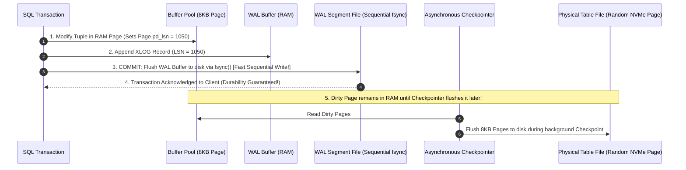
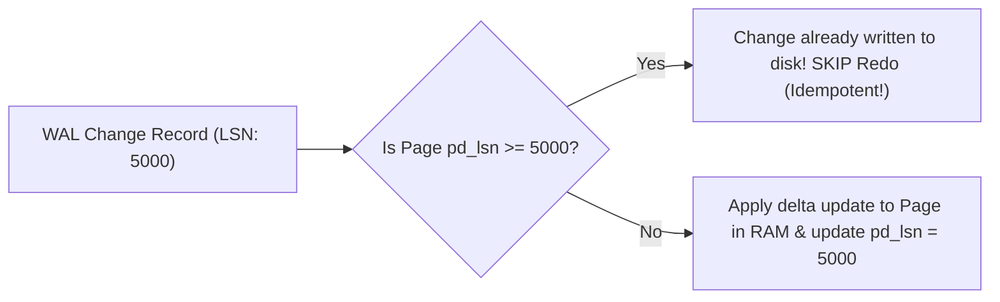
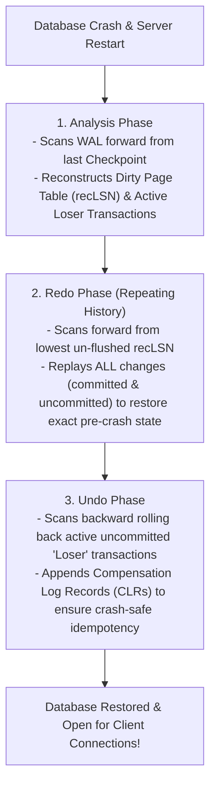
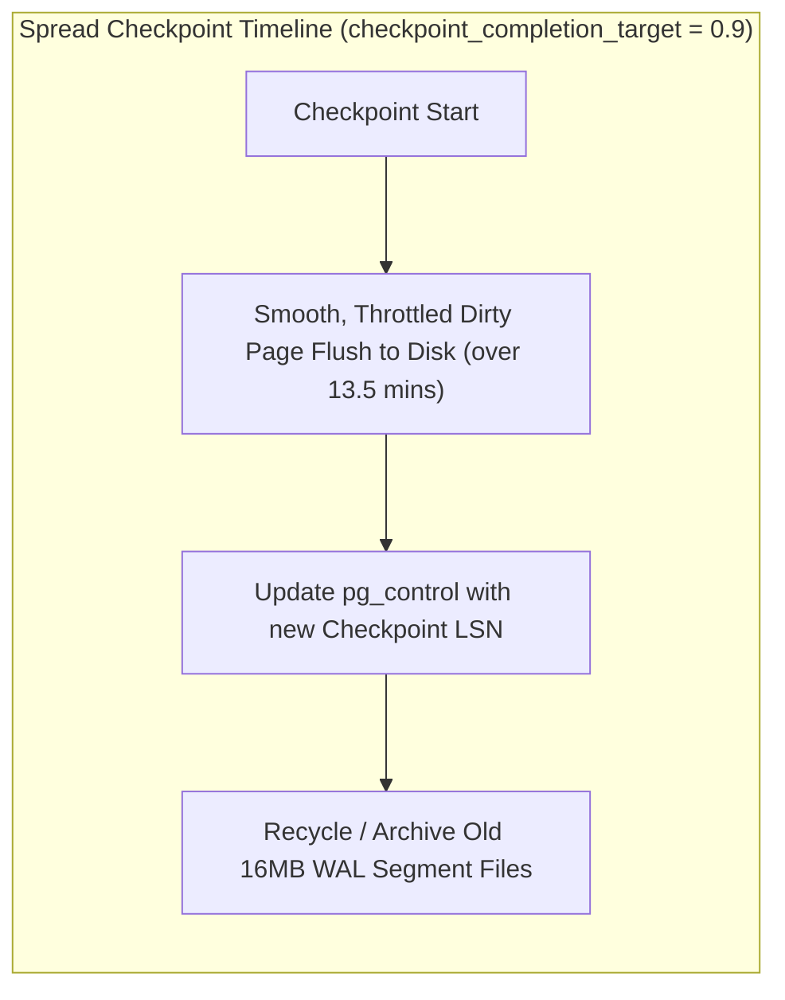
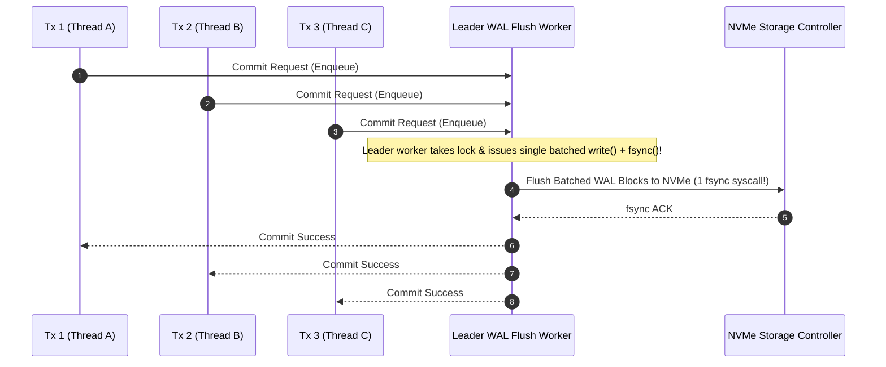

---


title: "Write-Ahead Logging (WAL) Architecture: ARIES Recovery & fsync Durability"
description: "Master-level engineering guide for Write-Ahead Logging (WAL), ARIES crash recovery algorithm (Analysis, Redo, Undo), Log Sequence Numbers (LSN), Checkpointing mechanics, and Full Page Writes (FPW)."
category: "Databases & SQL"
tags: [database-internals, wal, write-ahead-logging, aries-recovery, lsn, durability, fsync, checkpoints, postgresql, technical-skills, software-engineering, learning-note]
date: "2026-08-21"
---

# Write-Ahead Logging (WAL) Architecture & ARIES Recovery

---

## 1. Executive Summary & The WAL Durability Invariant

In high-throughput relational and distributed database engines, flushing modified 8KB data pages to random disk locations on every SQL `COMMIT` would collapse write performance to $< 200\text{ writes/sec}$ due to random I/O seek overhead.

To achieve ACID Durability while sustaining tens of thousands of transactions per second, databases enforce the **Write-Ahead Logging (WAL)** protocol:

> [!IMPORTANT]
> **The Fundamental WAL Invariant**:
> **Log records describing a page change MUST be flushed to persistent storage (`fsync`) BEFORE the dirty page itself can be written to disk.**

$$\text{LSN}_{\text{Page}} \le \text{LSN}_{\text{Flushed\_WAL}}$$



---

## 2. Log Sequence Numbers (LSN) & Disk Page Header Alignment

In PostgreSQL, every WAL record is tagged with a monotonically increasing 64-bit integer called a **Log Sequence Number (LSN)**, representing the exact byte offset of the record in the continuous WAL stream:

$$\text{LSN Format: } \text{Segment Number} / \text{Byte Offset} \quad (\text{e.g. } \texttt{16/B374D888})$$

Every 8KB database disk page header contains a 64-bit field called **`pd_lsn`**:

```c
typedef struct PageHeaderData {
    PageXLogRecPtr pd_lsn;      // LSN of latest WAL record modifying this page
    uint16         pd_checksum; // 16-bit CRC checksum
    uint16         pd_flags;    // Flag bits
    LocationIndex  pd_lower;    // Offset to start of free space
    LocationIndex  pd_upper;    // Offset to end of free space
    LocationIndex  pd_special;  // Offset to start of special space
    ItemPointerData pd_prune_xid;
} PageHeaderData;
```



---

## 3. The ARIES Recovery Algorithm (Mohan et al.)

When a database experiences a crash or sudden power loss, it executes the **ARIES (Algorithms for Recovery and Isolation Exploiting Semantics)** crash recovery protocol upon restart:



### 3.1 The Three ARIES Phases Deep Dive
1. **Analysis Phase**:
   - Reads the latest checkpoint record from `global/pg_control`.
   - Scans forward through WAL to identify all dirty pages in memory at the time of the crash and all active in-flight transactions (the **Losers Set**).
2. **Redo Phase ("Repeating History")**:
   - Locates the minimum `recLSN` across all dirty pages in the Dirty Page Table.
   - Replays every single physical/logical operation forward, re-establishing the exact state of the buffer pool immediately preceding the crash.
3. **Undo Phase**:
   - Traverses WAL backward from the end of the log.
   - Rolls back every operation belonging to uncommitted "Loser" transactions.
   - For every undone action, writes a **Compensation Log Record (CLR)** so that if the system crashes again *during* recovery, the undo step will not be repeated.

---

## 4. Checkpoint Mechanics & Full Page Writes (FPW)

A **Checkpoint** is an internal synchronization barrier where all dirty shared buffers in memory are flushed to persistent table storage:



### 4.1 Full Page Writes (FPW) & Torn Page Protection
Operating systems write in 4KB blocks, whereas database pages are 8KB. If the server loses power midway through writing an 8KB page, the page becomes corrupted (**Torn Page**).

To prevent unrecoverable corruption, PostgreSQL enforces **Full Page Writes (`full_page_writes = on`)**:
- The **very first time** a page is modified after a checkpoint, the **entire 8KB page image** is written into the WAL stream.
- Subsequent modifications to that page only log small differential delta records until the next checkpoint occurs.

---

## 5. Group Commit & `fsync` Performance Optimization

Issuing a synchronous `fsync()` syscall on every single transaction serializes disk writes. **Group Commit** batches concurrent committing transactions into a single physical disk flush:



---

## 6. WAL Production Sizing & S3 Continuous Archiving

```ini
# postgresql.conf WAL Production Configuration (Tuned for High Write Throughput)
wal_level = replica
wal_buffers = 64MB                     # Size of shared memory ring buffer for WAL
max_wal_size = 32GB                    # Target maximum disk size before forcing checkpoint
min_wal_size = 4GB                     # Minimum disk allocation for WAL recycling
checkpoint_timeout = 15min             # Maximum time between checkpoints
checkpoint_completion_target = 0.9     # Spread checkpoint I/O over 90% of checkpoint interval
full_page_writes = on                  # CRITICAL: Protects against torn page corruption

# Group Commit Tuning
synchronous_commit = on
commit_delay = 20                      # Microseconds to delay commit to batch siblings
commit_siblings = 5                    # Minimum active concurrent transactions to trigger delay

# Continuous Archiving
archive_mode = on
archive_command = 'pgbackrest --stanza=prod-db archive-push %p'
archive_timeout = 300                  # Forces a WAL switch every 5 mins even if low traffic
```

---

## 7. Real-Time WAL Diagnostics & Operational Queries

```sql
-- 1. Check current WAL Write & Flush LSN position
SELECT 
    pg_current_wal_lsn() AS current_lsn,
    pg_walfile_name(pg_current_wal_lsn()) AS current_wal_file;

-- 2. Measure WAL Generation Rate in Bytes
SELECT 
    pg_size_pretty(pg_wal_lsn_diff(pg_current_wal_lsn(), '0/1000000'::pg_lsn)) AS total_wal_bytes_generated;

-- 3. Monitor Checkpoint Frequency & Buffer Flush Statistics
SELECT 
    checkpoints_timed,
    checkpoints_req,
    checkpoint_write_time,
    checkpoint_sync_time,
    buffers_checkpoint,
    buffers_clean,
    buffers_backend
FROM pg_stat_bgwriter;
```

---

## 8. Operational Failure Modes & Recovery Runbook

| Incident | Root Cause | Engineering Solution |
| :--- | :--- | :--- |
| **`PANIC: could not locate a valid checkpoint record`** | Disk corruption destroyed `pg_control` or the latest WAL checkpoint segment. | Attempt emergency salvage with `pg_resetwal` (May cause data loss; restore from PITR backup if possible). |
| **Checkpoint I/O Storm Spikes** | `checkpoint_completion_target` set too low (e.g. default 0.5), causing disk writes to spike. | Set `checkpoint_completion_target = 0.9` to smooth I/O evenly over the duration. |
| **`pg_wal` Disk Exhaustion** | Failed `archive_command` or orphaned replication slot preventing WAL recycling. | Fix archive script destination, or drop disconnected replication slots via `pg_drop_replication_slot()`. |

---

## 🔗 Graph-Linked Knowledge Base
- ⚓ Buffer Pool Management: [[buffer_pool_manager_clock_sweep_lru_k_eviction|Buffer Pool Management & Clock Sweep]]
- ⚓ Flash Storage: [[ssd_nvme_flash_ftl_write_amplification|SSD, NVMe & Write Amplification]]
- 🔗 Concurrency: [[transactions_concurrency|Transactions, Isolation & Concurrency Control]]
