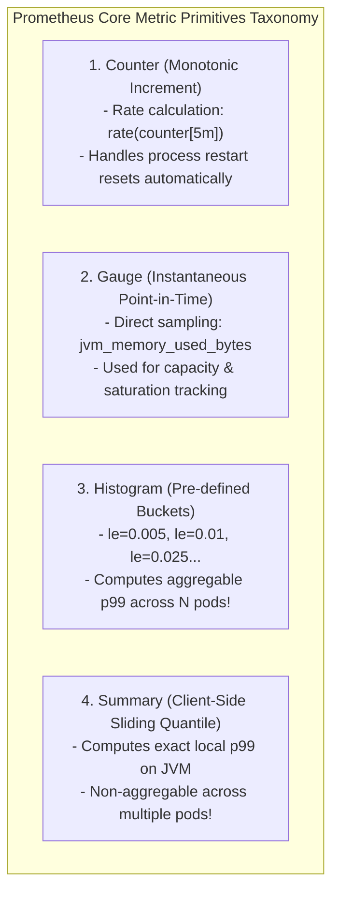
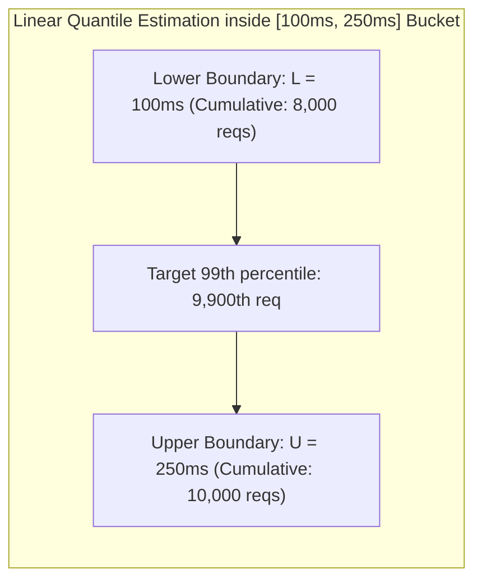

---


title: "Application Metrics Architecture: Counter, Gauge, Histogram & Summary"
description: "Master-level engineering guide for Application Metrics in distributed systems, covering Prometheus metric types (Counter, Gauge, Histogram, Summary), HDRHistograms, p99 latency calculation, and Micrometer / OpenTelemetry instrumentation."
category: "Backend Monitoring & Metrics"
tags: [metrics, prometheus, micrometer, histogram, opentelemetry, observability, p99-latency, sre, technical-skills, software-engineering, learning-note]
date: "2026-08-21"
---

# Application Metrics Architecture: Counters, Gauges, Histograms & p99 Latency

---

## 1. Executive Summary & Under-the-Hood Mechanics

In cloud-native production systems, **Metrics** provide numeric, time-series telemetry representing the operational health, performance, saturation, and error rates of software applications. Unlike logging (which provides high-cardinality discrete event details), metrics provide low-overhead aggregations sampled at regular intervals ($10\text{s} - 60\text{s}$), enabling real-time alerting, autoscaling (HPA), and Service Level Objective (SLO) tracking.

The **Prometheus / OpenTelemetry Metric Data Model** defines four fundamental metric primitives:
1. **Counter**: A monotonically increasing cumulative value representing counts of discrete events (e.g. `http_requests_total`, `db_deadlocks_total`). Can only increase or reset to $0$ on process restart.
2. **Gauge**: A variable instantaneous value that can arbitrarily increase, decrease, or fluctuate (e.g. `jvm_memory_used_bytes`, `cpu_usage_percentage`, `active_db_connections`).
3. **Histogram**: Client-side bucketed distribution sampling data over configurable bucket boundaries (e.g. request durations, payload sizes), enabling server-side calculation of arbitrary quantiles ($p50, p95, p99$) via `histogram_quantile()`.
4. **Summary**: Client-side streaming quantile calculator (e.g. streaming $\phi$-quantiles using the CKMS algorithm) calculating sliding-window percentiles without server-side aggregation.



---

## 2. Mathematical Mechanics: Histogram vs Summary & Quantile Estimation

### 2.1 The Multi-Pod Quantile Aggregation Invariant
A critical mathematical axiom in distributed systems engineering: **Percentiles cannot be averaged across nodes!**

$$\text{Average}(p99_{\text{Pod 1}}, p99_{\text{Pod 2}}, p99_{\text{Pod 3}}) \neq \text{Global } p99 \text{ Latency!}$$

- **Summary Flaw**: Summaries compute exact quantiles on each individual pod. If you have 50 pods, you cannot mathematically combine 50 local $p99$ summary values to calculate the overall system $p99$.
- **Histogram Advantage**: Histograms expose raw bucket counts (`_bucket{le="..."}`). Prometheus aggregates bucket counts across all 50 pods using `sum()` and then computes the true global quantile:

```prometheus
# Mathematically exact global p99 latency across all 50 pods in cluster:
histogram_quantile(0.99, sum(rate(http_request_duration_seconds_bucket[5m])) by (le))
```

### 2.2 Linear Interpolation Formula inside `histogram_quantile()`
When evaluating `histogram_quantile(q, bucket_counts)`, Prometheus assumes a uniform distribution of observations within the specific bucket $[L, U]$ where the target rank falls:

$$q\text{-th Quantile} = L + \left( \frac{q \times N - N_L}{N_U - N_L} \right) \times (U - L)$$

Where $L$ is lower bucket boundary, $U$ is upper boundary, $N$ is total observations, $N_L$ is cumulative observations below $L$, and $N_U$ is cumulative observations below $U$.



---

## 3. Production Java / Spring Boot 3 Micrometer Instrumentation Blueprint

```java
package com.enterprise.telemetry.metrics;

import io.micrometer.core.instrument.*;
import io.micrometer.core.instrument.binder.MeterBinder;
import org.springframework.stereotype.Component;

import java.time.Duration;
import java.util.concurrent.TimeUnit;
import java.util.concurrent.atomic.AtomicInteger;

@Component
public class PaymentPipelineMetrics implements MeterBinder {

    private Counter paymentSuccessCounter;
    private Counter paymentFailureCounter;
    private Timer paymentDurationTimer;
    private DistributionSummary paymentAmountSummary;
    private final AtomicInteger pendingPaymentQueueDepth = new AtomicInteger(0);

    @Override
    public void bindTo(MeterRegistry registry) {
        // 1. Monotonic Success / Failure Counters
        this.paymentSuccessCounter = Counter.builder("enterprise.payment.transactions")
                .tag("status", "SUCCESS")
                .description("Total successful payment transactions")
                .register(registry);

        this.paymentFailureCounter = Counter.builder("enterprise.payment.transactions")
                .tag("status", "FAILURE")
                .description("Total failed payment transactions")
                .register(registry);

        // 2. High-Resolution SLA Histogram Timer (Tracks p50, p95, p99 latency)
        this.paymentDurationTimer = Timer.builder("enterprise.payment.latency")
                .description("End-to-end payment processing latency")
                .publishPercentileHistogram(true)
                .serviceLevelObjectives(
                        Duration.ofMillis(50),
                        Duration.ofMillis(100),
                        Duration.ofMillis(250),
                        Duration.ofMillis(500),
                        Duration.ofSeconds(1),
                        Duration.ofSeconds(2)
                )
                .minimumExpectedValue(Duration.ofMillis(5))
                .maximumExpectedValue(Duration.ofSeconds(5))
                .register(registry);

        // 3. Distribution Summary (Tracks monetary transaction amounts)
        this.paymentAmountSummary = DistributionSummary.builder("enterprise.payment.amount")
                .description("Monetary value distribution of processed payments")
                .baseUnit("USD")
                .publishPercentileHistogram(true)
                .scale(100) // Store as cents
                .register(registry);

        // 4. Gauge tracking instantaneous queue depth
        Gauge.builder("enterprise.payment.queue.depth", pendingPaymentQueueDepth, AtomicInteger::get)
                .description("Current depth of pending payment processing queue")
                .register(registry);
    }

    public void recordPaymentExecution(double amountDollars, long latencyMillis, boolean isSuccess, String failureReason) {
        if (isSuccess) {
            paymentSuccessCounter.increment();
        } else {
            paymentFailureCounter.increment();
        }
        paymentDurationTimer.record(latencyMillis, TimeUnit.MILLISECONDS);
        paymentAmountSummary.record(amountDollars);
    }

    public void setQueueDepth(int depth) {
        pendingPaymentQueueDepth.set(depth);
    }
}
```

---

## 4. Production C# .NET 8/9 `System.Diagnostics.Metrics` Blueprint

```csharp
using System.Diagnostics.Metrics;

public static class OrderTelemetry
{
    private static readonly Meter EnterpriseMeter = new("Enterprise.OrderSystem", "1.0.0");

    // 1. Counter
    public static readonly Counter<long> OrdersPlacedCounter = 
        EnterpriseMeter.CreateCounter<long>("orders_placed_total", "orders", "Total number of orders submitted");

    // 2. Histogram with custom explicit bucket boundaries
    public static readonly Histogram<double> OrderProcessingDuration = 
        EnterpriseMeter.CreateHistogram<double>("order_processing_duration_seconds", "s", "Duration of order fulfillment");

    // 3. UpDownCounter (Gauge equivalent)
    public static readonly UpDownCounter<int> ActiveOrdersGauge = 
        EnterpriseMeter.CreateUpDownCounter<int>("active_orders_count", "orders", "Active orders currently being fulfilled");

    public static async Task ExecuteOrderAsync(Func<Task> orderAction)
    {
        ActiveOrdersGauge.Add(1);
        var stopwatch = ValueStopwatch.StartNew();
        try
        {
            await orderAction();
            OrdersPlacedCounter.Add(1, new KeyValuePair<string, object?>("status", "success"));
        }
        catch (Exception ex)
        {
            OrdersPlacedCounter.Add(1, new KeyValuePair<string, object?>("status", "error"), new KeyValuePair<string, object?>("error_type", ex.GetType().Name));
            throw;
        }
        finally
        {
            ActiveOrdersGauge.Add(-1);
            OrderProcessingDuration.Record(stopwatch.GetElapsedTime().TotalSeconds);
        }
    }
}
```

---

## 5. Metric Cardinality Explosion: Pathologies & Defenses

A **Cardinality Explosion** occurs when dynamic, high-cardinality values (e.g. `user_id`, `email`, `order_uuid`, `timestamp`) are placed inside metric label tags:

```prometheus
# SEVERE ANTI-PATTERN: Millions of unique time-series generated! Crashing Prometheus TSDB!
http_requests_total{user_id="usr_99210", order_id="018f2d5a-9012-7000-8000-000000000001"} 1
```

$$\text{Total Series Generated} = \prod_{i=1}^{M} |\text{Label}_i|$$

If an endpoint has 5 HTTP methods, 4 response codes, and 1,000,000 unique user IDs:
$$\text{Total Series} = 5 \times 4 \times 1,000,000 = 20,000,000 \text{ time series in RAM!}$$

### Cardinality Defense Rules
- **Rule 1**: NEVER put user IDs, email addresses, credit card numbers, or transaction UUIDs into metric labels. Put them into **Logs** or **Trace Spans** instead!
- **Rule 2**: Enforce strict Prometheus relabeling rules in `prometheus.yml` to drop high-cardinality label keys.
- **Rule 3**: Use static bounded enumerations for tags (`status: success/failure`, `http_method: GET/POST`, `datacenter: us-east-1/eu-west-1`).

---

## 6. Four Golden Signals & RED Method Monitoring Checklist

| SRE Framework | Metrics Measured | Prometheus Implementation |
| :--- | :--- | :--- |
| **RED Method** | **Rate** (Req/sec) | `sum(rate(http_requests_total[1m])) by (service)` |
| | **Errors** (Failed Req/sec) | `sum(rate(http_requests_total{status=~"5.."}[1m])) / sum(rate(http_requests_total[1m]))` |
| | **Duration** (Latency $p99$) | `histogram_quantile(0.99, sum(rate(http_request_duration_seconds_bucket[5m])) by (le))` |
| **USE Method** | **Utilization** (% Busy) | `1 - avg(rate(node_cpu_seconds_total{mode="idle"}[5m]))` |
| | **Saturation** (Queue backlog) | `avg(node_load1) / count(count(node_cpu_seconds_total) by (cpu))` |
| | **Errors** (Hardware/OS faults) | `rate(node_network_receive_errs_total[5m])` |

---

## 🔗 Graph-Linked Knowledge Base
- ⚓ Prometheus & Grafana: [[prometheus_and_grafana|Prometheus & Grafana Enterprise Architecture]]
- ⚓ Health Checks & Alerting: [[health_checks_and_alerting|Health Checks, SRE Alerting & SLOs]]
- 🔗 Distributed Tracing: [[02_Technical_Skills/01_theory_and_concepts/09_Backend_Logging_and_Tracing/distributed_tracing|Distributed Tracing with OpenTelemetry]]
