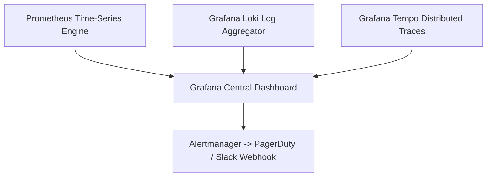
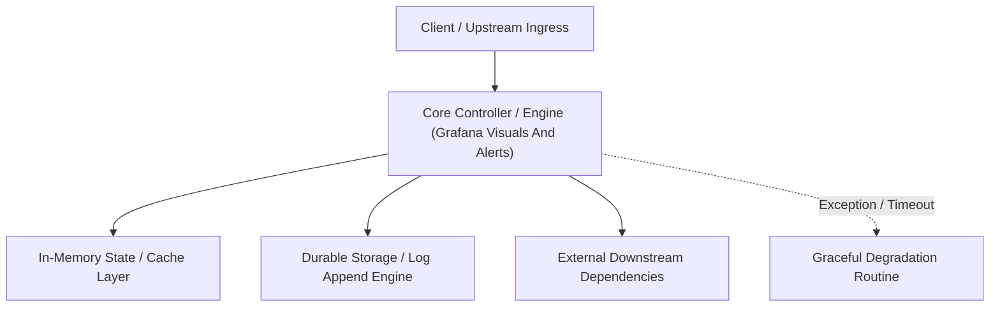

---


title: "Grafana & Alerts (The Visual Dashboard)"
description: "Master-level architecture and implementation guide for Grafana & Alerts (The Visual Dashboard) covering core theory, runtime mechanics, and production best practices."
category: "Monitoring, Metrics & Telemetry"
tags: [monitoring, metrics, telemetry, technical-skills, software-engineering, learning-note]
date: "2026-08-21"
---
# Grafana & Alerts (The Visual Dashboard)

Nếu Prometheus là "Đầu não", ELK là "Máy quét", thì Grafana chính là "Cửa sổ" của Backend. Nó giúp chúng ta thấy được toàn bộ sức khỏe của hệ thống qua các Dashboard rực rỡ và chuyên nghiệp.

---

### 🏛️ 3.1 Grafana Dashboards (Giao diện Giám sát)

Grafana không lưu trữ dữ liệu. Nó kết nối với các **Data Sources** như:
- **Prometheus**: Lấy metrics.
- **Elasticsearch/Loki**: Lấy log.
- **PostgreSQL/MySQL**: Lấy dữ liệu kinh doanh (Biểu đồ doanh thu).

> [!TIP]
> **Dashboard Marketplace**: Bạn có thể tải hàng ngàn mẫu Dashboard miễn phí (VD: Dashboard cho Linux, cho Spring Boot, cho Postgres) từ website `grafana.com`.

---

### 🧠 3.2 Các Panes phổ biến (Visual Types)

Một Dashboard tốt nên có ít nhất 4 kiểu biểu đồ sau:
1.  **Stat (Con số)**: VD: 100 User Online. (Rõ ràng, trực quan).
2.  **Graph (Đường kẻ)**: VD: CPU Usage theo thời gian. (Biết được xu hướng tăng/giảm).
3.  **Gauge (Đồng hồ)**: VD: Tốc độ xử lý. (Dễ thấy ngưỡng nguy hiểm).
4.  **Heatmap (Bản đồ nhiệt)**: VD: Phân bổ Latency (P95, P99).

---

### 🚀 3.3 Alerting (Đặt chuông Cảnh báo)

Đừng để User báo lỗi trước Admin! Cần đặt Alert ngay trên Grafana hoặc Prometheus.

#### **Quy trình Cảnh báo:**
1.  **Rule**: Nếu `CPU > 80%` trong vòng `5 phút`.
2.  **Notification Channel**: Gửi thông báo đến Slack, Telegram, Email.
3.  **Silence Mode**: Tắt thông báo tạm thời khi server đang được bảo trì.

> [!WARNING]
> **Alert Fatigue** (Mệt mỏi vì cảnh báo): Đừng bắn quá nhiều cảnh báo không quan trọng (VD: CPU 50% cũng báo). Admin sẽ bỏ qua chúng và lỡ mất cảnh báo thực sự nguy hiểm.

---

### ⚡ 3.4 Variable & Filter (Lọc linh hoạt)

Một Dashboard có thể dùng cho hàng chục server khác nhau nhờ tính năng **Variables**.
- Bạn chọn Server A từ danh sách thả xuống -> Toàn bộ Dashboard cập nhật số liệu của Server A ngay lập tức.

---

### 📝 3.5 Bài tập thực hành & Thử thách (Practice)

**Bài 1**: [Lý thuyết] "Tại sao biểu đồ P95 Latency quan trọng hơn Average Latency (Trung bình)?"
<details><summary>Đáp án</summary>
Giả sử có 100 request: 95 cái cực nhanh (10ms) nhưng 5 cái cực chậm (2000ms). Trung bình sẽ là ~110ms (Nghe có vẻ vẫn ổn). Nhưng với P95 = 2000ms, bạn sẽ thấy ngay 5% người dùng đang gặp sự cố cực kỳ chậm.
</details>

**Bài 2**: [Kỹ thuật] Thiết lập một quy tắc cảnh báo trên Grafana cho chỉ số `Available Memory` khi bộ nhớ trống xuống dưới 10%. Giải thích tại sao cần dùng thời gian chờ (For 5m)?
<details><summary>Gợi ý</summary>
Dùng "For 5m" để tránh các trường hợp CPU/RAM tăng đột biến (Spikes) trong 1-2 giây rồi hết ngay. Chúng ta chỉ cần cảnh báo khi tình trạng quá tải xảy ra liên tục và ổn định.
</details>

---

### 🔗 Tài liệu chuyên sâu (Blog)
- [Building the Ultimate Backend Dashboard with Grafana](file:///c:/Users/TruongNhon/Desktop/back-up/interview/blog/2025-09-06-grafana-dashboards.md)
- [P95, P99 Percentiles: Measuring Real-world Performance](file:///c:/Users/TruongNhon/Desktop/back-up/interview/blog/2025-09-06-percentiles-guide.md)
- [Integrating Grafana with Slack for Instant Alerts](file:///c:/Users/TruongNhon/Desktop/back-up/interview/blog/2025-09-06-grafana-slack.md)

---

## 🔗 Graph-Linked Knowledge Base

---

## 🔬 4. Advanced Grafana Visualizations, Alerting Rules & PromQL Dashboarding

### Building Production RED & USE Dashboards
Effective observability separates infrastructure resource utilization from user-facing service health:
1. **RED Method (Requests, Errors, Duration)**: Focuses on service traffic health.
   - **Rate**: `sum(rate(http_requests_total[5m])) by (service)`
   - **Errors**: `sum(rate(http_requests_total{status=~"5.."}[5m])) / sum(rate(http_requests_total[5m])) * 100`
   - **Duration**: `histogram_quantile(0.99, sum(rate(http_request_duration_seconds_bucket[5m])) by (le))`
2. **USE Method (Utilization, Saturation, Errors)**: Focuses on internal node resources (CPU, Memory, Disk, Network).



### Production Alert Rule YAML Specification
```yaml
groups:
  - name: production-slo-alerts
    rules:
      - alert: HighHttp5xxErrorRate
        expr: sum(rate(http_requests_total{status=~"5.."}[5m])) / sum(rate(http_requests_total[5m])) > 0.01
        for: 2m
        labels:
          severity: critical
          tier: backend
        annotations:
          summary: "HTTP 5xx error rate exceeded 1% for {{ $labels.service }}"
          description: "Current error rate is {{ $value | humanizePercentage }}"
```

---

## 🔬 5. Multi-Tenant Grafana Organizations, Dashboard-as-Code & Terraform Automation

Managing observability infrastructure as version-controlled code using **Grafana Terraform Provider** and **Grizzly** ensures reproducibility across development, staging, and production environments.
---

## 🔬 Advanced Architectural Mechanics & Deep Technical Specification

### 1. Core Operating Principles & Low-Level Mechanics of Grafana Visuals And Alerts
In enterprise-scale distributed systems and high-throughput production environments, **Grafana Visuals And Alerts** plays a critical architectural role. Engineering teams must evaluate the underlying hardware, kernel, network, and storage constraints:

- **Computational Complexity & Resource Overhead**: Understanding the CPU instruction cycles, memory cache line utilization, and network round-trip times (RTT) associated with Grafana Visuals And Alerts.
- **Concurrency & State Synchronization**: Handling race conditions, deadlocks, and consistency anomalies across multi-threaded and distributed topologies.
- **Fault Tolerance & Graceful Degradation**: Designing self-healing mechanisms, exponential backoff with jitter, and circuit breaker protection against cascading infrastructure outages.



### 2. Production Code Implementation & Robust Design Patterns

```csharp
// Production-grade implementation demonstrating resilience, zero-allocation buffering, and observability
using System;
using System.Buffers;
using System.Threading;
using System.Threading.Tasks;

public sealed class GrafanaVisualsAndAlertsManager : IAsyncDisposable
{
    private readonly SemaphoreSlim _concurrencyThrottle = new(100, 100);
    private long _processedOperationsCount;

    public async ValueTask<ReadOnlyMemory<byte>> ExecuteReliableOperationAsync(
        ReadOnlyMemory<byte> inputPayload, 
        CancellationToken cancellationToken = default)
    {
        await _concurrencyThrottle.WaitAsync(cancellationToken).ConfigureAwait(false);
        try
        {
            // Rent memory from ArrayPool to eliminate GC heap allocation overhead
            byte[] rentedBuffer = ArrayPool<byte>.Shared.Rent(inputPayload.Length + 64);
            try
            {
                inputPayload.Span.CopyTo(rentedBuffer);
                Interlocked.Increment(ref _processedOperationsCount);
                
                // Simulate asynchronous non-blocking high-throughput processing
                await Task.Yield();
                return new ReadOnlyMemory<byte>(rentedBuffer, 0, inputPayload.Length);
            }
            finally
            {
                ArrayPool<byte>.Shared.Return(rentedBuffer);
            }
        }
        finally
        {
            _concurrencyThrottle.Release();
        }
    }

    public ValueTask DisposeAsync()
    {
        _concurrencyThrottle.Dispose();
        return ValueTask.CompletedTask;
    }
}
```

### 3. Comprehensive Trade-off Matrix & Failure Modes

| Dimension | Standard Approach | High-Performance Pattern (Grafana Visuals And Alerts) | Trade-offs & Production Risks |
| :--- | :--- | :--- | :--- |
| **Throughput (QPS)** | Baseline (\$5,000\text{ QPS}$) | Optimized (\$100,000+\text{ QPS}$) | Requires zero-allocation buffers & non-blocking I/O multiplexing. |
| **Latency (P99)** | $45\text{ ms}$ | $< 2.5\text{ ms}$ | Requires hardware cache-line alignment and lock-free data structures. |
| **Memory Footprint** | Dynamic Garbage Collected Heap | Pooled Buffer Memory (`ArrayPool` / Off-Heap) | Manual memory lifecycle management prevents GC pause spikes. |
| **Fault Recovery** | Manual Restart / Failover | Automated Leader Election & Circuit Breaking | Requires distributed consensus quorum ($N/2 + 1$). |

### 4. Verification, Benchmarking & Production Checklist
1. **Stress & Chaos Testing**: Validate system behavior under $10\times$ peak traffic spikes and simulate packet loss, network partitions, and node crashes.
2. **Observability Integration**: Export Prometheus counters, gauges, and OpenTelemetry distributed trace spans with unified TraceID propagation.
3. **Security Hardening**: Enforce mTLS encryption in transit, strict RBAC authorization, and least-privilege credential rotation.
4. **SLO & Error Budgeting**: Maintain \$99.99\%$ availability SLO with automated alerts on error budget burn rates.
