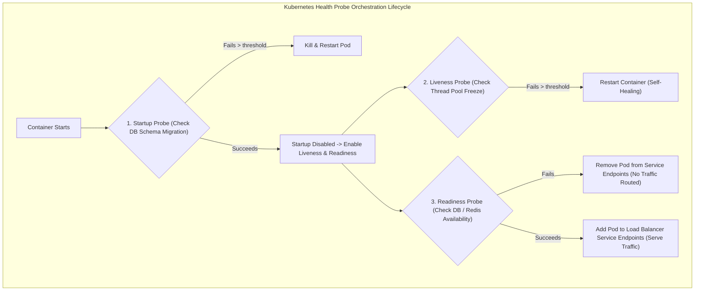
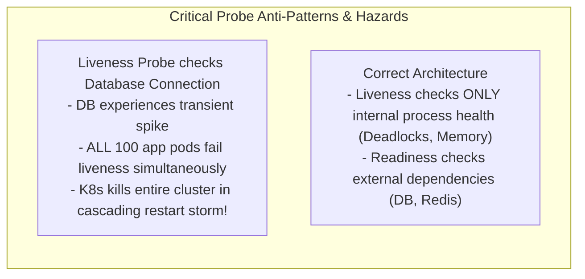
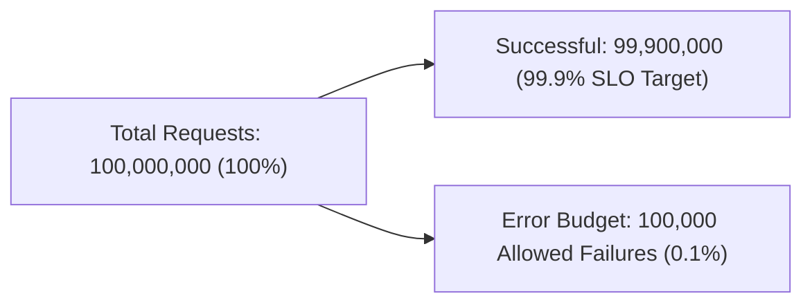
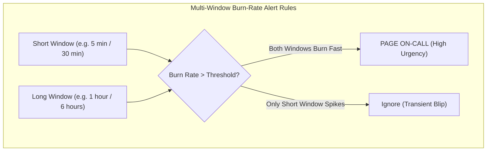
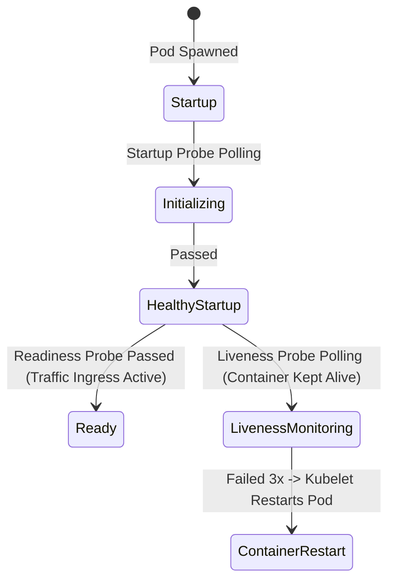

---


title: "Health Checks, SRE Alerting & SLO/Error Budget Architecture"
description: "Master-level engineering guide for Kubernetes Health Probes (Liveness, Readiness, Startup), Alertmanager routing, multi-window multi-burn-rate alerting, and SLO / Error Budget calculations."
category: "Backend Monitoring & Metrics"
tags: [health-checks, kubernetes, probes, alertmanager, sre, slo, error-budget, alerting, technical-skills, software-engineering, learning-note]
date: "2026-08-21"
---

# Health Checks, SRE Alerting & SLO/Error Budget Architecture

---

## 1. Executive Summary & Under-the-Hood Mechanics

In distributed cloud-native infrastructures running on Kubernetes, services must continuously communicate their operational state to the orchestrator to ensure graceful routing, automated self-healing, and zero-downtime rolling updates.

The **SRE Reliability Framework** integrates:
1. **Kubernetes Health Probes**: Explicit decoupling of **Startup** (initialization phase), **Liveness** (deadlock/freeze recovery via container restarts), and **Readiness** (traffic routing readiness).
2. **SLO & Error Budget Mathematics**: Quantifying acceptable unreliability based on Service Level Indicators (SLI) and Service Level Objectives (SLO).
3. **Multi-Window Multi-Burn-Rate Alerting (Google SRE Standard)**: Detecting fast and slow budget burns with zero alert fatigue.
4. **Prometheus Alertmanager**: Deduplicating, grouping, silencing, and routing incident alerts to on-call paging systems (PagerDuty, Opsgenie).



---

## 2. Kubernetes Health Probes: Liveness vs Readiness vs Startup



### 2.1 Complete Kubernetes Pod Probe Specification (`deployment.yaml`)
```yaml
apiVersion: apps/v1
kind: Deployment
metadata:
  name: order-service
  namespace: production
spec:
  replicas: 5
  template:
    spec:
      containers:
      - name: order-service
        image: enterprise/order-service:1.4.0
        ports:
        - containerPort: 8080
        
        # 1. Startup Probe: Allows up to 60s for cold start / Flyway migrations
        startupProbe:
          httpGet:
            path: /actuator/health/startup
            port: 8080
          initialDelaySeconds: 5
          periodSeconds: 5
          failureThreshold: 12
          timeoutSeconds: 2

        # 2. Liveness Probe: Checks if internal JVM threads are frozen
        livenessProbe:
          httpGet:
            path: /actuator/health/liveness
            port: 8080
          periodSeconds: 10
          failureThreshold: 3
          timeoutSeconds: 2

        # 3. Readiness Probe: Checks if app can currently process customer requests
        readinessProbe:
          httpGet:
            path: /actuator/health/readiness
            port: 8080
          periodSeconds: 5
          failureThreshold: 2
          timeoutSeconds: 2
```

---

## 3. SLO & Error Budget Mathematics (Google SRE Standard)

### 3.1 Mathematical Definitions
- **Service Level Indicator (SLI)**: A quantifiable metric of service performance:
  $$\text{SLI} = \frac{\text{Good Requests}}{\text{Total Requests}} \times 100\%$$
- **Service Level Objective (SLO)**: The target reliability agreed upon with business stakeholders (e.g. \$99.9\%$ over 30 days).
- **Error Budget**: The permitted amount of downtime or failed requests over a rolling window:
  $$\text{Error Budget} = 1 - \text{SLO} = 1 - 0.999 = 0.001 \quad (0.1\% \text{ allowable failure})$$

For a service handling \$100,000,000$ requests per month at \$99.9\%$ SLO, the Error Budget permits exactly \$100,000$ failed requests.



---

## 4. Multi-Window Multi-Burn-Rate Alerting Architecture

Traditional alerts (e.g. `alert if error_rate > 1% for 5m`) generate false positives on brief spikes and miss slow continuous burns that exhaust the error budget before end of month.

**Burn Rate ($B$)** is the rate at which the error budget is being consumed:
- $B=1 \implies$ Entire Error Budget will be consumed in exactly 30 days.
- $B=14.4 \implies 100\%$ of Error Budget consumed in 2 days ($2\%$ consumed in 1 hour) $\implies$ **Page On-Call Immediately!**
- $B=6 \implies 100\%$ of Error Budget consumed in 5 days ($5\%$ consumed in 6 hours) $\implies$ **Create Ticket / Slack Alert.**



### Production Prometheus SLO Multi-Burn Rule Blueprint
```yaml
groups:
  - name: order_service_slo_alerts
    rules:
      # Alert 1: Critical Emergency Page (Burns 2% of budget in 1 hour)
      - alert: OrderServiceErrorBudgetBurningFast
        expr: |
          (
            sum(rate(http_requests_total{service="order-service", status=~"5.."}[1h])) 
            / 
            sum(rate(http_requests_total{service="order-service"}[1h]))
          ) > (1 - 0.999) * 14.4
          and
          (
            sum(rate(http_requests_total{service="order-service", status=~"5.."}[5m])) 
            / 
            sum(rate(http_requests_total{service="order-service"}[5m]))
          ) > (1 - 0.999) * 14.4
        for: 2m
        labels:
          severity: critical
          pager: pagerduty
        annotations:
          summary: "Order Service error budget burning at 14.4x rate (100% loss in 2 days)"
          description: "High error rate over 1h and 5m windows. Current p99 error rate exceeds SLO threshold."
```

---

## 5. Prometheus Alertmanager Configuration (`alertmanager.yml`)

```yaml
global:
  resolve_timeout: 5m

route:
  group_by: ['alertname', 'service', 'namespace']
  group_wait: 30s
  group_interval: 5m
  repeat_interval: 4h
  receiver: 'slack-default'
  routes:
    - match:
        severity: critical
      receiver: 'pagerduty-oncall'
      continue: true

receivers:
  - name: 'pagerduty-oncall'
    pagerduty_configs:
      - service_key: 'PAGERDUTY_INTEGRATION_KEY'
        send_resolved: true

  - name: 'slack-default'
    slack_configs:
      - channel: '#alerts-engineering'
        api_url: 'https://hooks.slack.com/services/T00/B00/X00'
        send_resolved: true
```

---

## 🔗 Graph-Linked Knowledge Base
- ⚓ Metrics Foundations: [[application_metrics|Application Metrics & p99 Quantiles]]
- ⚓ Prometheus & Grafana: [[prometheus_and_grafana|Prometheus & Grafana Enterprise Architecture]]
- 🔗 Observability: [[02_Technical_Skills/01_theory_and_concepts/25_Observability_and_QA/chaos_engineering_fault_injection_litmus_chaos|Chaos Engineering & Resilience]]

---

## 🔬 4. Kubernetes Liveness, Readiness, and Startup Probes Architecture

### Probe Mechanics & Failure Remediation
- **Startup Probe**: Blocks liveness/readiness probes until heavy initialization routines (loading machine learning models, database schema migrations) complete.
- **Liveness Probe**: Determines if container process is deadlock-free. If failed $N$ times, kubelet restarts the container.
- **Readiness Probe**: Determines if container is ready to accept incoming ingress network traffic. If failed, the pod IP is removed from Service Endpoints.



---

## 🔬 5. Graceful Pod Termination and PreStop Lifecycle Hooks

When Kubernetes terminates a pod during deployment or horizontal scale-in:
1. Pod state changes to `Terminating` and endpoint is removed from Service.
2. `preStop` hook executes a sleep (e.g. `sleep 15`) allowing in-flight proxy traffic to drain.
3. App receives `SIGTERM`, shuts down HTTP server gracefully, drains worker queues, and exits within `terminationGracePeriodSeconds` (default 30s).
