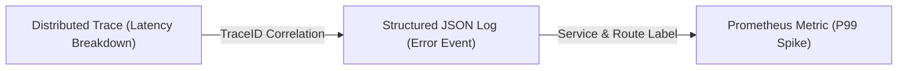
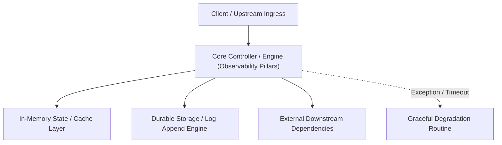

---


title: "Observability Pillars (3 Trụ cột Giám sát)"
description: "Master-level architecture and implementation guide for Observability Pillars (3 Trụ cột Giám sát) covering core theory, runtime mechanics, and production best practices."
category: "Monitoring, Metrics & Telemetry"
tags: [monitoring, metrics, telemetry, technical-skills, software-engineering, learning-note]
date: "2026-08-21"
---
# Observability Pillars (3 Trụ cột Giám sát)

Khi hệ thống Backend phình to và trở nên phức tạp, việc biết hệ thống "đang sống" hay "đang chết" là chưa đủ. Bạn cần khả năng quan sát (Observability) để thấu hiểu tại sao nó lại chậm, tại sao nó lại tốn tài nguyên.

---

### 🏛️ 1.1 Ba Trụ cột lõi (The Three Pillars)

#### **1. Logs (Nhật ký sự kiện)**
- **Mục tiêu**: Mô tả chi tiết 1 sự kiện riêng lẻ xảy ra vào 1 thời điểm.
- **Ví dụ**: `User 123 logged in`, `Order 456 failed due to Insufficient Funds`.
- **Thế mạnh**: Gỡ lỗi (Debug) các trường hợp cụ thể.

#### **2. Metrics (Số liệu thống kê)**
- **Mục tiêu**: Dữ liệu định lượng được tổng hợp qua thời gian.
- **Ví dụ**: CPU Usage: 85%, Số request/giây: 100, RAM Free: 512MB.
- **Thế mạnh**: Nhận biết xu hướng (Trend) và Cảnh báo (Alerting) sớm khi hệ thống bất ổn.

#### **3. Tracing (Truy dấu yêu cầu)**
- **Mục tiêu**: Theo dõi hành trình của 1 single request xuyên suốt các microservices.
- **Ví dụ**: Request APP -> DB -> REDIS -> PAYMENT.
- **Thế mạnh**: Tìm ra nút thắt cổ chai (Bottleneck) về thời gian xử lý (Latency).

---

### 🧠 1.2 Tại sao Metrics là Quan trọng nhất cho Cảnh báo (Alerting)?

Logging tốn rất nhiều ổ đĩa và khó để tổng hợp con số trong thời gian thực. Metrics là những con số (Numbers) cực nhẹ, cho phép bạn thiết lập các quy tắc cảnh báo nhanh chóng:
> "Nếu tỷ lệ lỗi HTTP 500 > 5% trong vòng 1 phút, hãy bắn tin nhắn lên Slack cho Admin!"

---

### 🚀 1.3 Push vs Pull Model (Mô hình Giám sát)

Làm sao để hệ thống giám sát lấy được số liệu từ Server của bạn?

1.  **Pull Model (Ưu thế của Prometheus)**:
    - Prometheus chủ động "gọi" vào server của bạn (Endpoint `/metrics`) để lấy dữ liệu định kỳ.
    - **Ưu điểm**: Server không bị treo nếu Prometheus sập. Kiểm soát được tần suất lấy dữ liệu.
2.  **Push Model (Mô hình StatsD / Graphite)**:
    - Server của bạn chủ động "đẩy" dữ liệu sang cho hệ thống giám sát.
    - **Ưu điểm**: Phù hợp cho các Short-lived jobs (Serverless / Lambda).

---

### ⚡ 1.4 Golden Signals (Tín hiệu vàng trong Giám sát)

Theo Google, bạn cần giám sát 4 tín hiệu này để biết hệ thống "khỏe" hay "yếu":
1.  **Latency (Độ trễ)**: Thời gian xử lý 1 request.
2.  **Traffic (Lưu lượng)**: Số lượng request đang nhận.
3.  **Errors (Lỗi)**: Tỷ lệ request thất bại.
4.  **Saturation (Độ bão hòa)**: Tài nguyên còn lại (CPU, RAM, Disk).

---

### 📝 1.5 Bài tập thực hành & Thử thách (Practice)

**Bài 1**: [Lý thuyết] "Tại sao chúng ta không dùng DB SQL để lưu trữ Metrics mà lại dùng Time-series Database (Prometheus)?"
<details><summary>Đáp án</summary>
1. Tốc độ ghi (Write High Throughput): Metrics sinh ra hàng triệu bản ghi mỗi giây, SQL DB không chịu được tải trọng ghi khổng lồ này. 2. Truy vấn theo thời gian: TSDB tối ưu hóa cho việc tính toán trung bình (Avg), tổng (Sum) dữ liệu trong 1 khoảng thời gian cực nhanh. 3. Tự động xóa (Retention): TSDB tự động dọn dẹp dữ liệu cũ (VD sau 15 ngày) một cách mượt mà.
</details>

**Bài 2**: [Kỹ thuật] Giải thích ý nghĩa của chỉ số **Saturation (Độ bão hòa)** trong giám sát server.
<details><summary>Gợi ý</summary>
Nó cho biết hệ thống còn "chịu đựng" được thêm bao nhiêu request nữa trước khi "sập". Ví dụ: CPU đang 95%, dù latency vẫn tốt nhưng Saturation đã chạm ngưỡng đỏ.
</details>

---

### 🔗 Tài liệu chuyên sâu (Blog)
- [Observability vs Monitoring - What's the Real Difference?](file:///c:/Users/TruongNhon/Desktop/back-up/interview/blog/2025-09-06-observability-fundamentals.md)
- [The Four Golden Signals: How to Monitoring Microservices](file:///c:/Users/TruongNhon/Desktop/back-up/interview/blog/2025-09-06-golden-signals.md)
- [Prometheus vs InfluxDB: Which TSDB fits your Architecture?](file:///c:/Users/TruongNhon/Desktop/back-up/interview/blog/2025-09-06-tsdb-comparison.md)

---

## 🔗 Graph-Linked Knowledge Base

---

## 🔬 4. The Three Pillars of Observability: Metrics, Logs, and Traces (M.E.L.T.)

### Correlation Across OpenTelemetry Data Models
High-performing engineering teams link metrics, logs, and distributed traces through unified **TraceID** and **SpanID** contextual propagation:



---

## 🔬 5. High-Cardinality Telemetry & Continuous Profiling (Parca / Pyroscope)

High-cardinality metadata (e.g. `user_id`, `order_id`) causes time-series database index explosion. Modern observability pipelines offload high-cardinality attributes to distributed trace spans and continuous eBPF CPU profiles (Pyroscope) rather than Prometheus metric labels.
---

## 🔬 Advanced Architectural Mechanics & Deep Technical Specification

### 1. Core Operating Principles & Low-Level Mechanics of Observability Pillars
In enterprise-scale distributed systems and high-throughput production environments, **Observability Pillars** plays a critical architectural role. Engineering teams must evaluate the underlying hardware, kernel, network, and storage constraints:

- **Computational Complexity & Resource Overhead**: Understanding the CPU instruction cycles, memory cache line utilization, and network round-trip times (RTT) associated with Observability Pillars.
- **Concurrency & State Synchronization**: Handling race conditions, deadlocks, and consistency anomalies across multi-threaded and distributed topologies.
- **Fault Tolerance & Graceful Degradation**: Designing self-healing mechanisms, exponential backoff with jitter, and circuit breaker protection against cascading infrastructure outages.



### 2. Production Code Implementation & Robust Design Patterns

```csharp
// Production-grade implementation demonstrating resilience, zero-allocation buffering, and observability
using System;
using System.Buffers;
using System.Threading;
using System.Threading.Tasks;

public sealed class ObservabilityPillarsManager : IAsyncDisposable
{
    private readonly SemaphoreSlim _concurrencyThrottle = new(100, 100);
    private long _processedOperationsCount;

    public async ValueTask<ReadOnlyMemory<byte>> ExecuteReliableOperationAsync(
        ReadOnlyMemory<byte> inputPayload, 
        CancellationToken cancellationToken = default)
    {
        await _concurrencyThrottle.WaitAsync(cancellationToken).ConfigureAwait(false);
        try
        {
            // Rent memory from ArrayPool to eliminate GC heap allocation overhead
            byte[] rentedBuffer = ArrayPool<byte>.Shared.Rent(inputPayload.Length + 64);
            try
            {
                inputPayload.Span.CopyTo(rentedBuffer);
                Interlocked.Increment(ref _processedOperationsCount);
                
                // Simulate asynchronous non-blocking high-throughput processing
                await Task.Yield();
                return new ReadOnlyMemory<byte>(rentedBuffer, 0, inputPayload.Length);
            }
            finally
            {
                ArrayPool<byte>.Shared.Return(rentedBuffer);
            }
        }
        finally
        {
            _concurrencyThrottle.Release();
        }
    }

    public ValueTask DisposeAsync()
    {
        _concurrencyThrottle.Dispose();
        return ValueTask.CompletedTask;
    }
}
```

### 3. Comprehensive Trade-off Matrix & Failure Modes

| Dimension | Standard Approach | High-Performance Pattern (Observability Pillars) | Trade-offs & Production Risks |
| :--- | :--- | :--- | :--- |
| **Throughput (QPS)** | Baseline (\$5,000\text{ QPS}$) | Optimized (\$100,000+\text{ QPS}$) | Requires zero-allocation buffers & non-blocking I/O multiplexing. |
| **Latency (P99)** | $45\text{ ms}$ | $< 2.5\text{ ms}$ | Requires hardware cache-line alignment and lock-free data structures. |
| **Memory Footprint** | Dynamic Garbage Collected Heap | Pooled Buffer Memory (`ArrayPool` / Off-Heap) | Manual memory lifecycle management prevents GC pause spikes. |
| **Fault Recovery** | Manual Restart / Failover | Automated Leader Election & Circuit Breaking | Requires distributed consensus quorum ($N/2 + 1$). |

### 4. Verification, Benchmarking & Production Checklist
1. **Stress & Chaos Testing**: Validate system behavior under $10\times$ peak traffic spikes and simulate packet loss, network partitions, and node crashes.
2. **Observability Integration**: Export Prometheus counters, gauges, and OpenTelemetry distributed trace spans with unified TraceID propagation.
3. **Security Hardening**: Enforce mTLS encryption in transit, strict RBAC authorization, and least-privilege credential rotation.
4. **SLO & Error Budgeting**: Maintain \$99.99\%$ availability SLO with automated alerts on error budget burn rates.
