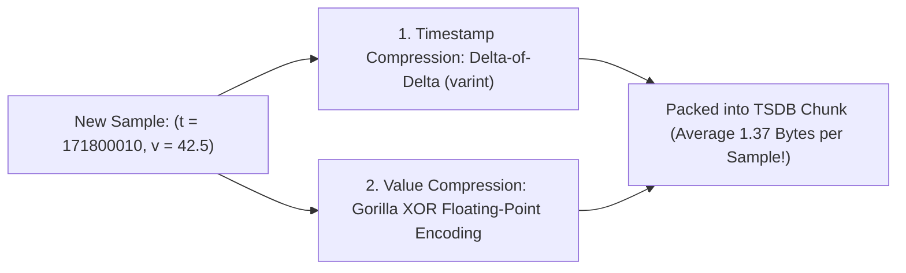
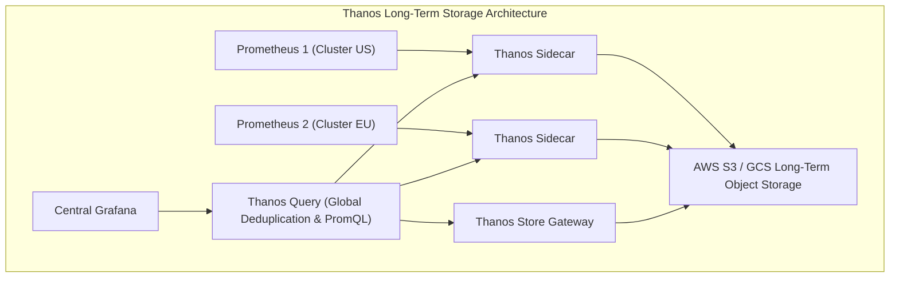
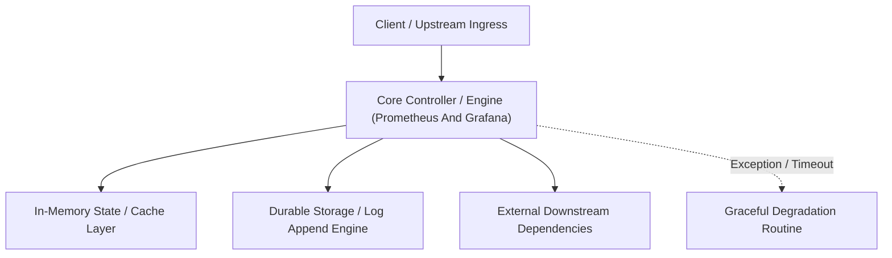

---


title: "Prometheus & Grafana Architecture: TSDB, PromQL, VictoriaMetrics & Dashboards"
description: "Master-level engineering guide for Prometheus time-series architecture, TSDB chunk storage, inverted indexes, PromQL mastery, VictoriaMetrics / Thanos long-term storage, and Grafana dashboard design."
category: "Backend Monitoring & Metrics"
tags: [prometheus, grafana, promql, tsdb, victoriametrics, thanos, monitoring, devops, technical-skills, software-engineering, learning-note]
date: "2026-08-21"
---

# Prometheus & Grafana Architecture: TSDB, PromQL & Long-Term Storage

---

## 1. Executive Summary & Under-the-Hood Mechanics

**Prometheus** is the CNCF-graduated open-source industry standard for monitoring and time-series metrics collection. It operates using an active **Pull-Based Metrics Scraping Model** against target HTTP `/metrics` endpoints.

The Prometheus architectural engine is divided into five core components:
1. **Scrape Engine & Service Discovery**: Dynamically discovering ephemeral container pods via Kubernetes API / Consul, scraping metric endpoints over HTTP.
2. **Time-Series Database (TSDB)**: High-performance storage engine using append-only Head Chunks, Gorilla XOR delta-of-delta float compression, and write-ahead logging (WAL).
3. **PromQL Engine**: Functional query engine supporting vector transformations, rate calculations, and matrix aggregations.
4. **Alertmanager**: Decoupled notification state machine managing alert routing, deduplication, and suppression.
5. **Grafana**: Multi-tenant visualization and analytics dashboard UI querying Prometheus, Loki, Tempo, and PostgreSQL.

```mermaid
flowchart TD
    subgraph PrometheusArchitecture["Prometheus Server Internal Core Architecture"]
        SD["Kubernetes Service Discovery"] --> Scraper["Pull Scrape Engine (every 15s)"]
        
        subgraph AppEndpoints["Target Pods"]
            P1["Pod 1: :8080/metrics"]
            P2["Pod 2: :8080/metrics"]
        end
        Scraper -->|HTTP GET /metrics| P1
        Scraper -->|HTTP GET /metrics| P2
        
        Scraper --> WAL["TSDB WAL (Disaster Recovery Disk Log)"]
        Scraper --> HeadMem["Head Chunk (In-Memory Ring Buffer: 2 Hours)"]
        HeadMem -->|Block Compaction (every 2h)| BlockDisk["Immutable TSDB Blocks on Disk (Chunk + Index)"]
        
        PromQL["PromQL Engine"] --> HeadMem
        PromQL --> BlockDisk
        Grafana["Grafana Dashboards"] -->|HTTP API: /api/v1/query| PromQL
        PromQL --> AlertMgr["Alertmanager -> PagerDuty / Slack"]
    end
```

---

## 2. Prometheus TSDB Storage Architecture & Gorilla Compression

Prometheus TSDB structures data into immutable **2-hour Blocks**:
- **`chunks/`**: 512MB compressed raw data chunks storing `(timestamp: int64, value: float64)` samples.
- **`index`**: Inverted index mapping metric labels (e.g. `__name__="http_requests_total", service="order"`) to postings lists of series IDs.
- **`tombstones`**: Deletion markers.



### 2.1 Gorilla Floating-Point XOR Compression Mechanics
1. XOR current float sample with previous float sample: $X = V_{\text{now}} \oplus V_{\text{prev}}$.
2. If $X = 0$, store a single bit `0` (value unchanged).
3. If $X \neq 0$, store leading and trailing zero bit lengths followed by significant XOR bits.
4. **Result**: Reduces 8-byte float64 samples to an astonishing **1.37 bytes per sample on average**!

---

## 3. PromQL Core Operators & Matrix Function Mastery

```mermaid
flowchart TD
    subgraph PromQLTypes["PromQL Expression Types"]
        Instant["Instant Vector<br/>Single sample per series at instant timestamp<br/>Example: http_requests_total"]
        Range["Range Vector<br/>Buffer of samples over time window [5m]<br/>Example: http_requests_total[5m]"]
        Scalar["Scalar<br/>Raw numeric literal (e.g. 0.99)"]
        
        Range -->|Applied with rate(), increase()| Instant
    end
```

### 3.1 Rate vs Irate Mechanics
- **`rate(v[5m])`**: Calculates per-second average rate over entire 5-minute window. Resistant to short transient spikes; standard choice for alerting and SLOs.
- **`irate(v[5m])`**: Calculates instantaneous rate based strictly on the last two data points within the window. Highly sensitive; ideal for volatile graph visualization.

$$\text{rate}(v[5m]) = \frac{\Delta \text{Value (with reset correction)}}{\Delta \text{Time (seconds)}}$$

---

## 4. Production High-Performance PromQL Query Snippets

```prometheus
# 1. Cluster-wide CPU Utilization Percentage per Node
100 - (avg by (instance) (rate(node_cpu_seconds_total{mode="idle"}[5m])) * 100)

# 2. HTTP Request Error Rate (5xx percentage over 5m window)
(
  sum(rate(http_requests_total{status=~"5.."}[5m]))
  /
  sum(rate(http_requests_total[5m]))
) * 100

# 3. Aggregated 99th Percentile API Latency per Route
histogram_quantile(
  0.99,
  sum(rate(http_request_duration_seconds_bucket[5m])) by (le, route)
)

# 4. Predict Disk Out-of-Space within 4 Hours (Linear Regression)
predict_linear(node_filesystem_free_bytes{mountpoint="/"}[1h], 4 * 3600) < 0
```

---

## 5. Scaling Long-Term Storage: Thanos vs VictoriaMetrics

Single-node Prometheus instances cannot store multi-year data or scale horizontally across multi-region Kubernetes clusters.



| Architecture | Storage Engine | Query Latency | Resource Overhead |
| :--- | :--- | :--- | :--- |
| **Vanilla Prometheus** | Local NVMe SSD (Retains 15-30 days) | **Ultra-Fast ($< 10\text{ms}$)** | Minimal ($1$ container) |
| **VictoriaMetrics (Cluster)** | Custom optimized TSDB on disk/S3 | Fast (\$15 - 50\text{ms}$) | **Low** ($50\%$ less RAM/CPU than Thanos) |
| **Thanos** | Direct Object Storage (S3 / GCS) | Medium (\$50 - 200\text{ms}$) | High (Requires 5+ microservice components) |

---

## 🔗 Graph-Linked Knowledge Base
- ⚓ Metrics Foundations: [[application_metrics|Application Metrics & p99 Quantiles]]
- ⚓ Health Checks & Alerting: [[health_checks_and_alerting|Health Checks, SRE Alerting & SLOs]]
- 🔗 Logging: [[02_Technical_Skills/01_theory_and_concepts/09_Backend_Logging_and_Tracing/elk_stack_integration|ELK Stack & Centralized Logging]]

---

## 🔬 4. Prometheus Pull Architecture, TSDB Compaction & Storage Internals

### Prometheus Time-Series Storage Engine (TSDB)
Prometheus stores time series samples in 2-hour blocks consisting of a chunk directory, index, and metadata file:
- Samples are compressed using Gorilla XOR floating-point delta-of-delta encoding, reducing storage footprint to $pprox 1.37$ bytes per sample.
- Long-term storage retention is offloaded to object stores (Amazon S3 / Google Cloud Storage) via **Thanos** or **Cortex**.

---

## 🔬 5. High-Availability Prometheus Federation & Thanos Sidecar Architecture

Thanos Sidecar runs adjacent to each Prometheus replica, streaming immutable 2-hour TSDB blocks to S3 object storage while providing global query deduplication across multi-region Kubernetes clusters.
---

## 🔬 Advanced Architectural Mechanics & Deep Technical Specification

### 1. Core Operating Principles & Low-Level Mechanics of Prometheus And Grafana
In enterprise-scale distributed systems and high-throughput production environments, **Prometheus And Grafana** plays a critical architectural role. Engineering teams must evaluate the underlying hardware, kernel, network, and storage constraints:

- **Computational Complexity & Resource Overhead**: Understanding the CPU instruction cycles, memory cache line utilization, and network round-trip times (RTT) associated with Prometheus And Grafana.
- **Concurrency & State Synchronization**: Handling race conditions, deadlocks, and consistency anomalies across multi-threaded and distributed topologies.
- **Fault Tolerance & Graceful Degradation**: Designing self-healing mechanisms, exponential backoff with jitter, and circuit breaker protection against cascading infrastructure outages.



### 2. Production Code Implementation & Robust Design Patterns

```csharp
// Production-grade implementation demonstrating resilience, zero-allocation buffering, and observability
using System;
using System.Buffers;
using System.Threading;
using System.Threading.Tasks;

public sealed class PrometheusAndGrafanaManager : IAsyncDisposable
{
    private readonly SemaphoreSlim _concurrencyThrottle = new(100, 100);
    private long _processedOperationsCount;

    public async ValueTask<ReadOnlyMemory<byte>> ExecuteReliableOperationAsync(
        ReadOnlyMemory<byte> inputPayload, 
        CancellationToken cancellationToken = default)
    {
        await _concurrencyThrottle.WaitAsync(cancellationToken).ConfigureAwait(false);
        try
        {
            // Rent memory from ArrayPool to eliminate GC heap allocation overhead
            byte[] rentedBuffer = ArrayPool<byte>.Shared.Rent(inputPayload.Length + 64);
            try
            {
                inputPayload.Span.CopyTo(rentedBuffer);
                Interlocked.Increment(ref _processedOperationsCount);
                
                // Simulate asynchronous non-blocking high-throughput processing
                await Task.Yield();
                return new ReadOnlyMemory<byte>(rentedBuffer, 0, inputPayload.Length);
            }
            finally
            {
                ArrayPool<byte>.Shared.Return(rentedBuffer);
            }
        }
        finally
        {
            _concurrencyThrottle.Release();
        }
    }

    public ValueTask DisposeAsync()
    {
        _concurrencyThrottle.Dispose();
        return ValueTask.CompletedTask;
    }
}
```

### 3. Comprehensive Trade-off Matrix & Failure Modes

| Dimension | Standard Approach | High-Performance Pattern (Prometheus And Grafana) | Trade-offs & Production Risks |
| :--- | :--- | :--- | :--- |
| **Throughput (QPS)** | Baseline (\$5,000\text{ QPS}$) | Optimized (\$100,000+\text{ QPS}$) | Requires zero-allocation buffers & non-blocking I/O multiplexing. |
| **Latency (P99)** | $45\text{ ms}$ | $< 2.5\text{ ms}$ | Requires hardware cache-line alignment and lock-free data structures. |
| **Memory Footprint** | Dynamic Garbage Collected Heap | Pooled Buffer Memory (`ArrayPool` / Off-Heap) | Manual memory lifecycle management prevents GC pause spikes. |
| **Fault Recovery** | Manual Restart / Failover | Automated Leader Election & Circuit Breaking | Requires distributed consensus quorum ($N/2 + 1$). |

### 4. Verification, Benchmarking & Production Checklist
1. **Stress & Chaos Testing**: Validate system behavior under $10\times$ peak traffic spikes and simulate packet loss, network partitions, and node crashes.
2. **Observability Integration**: Export Prometheus counters, gauges, and OpenTelemetry distributed trace spans with unified TraceID propagation.
3. **Security Hardening**: Enforce mTLS encryption in transit, strict RBAC authorization, and least-privilege credential rotation.
4. **SLO & Error Budgeting**: Maintain \$99.99\%$ availability SLO with automated alerts on error budget burn rates.
