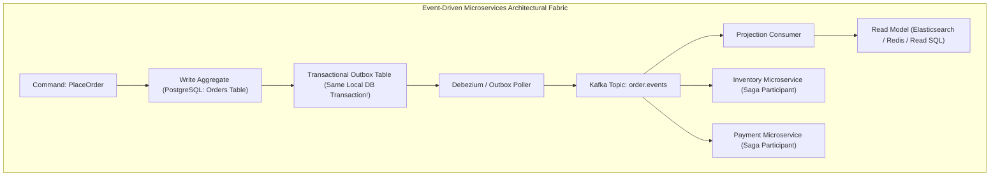
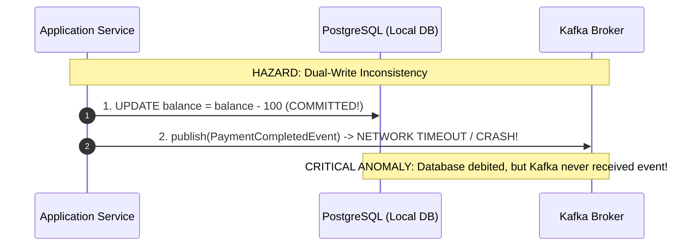
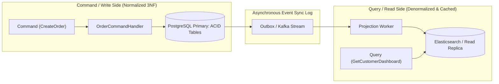
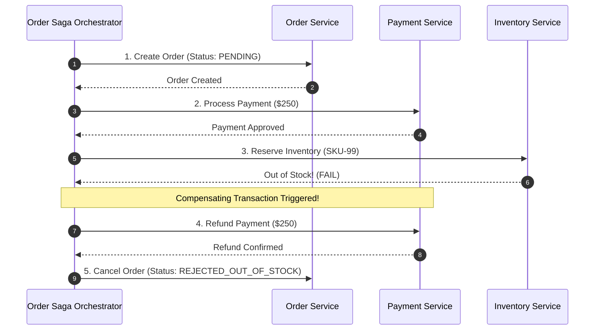
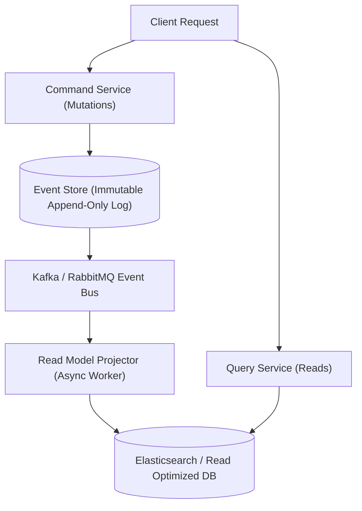
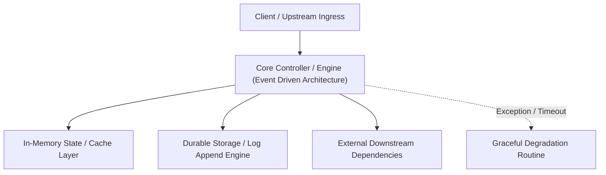

---


title: "Event-Driven Architecture: Event Sourcing, CQRS, Outbox & Saga Patterns"
description: "Master-level engineering guide for Event-Driven Microservices Architecture, covering Event Sourcing, Command Query Responsibility Segregation (CQRS), Transactional Outbox, and Distributed Sagas."
category: "Messaging & Event-Driven"
tags: [event-driven, event-sourcing, cqrs, outbox-pattern, saga-pattern, microservices, kafka, distributed-systems, technical-skills, software-engineering, learning-note]
date: "2026-08-21"
---

# Event-Driven Architecture: Event Sourcing, CQRS, Outbox & Saga Patterns

---

## 1. Executive Summary & Under-the-Hood Mechanics

Traditional enterprise software relies on synchronous, blocking request-response communication (HTTP REST / gRPC) and destructive in-place database state updates (`UPDATE users SET status = 'ACTIVE'`). As microservices scale across multiple distributed domains, synchronous dependencies introduce tight coupling, cascading availability failures, and transaction deadlock bottlenecks.

**Event-Driven Architecture (EDA)** decouples producers from consumers using immutable **Domain Events**:
1. **Event Sourcing**: Storing domain state as an append-only sequence of immutable business events rather than mutating current snapshot rows.
2. **Command Query Responsibility Segregation (CQRS)**: Physically segregating the Write Model (optimized for high-throughput transactional invariants) from the Read Model (optimized for low-latency denormalized queries).
3. **Transactional Outbox Pattern**: Guaranteeing atomic state mutations and message broker publishing with zero dual-write anomalies.
4. **Distributed Saga Pattern**: Coordinating distributed long-running business transactions across independent database boundaries without distributed two-phase commit (2PC) locks.



---

## 2. The Transactional Outbox Pattern & Dual-Write Mitigation

Directly updating a database and publishing to Kafka inside the same application method creates the catastrophic **Dual-Write Hazard**:



### The Transactional Outbox Solution
By inserting the outbound domain event into an `outbox` table within the **exact same local ACID database transaction**, atomicity is guaranteed by the relational engine:

```sql
-- Executed inside a single BEGIN ... COMMIT block
BEGIN;

-- 1. Mutate Domain Entity
INSERT INTO orders (id, customer_id, total_amount, status)
VALUES ('018f2d5a-9012-7000-8000-000000000001', 'cust_101', 250.00, 'CREATED');

-- 2. Insert Outbox Event
INSERT INTO outbox_events (id, aggregate_type, aggregate_id, event_type, payload, created_at)
VALUES (
    gen_random_uuid(),
    'Order',
    '018f2d5a-9012-7000-8000-000000000001',
    'OrderCreatedEvent',
    '{"customerId": "cust_101", "totalAmount": 250.00}',
    NOW()
);

COMMIT; -- Zero dual-write risk! Both succeed or both fail together!
```

---

## 3. CQRS Architecture & Materialized Read Projections



---

## 4. Distributed Saga Pattern: Choreography vs Orchestration



---

## 5. Architectural Tradeoffs Matrix

| Dimension | Synchronous REST / gRPC | Event-Driven (Outbox + Kafka) |
| :--- | :--- | :--- |
| **Coupling** | High (Temporal & Spatial) | **Loose (Producers unaware of consumers)** |
| **Availability** | Multiplicative: $A_{\text{total}} = \prod A_i$ | **Additive / Isolated (Buffering in queues)** |
| **Consistency** | Immediate Strong Consistency | Eventual Consistency (Bounded by replication lag) |
| **Debugging Complexity** | Low (Single synchronous call stack) | High (Requires Distributed Tracing with W3C TraceContext) |

---

## 🔗 Graph-Linked Knowledge Base
- ⚓ RabbitMQ & AMQP: [[message_queues_rabbitmq|RabbitMQ Architecture & AMQP Protocol]]
- ⚓ Kafka Architecture: [[02_Technical_Skills/01_theory_and_concepts/06_Java_Engineering/apache_kafka_integration_spring_kafka|Kafka Integration & Spring Kafka]]
- 🔗 Distributed Consensus: [[02_Technical_Skills/01_theory_and_concepts/01_Distributed_Systems/distributed_consensus|Distributed Consensus & SMR]]

---

## 🔬 4. Event-Driven Architecture: Event Sourcing, CQRS & Schema Evolution

### CQRS (Command Query Responsibility Segregation)
Separating mutation write commands from analytical read queries allows independent scaling of write and read storage engines:



### Schema Evolution with Protocol Buffers & Avro Schema Registry
In distributed event pipelines, backward and forward schema compatibility prevents message deserialization breakages across microservice versions.
---

## 🔬 Advanced Architectural Mechanics & Deep Technical Specification

### 1. Core Operating Principles & Low-Level Mechanics of Event Driven Architecture
In enterprise-scale distributed systems and high-throughput production environments, **Event Driven Architecture** plays a critical architectural role. Engineering teams must evaluate the underlying hardware, kernel, network, and storage constraints:

- **Computational Complexity & Resource Overhead**: Understanding the CPU instruction cycles, memory cache line utilization, and network round-trip times (RTT) associated with Event Driven Architecture.
- **Concurrency & State Synchronization**: Handling race conditions, deadlocks, and consistency anomalies across multi-threaded and distributed topologies.
- **Fault Tolerance & Graceful Degradation**: Designing self-healing mechanisms, exponential backoff with jitter, and circuit breaker protection against cascading infrastructure outages.



### 2. Production Code Implementation & Robust Design Patterns

```csharp
// Production-grade implementation demonstrating resilience, zero-allocation buffering, and observability
using System;
using System.Buffers;
using System.Threading;
using System.Threading.Tasks;

public sealed class EventDrivenArchitectureManager : IAsyncDisposable
{
    private readonly SemaphoreSlim _concurrencyThrottle = new(100, 100);
    private long _processedOperationsCount;

    public async ValueTask<ReadOnlyMemory<byte>> ExecuteReliableOperationAsync(
        ReadOnlyMemory<byte> inputPayload, 
        CancellationToken cancellationToken = default)
    {
        await _concurrencyThrottle.WaitAsync(cancellationToken).ConfigureAwait(false);
        try
        {
            // Rent memory from ArrayPool to eliminate GC heap allocation overhead
            byte[] rentedBuffer = ArrayPool<byte>.Shared.Rent(inputPayload.Length + 64);
            try
            {
                inputPayload.Span.CopyTo(rentedBuffer);
                Interlocked.Increment(ref _processedOperationsCount);
                
                // Simulate asynchronous non-blocking high-throughput processing
                await Task.Yield();
                return new ReadOnlyMemory<byte>(rentedBuffer, 0, inputPayload.Length);
            }
            finally
            {
                ArrayPool<byte>.Shared.Return(rentedBuffer);
            }
        }
        finally
        {
            _concurrencyThrottle.Release();
        }
    }

    public ValueTask DisposeAsync()
    {
        _concurrencyThrottle.Dispose();
        return ValueTask.CompletedTask;
    }
}
```

### 3. Comprehensive Trade-off Matrix & Failure Modes

| Dimension | Standard Approach | High-Performance Pattern (Event Driven Architecture) | Trade-offs & Production Risks |
| :--- | :--- | :--- | :--- |
| **Throughput (QPS)** | Baseline (\$5,000\text{ QPS}$) | Optimized (\$100,000+\text{ QPS}$) | Requires zero-allocation buffers & non-blocking I/O multiplexing. |
| **Latency (P99)** | $45\text{ ms}$ | $< 2.5\text{ ms}$ | Requires hardware cache-line alignment and lock-free data structures. |
| **Memory Footprint** | Dynamic Garbage Collected Heap | Pooled Buffer Memory (`ArrayPool` / Off-Heap) | Manual memory lifecycle management prevents GC pause spikes. |
| **Fault Recovery** | Manual Restart / Failover | Automated Leader Election & Circuit Breaking | Requires distributed consensus quorum ($N/2 + 1$). |

### 4. Verification, Benchmarking & Production Checklist
1. **Stress & Chaos Testing**: Validate system behavior under $10\times$ peak traffic spikes and simulate packet loss, network partitions, and node crashes.
2. **Observability Integration**: Export Prometheus counters, gauges, and OpenTelemetry distributed trace spans with unified TraceID propagation.
3. **Security Hardening**: Enforce mTLS encryption in transit, strict RBAC authorization, and least-privilege credential rotation.
4. **SLO & Error Budgeting**: Maintain \$99.99\%$ availability SLO with automated alerts on error budget burn rates.
