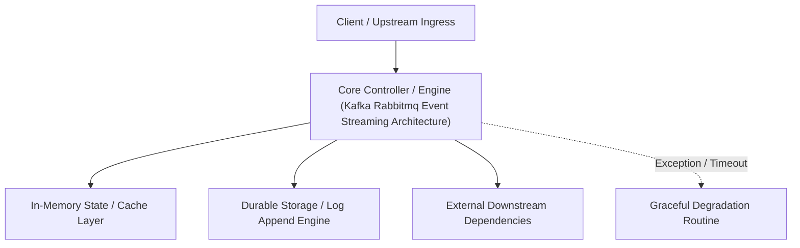

---


title: "Event Streaming Architecture - Apache Kafka vs RabbitMQ Deep Dive"
description: "Master-level architecture and implementation guide for Event Streaming Architecture - Apache Kafka vs RabbitMQ Deep Dive covering core theory, runtime mechanics, and production best practices."
category: "Event-Driven Architecture & Messaging"
tags: [event, driven, architecture, messaging, technical-skills, software-engineering, learning-note]
date: "2026-08-21"
---
# Event Streaming Architecture: Apache Kafka vs RabbitMQ Deep Dive

---

## 1. Architectural Paradigms: Message Broker vs Event Streaming Platform

Choosing between **RabbitMQ** (Smart Broker / Dumb Consumer) and **Apache Kafka** (Dumb Broker / Smart Consumer) dictates system topology, throughput scalability, and replayability.

```mermaid
graph TD
    subgraph RabbitMQ Paradigm
        P1["Producer"] -->|AMQP Routing Key| Ex["Exchange (Direct/Topic/Fanout)"]
        Ex --> Q1["Queue A (Stateful)"]
        Ex --> Q2["Queue B (Stateful)"]
        Q1 -->|Push & ACK/Delete| C1["Consumer A"]
        Q2 -->|Push & ACK/Delete| C2["Consumer B"]
    end

    subgraph Kafka Paradigm
        P2["Producer"] -->|Partition Key Hash| Topic["Kafka Topic (Append-Only Log)"]
        Topic --> Part0["Partition 0 (Segment File)"]
        Topic --> Part1["Partition 1 (Segment File)"]
        Part0 -->|Pull by Offset| CG1["Consumer Group A (Offset 1042)"]
        Part1 -->|Pull by Offset| CG2["Consumer Group B (Offset 890)"]
```

### 1.1 Structural Comparison Matrix

| Dimension | RabbitMQ | Apache Kafka |
| :--- | :--- | :--- |
| **Core Abstraction** | AMQP Queues (Transient Storage) | Commit Log Segments (Persistent Stream) |
| **Delivery Model** | Push-based (Broker pushes to consumer) | Pull-based (Consumer polls offsets) |
| **Message Lifetime** | Deleted immediately upon consumer ACK | Retained by time/size policy (e.g. 7 days) |
| **Replayability** | ❌ No (Once acknowledged, message is destroyed) | ✅ Yes (Seek to arbitrary log offset \$0..N$) |
| **Max Throughput** | ~50k–100k msgs/sec per node | ~1M+ msgs/sec per cluster (Zero-Copy I/O) |
| **Routing Flexibility**| Advanced AMQP topic/header exchanges | Topic-partition key hashing |

---

## 2. Apache Kafka Internals: High-Throughput Storage & Zero-Copy

Kafka achieves millions of writes per second by leveraging three hardware-level optimizations:
1. **Sequential Disk Writes**: Disk seek time is $10\text{ ms}$, whereas sequential write speed on modern NVMe drives exceeds $3\text{ GB/s}$. Kafka writes append-only segment files.
2. **Page Cache Centric**: Operates directly on the OS Kernel PageCache rather than JVM Heap, avoiding Garbage Collection overhead.
3. **Zero-Copy Data Transfer (`sendfile`)**: Data transfers directly from OS Page Cache to Network NIC via DMA (Direct Memory Access), bypassing JVM memory buffers.

```mermaid
flowchart LR
    subgraph Standard I/O (4 Copies, 4 Context Switches)
        Disk1[Disk File] -->|Read| Kernel1[Kernel Page Cache]
        Kernel1 -->|Copy| AppMem[JVM App Memory Buffer]
        AppMem -->|Write| SocketBuf[Kernel Socket Buffer]
        SocketBuf -->|Copy| NIC1[Network Card]
    end

    subgraph Zero-Copy sendfile (2 Copies, 2 Context Switches)
        Disk2[Disk File] -->|DMA Copy| Kernel2[Kernel Page Cache]
        Kernel2 -->|Descriptor DMA| NIC2[Network Card]
    end
```

---

## 3. Partitioning, Ordering & Consumer Group Rebalancing

Kafka topics are partitioned into immutable log streams. Ordering is guaranteed **only within a single partition**.

$$\text{Partition Index} = \text{MurmurHash2}(\text{Key}) \bmod \text{Total Partitions}$$

```mermaid
flowchart TD
    subgraph Kafka Topic: order-events (3 Partitions)
        P0["Partition 0 [Msg 0, Msg 1, Msg 2]"]
        P1["Partition 1 [Msg 0, Msg 1]"]
        P2["Partition 2 [Msg 0, Msg 1, Msg 2, Msg 3]"]
    end

    subgraph Consumer Group: Payment-Service
        C1["Consumer Instance 1"] --> P0
        C2["Consumer Instance 2"] --> P1
        C2 --> P2
    end
```

### 3.1 Partition-to-Consumer Assignment Rules
- If **Consumers == Partitions**: 1-to-1 mapping (Maximum parallelism).
- If **Consumers > Partitions**: Excess consumers remain idle in standby mode.
- If **Consumers < Partitions**: Consumers handle multiple partitions concurrently.

---

## 4. Production Python Kafka Producer with Idempotency & Retry Rules

```python
import json
from kafka import KafkaProducer
from kafka.errors import KafkaError

def create_robust_kafka_producer(bootstrap_servers: list[str]) -> KafkaProducer:
    """
    Creates an Idempotent Kafka Producer guaranteeing exactly-once delivery
    to the partition log without duplicate entries or out-of-order writes.
    """
    producer = KafkaProducer(
        bootstrap_servers=bootstrap_servers,
        # Guarantees leader & all in-sync replicas (ISR) acknowledge receipt
        acks='all',
        # Retries indefinitely on transient network errors
        retries=10000000,
        # Prevents message re-ordering during retries
        max_in_flight_requests_per_connection=1,
        # Enables Producer Idempotency (PID + Sequence Numbers)
        enable_idempotence=True,
        # Performance tuning: Batching and Snappy compression
        compression_type='snappy',
        linger_ms=20,
        batch_size=32768,  # 32 KB
        value_serializer=lambda v: json.dumps(v).encode('utf-8'),
        key_serializer=lambda k: k.encode('utf-8') if k else None
    )
    return producer

def send_order_event(producer: KafkaProducer, topic: str, order_id: str, payload: dict):
    try:
        # Keying by order_id guarantees all events for an order hit the SAME partition
        future = producer.send(topic, key=order_id, value=payload)
        record_metadata = future.get(timeout=10)
        print(f"Sent {order_id} to Partition {record_metadata.partition} at Offset {record_metadata.offset}")
    except KafkaError as e:
        print(f"Failed to publish event for Order {order_id}: {e}")
        raise e
```

---

## 🔬 Architectural Decision Framework: When to Use Which?

- **Use Apache Kafka when**:
  - Processing high-volume event streams (logs, metrics, clickstreams, financial ticks).
  - You require event replayability, auditability, or time-travel processing.
  - Feeding real-time analytics engines (Apache Flink, Spark Streaming).
- **Use RabbitMQ when**:
  - Complex routing rules are required (e.g. routing by location, headers, topic wildcards).
  - Background task queues (Celery workers, PDF processing, Email dispatch).
  - Request-Response / RPC style asynchronous communication across services.

---

## 🔬 4. Apache Kafka Partitioning, Consumer Groups & Rebalance Protocols

### Kafka Partition Rebalance Mechanics
When new consumer instances join or leave a Consumer Group, Kafka triggers partition rebalancing:
- **Eager Rebalance**: All consumers stop consuming, revoke partitions, and re-join the group.
- **Cooperative Sticky Assignor**: Reassigns only the necessary partitions without stopping unaffected consumers, reducing rebalance latency from seconds to milliseconds.
---

## 🔬 Advanced Architectural Mechanics & Deep Technical Specification

### 1. Core Operating Principles & Low-Level Mechanics of Kafka Rabbitmq Event Streaming Architecture
In enterprise-scale distributed systems and high-throughput production environments, **Kafka Rabbitmq Event Streaming Architecture** plays a critical architectural role. Engineering teams must evaluate the underlying hardware, kernel, network, and storage constraints:

- **Computational Complexity & Resource Overhead**: Understanding the CPU instruction cycles, memory cache line utilization, and network round-trip times (RTT) associated with Kafka Rabbitmq Event Streaming Architecture.
- **Concurrency & State Synchronization**: Handling race conditions, deadlocks, and consistency anomalies across multi-threaded and distributed topologies.
- **Fault Tolerance & Graceful Degradation**: Designing self-healing mechanisms, exponential backoff with jitter, and circuit breaker protection against cascading infrastructure outages.



### 2. Production Code Implementation & Robust Design Patterns

```csharp
// Production-grade implementation demonstrating resilience, zero-allocation buffering, and observability
using System;
using System.Buffers;
using System.Threading;
using System.Threading.Tasks;

public sealed class KafkaRabbitmqEventStreamingArchitectureManager : IAsyncDisposable
{
    private readonly SemaphoreSlim _concurrencyThrottle = new(100, 100);
    private long _processedOperationsCount;

    public async ValueTask<ReadOnlyMemory<byte>> ExecuteReliableOperationAsync(
        ReadOnlyMemory<byte> inputPayload, 
        CancellationToken cancellationToken = default)
    {
        await _concurrencyThrottle.WaitAsync(cancellationToken).ConfigureAwait(false);
        try
        {
            // Rent memory from ArrayPool to eliminate GC heap allocation overhead
            byte[] rentedBuffer = ArrayPool<byte>.Shared.Rent(inputPayload.Length + 64);
            try
            {
                inputPayload.Span.CopyTo(rentedBuffer);
                Interlocked.Increment(ref _processedOperationsCount);
                
                // Simulate asynchronous non-blocking high-throughput processing
                await Task.Yield();
                return new ReadOnlyMemory<byte>(rentedBuffer, 0, inputPayload.Length);
            }
            finally
            {
                ArrayPool<byte>.Shared.Return(rentedBuffer);
            }
        }
        finally
        {
            _concurrencyThrottle.Release();
        }
    }

    public ValueTask DisposeAsync()
    {
        _concurrencyThrottle.Dispose();
        return ValueTask.CompletedTask;
    }
}
```

### 3. Comprehensive Trade-off Matrix & Failure Modes

| Dimension | Standard Approach | High-Performance Pattern (Kafka Rabbitmq Event Streaming Architecture) | Trade-offs & Production Risks |
| :--- | :--- | :--- | :--- |
| **Throughput (QPS)** | Baseline (\$5,000\text{ QPS}$) | Optimized (\$100,000+\text{ QPS}$) | Requires zero-allocation buffers & non-blocking I/O multiplexing. |
| **Latency (P99)** | $45\text{ ms}$ | $< 2.5\text{ ms}$ | Requires hardware cache-line alignment and lock-free data structures. |
| **Memory Footprint** | Dynamic Garbage Collected Heap | Pooled Buffer Memory (`ArrayPool` / Off-Heap) | Manual memory lifecycle management prevents GC pause spikes. |
| **Fault Recovery** | Manual Restart / Failover | Automated Leader Election & Circuit Breaking | Requires distributed consensus quorum ($N/2 + 1$). |

### 4. Verification, Benchmarking & Production Checklist
1. **Stress & Chaos Testing**: Validate system behavior under $10\times$ peak traffic spikes and simulate packet loss, network partitions, and node crashes.
2. **Observability Integration**: Export Prometheus counters, gauges, and OpenTelemetry distributed trace spans with unified TraceID propagation.
3. **Security Hardening**: Enforce mTLS encryption in transit, strict RBAC authorization, and least-privilege credential rotation.
4. **SLO & Error Budgeting**: Maintain \$99.99\%$ availability SLO with automated alerts on error budget burn rates.
