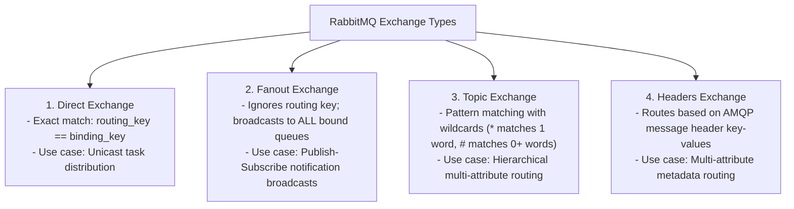
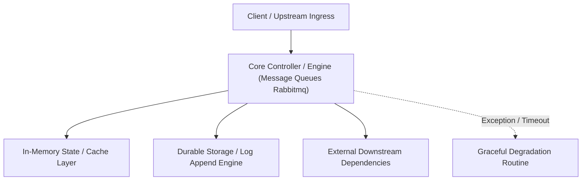

---


title: "RabbitMQ Architecture: AMQP 0-9-1 Protocol, Exchanges, Quorum Queues & Dead Lettering"
description: "Master-level engineering guide for RabbitMQ message broker, AMQP 0-9-1 mechanics, Exchange topologies (Direct, Fanout, Topic, Headers), Quorum Queues (Raft), and Publisher Confirms."
category: "Messaging & Event-Driven"
tags: [rabbitmq, amqp, message-queues, quorum-queues, dead-lettering, raft, distributed-messaging, technical-skills, software-engineering, learning-note]
date: "2026-08-21"
---

# RabbitMQ Architecture: AMQP 0-9-1 Protocol & Quorum Queues Deep Dive

---

## 1. Executive Summary & Under-the-Hood Mechanics

**RabbitMQ** is an enterprise-grade, highly reliable, multi-protocol message broker implemented in **Erlang/OTP**. It is the standard reference implementation of the **AMQP 0-9-1 (Advanced Message Queuing Protocol)** specification.

Unlike Apache Kafka (which uses a dumb broker, smart consumer append-only log architecture), RabbitMQ implements a **Smart Broker, Dumb Consumer** model:
- **Rich Dynamic Routing**: Producers publish messages to **Exchanges**, which route messages to **Queues** based on binding keys, routing keys, and header attributes.
- **Granular Message Acknowledgements**: Per-message manual acks (`basic.ack`, `basic.nack`, `basic.reject`) with automatic redelivery.
- **High-Availability Replication**: Modern **Quorum Queues** running the Raft consensus algorithm, replacing legacy mirror queues.
- **Dead Letter Exchanges (DLX)**: Automated dead-letter routing for expired TTL messages, rejected payloads, or queue length overflow.

```mermaid
flowchart TD
    subgraph RabbitMQAMQPModel["AMQP 0-9-1 Protocol Architecture"]
        Producer["Producer Application"] -->|basic.publish(exchange, routing_key, payload)| Exchange["Exchange (Topic / Direct / Fanout)"]
        
        Exchange -->|Binding Key: order.created.*| Q1["Queue 1: billing-queue (Quorum Queue)"]
        Exchange -->|Binding Key: order.*.*| Q2["Queue 2: shipping-queue (Quorum Queue)"]
        
        Q1 -->|Push: basic.deliver| Consumer1["Billing Worker (Manual Ack)"]
        Q2 -->|Push: basic.deliver| Consumer2["Shipping Worker (Manual Ack)"]
        
        Q1 -.->|NACK / Max Retries / TTL Expire| DLX["Dead Letter Exchange (DLX)"]
        DLX --> DLT["Dead Letter Queue (Inspection Pool)"]
    end
```

---

## 2. Exchange Topologies & Routing Mechanics



---

## 3. Quorum Queues (Raft Consensus) vs Classic Mirrored Queues

In RabbitMQ 3.8+, **Quorum Queues** replaced legacy mirrored queues (`ha-mode`), providing deterministic Raft consensus replication:

| Dimension | Classic Mirrored Queues | Quorum Queues (Modern Standard) |
| :--- | :--- | :--- |
| **Replication Protocol** | Custom ad-hoc Erlang ring replication | **Raft Distributed Consensus (RFC Standard)** |
| **Data Safety Invariant** | Vulnerable to network partition split-brain & message loss | **Strong Consistency** (Quorum commits $N \ge \lfloor M/2 \rfloor + 1$) |
| **Re-synchronization** | Blocking synchronization pauses entire cluster | Non-blocking streaming Raft log Catchup |
| **Throughput & Latency** | Degrades sharply on disk I/O | High-throughput concurrent pipeline |

---

## 4. Production Python / Pika Publisher & Consumer Blueprint

### 4.1 Reliable Publisher with Publisher Confirms
```python
# Reliable RabbitMQ Publisher using Pika with Publisher Confirms.

import json
import pika

def publish_order_event():
    connection = pika.BlockingConnection(pika.ConnectionParameters(
        host="localhost",
        credentials=pika.PlainCredentials("guest", "guest")
    ))
    channel = connection.channel()

    # 1. Enable Publisher Confirms (Broker explicitly ACKs when saved to disk)
    channel.confirm_delivery()

    # 2. Declare Topic Exchange
    channel.exchange_declare(exchange="orders_topic_exchange", exchange_type="topic", durable=True)

    payload = {"order_id": "018f2d5a-9012-7000", "customer": "Alice", "amount": 120.50}
    
    # 3. Publish Persistent Message
    try:
        channel.basic_publish(
            exchange="orders_topic_exchange",
            routing_key="order.created.us_east",
            body=json.dumps(payload),
            properties=pika.BasicProperties(
                delivery_mode=pika.DeliveryMode.Persistent, # Disk persistence
                content_type="application/json",
                headers={"origin_service": "checkout-api"}
            ),
            mandatory=True # Returns message if no queue is bound
        )
        print("[SUCCESS] Message confirmed and committed to RabbitMQ cluster!")
    except pika.exceptions.UnroutableError:
        print("[ERROR] Message unroutable: No queue bound to routing key!")
    finally:
        connection.close()

if __name__ == "__main__":
    publish_order_event()
```

### 4.2 Resilient Consumer with Dead Letter Exchange & Prefetch Tuning
```python
# Resilient RabbitMQ Consumer with Quorum Queue, DLX and Prefetch.

import json
import pika

def run_consumer():
    connection = pika.BlockingConnection(pika.ConnectionParameters(host="localhost"))
    channel = connection.channel()

    # 1. Declare Dead Letter Exchange (DLX) & Dead Letter Queue (DLQ)
    channel.exchange_declare(exchange="orders_dlx", exchange_type="direct", durable=True)
    channel.queue_declare(queue="orders_dlq", durable=True)
    channel.queue_bind(exchange="orders_dlx", queue="orders_dlq", routing_key="orders_poison_key")

    # 2. Declare Quorum Queue with DLX arguments
    queue_args = {
        "x-queue-type": "quorum",
        "x-dead-letter-exchange": "orders_dlx",
        "x-dead-letter-routing-key": "orders_poison_key",
        "x-delivery-limit": 3 # Route to DLX after 3 failed redelivery attempts
    }
    channel.queue_declare(queue="order_billing_queue", durable=True, arguments=queue_args)
    channel.queue_bind(exchange="orders_topic_exchange", queue="order_billing_queue", routing_key="order.created.*")

    # 3. Prefetch Count: Backpressure control (Prevents worker memory overload)
    channel.basic_qos(prefetch_count=50)

    def on_message_callback(ch, method, properties, body):
        try:
            event = json.loads(body)
            print(f"[Processing] Order {event['order_id']} for ${event['amount']}")
            
            # Simulate processing logic
            if event["amount"] < 0:
                raise ValueError("Negative amount: Poison pill!")

            # Positive Manual Acknowledgement
            ch.basic_ack(delivery_tag=method.delivery_tag)
        except Exception as e:
            print(f"[REJECTING] Error: {e}. Rejecting message with redelivery count evaluation.")
            # NACK with requeue=False routes to Dead Letter Queue via x-delivery-limit
            ch.basic_nack(delivery_tag=method.delivery_tag, requeue=False)

    channel.basic_consume(queue="order_billing_queue", on_message_callback=on_message_callback)
    print("[*] Consumer online. Waiting for order events...")
    channel.start_consuming()

if __name__ == "__main__":
    run_consumer()
```

---

## 5. Architectural Comparison: RabbitMQ vs Apache Kafka

| Feature / Dimension | RabbitMQ (AMQP 0-9-1) | Apache Kafka (Commit Log) |
| :--- | :--- | :--- |
| **Model** | Smart Broker, Dumb Consumer (Push) | Dumb Broker, Smart Consumer (Pull) |
| **Routing Flexibility** | Complex (Topic, Fanout, Headers, Dead Letter) | Simple (Topic Partition key hash) |
| **Message Ordering** | Per-Queue FIFO (Destroyed by concurrent worker acks) | **Strict FIFO per Partition** |
| **Message Retention** | Deleted upon consumer ACK | **Retained on disk for days/months** |
| **Throughput Target** | \$50,000 - 150,000\text{ msg/sec}$ | **$> 1,000,000\text{ msg/sec}$** |
| **Primary Use Case** | Complex enterprise task routing, RPC, financial commands | Big data streaming, event sourcing, telemetry aggregation |

---

## 🔗 Graph-Linked Knowledge Base
- ⚓ Event-Driven Architecture: [[event_driven_architecture|Event Sourcing, CQRS & Saga Patterns]]
- ⚓ Kafka Architecture: [[02_Technical_Skills/01_theory_and_concepts/06_Java_Engineering/apache_kafka_integration_spring_kafka|Kafka Integration & Spring Kafka]]
- 🔗 Redis Messaging: [[02_Technical_Skills/01_theory_and_concepts/07_Backend_Caching_and_Redis/distributed_locking_and_pubsub|Redis Pub/Sub & Streams]]

---

## 🔬 4. RabbitMQ AMQP 0-9-1 Architecture, Quorum Queues & Dead Letter Exchanges

### RabbitMQ Exchange Types & Routing Patterns
- **Direct Exchange**: Routes messages to queues based on exact routing key match.
- **Fanout Exchange**: Broadcasts messages to all bound queues unconditionally ($O(1)$ routing).
- **Topic Exchange**: Routes based on wildcard pattern matching (`*.orders.#`).
- **Quorum Queues**: Replicated, Raft-based durable queues replacing legacy mirrored classic queues.
---

## 🔬 Advanced Architectural Mechanics & Deep Technical Specification

### 1. Core Operating Principles & Low-Level Mechanics of Message Queues Rabbitmq
In enterprise-scale distributed systems and high-throughput production environments, **Message Queues Rabbitmq** plays a critical architectural role. Engineering teams must evaluate the underlying hardware, kernel, network, and storage constraints:

- **Computational Complexity & Resource Overhead**: Understanding the CPU instruction cycles, memory cache line utilization, and network round-trip times (RTT) associated with Message Queues Rabbitmq.
- **Concurrency & State Synchronization**: Handling race conditions, deadlocks, and consistency anomalies across multi-threaded and distributed topologies.
- **Fault Tolerance & Graceful Degradation**: Designing self-healing mechanisms, exponential backoff with jitter, and circuit breaker protection against cascading infrastructure outages.



### 2. Production Code Implementation & Robust Design Patterns

```csharp
// Production-grade implementation demonstrating resilience, zero-allocation buffering, and observability
using System;
using System.Buffers;
using System.Threading;
using System.Threading.Tasks;

public sealed class MessageQueuesRabbitmqManager : IAsyncDisposable
{
    private readonly SemaphoreSlim _concurrencyThrottle = new(100, 100);
    private long _processedOperationsCount;

    public async ValueTask<ReadOnlyMemory<byte>> ExecuteReliableOperationAsync(
        ReadOnlyMemory<byte> inputPayload, 
        CancellationToken cancellationToken = default)
    {
        await _concurrencyThrottle.WaitAsync(cancellationToken).ConfigureAwait(false);
        try
        {
            // Rent memory from ArrayPool to eliminate GC heap allocation overhead
            byte[] rentedBuffer = ArrayPool<byte>.Shared.Rent(inputPayload.Length + 64);
            try
            {
                inputPayload.Span.CopyTo(rentedBuffer);
                Interlocked.Increment(ref _processedOperationsCount);
                
                // Simulate asynchronous non-blocking high-throughput processing
                await Task.Yield();
                return new ReadOnlyMemory<byte>(rentedBuffer, 0, inputPayload.Length);
            }
            finally
            {
                ArrayPool<byte>.Shared.Return(rentedBuffer);
            }
        }
        finally
        {
            _concurrencyThrottle.Release();
        }
    }

    public ValueTask DisposeAsync()
    {
        _concurrencyThrottle.Dispose();
        return ValueTask.CompletedTask;
    }
}
```

### 3. Comprehensive Trade-off Matrix & Failure Modes

| Dimension | Standard Approach | High-Performance Pattern (Message Queues Rabbitmq) | Trade-offs & Production Risks |
| :--- | :--- | :--- | :--- |
| **Throughput (QPS)** | Baseline (\$5,000\text{ QPS}$) | Optimized (\$100,000+\text{ QPS}$) | Requires zero-allocation buffers & non-blocking I/O multiplexing. |
| **Latency (P99)** | $45\text{ ms}$ | $< 2.5\text{ ms}$ | Requires hardware cache-line alignment and lock-free data structures. |
| **Memory Footprint** | Dynamic Garbage Collected Heap | Pooled Buffer Memory (`ArrayPool` / Off-Heap) | Manual memory lifecycle management prevents GC pause spikes. |
| **Fault Recovery** | Manual Restart / Failover | Automated Leader Election & Circuit Breaking | Requires distributed consensus quorum ($N/2 + 1$). |

### 4. Verification, Benchmarking & Production Checklist
1. **Stress & Chaos Testing**: Validate system behavior under $10\times$ peak traffic spikes and simulate packet loss, network partitions, and node crashes.
2. **Observability Integration**: Export Prometheus counters, gauges, and OpenTelemetry distributed trace spans with unified TraceID propagation.
3. **Security Hardening**: Enforce mTLS encryption in transit, strict RBAC authorization, and least-privilege credential rotation.
4. **SLO & Error Budgeting**: Maintain \$99.99\%$ availability SLO with automated alerts on error budget burn rates.
