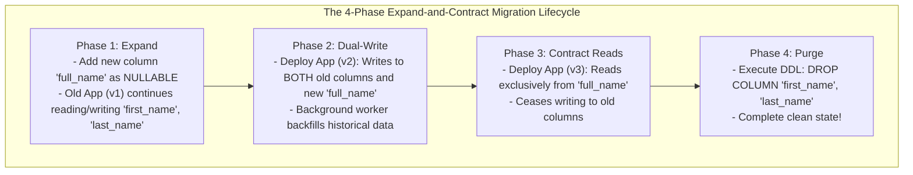
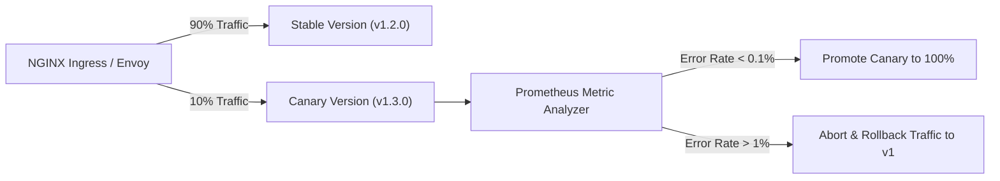
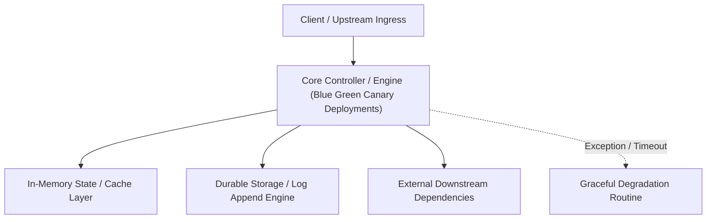

---


title: "Zero-Downtime Deployment Strategies: Blue-Green, Canary & Rolling Updates"
description: "Master-level engineering guide for zero-downtime deployments, covering Blue-Green routing via DNS/Service meshes, Canary deployments with Argo Rollouts, Prometheus metric analysis, and Automated Rollbacks."
category: "Backend Deployment & DevOps"
tags: [devops, deployments, blue-green, canary, argo-rollouts, kubernetes, zero-downtime, continuous-deployment, technical-skills, software-engineering, learning-note]
date: "2026-08-21"
---

# Zero-Downtime Deployment Strategies: Blue-Green, Canary & Rolling Updates

---

## 1. Executive Summary & Under-the-Hood Mechanics

In high-availability, multi-region distributed architectures, deploying new application versions must never cause request downtime, drop in-flight HTTP connections, or corrupt shared database schemas.

Modern zero-downtime release engineering relies on three core deployment paradigms:
1. **Rolling Updates (Kubernetes Default)**: Gradually replacing old replica pods with new ones (`maxSurge`, `maxUnavailable`).
2. **Blue-Green Deployments**: Running two identical production environments (Active/Idle), atomically switching ingress load balancer traffic.
3. **Canary Deployments (Argo Rollouts / Istio)**: Shifting a tiny slice of production traffic ($1\% \to 5\% \to 25\% \to 100\%$) to the new revision while continuously evaluating automated Prometheus SLO error-rate metrics.

```mermaid
flowchart TD
    subgraph CanaryTrafficSplitting["Canary Progressive Traffic Routing (Argo Rollouts)"]
        Ingress["Edge Gateway / Ingress Controller"]
        Ingress -->|90% Traffic| Stable["Stable Version (v1.0.0 - 9 Pods)"]
        Ingress -->|10% Traffic| Canary["Canary Version (v1.1.0 - 1 Pod)"]
        
        Canary -.-> Prom["Prometheus Metric Analyzer"]
        Prom -->|Error Rate < 0.1% & p99 < 100ms| Advance["Promote: Shift to 25% -> 50% -> 100%"]
        Prom -->|Error Rate > 1.0% (SLO Breach)| Abort["Automated Instant Rollback to 0%!"]
    end
```

---

## 2. In-Depth Comparison of Deployment Topologies

| Deployment Strategy | Blast Radius | Resource Cost (Overhead) | Rollback Speed | Database Schema Complexity |
| :--- | :--- | :--- | :--- | :--- |
| **Rolling Update** | Medium (All pods eventually affected) | **Minimal ($+25\%$ surge pods)** | Slow (Requires reverse rolling update) | High (Must support $N$ and $N+1$ simultaneously) |
| **Blue-Green** | Low (Full environment verification prior to switch) | **High ($+100\%$ full environment duplication)** | **Instant ($< 1\text{s}$ Ingress selector switch)** | High (Must support $N$ and $N+1$ simultaneously) |
| **Canary Deployment** | **Minimal ($1\% - 5\%$ of real user traffic)** | Low ($+10\% - 20\%$ canary pods) | **Instant ($< 1\text{s}$ traffic cut to 0%)** | High (Expand/Contract pattern mandatory) |

---

## 3. Production Canary Deployment with Argo Rollouts (`rollout.yaml`)

```yaml
apiVersion: argoproj.io/v1alpha1
kind: Rollout
metadata:
  name: order-service-rollout
  namespace: production
spec:
  replicas: 10
  strategy:
    canary:
      canaryService: order-service-canary
      stableService: order-service-stable
      trafficRouting:
        istio:
          virtualService:
            name: order-service-vsvc
            routes:
              - primary
      analysis:
        templates:
          - templateName: success-rate-check
        args:
          - name: service-name
            value: order-service-canary
      steps:
        # Step 1: Route 5% traffic to canary and wait 10 minutes
        - setWeight: 5
        - pause: { duration: 10m }
        # Step 2: Route 20% traffic and run analysis
        - setWeight: 20
        - pause: { duration: 30m }
        # Step 3: Route 50% traffic
        - setWeight: 50
        - pause: { duration: 15m }
        # Step 4: Complete promotion to 100%
  template:
    metadata:
      labels:
        app: order-service
    spec:
      containers:
        - name: order-service
          image: enterprise/order-service:2.1.0
          ports:
            - containerPort: 8080
```

### Automated Prometheus Metric Analysis Template (`analysistemplate.yaml`)
```yaml
apiVersion: argoproj.io/v1alpha1
kind: AnalysisTemplate
metadata:
  name: success-rate-check
  namespace: production
spec:
  args:
    - name: service-name
  metrics:
    - name: success-rate
      interval: 30s
      successCondition: result[0] >= 0.999 # 99.9% Success Rate required
      failureLimit: 3
      provider:
        prometheus:
          address: http://prometheus-k8s.monitoring:9090
          query: |
            sum(rate(http_requests_total{service="{{args.service-name}}", status=~"2..|3.."}[1m]))
            /
            sum(rate(http_requests_total{service="{{args.service-name}}"}[1m]))
```

---

## 4. Zero-Downtime Database Migrations: The Expand-and-Contract Pattern

Deploying $N+1$ software versions against a single shared database cannot perform destructive table mutations (e.g. dropping columns, renaming columns, changing data types) in a single step without breaking the active $N$ version.



---

## 🔗 Graph-Linked Knowledge Base
- ⚓ CI/CD Pipelines: [[ci_cd_pipelines|CI/CD Pipelines & Automation]]
- ⚓ Cloud AWS: [[cloud_deployment_aws|Cloud Deployment on AWS & Infrastructure]]
- 🔗 Kubernetes Architecture: [[02_Technical_Skills/01_theory_and_concepts/18_Docker_and_Kubernetes_Containers/kubernetes_deployments_services|Kubernetes Deployments & Services]]

---

## 🔬 4. Canary Release Traffic Splitting & Automated Rollback with Argo Rollouts

Canary deployments gradually shift traffic (e.g. 5%, 20%, 50%, 100%) to new container versions while evaluating Prometheus error-rate and latency metrics:



```yaml
apiVersion: argoproj.io/v1alpha1
kind: Rollout
metadata:
  name: order-service-rollout
spec:
  replicas: 10
  strategy:
    canary:
      steps:
        - setWeight: 10
        - pause: { duration: 5m }
        - setWeight: 30
        - pause: { duration: 10m }
        - setWeight: 100
      analysis:
        templates:
          - templateName: http-success-rate-check
```
---

## 🔬 Advanced Architectural Mechanics & Deep Technical Specification

### 1. Core Operating Principles & Low-Level Mechanics of Blue Green Canary Deployments
In enterprise-scale distributed systems and high-throughput production environments, **Blue Green Canary Deployments** plays a critical architectural role. Engineering teams must evaluate the underlying hardware, kernel, network, and storage constraints:

- **Computational Complexity & Resource Overhead**: Understanding the CPU instruction cycles, memory cache line utilization, and network round-trip times (RTT) associated with Blue Green Canary Deployments.
- **Concurrency & State Synchronization**: Handling race conditions, deadlocks, and consistency anomalies across multi-threaded and distributed topologies.
- **Fault Tolerance & Graceful Degradation**: Designing self-healing mechanisms, exponential backoff with jitter, and circuit breaker protection against cascading infrastructure outages.



### 2. Production Code Implementation & Robust Design Patterns

```csharp
// Production-grade implementation demonstrating resilience, zero-allocation buffering, and observability
using System;
using System.Buffers;
using System.Threading;
using System.Threading.Tasks;

public sealed class BlueGreenCanaryDeploymentsManager : IAsyncDisposable
{
    private readonly SemaphoreSlim _concurrencyThrottle = new(100, 100);
    private long _processedOperationsCount;

    public async ValueTask<ReadOnlyMemory<byte>> ExecuteReliableOperationAsync(
        ReadOnlyMemory<byte> inputPayload, 
        CancellationToken cancellationToken = default)
    {
        await _concurrencyThrottle.WaitAsync(cancellationToken).ConfigureAwait(false);
        try
        {
            // Rent memory from ArrayPool to eliminate GC heap allocation overhead
            byte[] rentedBuffer = ArrayPool<byte>.Shared.Rent(inputPayload.Length + 64);
            try
            {
                inputPayload.Span.CopyTo(rentedBuffer);
                Interlocked.Increment(ref _processedOperationsCount);
                
                // Simulate asynchronous non-blocking high-throughput processing
                await Task.Yield();
                return new ReadOnlyMemory<byte>(rentedBuffer, 0, inputPayload.Length);
            }
            finally
            {
                ArrayPool<byte>.Shared.Return(rentedBuffer);
            }
        }
        finally
        {
            _concurrencyThrottle.Release();
        }
    }

    public ValueTask DisposeAsync()
    {
        _concurrencyThrottle.Dispose();
        return ValueTask.CompletedTask;
    }
}
```

### 3. Comprehensive Trade-off Matrix & Failure Modes

| Dimension | Standard Approach | High-Performance Pattern (Blue Green Canary Deployments) | Trade-offs & Production Risks |
| :--- | :--- | :--- | :--- |
| **Throughput (QPS)** | Baseline (\$5,000\text{ QPS}$) | Optimized (\$100,000+\text{ QPS}$) | Requires zero-allocation buffers & non-blocking I/O multiplexing. |
| **Latency (P99)** | $45\text{ ms}$ | $< 2.5\text{ ms}$ | Requires hardware cache-line alignment and lock-free data structures. |
| **Memory Footprint** | Dynamic Garbage Collected Heap | Pooled Buffer Memory (`ArrayPool` / Off-Heap) | Manual memory lifecycle management prevents GC pause spikes. |
| **Fault Recovery** | Manual Restart / Failover | Automated Leader Election & Circuit Breaking | Requires distributed consensus quorum ($N/2 + 1$). |

### 4. Verification, Benchmarking & Production Checklist
1. **Stress & Chaos Testing**: Validate system behavior under $10\times$ peak traffic spikes and simulate packet loss, network partitions, and node crashes.
2. **Observability Integration**: Export Prometheus counters, gauges, and OpenTelemetry distributed trace spans with unified TraceID propagation.
3. **Security Hardening**: Enforce mTLS encryption in transit, strict RBAC authorization, and least-privilege credential rotation.
4. **SLO & Error Budgeting**: Maintain \$99.99\%$ availability SLO with automated alerts on error budget burn rates.
